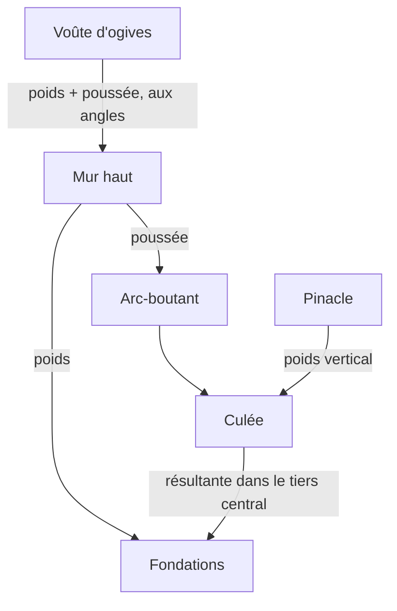

# Architecture Gothique

L'architecture gothique naît en Île-de-France vers 1140, quand l'abbé Suger fait reconstruire le chevet de l'abbatiale de Saint-Denis (consacré en 1144). En moins d'un siècle, elle fait passer les grandes églises de murs épais percés de petites fenêtres à des cages de pierre presque entièrement vitrées, dont les voûtes montent à plus de 40 mètres.

Ce n'est pas d'abord un style décoratif. C'est une **solution de statique** : au lieu de laisser un mur porter seul la voûte, on concentre les efforts en quelques points et on les conduit vers le sol par un squelette de pierre. Le mur, déchargé, peut alors s'ouvrir sur le vitrail.


## Le problème : une voûte pousse

Une voûte en maçonnerie ne fait pas que peser. Ses pierres ne tiennent que comprimées les unes contre les autres, et cette compression ne descend pas verticalement : elle s'appuie aussi **vers l'extérieur**, sur ce qui la porte. C'est la **poussée**.

L'église romane répond par la masse. La voûte en berceau pousse tout le long du mur, alors le mur est épais et les fenêtres petites, parce que chaque ouverture affaiblit l'appui. Plus on veut monter haut, plus la poussée agit loin du sol, et plus le mur doit être épais pour ne pas basculer.

> [!abstract] Définition — Poussée
> Composante horizontale de l'effort qu'un arc ou une voûte exerce sur ses appuis. Elle tend à écarter les appuis et à faire basculer les murs vers l'extérieur.

La règle qui décide si une maçonnerie tient est simple : la **résultante** des forces (le poids du mur plus la poussée) doit rester à l'intérieur de sa base. Pour qu'aucun joint ne s'ouvre, elle doit même passer dans le **tiers central** de la section. Si elle sort de la base, le mur pivote sur son arête et s'effondre ; la pierre résiste très bien à l'écrasement, presque pas à la traction.


## Trois inventions qui travaillent ensemble

### L'arc brisé

L'arc brisé est formé de deux arcs de cercle qui se rencontrent en pointe. Pour une même portée, il est plus haut qu'un arc en plein cintre et sa poussée est plus verticale, donc plus faible horizontalement. Surtout, sa hauteur ne dépend plus de sa largeur : on peut couvrir des travées de largeurs différentes avec des arcs qui culminent au même niveau, ce qui libère le plan.

### La croisée d'ogives

La voûte d'ogives est portée par deux arcs diagonaux qui se croisent au sommet de la travée, les **ogives**, dont la rencontre est fermée par une **clé de voûte**. Entre ces nervures, les **voûtains** sont des remplissages minces.

L'effet est de rassembler la poussée. Au lieu de s'exercer le long de tout le mur, elle se concentre aux quatre angles de la travée, là où les nervures descendent. Le mur entre ces points ne porte presque plus rien de la voûte : il devient une paroi qu'on peut ouvrir.

> [!abstract] Définition — Croisée d'ogives
> Voûte dont la structure est formée de deux arcs diagonaux en pierre appareillée qui se croisent à la clé ; elle reporte les charges et la poussée aux angles de la travée.

### L'arc-boutant

Reste à reprendre la poussée concentrée aux angles, très haut, au-dessus des bas-côtés. C'est le rôle de l'**arc-boutant** : un demi-arc de pierre lancé par-dessus le toit du bas-côté, qui vient appuyer contre le mur haut juste au niveau où la voûte pousse, et transmet cette poussée à une masse de pierre extérieure, la **culée**.

> [!abstract] Définition — Arc-boutant
> Arc extérieur qui reçoit la poussée d'une voûte haute à son point d'application et la reporte, au-dessus des bas-côtés, sur une culée isolée du vaisseau.

La culée peut être aussi large qu'il le faut, puisqu'elle est dehors et ne gêne ni la lumière ni la circulation. On la charge en outre d'un **pinacle**, une petite flèche de pierre. Le pinacle ajoute du poids vertical au sommet de la culée, ce qui redresse la résultante et la ramène dans la base. Ce n'est pas un ornement, même s'il en a l'air.

> [!abstract] Définition — Culée
> Massif de maçonnerie qui reçoit la poussée d'un arc ou d'un arc-boutant et la conduit au sol ; on la dimensionne pour que la résultante reste dans son tiers central.


## La figure : retirer l'arc-boutant

La figure ci-dessous coupe une travée de 3 m de long. Le mur haut, épais de 1,20 m, porte la voûte et reçoit sa poussée ; l'arc-boutant, éclairé, la reporte sur la culée surmontée de son pinacle. Les règles graduées sous le mur et sous la culée montrent où passe la résultante par rapport au centre de la base, et le tiers central est marqué.

Passez sur la figure (ou appuyez sur B) pour retirer l'arc-boutant. Toute la poussée revient alors sur le mur, et la lecture en haut à droite passe de « mur 0,00 m » à « mur 1,30 m hors de sa base · il bascule » : la résultante sort à 1,30 m du centre d'un mur dont la demi-épaisseur n'est que de 0,60 m. Avec l'arc-boutant, le mur ne reçoit plus que du poids, et la culée, quatre mètres de large, garde sa résultante à 0,39 m du centre, dans son tiers central.

```iso:voute-gothique
```

Les chiffres viennent d'un modèle volontairement simple (poussée de 130 kN appliquée à 22 m de haut, pierre à 22 kN/m³, poids de la voûte compté forfaitairement) : ils donnent les bons ordres de grandeur et le bon mécanisme, pas le calcul d'une cathédrale réelle, où la poussée varie avec le vent, la charpente et la forme exacte de la voûte.


## Une élévation qui s'ouvre

Une fois le mur déchargé, son élévation change. Dans une grande église gothique on lit typiquement, de bas en haut :

| Niveau | Rôle |
|---|---|
| Grandes arcades | Ouvrent la nef sur les bas-côtés, sur des piliers |
| Tribunes (gothique primitif) | Étage de galeries au-dessus des bas-côtés, qui contrebute aussi la nef |
| Triforium | Étroite galerie dans l'épaisseur du mur, sous le toit des bas-côtés |
| Fenêtres hautes | Le clair-étage, qui s'agrandit à mesure que les arcs-boutants s'imposent |

Les tribunes disparaissent au XIIIᵉ siècle, quand l'arc-boutant fait seul le travail qu'elles assuraient en partie ; les fenêtres hautes prennent la place gagnée.




## Quatre âges

| Période | Dates approximatives | Traits | Exemples |
|---|---|---|---|
| Gothique primitif | 1140 – 1190 | Élévation à quatre niveaux avec tribunes, voûtes sexpartites | Saint-Denis (chevet), Laon, Noyon, début de Notre-Dame de Paris |
| Gothique classique | 1190 – 1230 | Élévation à trois niveaux, arcs-boutants systématiques, grandes fenêtres hautes | Chartres, Reims, Amiens |
| Gothique rayonnant | 1230 – 1350 | Murs presque entièrement vitrés, grandes roses, réseaux fins | Sainte-Chapelle de Paris, transepts de Notre-Dame |
| Gothique flamboyant | 1350 – 1520 | Réseaux en courbes et contre-courbes en forme de flamme, décor foisonnant | Saint-Maclou de Rouen, façade de la cathédrale de Rouen |

Les dates varient selon les régions : l'Angleterre a ses propres phases (Early English, Decorated, Perpendicular), et le gothique se prolonge dans le Saint-Empire et en Espagne bien après 1520.


## Repères chiffrés

| Édifice | Début des travaux | Hauteur sous voûte |
|---|---|---|
| Notre-Dame de Paris | 1163 | environ 33 m |
| Chartres | 1194 (après l'incendie) | environ 37 m |
| Reims | 1211 | environ 38 m |
| Amiens | 1220 | environ 42 m |
| Beauvais (chœur) | 1225 | environ 48 m |

Beauvais montre la limite du système. Les voûtes de son chœur, les plus hautes jamais construites dans une cathédrale gothique, s'effondrent en partie en 1284. On le reconstruit en doublant les piles et les arcs-boutants, et la nef ne sera jamais bâtie. Pousser plus haut demande des appuis plus massifs, jusqu'au point où la pierre et les fondations ne suivent plus.


## À retenir

> [!quiz] Pourquoi une voûte haute menace-t-elle de faire basculer le mur qui la porte ?
> Parce qu'elle exerce une poussée horizontale vers l'extérieur ; appliquée haut, cette poussée fait sortir la résultante des forces de la base du mur, qui pivote alors sur son arête.

> [!quiz] Que change la croisée d'ogives dans la répartition des efforts ?
> Elle concentre le poids et la poussée de la voûte aux quatre angles de la travée, si bien que le mur entre ces points ne porte presque plus rien et peut être ouvert.

> [!quiz] À quoi sert le pinacle posé sur une culée ?
> Son poids vertical redresse la résultante des forces dans la culée et la maintient dans le tiers central de sa base.

> [!quiz] Quelle cathédrale gothique a vu ses voûtes de chœur s'effondrer en partie en 1284 ?
> Beauvais, dont le chœur atteint environ 48 m sous voûte.
