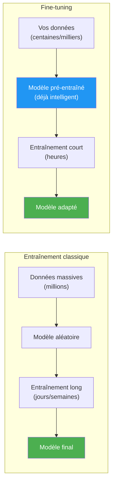
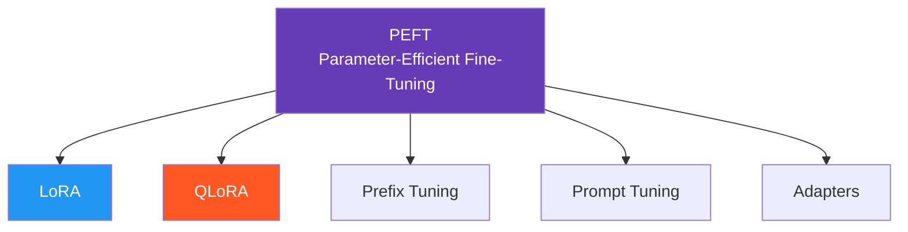
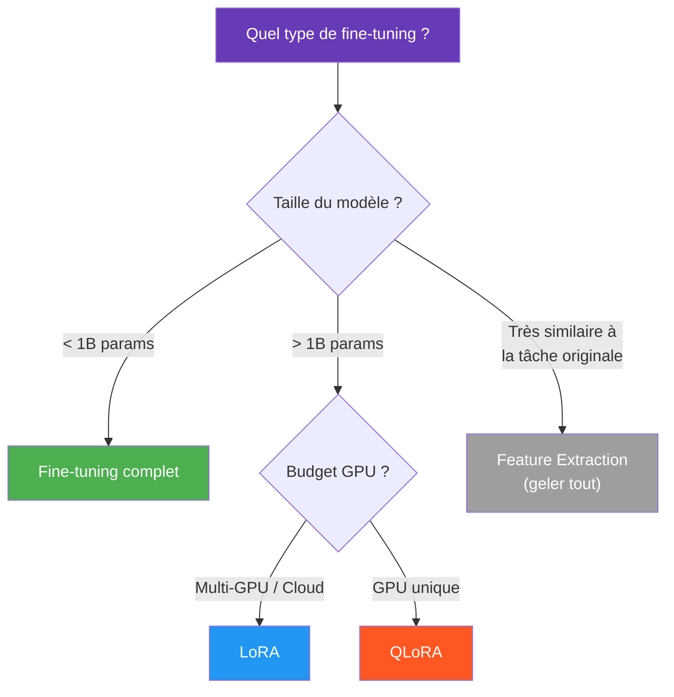

# Fine Tuning

En 2012, un réseau de neurones nommé AlexNet remporte le concours ImageNet après une semaine d'entraînement sur 1,2 million d'images. Quelques années plus tard, un radiologue veut un modèle qui repère des fractures sur des radiographies : il ne dispose que de quelques milliers d'images annotées, beaucoup trop peu pour entraîner un réseau de cette taille depuis zéro. Pourtant, en partant d'un réseau déjà entraîné sur ImageNet et en le réentraînant quelques heures sur ses radiographies, il obtient un modèle performant. Le réseau n'avait jamais vu de radiographie, mais il savait déjà reconnaître des contours, des textures et des formes. C'est le principe du **fine-tuning** (ajustement fin) : prendre un modèle **pré-entraîné** sur une grande quantité de données et l'adapter à une **tâche spécifique** en continuant son entraînement sur un jeu de données plus petit et ciblé.

## Pourquoi ne pas tout réentraîner ?

Entraîner un modèle de deep learning depuis zéro demande des millions d'exemples, des centaines ou des milliers d'heures de GPU et un budget en conséquence. Or une grande partie de ce qu'apprend un modèle est générique : les premières couches d'un réseau de vision détectent des bords et des couleurs, utiles pour n'importe quelle image ; un modèle de langage pré-entraîné connaît déjà la grammaire, le vocabulaire et beaucoup de faits. Le fine-tuning réutilise ce savoir et n'apprend que ce qui est propre à la nouvelle tâche, avec beaucoup moins de données et de calcul.

## Transfer learning et fine-tuning

> [!important] Distinction clé
> Transfer learning est le principe général (réutiliser un modèle pré-entraîné) ; fine-tuning en est une forme spécifique où l'on continue réellement l'entraînement (au moins partiellement) plutôt que de figer tout le backbone.

Dans la forme la plus simple du transfer learning, l'**extraction de caractéristiques** (*feature extraction*), on gèle tout le réseau pré-entraîné, qu'on utilise comme un extracteur fixe, et on n'entraîne qu'une nouvelle tête ajoutée au bout, par exemple une couche de classification pour ses propres catégories. Dans le fine-tuning proprement dit, on dégèle aussi une partie des couches existantes, généralement les dernières, pour qu'elles s'ajustent aux nouvelles données.

| | Transfer Learning | Fine-Tuning |
|---|---|---|
| **Principe** | Réutiliser les features d'un modèle pré-entraîné | Sous-catégorie du transfer learning |
| **Couches gelées** | Toutes les couches du backbone sont gelées | On dégèle certaines couches pour les ré-entraîner |
| **Ce qu'on entraîne** | Uniquement les nouvelles couches ajoutées | Couches existantes + nouvelles couches |
| **Données requises** | Très peu | Un peu plus |
| **Quand l'utiliser** | Tâche très similaire à celle du pré-entraînement | Tâche différente ou données spécifiques |

## Les stratégies de fine-tuning

Le **fine-tuning complet** réentraîne tous les poids du modèle. C'est la méthode la plus puissante quand la tâche cible est très différente de la tâche d'origine, mais elle demande plus de données et de calcul, et un petit jeu de données expose au surapprentissage.

Le **dégel progressif** (*gradual unfreezing*) procède par étapes : on n'entraîne d'abord que la nouvelle tête, puis on dégèle les dernières couches, puis les précédentes, en remontant vers l'entrée. Les premières couches, qui portent les caractéristiques les plus génériques, restent souvent gelées jusqu'au bout. Cette progressivité évite de détruire d'un coup ce que le modèle savait.

Les **taux d'apprentissage différenciés** (*discriminative learning rates*) poursuivent la même idée autrement : toutes les couches sont entraînées, mais avec un taux d'apprentissage très faible pour les premières couches et plus élevé pour les dernières. Les caractéristiques génériques ne bougent presque pas, tandis que les caractéristiques spécifiques s'adaptent. Ces deux techniques ont été popularisées par la méthode ULMFiT de Jeremy Howard et Sebastian Ruder (2018).

## Le cas des grands modèles de langage

Les LLM posent un problème d'échelle. Rien que pour stocker les poids en demi-précision (FP16, deux octets par paramètre), il faut :

| Modèle | Paramètres | VRAM requise (FP16) |
|--------|-----------|---------------------|
| LLaMA 7B | 7 milliards | ~14 Go |
| LLaMA 13B | 13 milliards | ~26 Go |
| LLaMA 70B | 70 milliards | ~140 Go |

Un fine-tuning complet demande bien plus encore, puisqu'il faut aussi garder les gradients et l'état de l'optimiseur, soit trois à quatre fois la taille du modèle. C'est hors de portée de la plupart des praticiens. D'où la famille des méthodes **PEFT** (*Parameter-Efficient Fine-Tuning*), qui gèlent le modèle d'origine et n'entraînent qu'une toute petite fraction de paramètres supplémentaires.

### LoRA

La plus utilisée est **LoRA** (*Low-Rank Adaptation*, Hu et al., 2021). Elle part d'une observation : la modification qu'un fine-tuning apporte à une matrice de poids est, en pratique, de faible « rang », c'est-à-dire qu'elle peut se décrire avec beaucoup moins de nombres que la matrice entière. Plutôt que de modifier la matrice originale $W$, de taille $d \times d$, on la gèle et on lui ajoute le produit de deux petites matrices entraînables :

$$W' = W + \Delta W = W + BA$$

où $B$ est de taille $d \times r$, $A$ de taille $r \times d$, et le rang $r$, typiquement entre 4 et 64, est très petit devant $d$. Pour $d = 4096$ et $r = 8$, on entraîne 65 536 paramètres au lieu de près de 17 millions pour cette matrice. Sur GPT-3, les auteurs divisent ainsi le nombre de paramètres entraînables par environ 10 000. Une fois l'entraînement terminé, on peut fusionner $W + BA$ en une seule matrice, si bien que l'inférence n'est pas ralentie. Et comme un adaptateur ne pèse que quelques mégaoctets, on peut en garder plusieurs pour un même modèle de base, un par tâche, et les échanger à volonté.

> [!tip] Choisir le rang r
> Un rang trop faible (r=1-2) peut manquer de capacité pour des adaptations complexes ; un rang trop élevé se rapproche du fine-tuning complet sans en garder les bénéfices. En pratique, r=8 à 16 suffit pour la plupart des adaptations de style/domaine ; monter à 32-64 seulement pour des tâches qui demandent d'apprendre des connaissances nouvelles substantielles.

### QLoRA

**QLoRA** (Dettmers et al., 2023) pousse l'économie plus loin en combinant LoRA et quantification. Le modèle de base, gelé, est chargé en 4 bits, dans un format adapté à la distribution des poids (NormalFloat4), tandis que les adaptateurs LoRA restent en 16 bits ; les gradients traversent le modèle quantifié pour mettre à jour les seuls adaptateurs. Résultat : on peut fine-tuner un modèle de 65 milliards de paramètres sur un seul GPU de 48 Go.

### Les autres méthodes PEFT

D'autres méthodes ajoutent des paramètres ailleurs. Le **prefix tuning** ajoute des vecteurs apprenables au début de chaque couche d'attention, en laissant tout le modèle gelé, pour environ 0,1 % de paramètres en plus. Le **prompt tuning** se contente d'ajouter quelques « tokens virtuels » apprenables au début de l'entrée ; il est encore plus léger et devient compétitif sur les très grands modèles, au-delà d'une dizaine de milliards de paramètres. Les **adapters**, enfin, insèrent de petites couches entraînables entre les couches existantes.

## Bien s'y prendre

La qualité des données compte plus que leur quantité : quelques centaines d'exemples propres et représentatifs valent mieux que des milliers d'exemples bruités. Ils doivent suivre un format cohérent, couvrir la diversité des cas réels attendus, et un jeu de test séparé doit permettre de vérifier que le modèle généralise.

Les hyperparamètres diffèrent de ceux d'un entraînement depuis zéro, surtout le taux d'apprentissage, nettement plus faible pour ne pas détruire ce que le modèle sait déjà. Les valeurs suivantes sont des points de départ habituels pour un fine-tuning complet de transformer ; LoRA tolère des taux plus élevés, de l'ordre de 1e-4 à 2e-4.

| Paramètre | Valeur typique | Notes |
|-----------|---------------|-------|
| **Learning rate** | 1e-5 à 5e-5 | Plus faible que l'entraînement from scratch |
| **Epochs** | 2 à 5 | Surveiller l'overfitting |
| **Batch size** | Le plus grand possible | Limité par la VRAM |
| **Warmup** | 5-10% des steps | Montée progressive du learning rate |
| **Weight decay** | 0.01 à 0.1 | Régularisation |

> [!warning] Pièges à éviter
> - **Catastrophic forgetting** : le modèle oublie ses connaissances d'origine en s'adaptant trop à la nouvelle tâche → learning rate faible, régularisation, dégel progressif.
> - **Overfitting** : le modèle mémorise le dataset de fine-tuning → data augmentation, early stopping, dropout.
> - **Learning rate trop élevé** : détruit les poids pré-entraînés en une ou deux étapes → commencer très bas, utiliser un warmup.

## Quelle méthode choisir ?

Le choix dépend surtout de la taille du modèle et du matériel disponible. Pour un petit modèle, de moins d'un milliard de paramètres, le fine-tuning complet reste accessible. Au-delà, LoRA s'impose si l'on dispose de plusieurs GPU ou du cloud, QLoRA si l'on n'a qu'un GPU. Et si la nouvelle tâche ressemble beaucoup à celle d'origine, l'extraction de caractéristiques, avec tout le réseau gelé, peut suffire.

## Ressources

- [Hugging Face PEFT](https://huggingface.co/docs/peft), la bibliothèque de référence pour LoRA, QLoRA et les autres méthodes.
- [LoRA: Low-Rank Adaptation of Large Language Models](https://arxiv.org/abs/2106.09685), l'article original (2021), et [QLoRA](https://arxiv.org/abs/2305.14314) (2023).
- [Fine-tuning LLaMA 2, notebook complet](https://github.com/brevdev/notebooks/blob/main/llama2-finetune-own-data.ipynb).
