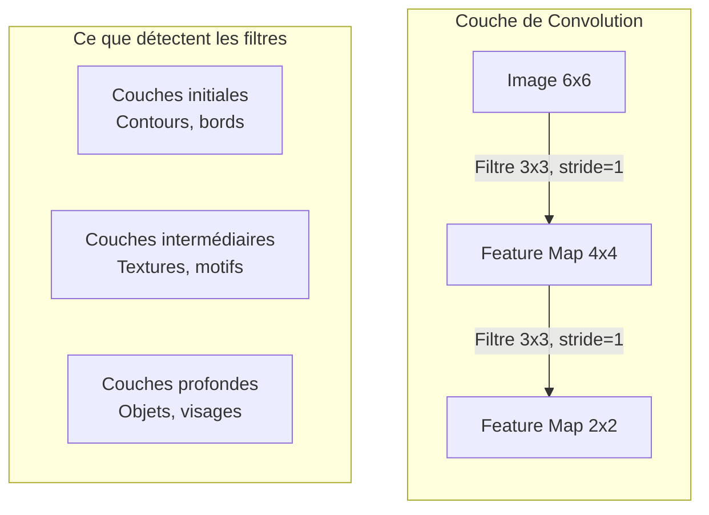
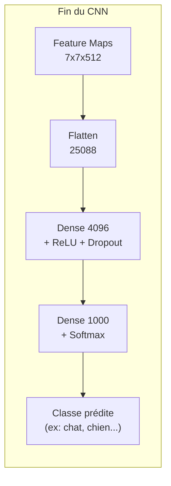
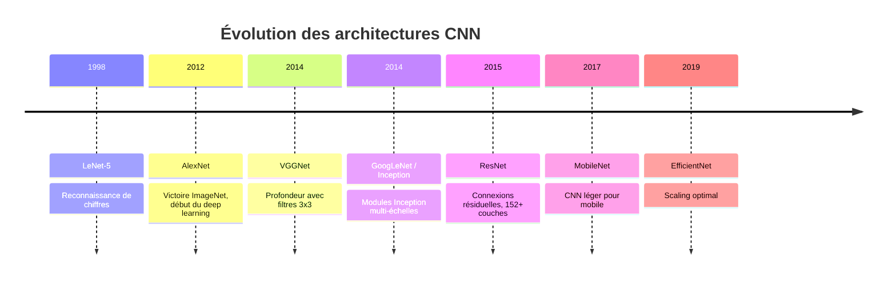
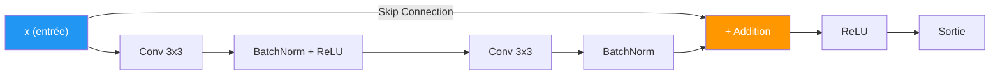

# Réseaux de Neurones Convolutifs (CNN)

À la fin des années 1950, les neurophysiologistes David Hubel et Torsten Wiesel plantent des électrodes dans le cortex visuel d'un chat et lui projettent des images. Ils découvrent que certains neurones ne réagissent qu'à une barre lumineuse orientée d'une certaine façon, à un endroit précis du champ visuel, et que d'autres, plus loin dans le cortex, combinent ces signaux pour réagir à des formes plus complexes. Cette découverte, qui leur vaudra le prix Nobel, inspire le Japonais Kunihiko Fukushima, puis le Français Yann LeCun, qui conçoit à la fin des années 1980 un réseau capable de lire les chiffres manuscrits des chèques. Les **réseaux de neurones convolutifs** (*Convolutional Neural Networks*, CNN) reprennent ce principe : des détecteurs locaux de motifs simples, combinés couche après couche en détecteurs de motifs de plus en plus abstraits. Ils traitent des données organisées en grille, avant tout des **images**, et ont été pendant une décennie le cœur de la **vision par ordinateur**.

## Pourquoi ne pas utiliser un réseau classique ?

Dans un réseau entièrement connecté (*fully connected*), chaque neurone est relié à chaque valeur d'entrée. Pour une image couleur de 256 × 256 pixels, cela fait 196 608 poids pour un seul neurone de la première couche, et des centaines de millions pour une couche entière. Un tel réseau serait énorme, lent, et il ignorerait la structure même de l'image : il devrait réapprendre à reconnaître un œil en haut à gauche, puis à nouveau en bas à droite.

Les CNN reposent sur deux idées. Les **connexions locales** : chaque neurone ne regarde qu'une petite zone de l'image, parce qu'un motif comme un bord ou un coin est local. Le **partage des poids** : le même détecteur est appliqué partout.

> [!important] Idée clé
> Un même filtre (quelques dizaines de paramètres) glisse sur toute l'image au lieu d'avoir un poids différent par pixel — le partage de poids. Ça part du principe qu'un motif utile (un bord, une texture) est pertinent où qu'il apparaisse dans l'image, ce qui réduit drastiquement le nombre de paramètres par rapport à un réseau dense.

Un CNN typique enchaîne des blocs de convolution et de sous-échantillonnage, qui extraient des caractéristiques de plus en plus abstraites tout en réduisant la taille de l'image, puis termine par quelques couches classiques qui prennent la décision.

## La convolution

La couche de convolution fait glisser un **filtre** (ou noyau, *kernel*), une petite matrice de poids de taille $k \times k$, sur toute l'image. À chaque position, elle multiplie terme à terme le filtre et la zone de l'image qu'il recouvre, puis additionne le tout. Le résultat, calculé pour toutes les positions, forme une **carte de caractéristiques** (*feature map*) qui indique où le motif reconnu par le filtre est présent.

$$S(i, j) = (I * K)(i, j) = \sum_m \sum_n I(i+m,\; j+n) \cdot K(m, n)$$

Ici $I$ est l'image, $K$ le filtre et $S$ la carte produite. Au sens mathématique strict, cette opération est une corrélation croisée (une vraie convolution retournerait le filtre), mais comme les poids sont appris, la différence n'a aucune importance et le nom est resté. Les valeurs du filtre ne sont pas choisies à la main : l'entraînement les ajuste. Une couche compte en général des dizaines ou des centaines de filtres, chacun produisant sa propre carte.

Quatre réglages définissent une couche de convolution :

| Paramètre | Description |
|-----------|-------------|
| **Taille du filtre** | Généralement 3x3 ou 5x5 |
| **Stride** | Pas de déplacement du filtre (1 = pixel par pixel) |
| **Padding** | Ajout de zéros autour de l'image pour conserver la taille |
| **Nombre de filtres** | Détermine le nombre de feature maps en sortie |

La taille de la carte produite se calcule à partir de la taille d'entrée $W$, de celle du filtre $K$, du padding $P$ et du pas $S$ :

$$O = \frac{W - K + 2P}{S} + 1$$

Par exemple, une image de 6 × 6 traversée par un filtre 3 × 3 sans padding et avec un pas de 1 donne une carte de 4 × 4.

> [!warning] Piège fréquent
> Cette formule ne donne un entier que si $(W - K + 2P)$ est divisible par $S$ — sinon la taille de sortie doit être arrondie (généralement vers le bas), ce qui peut désaligner les couches suivantes si elle n'est pas vérifiée à la conception du réseau. C'est une source classique d'erreurs de dimension lors de l'écriture manuelle d'une architecture CNN.

En empilant les couches, chaque neurone voit indirectement une zone de plus en plus grande de l'image d'origine, son **champ réceptif**. C'est pourquoi les premières couches détectent des bords et des contours, les couches intermédiaires des textures et des motifs, et les couches profondes des parties d'objets puis des objets entiers.

## L'activation

Après chaque convolution, on applique une fonction d'activation non linéaire, le plus souvent **ReLU** (*Rectified Linear Unit*), qui remplace toutes les valeurs négatives par zéro :

$$f(x) = \max(0, x)$$

La non-linéarité est indispensable : sans elle, empiler des couches linéaires reviendrait à une seule couche linéaire, et le réseau ne pourrait rien apprendre de complexe. ReLU a en plus deux avantages par rapport aux fonctions plus anciennes comme la sigmoïde : elle est très rapide à calculer et son gradient ne s'écrase pas pour les grandes valeurs, ce qui limite le problème de la disparition du gradient dans les réseaux profonds. Son défaut est que des neurones peuvent « mourir » en restant bloqués dans la zone négative. Des variantes y remédient : **Leaky ReLU** ($\max(0.01x, x)$) garde une petite pente pour les valeurs négatives, **ELU** est lisse autour de zéro, et **GELU** est la variante utilisée dans les Transformers.

## Le pooling

Le **pooling** réduit la taille spatiale des cartes de caractéristiques en résumant chaque petite fenêtre, souvent de 2 × 2, par une seule valeur. Il divise ainsi la quantité de calcul des couches suivantes, rend le réseau un peu moins sensible aux petits déplacements de l'objet dans l'image et contribue à limiter le surapprentissage.

| Type | Description | Utilisation |
|------|-------------|-------------|
| **Max Pooling** | Prend la valeur maximale dans la fenêtre | Le plus courant, conserve les caractéristiques dominantes |
| **Average Pooling** | Prend la moyenne dans la fenêtre | Utilisé parfois en fin de réseau |
| **Global Average Pooling** | Moyenne sur toute la feature map | Remplace les couches denses finales dans les architectures modernes |

## La décision finale

À la fin du réseau, les cartes de caractéristiques sont **aplaties** (*flatten*) en un long vecteur, puis passées dans une ou plusieurs couches denses classiques. La dernière couche compte un neurone par classe et une fonction softmax transforme ses sorties en probabilités. Dans VGG-16, par exemple, des cartes de 7 × 7 × 512 deviennent un vecteur de 25 088 valeurs, traité par deux couches de 4 096 neurones puis par 1 000 neurones, un par catégorie d'ImageNet. Ces couches denses concentrent l'essentiel des paramètres, ce qui explique que les architectures modernes les remplacent souvent par un *global average pooling*.

## La normalisation par lot

La **Batch Normalization** (Ioffe et Szegedy, 2015) normalise les activations de chaque couche pendant l'entraînement. Pour chaque mini-lot d'exemples, on centre et réduit les activations à partir de la moyenne $\mu_B$ et de la variance $\sigma_B^2$ du lot :

$$\hat{x}_i = \frac{x_i - \mu_B}{\sqrt{\sigma_B^2 + \epsilon}}$$

puis on applique une transformation dont les paramètres $\gamma$ (échelle) et $\beta$ (décalage) sont appris, pour que le réseau puisse retrouver la distribution qui lui convient :

$$y_i = \gamma \hat{x}_i + \beta$$

Les activations restant dans une plage stable, on peut utiliser des taux d'apprentissage plus élevés, l'entraînement devient moins sensible à l'initialisation des poids et moins exposé à l'explosion ou à la disparition des gradients, et le bruit introduit par le calcul sur des lots régularise légèrement le modèle. On la place en général entre la convolution et l'activation : `Conv → BatchNorm → ReLU`.

## Les grandes architectures

L'histoire des CNN est une suite d'architectures qui ont chacune apporté une idée.

**LeNet-5** (1998), de Yann LeCun et ses collègues, est le pionnier : deux convolutions, deux poolings et trois couches denses, environ 60 000 paramètres, pour lire les chiffres manuscrits de la base MNIST et des chèques bancaires.

**AlexNet** (2012), d'Alex Krizhevsky, Ilya Sutskever et Geoffrey Hinton, remporte le concours ImageNet avec une erreur de 15 % contre 26 % pour le deuxième, et lance la vague du deep learning. Avec cinq couches de convolution, trois couches denses et environ 60 millions de paramètres, il popularise l'entraînement sur GPU, ReLU, le dropout et l'augmentation de données.

**VGGNet** (2014) montre qu'on gagne à empiler de petits filtres 3 × 3 plutôt qu'à utiliser de grands filtres : deux filtres 3 × 3 successifs couvrent le même champ qu'un filtre 5 × 5, avec moins de paramètres et une non-linéarité de plus. VGG-16 et VGG-19 sont simples et réguliers, mais lourds, avec environ 138 millions de paramètres.

**GoogLeNet**, ou **Inception** (2014), applique en parallèle des filtres de tailles différentes (1 × 1, 3 × 3, 5 × 5) et concatène leurs résultats, pour capter des motifs à plusieurs échelles. Des convolutions 1 × 1 réduisent le nombre de canaux avant les filtres coûteux, si bien que ses 22 couches ne comptent qu'environ 5 millions de paramètres.

**ResNet** (2015), de Kaiming He et ses collègues, résout un paradoxe : au-delà d'une certaine profondeur, ajouter des couches dégradait les performances, même sur les données d'entraînement. La solution est la **connexion résiduelle** (*skip connection*), qui ajoute l'entrée d'un bloc à sa sortie :

$$y = F(x) + x$$

Le bloc n'a plus à apprendre la transformation complète, seulement le résidu $F(x)$, la correction à apporter à l'entrée. Cela a permis d'entraîner des réseaux de 50, 101, 152 couches et au-delà, et l'idée est aujourd'hui présente dans presque toutes les architectures profondes, Transformers compris.

> [!tip] Intuition
> Sans skip connection, un réseau très profond doit apprendre une fonction identité couche par couche si ajouter des couches ne doit pas nuire — ce qui est étonnamment difficile à optimiser. Avec `y = F(x) + x`, il suffit que le réseau apprenne `F(x) ≈ 0` pour repasser en identité : un point de départ beaucoup plus facile à atteindre par la descente de gradient.

**MobileNet** (2017) vise les téléphones et les systèmes embarqués. Il remplace la convolution classique par une **convolution séparable en profondeur**, qui filtre d'abord chaque canal séparément puis les combine par une convolution 1 × 1, ce qui divise le calcul par huit ou neuf pour une précision proche. Un facteur de largeur permet de régler le compromis entre précision et légèreté.

**EfficientNet** (2019) propose une méthode de **mise à l'échelle composée** : plutôt que d'augmenter seulement la profondeur, ou la largeur, ou la résolution d'entrée, on augmente les trois ensemble selon des proportions fixées. La famille va d'EfficientNet-B0 à B7, du plus léger au plus précis, avec de meilleures performances que les modèles précédents à nombre de paramètres égal.

Depuis 2020, les **Vision Transformers** concurrencent les CNN sur les grands jeux de données, mais les CNN restent très utilisés, notamment sur les petits jeux de données et les appareils peu puissants.

## Ce que l'on fait avec les CNN

| Domaine | Application | Exemple |
|---------|-------------|---------|
| **Classification d'images** | Catégoriser une image | Chat vs Chien, diagnostic médical |
| **Détection d'objets** | Localiser et identifier des objets | YOLO, Faster R-CNN pour la conduite autonome |
| **Segmentation sémantique** | Classifier chaque pixel | Imagerie médicale, cartographie satellite |
| **Reconnaissance faciale** | Identifier des visages | FaceNet, DeepFace |
| **Transfert de style** | Appliquer le style d'une image à une autre | Neural Style Transfer |
| **Super-résolution** | Augmenter la résolution d'une image | SRGAN, ESRGAN |

## Entraîner un CNN efficacement

Les CNN demandent beaucoup d'images, et plusieurs techniques permettent d'en tirer le meilleur. L'**augmentation de données** crée artificiellement de nouveaux exemples en transformant les images existantes : rotations, retournements, zooms, recadrages, variations de luminosité et de contraste, ajout de bruit. Le modèle apprend ainsi qu'un chat reste un chat, retourné ou un peu plus sombre. Le **dropout** désactive au hasard une partie des neurones à chaque étape d'entraînement, ce qui empêche le réseau de dépendre de quelques neurones précis et réduit le surapprentissage.

Le **transfer learning**, surtout, évite de partir de zéro. On reprend un réseau déjà entraîné sur ImageNet et on l'adapte, soit en gelant les couches convolutives pour n'entraîner que les dernières couches denses (*feature extraction*), soit en dégelant progressivement les dernières couches pour les réentraîner (*fine-tuning*). La note [[Fine Tuning]] détaille ces stratégies.

## Synthèse

Une architecture typique, de l'image de 224 × 224 pixels à la prédiction, résume tout ce qui précède : des blocs convolution, normalisation, activation et pooling qui réduisent la taille et augmentent le nombre de canaux, puis l'aplatissement, une couche dense avec dropout, et la couche de sortie.

```mermaid
flowchart TB
    subgraph "Architecture CNN typique"
        direction LR
        IN["Image\n224x224x3"] --> CONV1["Conv 3x3\n64 filtres"]
        CONV1 --> BN1["BN + ReLU"]
        BN1 --> POOL1["Max Pool 2x2\n112x112x64"]
        POOL1 --> CONV2["Conv 3x3\n128 filtres"]
        CONV2 --> BN2["BN + ReLU"]
        BN2 --> POOL2["Max Pool 2x2\n56x56x128"]
        POOL2 --> CONV3["Conv 3x3\n256 filtres"]
        CONV3 --> BN3["BN + ReLU"]
        BN3 --> POOL3["Max Pool 2x2\n28x28x256"]
        POOL3 --> FLAT["Flatten"]
        FLAT --> FC1["Dense 512 + ReLU"]
        FC1 --> DROP["Dropout 0.5"]
        DROP --> FC2["Dense N classes"]
        FC2 --> SOFT["Softmax"]
        SOFT --> OUT["Prédiction"]
    end

    style IN fill:#4CAF50,color:#fff
    style OUT fill:#FF5722,color:#fff
```

## Ressources

- Le cours CS231n de Stanford, *Convolutional Neural Networks for Visual Recognition*, disponible en ligne.
- Les articles originaux : LeCun et al. (1998), Krizhevsky et al. (2012), He et al., *Deep Residual Learning for Image Recognition* (2015).
