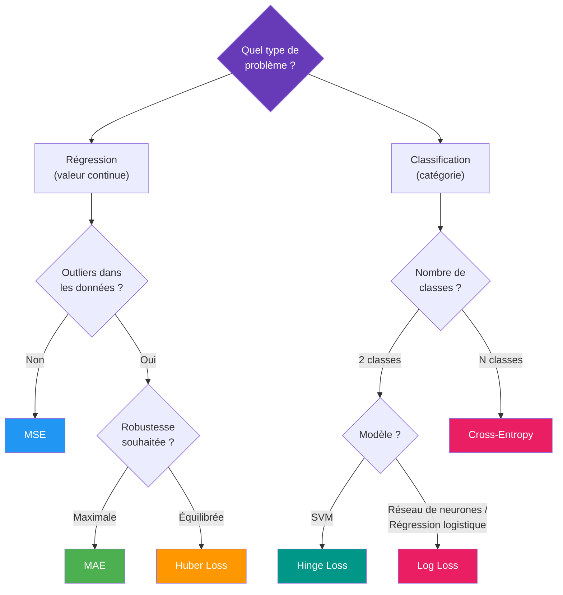

# Fonctions de pertes

Imaginez qu'on vous demande d'apprendre à lancer des fléchettes les yeux bandés, avec pour seule information, après chaque lancer, un nombre qui dit « à quel point c'était raté ». Selon la façon dont ce nombre est calculé, vous n'apprendrez pas la même chose. S'il augmente avec le carré de la distance à la cible, vous ferez tout pour éviter les lancers très ratés. S'il compte simplement la distance, un lancer catastrophique pèsera moins lourd. S'il vaut 1 quand vous manquez le centre et 0 sinon, vous n'aurez aucune idée de la direction dans laquelle corriger. Un modèle d'apprentissage automatique est dans cette situation. La **fonction de perte** (*loss function*) est ce nombre : elle mesure l'écart entre les prédictions du modèle et les valeurs réelles, et l'entraînement consiste à ajuster les paramètres pour la faire diminuer, en suivant son gradient. Pour que cela fonctionne, elle doit être dérivable, ou presque, et elle doit traduire ce qu'on considère vraiment comme une erreur grave.

> [!important] Idée clé
> La fonction de perte définit ce que le modèle considère comme une "bonne" prédiction pendant l'entraînement — deux modèles avec la même architecture mais des pertes différentes optimisent des objectifs différents. Le choix n'est jamais neutre : il détermine notamment la sensibilité aux outliers (MSE vs MAE) et la façon dont les erreurs rares sont traitées (Cross-Entropy vs Focal Loss).

## Comment choisir

Le premier critère est la nature du problème. En **régression**, on prédit une valeur continue (un prix, une température), et la perte mesure une distance entre deux nombres. En **classification**, on prédit une catégorie, le plus souvent sous la forme d'une probabilité par classe, et la perte mesure à quel point la probabilité attribuée à la bonne classe est faible. D'autres pertes servent à des tâches particulières : comparer des distributions, segmenter des images, apprendre des représentations.



## Pour la régression : MSE, MAE et Huber

L'**erreur quadratique moyenne** (*Mean Squared Error*, MSE) fait la moyenne des carrés des écarts :

$$\text{MSE} = \frac{1}{n} \sum_{i=1}^{n} (y_i - \hat{y_i})^2$$

Le carré a deux effets. Il rend la perte lisse et facile à optimiser, avec un gradient proportionnel à l'erreur. Et il amplifie les grandes erreurs : un écart de 10 pèse cent fois plus qu'un écart de 1. C'est utile quand une grosse erreur est vraiment grave, mais cela rend la MSE très sensible aux valeurs aberrantes, qui peuvent à elles seules tirer tout le modèle vers elles. Minimiser la MSE revient à prédire la moyenne conditionnelle des données.

L'**erreur absolue moyenne** (*Mean Absolute Error*, MAE) prend la valeur absolue des écarts :

$$\text{MAE} = \frac{1}{n} \sum_{i=1}^{n} |y_i - \hat{y_i}|$$

Toutes les erreurs comptent proportionnellement à leur taille, si bien qu'une valeur aberrante pèse beaucoup moins lourd : la MAE est dite **robuste**. Elle revient à prédire la médiane plutôt que la moyenne. Son défaut est d'avoir un gradient de même intensité quelle que soit l'erreur, et une pointe non dérivable en zéro, ce qui rend la convergence moins douce près de la solution.

La **perte de Huber** combine les deux : quadratique pour les petites erreurs, linéaire au-delà d'un seuil $\delta$.

$$
\text{Huber Loss}(a, \delta) = \begin{cases}
\frac{1}{2}a^2 & \text{si } |a| \le \delta \\
\delta (|a| - \frac{1}{2}\delta) & \text{sinon}
\end{cases}
$$

Elle garde la douceur de la MSE près de la solution et la robustesse de la MAE face aux valeurs aberrantes, au prix d'un paramètre $\delta$ à choisir, qui fixe à partir de quand une erreur est considérée comme aberrante.

## Pour la classification : l'entropie croisée

Quand le modèle produit une probabilité, on mesure sa qualité par l'**entropie croisée** (*cross-entropy*), appelée **log loss** dans le cas binaire :

$$
\text{Log Loss} = -\frac{1}{n} \sum_{i=1}^{n} [y_i \log(\hat{y_i}) + (1 - y_i) \log(1 - \hat{y_i})]
$$

Pour chaque exemple, seul compte le logarithme de la probabilité donnée à la bonne réponse. Si le modèle attribue 0,9 à la bonne classe, la perte est faible (environ 0,1) ; s'il lui attribue 0,01, elle est forte (environ 4,6) ; et elle tend vers l'infini si le modèle est absolument certain d'une mauvaise réponse. L'entropie croisée punit donc surtout l'excès de confiance dans l'erreur. Dans le cas à plusieurs classes, la formule se généralise en $-\log \hat{y}_{c}$, où $c$ est la vraie classe, après une fonction softmax qui transforme les sorties du réseau en probabilités. Minimiser l'entropie croisée revient à maximiser la vraisemblance des données, ce qui lui donne une justification statistique solide. Sa valeur brute est en revanche moins parlante qu'une précision en pourcentage.

## La perte hinge des SVM

La **perte hinge** (« charnière ») est celle des machines à vecteurs de support. Avec des étiquettes valant $-1$ ou $+1$ et un score $\hat{y}$ produit par le modèle :

$$
\text{Hinge Loss} = \frac{1}{n} \sum_{i=1}^{n} \max(0, 1 - y_i \cdot \hat{y_i})
$$

Un exemple bien classé avec une marge suffisante, c'est-à-dire un score du bon signe et supérieur à 1 en valeur absolue, ne coûte rien. Un exemple mal classé, ou bien classé mais trop près de la frontière, est pénalisé. La perte pousse donc à maximiser la marge entre les classes. Elle ne produit pas de probabilités, ce qui la rend inadaptée quand on a besoin d'une estimation de confiance.

## Comparer des distributions : la divergence de Kullback-Leibler

La **divergence de Kullback-Leibler** mesure à quel point une distribution de probabilité $Q$ s'écarte d'une distribution de référence $P$ :

$$
D_{KL}(P \parallel Q) = \sum_{i} P(i) \log\left(\frac{P(i)}{Q(i)}\right)
$$

Elle est nulle quand les deux distributions sont identiques et positive sinon. Elle est infinie si $Q$ attribue une probabilité nulle à un événement que $P$ juge possible. On la retrouve dans les autoencodeurs variationnels, pour rapprocher la distribution des codes latents d'une loi normale, dans la distillation de modèles, où un petit modèle apprend à imiter les probabilités d'un grand, ou dans l'apprentissage par renforcement des LLM, pour empêcher le modèle de trop s'éloigner de sa version de départ.

> [!warning] Piège fréquent
> La KL Divergence n'est **pas symétrique** : $D_{KL}(P \| Q) \neq D_{KL}(Q \| P)$ en général. Le sens compte — dans un VAE, on calcule $D_{KL}(q(z|x) \| p(z))$ et pas l'inverse, ce qui n'est pas un détail de notation mais change ce qui est réellement pénalisé (voir [[Autoencoders]]).

## Des pertes pour des problèmes particuliers

Quand une classe est rare, comme un objet à détecter dans une image presque entièrement composée de fond, l'entropie croisée est dominée par la masse des exemples faciles. La **focal loss**, introduite avec le détecteur RetinaNet (Lin et al., 2017), réduit le poids de ces exemples bien classés pour concentrer l'apprentissage sur les difficiles :

$$\text{Focal Loss} = -\alpha_t (1 - p_t)^\gamma \log(p_t)$$

Ici $p_t$ est la probabilité donnée à la bonne classe. Le facteur $(1 - p_t)^\gamma$ est presque nul pour un exemple facile et proche de 1 pour un exemple difficile. Avec $\gamma = 0$ on retrouve l'entropie croisée, et $\gamma = 2$ est la valeur courante ; $\alpha_t$ pondère en plus chaque classe.

En segmentation d'images, surtout médicale, la structure à détecter (une tumeur, un organe) n'occupe souvent qu'une petite partie de l'image. La **Dice loss** mesure directement le recouvrement entre le masque prédit $P$ et le masque réel $G$, ce qui la rend insensible à l'immense surface de fond correctement prédite :

$$\text{Dice Loss} = 1 - \frac{2 |P \cap G|}{|P| + |G|}$$

Enfin, quand on veut apprendre des **représentations** (*embeddings*) plutôt que des prédictions, on ne compare plus une sortie à une étiquette mais des exemples entre eux. La **perte contrastive** prend des paires : elle rapproche les paires similaires ($y = 0$) et éloigne les paires dissemblables ($y = 1$) jusqu'à une marge $m$, où $D$ est la distance entre les deux représentations.

$$L = (1-y) \frac{1}{2}D^2 + y \cdot \frac{1}{2}\max(0, m-D)^2$$

La **triplet loss** prend des triplets : une ancre, un exemple positif de la même classe et un négatif d'une autre classe. Elle exige que l'ancre soit plus proche du positif que du négatif, d'au moins une marge $\alpha$. C'est elle qui a permis à FaceNet (Google, 2015) de reconnaître des visages en comparant leurs représentations.

$$L = \max(0, \|f_a - f_p\|^2 - \|f_a - f_n\|^2 + \alpha)$$

> [!tip] Lien avec les embeddings modernes
> C'est exactement le principe d'entraînement des modèles d'embedding de texte modernes (voir [[Embeddings]]) : rapprocher les paires sémantiquement liées, éloigner les paires non liées. Contrastive Loss et Triplet Loss ne sont pas propres à la vision.

## En pratique avec PyTorch

PyTorch fournit la plupart de ces pertes toutes faites. Deux pièges classiques : `nn.CrossEntropyLoss` attend les scores bruts du réseau (*logits*) et applique elle-même le softmax, et pour le cas binaire `nn.BCEWithLogitsLoss` est préférable à `nn.BCELoss` précédé d'une sigmoïde, car elle est numériquement plus stable.

```python
import torch
import torch.nn as nn
import torch.nn.functional as F

# MSE
criterion = nn.MSELoss()

# MAE
criterion = nn.L1Loss()

# Huber
criterion = nn.HuberLoss(delta=1.0)

# Cross-Entropy (inclut Softmax)
criterion = nn.CrossEntropyLoss()
# Pour classification binaire
criterion = nn.BCELoss()
criterion = nn.BCEWithLogitsLoss()  # Plus stable (inclut Sigmoid)

# Hinge (SVM multiclasse) ; HingeEmbeddingLoss sert, lui, à comparer des paires
criterion = nn.MultiMarginLoss()

# KL Divergence
criterion = nn.KLDivLoss(reduction='batchmean')

# Focal Loss (implémentation custom)
class FocalLoss(nn.Module):
    def __init__(self, gamma=2, alpha=0.25):
        super().__init__()
        self.gamma = gamma
        self.alpha = alpha

    def forward(self, logits, targets):
        ce_loss = F.cross_entropy(logits, targets, reduction='none')
        p_t = torch.exp(-ce_loss)
        focal_loss = self.alpha * (1 - p_t) ** self.gamma * ce_loss
        return focal_loss.mean()

# Triplet Loss
criterion = nn.TripletMarginLoss(margin=1.0)

# Utilisation type
outputs = model(inputs)
loss = criterion(outputs, targets)
loss.backward()
optimizer.step()
```

## Synthèse

| Fonction | Type de problème | Sensible aux outliers | Quand l'utiliser |
|----------|:---:|:---:|---|
| **MSE** | Régression | Oui | Données propres, pénaliser les grandes erreurs |
| **MAE** | Régression | Non | Données avec outliers |
| **Huber** | Régression | Partiellement | Compromis MSE/MAE |
| **Log Loss** | Classification | — | Classification probabiliste binaire |
| **Cross-Entropy** | Classification | — | Classification multi-classes |
| **Hinge** | Classification | — | SVM, maximiser la marge |
| **KL Divergence** | Distributions | — | VAE, comparaison de distributions |
| **Focal Loss** | Classification déséquilibrée | — | Classes rares, détection d'objets |
| **Dice Loss** | Segmentation | — | Segmentation médicale |
| **Triplet Loss** | Embeddings | — | Reconnaissance faciale, similarité |

## Questions

> [!quiz] Un jeu de données contient une valeur aberrante, avec une erreur de 10 alors que les autres sont autour de 1. Quelle perte en est la plus affectée ?
> - [x] La MSE
>   L'erreur est élevée au carré : la valeur aberrante pèse 100 dans la somme, contre 1 pour une erreur normale.
> - [ ] La MAE
>   La MAE prend la valeur absolue : la valeur aberrante pèse 10, pas 100. C'est pour ça qu'elle est dite robuste.
> - [ ] Les deux autant
>   Le carré de la MSE fait toute la différence entre les deux.

> [!quiz] Quelle perte utiliser pour une classification binaire dont la sortie est une probabilité ?
> La **log loss** (entropie croisée binaire) : $-\frac{1}{n}\sum [y_i \log \hat{y}_i + (1-y_i)\log(1-\hat{y}_i)]$. Elle punit très fort une prédiction sûre d'elle et fausse.

> [!quiz] Que fait la Huber Loss ?
> Elle se comporte comme la MSE pour les petites erreurs et comme la MAE pour les grandes : dérivable partout, mais moins sensible aux valeurs aberrantes que la MSE.
