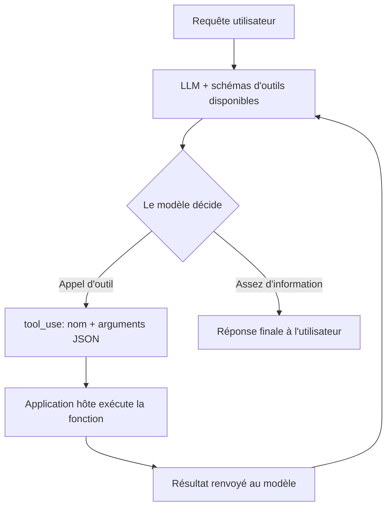
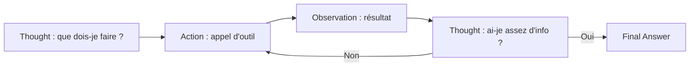
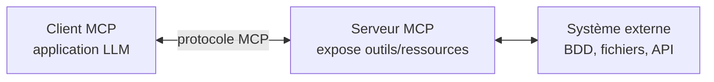
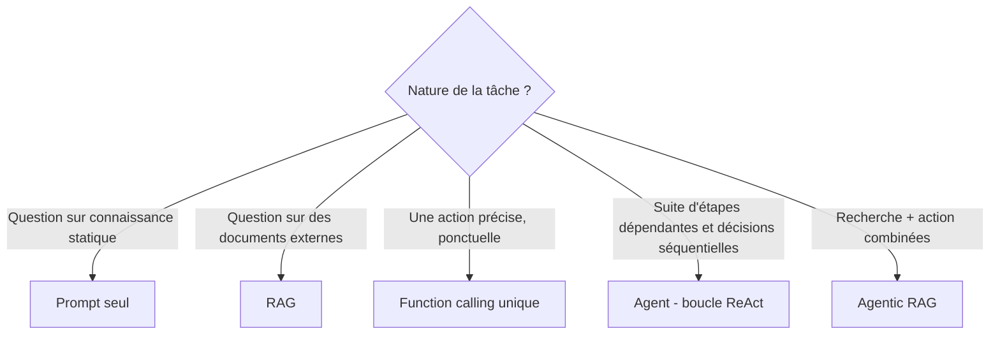

# Agents LLM et Function Calling

Demandez à un modèle de langage, seul, quel temps il fait à Lyon : il ne peut que deviner, ou avouer qu'il n'en sait rien, puisqu'il ne connaît que son corpus d'entraînement, figé à une date passée. Donnez-lui maintenant la possibilité d'écrire « appelle le service météo pour Lyon », laissez un programme exécuter cette demande et renvoyez-lui le résultat : il répond juste. Ce simple aller-retour, popularisé par OpenAI en juin 2023 sous le nom de *function calling*, a ouvert la voie aux agents, ces programmes qui enchaînent des dizaines d'actions pour accomplir une tâche, corriger un bug dans un dépôt de code ou préparer un dossier de recherche.

Un LLM seul ne fait que produire du texte : il ne peut ni consulter une base de données, ni naviguer sur le web, ni exécuter du code, ni envoyer un email. Le **function calling** (tool use) lui donne la capacité de déclencher des actions déterministes. Un **agent** est un LLM placé dans une boucle : il raisonne, appelle des outils, observe les résultats, et décide de l'étape suivante jusqu'à résoudre la tâche.

## Pourquoi sortir du simple prompt-réponse ?

| Limite du LLM seul | Solution |
|---|---|
| Connaissance figée à la date d'entraînement | Outil de recherche web, [[RAG]] |
| Pas d'accès à des données privées/internes | Outil de requête base de données, API interne |
| Incapable de calculer précisément | Outil calculatrice / interpréteur de code |
| Ne peut pas agir sur le monde réel | Outils d'action (envoyer un email, créer un fichier, réserver) |
| Tâche trop complexe pour une seule génération | Décomposition en étapes via boucle d'agent |

## Function Calling : le mécanisme

> [!important] Idée reçue à corriger
> Le LLM **n'exécute jamais rien lui-même**. Il décide *quoi* appeler et *avec quels arguments* ; l'exécution, la sécurité et les effets de bord restent entièrement sous la responsabilité de l'application hôte.

Le déroulement est toujours le même. Le développeur décrit les outils disponibles dans un schéma : un nom, une description en langage naturel et la liste des paramètres attendus. Ce schéma est envoyé au modèle avec la conversation. Quand le modèle juge qu'un outil l'aiderait, il ne répond pas en texte libre mais produit un **appel structuré**, le nom d'une fonction et ses arguments au format JSON. L'application hôte lit cet appel, **exécute réellement** la fonction, puis renvoie le résultat au modèle sous la forme d'un nouveau message. Le modèle reprend alors la main : il peut appeler un autre outil ou formuler sa réponse finale.

La description de chaque outil compte autant que son code : c'est elle que le modèle lit pour décider quand et comment l'utiliser. Une description vague produit des appels mal choisis ou des arguments mal remplis.



**Exemple de schéma d'outil :**

```json
{
  "name": "get_weather",
  "description": "Renvoie la météo actuelle pour une ville donnée",
  "parameters": {
    "type": "object",
    "properties": {
      "ville": {"type": "string"},
      "unite": {"type": "string", "enum": ["celsius", "fahrenheit"]}
    },
    "required": ["ville"]
  }
}
```

**Ce que le modèle produit** (au lieu de texte) :

```json
{"tool_use": {"name": "get_weather", "arguments": {"ville": "Lyon", "unite": "celsius"}}}
```

L'hôte exécute réellement l'appel API météo, puis renvoie par exemple `{"temperature": 22, "conditions": "ensoleillé"}` au modèle, qui peut alors formuler : *"Il fait 22°C et ensoleillé à Lyon."*

## Le pattern ReAct (Reason + Act)

Le schéma ReAct, proposé en 2022 par Shunyu Yao et ses collègues et déjà présenté dans [[Prompt Engineering]], est le mécanisme sous-jacent de la plupart des agents. Le modèle alterne explicitement raisonnement et action jusqu'à obtenir une réponse finale :



Que ce raisonnement soit affiché à l'utilisateur (comme dans un prompt ReAct explicite) ou masqué en interne, c'est structurellement la même boucle qui fait fonctionner un agent moderne.

## Appel d'outil unique vs boucle d'agent

La différence entre un simple appel d'outil et un agent tient à qui décide de l'enchaînement. Dans le premier cas, le modèle choisit un outil, l'utilise et répond. Dans le second, il replanifie après chaque observation, et le nombre d'étapes n'est pas connu à l'avance.

| | Appel d'outil unique | Boucle d'agent |
|---|---|---|
| **Exemple** | "Quelle est la météo à Lyon ?" | "Compare les vols Paris-Tokyo cette semaine et réserve le moins cher" |
| **Nombre d'appels** | 1 | Plusieurs, séquentiels, dépendants les uns des autres |
| **Décision** | Le modèle choisit un outil puis répond | Le modèle re-planifie à chaque étape selon les observations |
| **Coût / latence** | Faible | Élevé (un tour = un appel LLM complet) |

## Types d'outils courants

Presque tout ce qu'un programme sait faire peut devenir un outil. Les plus répandus donnent accès à l'information récente, à des données privées, à un calcul exact ou à une action dans le monde.

| Outil | Rôle | Exemple |
|---|---|---|
| Recherche web | Information à jour | Vérifier un fait récent |
| Exécution de code (sandbox) | Calcul précis, traitement de données | Analyser un CSV, résoudre une équation |
| Accès fichiers | Lire/écrire des documents | Éditer du code, générer un rapport |
| Appel API | Intégration avec un service externe | Réserver, envoyer un message, consulter un CRM |
| Base de données | Requêtes structurées | SQL agent sur une base métier |
| Retrieval | Recherche sémantique | Utiliser le [[RAG]] comme un outil parmi d'autres |

## Model Context Protocol (MCP)

Protocole ouvert introduit par Anthropic (2024) qui standardise la façon dont une application LLM se connecte à des outils et des sources de données externes. Avant MCP, chaque intégration (Slack, GitHub, une base de données...) devait être recodée pour chaque application LLM. MCP découple l'implémentation d'un outil de l'application qui l'utilise.



Un **serveur MCP** expose, dans un format standard, des outils, des ressources (des données à lire) et des modèles de prompts. Un **client MCP**, c'est-à-dire n'importe quelle application LLM compatible, peut s'y connecter sans code spécifique. Un même serveur, par exemple celui qui donne accès à GitHub, fonctionne ainsi avec tous les clients compatibles, alors que le function calling reste propre à l'API de chaque modèle. Le protocole joue pour les outils le rôle qu'a joué le *Language Server Protocol* pour les éditeurs de code : écrire l'intégration une fois, l'utiliser partout.

**Function calling vs MCP** : le function calling est le mécanisme bas niveau par lequel *un* modèle appelle *un* outil pendant *une* conversation. MCP standardise la couche de découverte et de connexion à ces outils, indépendamment du modèle utilisé.

## Orchestration multi-agents

Pour des tâches complexes, plutôt que de tout gérer dans une seule boucle de plus en plus longue, un agent orchestrateur peut déléguer des sous-tâches à des agents spécialisés, chacun avec ses propres instructions, ses outils et un contexte plus court.

| Pattern | Principe | Quand l'utiliser |
|---|---|---|
| **Séquentiel** | Chaque agent traite la sortie du précédent | Pipeline (recherche → rédaction → révision) |
| **Parallèle** | Plusieurs agents travaillent en même temps sur des sous-tâches indépendantes | Recherche sur plusieurs sources simultanément |
| **Hiérarchique (manager-worker)** | Un agent orchestrateur planifie et délègue à des agents exécutants | Tâches larges décomposables |
| **Débat / vote** | Plusieurs agents proposent une réponse, un consensus ou un juge tranche | Réduire les erreurs sur des tâches de raisonnement |

Coût à garder en tête : chaque agent supplémentaire multiplie le nombre d'appels LLM. La complexité de l'orchestration doit être justifiée par la difficulté réelle de la tâche.

## Pièges et risques

> [!warning] Pièges et risques
> - **Boucles infinies** : un agent qui ne converge jamais vers une condition d'arrêt. Toujours fixer un nombre maximal d'itérations.
> - **Hallucination d'appels d'outils** : le modèle invente un nom de fonction ou des arguments invalides. Valider strictement le schéma et renvoyer l'erreur au modèle pour qu'il corrige, plutôt que de planter silencieusement.
> - **Prompt injection via les résultats d'outils** : une page web ou un document récupéré par un outil peut contenir des instructions cachées destinées à détourner l'agent ("ignore tes instructions précédentes..."). Traiter tout contenu externe comme non fiable, ne jamais accorder d'action destructive sans confirmation humaine.
> - **Coût et latence** : une tâche à 10 étapes peut coûter 10 fois plus qu'une réponse directe — ne pas donner un agent à un problème qui se résout avec un seul prompt.
> - **Sur-ingénierie** : la tentation d'ajouter des outils et des agents à un problème simple. Commencer par le function calling unique, ne monter en boucle d'agent que si la tâche l'exige réellement.

## Évaluer un agent

Évaluer un agent est plus difficile qu'évaluer une réponse unique ([[Métriques d'Évaluation]]), parce que le chemin compte autant que le résultat. Le premier critère est le **taux de réussite** : la tâche est-elle accomplie correctement ? Viennent ensuite l'**efficacité**, c'est-à-dire le nombre d'étapes et d'appels nécessaires, la **précision des appels d'outils** (le bon outil, avec les bons arguments) et la **capacité de récupération** : face à une erreur ou à un résultat inattendu, l'agent corrige-t-il sa trajectoire ou s'obstine-t-il ? Comme les agents ne sont pas déterministes, on mesure ces critères sur de nombreuses exécutions plutôt qu'une seule.

Plusieurs bancs d'essai publics servent de référence : AgentBench et ToolBench pour l'usage d'outils, SWE-bench pour les agents qui corrigent de vrais bugs dans des dépôts GitHub, GAIA pour les questions qui demandent de combiner recherche, lecture et calcul.

## Function Calling vs RAG vs Agent — quand utiliser quoi

Le bon outil est le plus simple qui suffit. Une question sur des connaissances générales se traite avec un prompt ; une question sur des documents précis, avec le [[RAG]] ; une action ponctuelle, avec un appel de fonction ; seule une suite d'étapes dépendantes justifie un agent.



## Ressources

- Shunyu Yao et al., [*ReAct: Synergizing Reasoning and Acting in Language Models*](https://arxiv.org/abs/2210.03629) (2022).
- La [spécification du Model Context Protocol](https://modelcontextprotocol.io).
- Anthropic, *Building effective agents* (2024), un guide pratique sur les schémas d'agents et le choix de la solution la plus simple.
