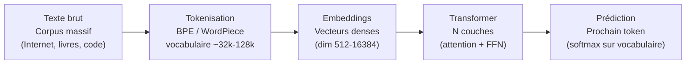
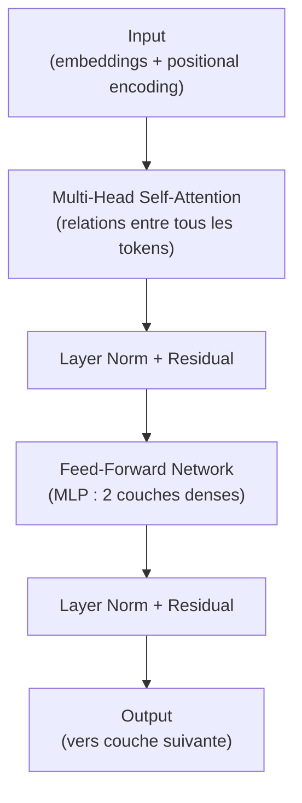

# LLM — Architectures et Fonctionnement

Tapez « Le chat est monté sur le » dans votre téléphone : le clavier propose « toit », « canapé », « lit ». Il a appris quels mots suivent souvent d'autres mots. Un **grand modèle de langage** (*Large Language Model*, LLM) fait fondamentalement la même chose : il prédit le morceau de texte suivant. La différence est d'échelle. Entraîné sur des milliers de milliards de mots, avec des centaines de milliards de paramètres, il doit, pour bien prédire la suite d'un texte, avoir capté la grammaire, des faits, des styles, des raisonnements, du code. Le 30 novembre 2022, OpenAI ouvre ChatGPT au public ; cinq jours plus tard, il compte un million d'utilisateurs. GPT, Claude, Gemini, Llama ou Mistral reposent tous sur ce principe et sur la même architecture, le Transformer.

## Vue d'ensemble

Le trajet d'un texte dans un LLM suit toujours les mêmes étapes. Le texte est découpé en **tokens**, chaque token est transformé en un vecteur de nombres (un **embedding**), ces vecteurs traversent une pile de couches de Transformer qui les enrichissent de leur contexte, et la dernière couche produit une probabilité pour chacun des tokens du vocabulaire : celle d'être le suivant.



L'entraînement consiste uniquement à **prédire le prochain token**, sur des milliards d'exemples. Aucune règle de grammaire, aucun fait n'est programmé : la capacité à manier le langage émerge de cette tâche simple poussée à très grande échelle.

## La tokenisation

Le modèle ne lit ni des lettres ni des mots, mais des **tokens**, en général des morceaux de mots. Un mot courant forme souvent un seul token, un mot rare est découpé en plusieurs. Le découpage exact dépend du tokeniseur de chaque modèle ; à titre d'illustration :

```
"Bonjour, monde!" → ["Bon", "jour", ",", " monde", "!"]
"unforgettable"  → ["un", "forget", "table"]
```

L'algorithme le plus répandu est le **BPE** (*Byte Pair Encoding*), utilisé par GPT et Llama. Il part des caractères (ou des octets) individuels, puis fusionne de manière répétée les paires les plus fréquentes du corpus, jusqu'à obtenir un vocabulaire de la taille voulue, en général entre 30 000 et 200 000 tokens. Cette approche n'a jamais de mot inconnu, puisqu'au pire elle redescend aux octets.

La tokenisation a des conséquences concrètes. En anglais, un token vaut environ trois quarts de mot ; dans les langues moins présentes dans le corpus du tokeniseur, il en faut davantage pour le même texte, ce qui coûte plus cher et occupe plus de contexte. La **fenêtre de contexte**, la quantité de texte que le modèle peut prendre en compte d'un coup, se mesure d'ailleurs en tokens. Et certaines faiblesses célèbres, comme la difficulté à compter les lettres d'un mot, viennent de ce que le modèle ne voit pas les lettres, seulement des tokens.

## L'architecture Transformer

Tous les LLM modernes dérivent du Transformer, introduit en 2017 par une équipe de Google dans l'article « Attention Is All You Need » (Vaswani et al.). Les LLM génératifs n'en gardent que la partie « décodeur », une pile de blocs identiques, de quelques dizaines à plus d'une centaine. Chaque bloc fait deux choses : il laisse chaque token regarder les autres (l'attention), puis il transforme chaque token individuellement (un petit réseau de neurones, le *feed-forward network*). Des connexions résiduelles et des normalisations entourent ces deux étapes pour que le réseau reste entraînable malgré sa profondeur.



Le mécanisme central est l'**auto-attention** (*self-attention*). Pour chaque token, le modèle calcule à partir de son vecteur trois projections : une requête $Q$ (« ce que je cherche »), une clé $K$ (« ce que je contiens ») et une valeur $V$ (« ce que je transmets »). Il compare la requête de chaque token aux clés de tous les tokens précédents, transforme ces scores en poids par un softmax, et fait la moyenne pondérée des valeurs correspondantes :

$$\text{Attention}(Q, K, V) = \text{softmax}\left(\frac{QK^\top}{\sqrt{d_k}}\right) V$$

La division par $\sqrt{d_k}$ évite que les scores deviennent trop grands quand la dimension augmente. Concrètement, dans « Le trophée ne rentre pas dans la valise car il est trop grand », l'attention permet au token « il » d'aller chercher l'information dans « trophée ». Dans un LLM, un masque empêche chaque token de regarder les tokens qui le suivent, puisqu'il doit les prédire. L'attention est **multi-têtes** : plusieurs attentions fonctionnent en parallèle, chacune avec ses propres projections, ce qui permet de capter en même temps différents types de relations, syntaxiques, sémantiques ou de position.

L'attention, par elle-même, ignore l'ordre des mots : elle traite les tokens comme un ensemble. Il faut donc lui fournir la position de chaque token. GPT-2 ajoutait aux embeddings un vecteur de position absolue appris ; les modèles récents utilisent des encodages relatifs comme **RoPE** (qui fait tourner les vecteurs selon la position) ou **ALiBi**, qui se généralisent mieux à des textes plus longs que ceux vus à l'entraînement.

## Comment on entraîne un LLM

L'entraînement se fait en plusieurs étapes, qui transforment progressivement un prédicteur de texte en assistant.

Le **pré-entraînement** est l'étape la plus massive. Le modèle apprend à prédire le prochain token (*causal language modeling*) sur des milliers de milliards de tokens tirés du web (Common Crawl), de Wikipédia, de livres, de code (GitHub), d'articles scientifiques. Cela prend des semaines à des mois sur des milliers de GPU, pour un coût qui se chiffre en millions, voire en centaines de millions de dollars. On obtient un **modèle de base** (*base model*) : il sait énormément de choses, mais il continue un texte plutôt qu'il ne répond à une question. Posez-lui une question, et il risque d'enchaîner sur d'autres questions, comme s'il complétait une liste d'examen.

Le **fine-tuning supervisé** (*Supervised Fine-Tuning*, SFT) lui apprend ensuite le format d'un dialogue, à partir de quelques milliers à quelques millions d'exemples soignés de paires instruction-réponse. C'est cette étape qui le transforme en assistant.

L'**alignement sur les préférences** affine enfin son comportement. Dans le **RLHF** (*Reinforcement Learning from Human Feedback*), on génère plusieurs réponses à une même demande, des annotateurs humains les classent, on entraîne un **modèle de récompense** à prédire ces préférences, puis on optimise le LLM par apprentissage par renforcement (avec l'algorithme PPO) pour maximiser cette récompense, tout en l'empêchant de trop s'éloigner de sa version de départ. Le **RLAIF** remplace une partie des annotateurs humains par un autre modèle guidé par des principes écrits, ce qui permet de passer à l'échelle ; c'est l'idée de la « Constitutional AI » d'Anthropic. Des méthodes plus simples comme **DPO** (*Direct Preference Optimization*, 2023) se passent du modèle de récompense et optimisent directement sur les paires de préférences. Depuis 2024, l'apprentissage par renforcement sert aussi à entraîner des modèles dits « de raisonnement », récompensés quand ils trouvent la bonne réponse à des problèmes vérifiables, comme des exercices de mathématiques ou de programmation.

## Taille, données et lois d'échelle

Les modèles ont grossi très vite, en paramètres comme en longueur de contexte.

| Modèle | Paramètres | Contexte | Année |
|---|---|---|---|
| GPT-2 | 1,5 B | 1 024 tokens | 2019 |
| GPT-3 | 175 B | 2 048 tokens | 2020 |
| LLaMA 2 | 7B à 70B | 4 096 tokens | 2023 |
| GPT-4 | non publié | 8 192 puis 128 000 tokens (GPT-4 Turbo) | 2023 |
| Llama 3.1 | 8B à 405B | 128 000 tokens | 2024 |
| Claude 3.5 Sonnet | non publié | 200 000 tokens | 2024 |

Cette croissance repose sur les **lois d'échelle** (*scaling laws*). Jared Kaplan et ses collègues d'OpenAI ont montré en 2020 que l'erreur d'un modèle diminue de façon régulière et prévisible quand on augmente le nombre de paramètres, la quantité de données et la puissance de calcul. En 2022, l'étude **Chinchilla** de DeepMind a précisé comment répartir un budget de calcul donné : l'optimum se situe autour de 20 tokens d'entraînement par paramètre. Depuis, on entraîne même des modèles bien au-delà de cet optimum, parce qu'un petit modèle très entraîné coûte moins cher à utiliser : Llama 3 8B, entraîné sur 15 000 milliards de tokens, dépasse GPT-3 et ses 175 milliards de paramètres.

> [!important] Ce que Chinchilla a corrigé
> Avant 2022, la course était surtout à plus de paramètres (GPT-3 : 175B). Chinchilla a montré que la plupart des grands modèles de l'époque étaient **sous-entraînés** par rapport à leur taille — un modèle plus petit mais entraîné sur beaucoup plus de tokens peut surpasser un modèle plus gros mais sous-alimenté en données, à budget de calcul égal.

## Les limites des LLM

La plus connue est l'**hallucination**.

> [!warning] Hallucinations
> Les LLM génèrent des informations fausses avec confiance parce qu'ils optimisent la **vraisemblance du texte**, pas la vérité factuelle — un énoncé faux mais grammaticalement et statistiquement plausible n'est pas distingué d'un énoncé vrai par l'objectif d'entraînement. Solutions partielles : [[RAG]], grounding, chain-of-thought.

La **fenêtre de contexte** est une autre limite : le modèle n'a pas de mémoire en dehors du texte qu'on lui fournit à chaque requête, et tout ce qui dépasse la fenêtre est ignoré. Même à l'intérieur, l'information placée au milieu d'un très long contexte est parfois moins bien exploitée. On contourne cette limite en allant chercher les passages utiles au moment de la question ([[RAG]]), en compressant le cache, ou avec des architectures conçues pour les longues séquences.

Les LLM reproduisent aussi, et parfois amplifient, les **biais** de leur corpus d'entraînement. Ils restent fragiles en **calcul et en raisonnement formel** : arithmétique exacte, logique, planification longue. Faire écrire au modèle son raisonnement étape par étape (*chain-of-thought*), lui donner des outils comme une calculatrice ou un interpréteur de code ([[Agents LLM et Function Calling]]), ou l'entraîner spécifiquement au raisonnement améliore nettement ces résultats sans les rendre infaillibles. Enfin, leur **coût d'inférence** est élevé : chaque token généré exige de traverser toutes les couches du modèle, ce qui devient coûteux à grande échelle.

## Générer du texte efficacement

Plusieurs techniques rendent la génération plus rapide ou mieux contrôlée. Le **KV-cache** conserve les clés et les valeurs déjà calculées pour les tokens précédents : sans lui, chaque nouveau token obligerait à recalculer l'attention sur tout le texte depuis le début. La **quantification** (voir [[Quantization]]) stocke les poids avec moins de bits pour réduire la mémoire et accélérer les calculs.

Le choix du token suivant, parmi les probabilités produites par le modèle, se règle par plusieurs paramètres. La **température** modifie la forme de la distribution : en dessous de 1, elle la resserre sur les tokens les plus probables et rend le texte plus prévisible ; au-dessus de 1, elle l'aplatit et rend le texte plus varié, voire incohérent ; à 0, on prend toujours le plus probable (décodage glouton). Le **top-p** (*nucleus sampling*) ne tire qu'au sein du plus petit ensemble de tokens dont les probabilités cumulées atteignent $p$, ce qui écarte la longue traîne des choix absurdes. La **recherche en faisceau** (*beam search*), qui explore plusieurs suites en parallèle, favorise au contraire les réponses les plus probables dans leur ensemble ; elle convient à la traduction, mais produit des textes répétitifs en génération libre, où l'on préfère l'échantillonnage.

## Ressources

- Vaswani et al., [*Attention Is All You Need*](https://arxiv.org/abs/1706.03762) (2017).
- Jay Alammar, *The Illustrated Transformer*, et la série vidéo de 3Blue1Brown sur les réseaux de neurones et les Transformers.
- Andrej Karpathy, *Let's build GPT: from scratch, in code, spelled out* (vidéo, 2023).
- Hoffmann et al., *Training Compute-Optimal Large Language Models* (« Chinchilla », 2022).
