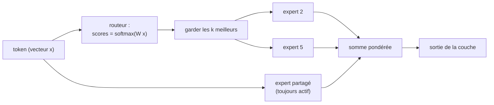
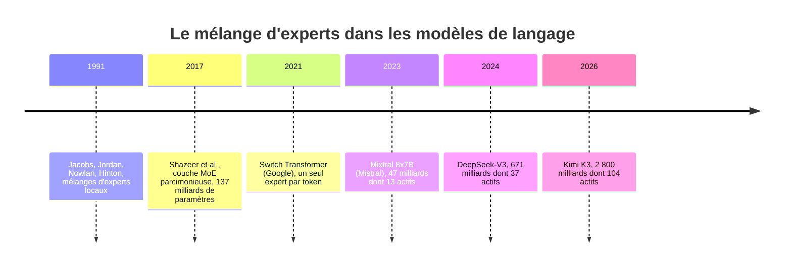

# Mixture of Experts

Kimi K3, le plus gros modèle aux poids publiés en 2026, compte 2 800 milliards de paramètres. Pourtant, pour produire chaque mot, il n'en utilise qu'environ 104 milliards, moins de 4 %. Le reste dort. Cette architecture, le **mélange d'experts** (*Mixture of Experts*, MoE), est devenue en deux ans la norme des grands modèles ouverts : DeepSeek, GLM, Qwen, Kimi et Mistral l'utilisent tous. Elle découple deux choses qu'on croyait liées, la quantité de connaissances qu'un modèle peut stocker et le calcul qu'il dépense par mot. Cette note explique comment un routeur choisit les experts, pourquoi il faut l'empêcher de favoriser toujours les mêmes, ce que cela change pour la mémoire et le matériel, et ce qu'on sait réellement de la « spécialisation » des experts.

Le fonctionnement général d'un Transformer est dans [[Transformers]] et [[LLM — Architectures et Fonctionnement]].

## Le problème des modèles denses

Dans un Transformer classique, dit **dense**, chaque couche contient deux blocs : l'attention, qui fait circuler l'information entre les tokens, et un réseau feed-forward (FFN), deux grandes multiplications de matrices appliquées à chaque token séparément. Le FFN porte l'essentiel des paramètres, environ les deux tiers, et c'est là que le modèle semble stocker ses connaissances factuelles.

Les lois d'échelle (voir [[LLM — Architectures et Fonctionnement]]) disent qu'un modèle plus gros, entraîné sur plus de données, est meilleur. Mais dans un modèle dense, chaque paramètre participe au calcul de chaque token. Doubler la taille, c'est doubler le coût de chaque mot généré, à l'entraînement comme à l'usage. Un modèle dense de 1 000 milliards de paramètres coûterait 2 000 milliards d'opérations par token.

L'intuition du MoE est qu'un token n'a pas besoin de toute la connaissance du modèle. Pour écrire la suite de « def fibonacci(n): », inutile de mobiliser ce que le modèle sait de la cuisine thaïe.

## Des experts et un aiguilleur

Une couche MoE remplace le FFN unique par **plusieurs FFN**, appelés experts, plus un petit réseau, le **routeur**, qui décide pour chaque token lesquels utiliser.



Le routeur est une simple matrice W : multipliée par le vecteur du token, elle donne un score par expert, que l'on transforme en probabilités (softmax, ou une sigmoïde chez DeepSeek-V3). On garde les k experts de plus haut score, le « top-k », on fait passer le token dans ces k experts seulement, et l'on additionne leurs sorties pondérées par leurs scores renormalisés. Les autres experts ne calculent rien pour ce token.

> [!abstract] Définition — Mélange d'experts parcimonieux
> Couche de réseau de neurones composée de N sous-réseaux (les experts) et d'un routeur qui, pour chaque entrée, n'active que k experts parmi N et combine leurs sorties. Le modèle stocke les paramètres des N experts mais n'en calcule que k à chaque passage : on distingue les paramètres **totaux** des paramètres **actifs**.

Le routeur apprend en même temps que le reste du réseau. Si confier un token à l'expert 5 réduit l'erreur, le gradient augmente le score de l'expert 5 pour les tokens semblables. Personne ne dit aux experts de quoi s'occuper : leur partage du travail émerge de l'entraînement.

Le widget fait passer une phrase dans une couche de 8 experts. Chaque ligne est un token, chaque case un expert, plus foncée quand le routeur lui donne un score élevé ; les cases encadrées sont les k experts retenus.

```widget:moe-routeur
experts: 8
k: 2
objectif: La charge est très déséquilibrée : quelques experts reçoivent plus du double de leur part. Activez l'équilibrage et ramenez le déséquilibre sous 1,2.
cible: equilibrage=1, desequilibre<1.2
indice: Cochez la case d'équilibrage sous le tableau.
bravo: Les biais ont redistribué les tokens sans toucher au poids que chaque expert reçoit dans le mélange.
objectif-2: Réglez le routage pour qu'un token n'active pas plus de 10 % des experts.
cible-2: actifs_pct<=10
indice-2: Il faut beaucoup d'experts et un k petit.
bravo-2: C'est l'esprit des MoE « fins » de 2026 : GLM-5.3 active 9 experts sur 257 (3,5 %), Kimi K3 18 sur 898.
```

## Une idée ancienne, une renaissance récente

Le mélange d'experts date de 1991 : Robert Jacobs, Michael Jordan, Steven Nowlan et Geoffrey Hinton proposaient de confier chaque région de l'espace des entrées à un petit réseau, sous le contrôle d'un réseau « aiguilleur ». L'idée est restée marginale jusqu'en 2017, quand Noam Shazeer et ses collègues de Google ont inséré une couche MoE parcimonieuse de plusieurs milliers d'experts dans un réseau de traduction, atteignant 137 milliards de paramètres pour un coût de calcul modeste.



Le tournant pour les modèles ouverts est **Mixtral 8x7B**, publié par Mistral en décembre 2023 : huit experts par couche, deux actifs par token, 46,7 milliards de paramètres au total mais 12,9 milliards utilisés par token. Il égalait des modèles denses bien plus coûteux. Son nom trompe d'ailleurs : ce ne sont pas huit modèles de 7 milliards, car seuls les FFN sont multipliés, l'attention et les embeddings restent partagés.

## Experts fins et experts partagés

DeepSeek a apporté en 2024 deux modifications reprises par presque tout le monde.

La première est de découper les experts **plus finement** : au lieu de 8 gros experts dont on active 2, on en prend 64 quatre fois plus petits dont on active 8. Le calcul est le même, mais les combinaisons possibles explosent : il y a 28 façons de choisir 2 experts parmi 8, et plus de quatre milliards de choisir 8 experts parmi 64. Le routeur peut composer des combinaisons de compétences bien plus nuancées.

La seconde est d'ajouter des **experts partagés**, toujours actifs, qui ne passent pas par le routeur. Ils absorbent les connaissances communes à tous les tokens (la grammaire, les mots fréquents), ce qui libère les experts routés pour des compétences plus spécifiques, au lieu que chacun réapprenne les mêmes bases.

DeepSeek-V3 (décembre 2024) combine les deux à grande échelle : dans chacune de ses couches MoE, 256 experts routés dont 8 actifs, plus un expert partagé. Avec 58 couches MoE, cela donne 671 milliards de paramètres au total, dont 37 milliards actifs par token, soit 5,5 %. Le widget refait ce calcul pour les réglages choisis.

## Empêcher les embouteillages

Un routeur laissé libre a une tendance naturelle à s'effondrer. Au début de l'entraînement, un expert un peu meilleur que les autres reçoit plus de tokens, donc plus de gradients, donc s'améliore plus vite, donc reçoit encore plus de tokens. À la fin, quelques experts font tout le travail pendant que les autres n'apprennent rien : on a payé un gros modèle pour en utiliser un petit. Le problème est aussi matériel : les experts sont répartis sur plusieurs GPU, et un expert surchargé fait attendre tous les autres.

La solution classique, depuis le Switch Transformer, est une **perte auxiliaire d'équilibrage** : un terme ajouté à la fonction de perte, qui pénalise le modèle quand la part de tokens envoyée à chaque expert s'écarte de la moyenne. Elle marche, mais elle tire le modèle dans deux directions à la fois : prédire le bon mot, et répartir également la charge, quitte à envoyer un token vers un expert moins pertinent. Si son poids est trop fort, la qualité baisse.

DeepSeek-V3 a introduit un équilibrage **sans perte auxiliaire**. Chaque expert reçoit un biais, ajouté à son score uniquement pour le choix du top-k, jamais pour le poids du mélange. Après chaque lot, on augmente un peu le biais des experts sous-employés et l'on diminue celui des experts surchargés. La charge s'équilibre, et le gradient de la perte principale n'est pas perturbé. C'est ce que fait la case d'équilibrage du widget.

Il reste un garde-fou mécanique, la **capacité** : chaque expert ne peut traiter qu'un nombre maximal de tokens par lot, typiquement 1,25 fois sa part moyenne. Les tokens en surplus sont abandonnés pour cette couche (ils passent par la connexion résiduelle sans traitement) ou redirigés. Les implémentations récentes cherchent à ne plus rien abandonner.

## Ce que le MoE coûte vraiment

Le MoE économise du calcul, pas de la mémoire. Tous les experts doivent être chargés, puisqu'on ne sait pas à l'avance lesquels le prochain token demandera. Faire tourner DeepSeek-V3 demande donc de stocker 671 milliards de paramètres, environ 700 Go en 8 bits, même si chaque token n'en utilise que 37 milliards.

À l'usage, la génération d'un token est surtout limitée par la vitesse à laquelle on lit les poids en mémoire, et l'on ne lit que les experts activés. Un MoE génère donc à peu près à la vitesse d'un modèle dense de la taille de ses paramètres actifs, avec la qualité d'un modèle bien plus gros. C'est la raison de son succès économique. Le revers est qu'il faut beaucoup de mémoire, et, à l'échelle d'un centre de calcul, répartir les experts sur de nombreux GPU : chaque token doit être envoyé vers le GPU qui héberge ses experts, puis revenir. Cette communication de « tous vers tous » (all-to-all) devient le goulot d'étranglement, et DeepSeek limite par exemple chaque token à des experts situés sur au plus quatre machines.

> [!warning] Piège
> On lit parfois qu'un MoE est un « comité de spécialistes », avec un expert pour les mathématiques, un pour le code, un pour le français. Les analyses ne le confirment pas. En étudiant Mixtral, ses auteurs n'ont trouvé aucune spécialisation nette par domaine (biologie, philosophie, mathématiques) ; le routage suivait plutôt la syntaxe : les indentations en Python, certains mots-clés, la position dans la phrase. Les experts se partagent le travail selon des critères que le modèle trouve utiles, pas selon nos catégories.

## Les MoE de 2026

Les grands modèles ouverts de 2026 poussent la logique des experts fins jusqu'au bout. Les chiffres ci-dessous viennent des fiches publiées par les éditeurs (novembre 2026).

| Modèle | Paramètres totaux | Actifs par token | Experts par couche | Part active |
|---|---|---|---|---|
| Mixtral 8x7B (2023) | 46,7 Md | 12,9 Md | 8, dont 2 actifs | 28 % |
| DeepSeek-V3 (2024) | 671 Md | 37 Md | 256 + 1 partagé, 8 actifs | 5,5 % |
| Qwen3.8-Flash-Next (2026) | 125 Md | 6 Md | 512, 10 actifs | 4,8 % |
| GLM-5.3 (2026) | 753 Md | 40 Md | 256 + 1 partagé, 8 actifs | 5,3 % |
| DeepSeek V4-Pro (2026) | 1 600 Md | 49 Md | non publié | 3,1 % |
| Kimi K3 (2026) | 2 800 Md | 104 Md | 896 + 2 partagés, 16 actifs | 3,7 % |

La tendance est nette : toujours plus d'experts, toujours plus petits, et une part active qui descend vers 3 à 5 %. Les modèles de 2026 stockent aussi leurs experts en précision réduite (FP4 pour les experts de DeepSeek V4), puisque ce sont eux qui occupent la mémoire. La suite logique, pour ces modèles, est de réduire aussi le coût de l'attention sur de très longs contextes : voir [[Attention moderne — KV cache, GQA, MLA]]. Pour une vue d'ensemble des modèles eux-mêmes, voir [[Panorama des modèles open-weight (2026)]].

## Questions de révision

> [!quiz] Que distingue-t-on entre paramètres totaux et paramètres actifs dans un MoE ?
> Les paramètres totaux sont tous ceux que le modèle stocke (tous les experts) ; les paramètres actifs sont ceux réellement utilisés pour calculer un token (les k experts choisis, les experts partagés, l'attention et les embeddings).

> [!quiz] Pourquoi un routeur non contraint tend-il à s'effondrer sur quelques experts ?
> Un expert un peu meilleur reçoit plus de tokens, donc plus de gradients, donc progresse plus vite et reçoit encore plus de tokens : c'est une boucle de renforcement.

> [!quiz] Qu'apporte l'équilibrage sans perte auxiliaire de DeepSeek-V3 ?
> - [x] Il équilibre la charge par un biais qui change le choix des experts, sans perturber le gradient de la perte principale.
>   Le biais n'intervient que dans le top-k, pas dans les poids du mélange ; il est ajusté après chaque lot.
> - [ ] Il supprime le routeur.
>   Le routeur reste ; seul le choix des experts est corrigé par le biais.
> - [ ] Il active tous les experts pour chaque token.
>   Ce serait un modèle dense, avec tout son coût.

> [!quiz] Un MoE de 671 milliards de paramètres, dont 37 actifs, a besoin en mémoire de :
> - [ ] 37 milliards de paramètres.
>   C'est ce qu'il calcule par token, pas ce qu'il doit garder chargé.
> - [x] 671 milliards de paramètres.
>   Tous les experts doivent rester en mémoire, car chaque token peut en demander d'autres.
> - [ ] Une moyenne des deux.
>   Aucune économie de mémoire n'est possible sans savoir à l'avance quels experts seront choisis.

> [!quiz] Que montrent les analyses du routage de Mixtral sur la spécialisation des experts ?
> Pas de spécialisation nette par domaine (code, mathématiques, philosophie) ; le routage suit surtout des régularités syntaxiques.
