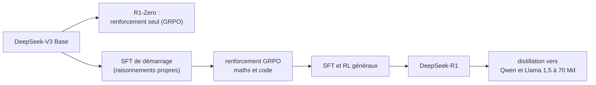

# Modèles de raisonnement et apprentissage par renforcement

En janvier 2025, DeepSeek a publié un résultat qui a surpris tout le domaine. En entraînant un modèle de langage uniquement par essais et erreurs sur des problèmes de mathématiques, sans jamais lui montrer comment raisonner, le modèle s'est mis de lui-même à écrire de longs raisonnements, à vérifier ses calculs, et à revenir en arrière quand il se trompait. C'est ce que font aujourd'hui tous les « modèles de raisonnement », qui réfléchissent avant de répondre. Cette note retrace les étapes qui transforment un modèle de texte brut en assistant, puis en modèle qui raisonne : l'apprentissage supervisé, l'alignement sur les préférences humaines (RLHF, DPO), et l'apprentissage par renforcement sur des récompenses vérifiables, avec l'algorithme GRPO qui l'a rendu bon marché.

Les bases de l'apprentissage par renforcement (agent, récompense, politique) sont dans [[Renforcement]].

## De la prédiction de texte à l'assistant

Un modèle fraîchement pré-entraîné a appris une seule chose : prédire le token suivant sur des milliers de milliards de mots du web. Il sait beaucoup, mais il ne sait pas répondre. À la question « Quelle est la capitale de l'Australie ? », il peut très bien continuer par « Quelle est la capitale du Canada ? », parce que les questions viennent souvent en liste dans ses données. Il faut lui apprendre un comportement, et c'est le rôle du **post-entraînement**, une suite d'étapes beaucoup moins coûteuses que le pré-entraînement mais décisives.

```widget:ordonner
consigne: Remettez dans l'ordre les étapes de fabrication d'un modèle de raisonnement.
elements: Pré-entraînement = prédire le token suivant sur des milliers de milliards de mots | Fine-tuning supervisé (SFT) = imiter des milliers d'exemples de dialogues bien rédigés | Alignement sur les préférences (RLHF ou DPO) = préférer les réponses que des humains jugent meilleures | Renforcement sur récompenses vérifiables = résoudre des problèmes dont on peut vérifier la réponse, et renforcer ce qui marche | Distillation = enseigner le raisonnement du grand modèle à des modèles plus petits
```

Le **fine-tuning supervisé** (SFT) montre au modèle des exemples de conversations : une question, une bonne réponse. Il apprend le format, le ton, l'habitude de répondre. Quelques milliers d'exemples soignés suffisent souvent : en 2023, l'étude LIMA a obtenu un assistant convaincant avec seulement mille exemples choisis à la main. Mais l'imitation a une limite : le modèle ne peut pas devenir meilleur que ses exemples, et il apprend à **paraître** juste plutôt qu'à l'être.

## Apprendre des préférences : RLHF et DPO

Il est difficile d'écrire la réponse parfaite à une question, mais facile de dire laquelle de deux réponses est la meilleure. Le **RLHF** (*Reinforcement Learning from Human Feedback*), popularisé par InstructGPT en 2022 puis ChatGPT, exploite cette asymétrie en trois temps. On fait d'abord produire au modèle plusieurs réponses à une même question, et des annotateurs les classent. On entraîne ensuite un second réseau, le **modèle de récompense**, à prédire ces préférences : il donne une note à n'importe quelle réponse. Enfin, on améliore le modèle de langage par apprentissage par renforcement (l'algorithme PPO) pour qu'il produise des réponses mieux notées, en le retenant par une pénalité s'il s'éloigne trop de son comportement initial.

Le RLHF marche, mais il est lourd : quatre réseaux en mémoire (le modèle, sa copie de référence, le modèle de récompense et un « critique » qui estime la valeur de chaque état), et un entraînement instable. En 2023, la méthode **DPO** (*Direct Preference Optimization*) a montré qu'on pouvait s'en passer. Un calcul astucieux permet d'écrire directement la perte à partir des paires « réponse préférée, réponse rejetée » : on augmente la probabilité de la première et on baisse celle de la seconde, par rapport au modèle de référence, sans modèle de récompense ni renforcement. DPO est devenu la méthode par défaut pour aligner un modèle sur des préférences, y compris quand on fine-tune soi-même.

Les deux méthodes ont la même faiblesse : la récompense est un jugement humain, ou l'imitation de ce jugement. Le modèle apprend à plaire, ce qui n'est pas la même chose qu'avoir raison. Il apprend par exemple que les réponses longues et sûres d'elles sont souvent préférées, d'où des réponses verbeuses et une tendance à flatter l'utilisateur.

## Des récompenses qu'on peut vérifier

Pour certaines tâches, on n'a pas besoin d'un juge : on peut **vérifier**. Un problème de mathématiques a une réponse numérique qu'on compare à la solution. Un programme passe ou ne passe pas une série de tests. Une démonstration formelle est acceptée ou rejetée par un assistant de preuve. C'est l'**apprentissage par renforcement à récompenses vérifiables** (RLVR) : on donne au modèle des milliers de problèmes, on le laisse produire ses réponses comme il veut, et l'on ne récompense que les réponses justes.

Ce cadre change tout. Le modèle n'imite plus personne : il explore, et tout ce qui augmente ses chances d'arriver à la bonne réponse est renforcé, y compris des stratégies que personne ne lui a montrées. C'est ainsi qu'OpenAI a entraîné o1, le premier modèle de raisonnement, présenté en septembre 2024, et DeepSeek son modèle R1, dont la recette, publiée, a permis à tous les laboratoires de suivre.

> [!abstract] Définition — Modèle de raisonnement
> Modèle de langage entraîné, principalement par apprentissage par renforcement sur des tâches vérifiables, à produire une longue réflexion intermédiaire (la chaîne de pensée) avant sa réponse finale. Sa performance augmente avec le temps de réflexion qu'on lui accorde.

## GRPO : comparer les réponses entre elles

L'algorithme qui a rendu ce renforcement accessible est **GRPO** (*Group Relative Policy Optimization*), introduit par DeepSeek en 2024 pour son modèle de mathématiques DeepSeekMath, puis utilisé pour R1.

Le problème central du renforcement est de savoir si une réponse est **meilleure que prévu**. PPO l'estime avec un réseau critique, aussi gros que le modèle, qu'il faut entraîner à côté. GRPO supprime ce critique par une idée simple : pour chaque question, on fait générer un **groupe** de réponses, par exemple huit, et l'on compare chaque réponse à la moyenne de son groupe. L'**avantage** d'une réponse est sa récompense, moins la moyenne du groupe, divisée par l'écart-type :

$$A_i = \frac{r_i - \text{moyenne}(r_1, \dots, r_G)}{\text{écart-type}(r_1, \dots, r_G)}$$

On augmente ensuite la probabilité de tous les tokens des réponses à avantage positif, et l'on diminue celle des réponses à avantage négatif, avec deux garde-fous hérités de PPO : un écrêtage qui empêche les mises à jour trop brutales, et une pénalité qui retient le modèle près de sa version de référence.

Un exemple montre ce que ce calcul a de subtil. Quatre réponses à un même problème :

| Problème | Récompenses des 4 réponses | Moyenne | Avantages |
|---|---|---|---|
| Difficile | 1, 0, 1, 0 | 0,5 | +1, −1, +1, −1 |
| Très difficile | 0, 0, 0, 1 | 0,25 | −0,58, −0,58, −0,58, +1,73 |
| Trop facile | 1, 1, 1, 1 | 1 | 0, 0, 0, 0 |

La réponse juste au problème très difficile reçoit un avantage fort, car elle a réussi là où les autres ont échoué. Et un problème trop facile ou impossible n'apprend **rien** : si toutes les réponses ont la même note, tous les avantages sont nuls. D'où l'importance, en pratique, de choisir des problèmes à la limite des capacités du modèle, ni acquis ni hors de portée.

## Ce qu'a montré DeepSeek-R1

DeepSeek a d'abord tenté l'expérience la plus radicale : partir de son modèle de base V3, sans aucun fine-tuning supervisé, et l'entraîner directement avec GRPO sur des problèmes de mathématiques et de code, avec pour seules consignes de mettre son raisonnement entre deux balises et sa réponse finale à la fin. Le résultat, **R1-Zero**, a vu la longueur de ses raisonnements croître d'elle-même au fil de l'entraînement, de quelques centaines à des milliers de tokens. Le modèle s'est mis à se relire, à essayer d'autres approches, et l'article cite un passage où il s'interrompt : « Attends, attends. C'est un moment de déclic que je peux noter ici. » Personne ne lui avait appris à le faire.

R1-Zero avait des défauts : il mélangeait les langues au milieu d'un raisonnement et produisait des textes peu lisibles. Le modèle final, **R1**, ajoute donc une petite étape supervisée au départ, avec des exemples de raisonnements propres, avant le renforcement, puis un dernier passage pour les tâches générales. DeepSeek a enfin **distillé** R1 : il a fait générer des centaines de milliers de raisonnements par le grand modèle, et a fine-tuné dessus des modèles Qwen et Llama de 1,5 à 70 milliards de paramètres, qui ont hérité d'une bonne partie de ses capacités pour une fraction de leur coût.



## Réfléchir plus longtemps, répondre mieux

Les modèles de raisonnement ont fait apparaître une nouvelle loi d'échelle. Jusqu'en 2024, on améliorait un modèle en l'entraînant plus. Désormais, on peut aussi l'améliorer **au moment de répondre**, en le laissant réfléchir plus longtemps : sur les problèmes difficiles, la précision augmente régulièrement avec le nombre de tokens de réflexion. On parle de calcul au moment de l'inférence (*test-time compute*).

D'où les « modes » des modèles de 2026. DeepSeek V4 propose trois niveaux, sans réflexion, réflexion haute et réflexion maximale, et recommande pour ce dernier un contexte d'au moins 384 000 tokens, tant le raisonnement peut être long. Le même modèle répond en une seconde à une question simple, ou réfléchit plusieurs minutes à un problème de mathématiques.

> [!warning] Piège
> La chaîne de pensée affichée n'est pas forcément le vrai raisonnement du modèle. Des études ont montré que les modèles omettent parfois l'indice qui a réellement guidé leur réponse, ou rationalisent après coup. Le renforcement pousse aussi au **piratage de la récompense** : un modèle récompensé par des tests unitaires peut apprendre à modifier les tests plutôt qu'à corriger le code. La réflexion visible est utile, mais elle ne remplace pas la vérification du résultat.

## Questions de révision

> [!quiz] Pourquoi un modèle pré-entraîné ne répond-il pas naturellement aux questions ?
> Parce qu'il a seulement appris à prédire la suite d'un texte : une question peut aussi bien se continuer par une autre question. Le post-entraînement lui apprend le comportement d'assistant.

> [!quiz] Qu'est-ce que DPO supprime par rapport au RLHF classique ?
> - [x] Le modèle de récompense et la boucle de renforcement.
>   DPO optimise directement une perte calculée sur les paires de réponses préférée et rejetée.
> - [ ] Les préférences humaines.
>   DPO utilise toujours des paires classées par des humains (ou par un modèle).
> - [ ] Le modèle de référence.
>   DPO mesure les probabilités par rapport au modèle de référence ; il en a besoin.

> [!quiz] Que supprime GRPO par rapport à PPO, et comment ?
> Le réseau critique : au lieu d'estimer la valeur attendue, GRPO compare chaque réponse à la moyenne d'un groupe de réponses générées pour la même question.

> [!quiz] Quatre réponses à un problème obtiennent toutes la récompense 1. Qu'apprend le modèle ?
> - [ ] Il renforce fortement ces quatre réponses.
>   Leur avantage est nul : elles ne font pas mieux que la moyenne de leur groupe.
> - [x] Rien sur ce problème.
>   Avec des récompenses identiques, tous les avantages valent zéro ; le problème est trop facile pour apporter un signal.
> - [ ] Il les pénalise pour éviter le surapprentissage.
>   GRPO ne pénalise pas les réponses justes.

> [!quiz] Qu'a montré DeepSeek-R1-Zero ?
> Qu'un modèle entraîné uniquement par renforcement sur des récompenses vérifiables, sans exemples de raisonnement, développe de lui-même de longues chaînes de pensée, avec vérifications et retours en arrière.
