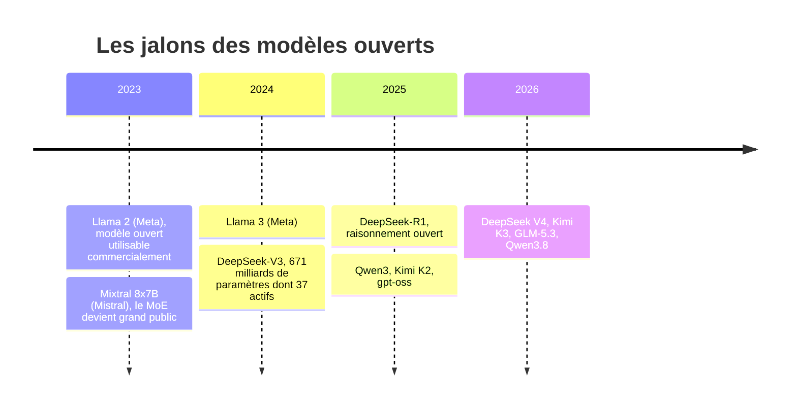
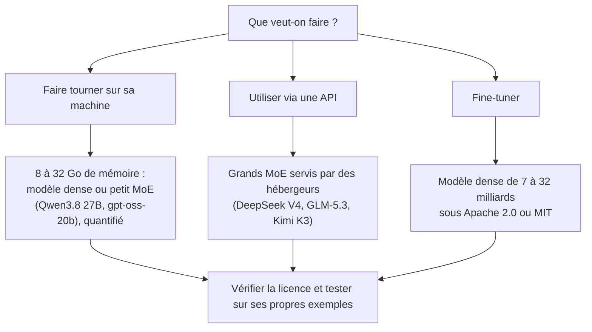

# Panorama des modèles open-weight (2026)

Fin 2022, un modèle aux poids téléchargeables avait plusieurs années de retard sur les meilleurs modèles fermés. Fin 2026, l'écart se compte en mois, et les meilleurs modèles ouverts viennent surtout de laboratoires chinois : DeepSeek, Zhipu (Z.ai), Moonshot, Alibaba. Cette note dresse l'état des lieux en novembre 2026 : ce que veut dire « ouvert », ce que les grands modèles du moment ont en commun, ce qui les distingue, et comment choisir sans se laisser abuser par les classements. Les chiffres viennent des fiches publiées par les éditeurs ; ce domaine bouge vite, et cette note sera datée dans quelques mois.

Les architectures citées ici sont expliquées dans [[Mixture of Experts]] et [[Attention moderne — KV cache, GQA, MLA]].

## Open-weight n'est pas open source

Un logiciel libre fournit son code source, ce qui permet de le reconstruire, de le comprendre et de le modifier. Pour un modèle de langage, l'équivalent du code source serait l'ensemble des données d'entraînement, le code d'entraînement et la recette complète. Presque aucun grand modèle ne les publie. Ce qui est distribué, ce sont les **poids** : les milliards de nombres du réseau entraîné. On peut les faire tourner, les étudier et les affiner, mais pas reproduire leur fabrication.

> [!abstract] Définition — Modèle open-weight
> Modèle dont les poids entraînés sont téléchargeables et utilisables localement, sous une licence qui fixe ce qu'on a le droit d'en faire. Il se distingue d'un modèle open source au sens de l'Open Source Initiative (définition de 2024), qui exige en plus le code d'entraînement et une description suffisante des données pour reconstruire le modèle.

La licence compte autant que les poids. Elle va de la plus permissive, MIT ou Apache 2.0, qui autorisent tout usage commercial, à des licences maison qui ajoutent des conditions : seuil de chiffre d'affaires, interdiction de servir le modèle à des tiers, revue de sécurité, obligation d'afficher le nom du modèle. Avant de construire un produit sur un modèle, on lit sa licence, pas son communiqué.

## Les modèles de référence, fin 2026

| Modèle (éditeur) | Sortie | Paramètres totaux / actifs | Contexte | Licence |
|---|---|---|---|---|
| DeepSeek V4-Pro (DeepSeek) | avril 2026 | 1 600 Md / 49 Md | 1 M | MIT |
| DeepSeek V4-Flash (DeepSeek) | avril 2026 | 284 Md / 13 Md | 1 M | MIT |
| Kimi K3 (Moonshot) | juillet 2026 | 2 800 Md / 104 Md | 1 M | Kimi K3 License (maison) |
| GLM-5.3 (Z.ai) | août 2026 | 753 Md / 40 Md | 1 M | Proche de MIT, avec revue de sécurité pour les très grands hébergeurs |
| Qwen3.8-Flash-Next (Alibaba) | août 2026 | 125 Md / 6 Md | 262 k natif, 1 M étendu | Qwen Community License |
| Qwen3.8 27B (Alibaba) | 2026 | 27 Md, dense | | Apache 2.0 |
| gpt-oss-120b (OpenAI) | août 2025 | 117 Md / 5,1 Md | 128 k | Apache 2.0 |

Des versions plus récentes circulent déjà (Kimi K3.1, DeepSeek V4.1-Flash) : la famille compte plus que le numéro. Quelques repères sur chacun.

**DeepSeek** est le laboratoire qui a lancé la vague : DeepSeek-V3 (décembre 2024) puis le modèle de raisonnement DeepSeek-R1 (janvier 2025) ont montré qu'un modèle ouvert pouvait rivaliser avec les meilleurs modèles fermés, pour un coût d'entraînement annoncé bien inférieur. V4 garde l'architecture d'experts de V3, ajoute une attention hybride compressée pour le million de tokens, stocke ses experts en FP4 et propose trois modes de raisonnement (sans réflexion, réflexion haute, réflexion maximale). Sa licence MIT en fait le plus libre des grands modèles.

**Kimi K3**, de Moonshot AI, est le plus gros modèle ouvert jamais publié : 2 800 milliards de paramètres, 896 experts dont 16 actifs, et une attention hybride (trois couches d'attention linéaire pour une d'attention latente). Il domine la plupart des classements de modèles ouverts de l'automne 2026, mais demande environ 1,4 To de mémoire rien que pour ses poids.

**GLM-5.3**, de Zhipu AI (devenu Z.ai), reprend le modèle de base de GLM-5.2 et doit ses progrès au post-entraînement, surtout en programmation et en usage d'outils. Son architecture est proche de celle de DeepSeek : 256 experts routés dont 8 actifs plus un partagé, attention parcimonieuse DSA, une couche de prédiction de plusieurs tokens à la fois (MTP) qui accélère la génération.

**Qwen**, d'Alibaba, est la famille la plus large : du petit modèle pour téléphone au MoE de plusieurs milliers de milliards de paramètres. Ses modèles denses de taille moyenne, sous Apache 2.0, sont les plus utilisés pour le fine-tuning (voir [[Fine-tuner un LLM open-weight]]). Qwen3.8-Flash-Next teste l'architecture annoncée pour Qwen4 : 512 experts minuscules, seulement 6 milliards de paramètres actifs, et des couches d'attention linéaire.

**gpt-oss**, publié par OpenAI en août 2025 sous Apache 2.0, n'est plus en tête mais reste une référence pratique : sa version de 20 milliards de paramètres tourne sur une carte graphique grand public, et se fine-tune en moins de 13 Go de mémoire.

## Ce que les modèles de 2026 ont en commun

Les fiches techniques de 2026 se ressemblent davantage qu'elles ne diffèrent. Presque tous les grands modèles sont des **MoE à experts fins**, avec 3 à 5 % de paramètres actifs. Presque tous visent **un million de tokens** de contexte, au moyen d'attentions parcimonieuses ou hybrides. Presque tous stockent leurs poids en **précision réduite** dès la publication (FP8, voire FP4 pour les experts), parce que l'entraînement lui-même s'y est mis. Plusieurs ont adopté l'**optimiseur Muon**, qui remplace Adam pour les matrices de poids et rend l'entraînement plus stable et plus économe. Et tous proposent des **modes de réflexion** : le même modèle répond vite, ou réfléchit longuement avant de répondre (voir [[Modèles de raisonnement et apprentissage par renforcement]]).

La différence se joue de plus en plus après le pré-entraînement : sur les données de post-entraînement, l'apprentissage par renforcement et l'aptitude à utiliser des outils, ce qu'on appelle les capacités « agentiques ».

## Lire un classement sans se faire avoir

Les annonces s'accompagnent toujours de tableaux de scores où le nouveau modèle bat tous les autres. Quelques précautions s'imposent.

Les scores publiés par les éditeurs sont **auto-déclarés**, souvent avec les réglages les plus favorables (mode de réflexion maximal, plusieurs essais). Les tests publics finissent par se retrouver dans les données d'entraînement, ce qui gonfle les scores sans améliorer le modèle : c'est la **contamination**. Un score agrégé, comme l'indice d'Artificial Analysis, mélange des compétences très différentes. Enfin, le classement change d'un mois à l'autre : à l'automne 2026, Kimi K3.1 Pro mène la plupart des indices ouverts, devant DeepSeek V4.1-Flash et GLM-5.3, mais l'ordre dépend de la tâche.

La seule mesure qui compte vraiment est celle qu'on fait soi-même, sur ses propres cas d'usage : cinquante exemples représentatifs, notés à l'aveugle, valent mieux qu'un classement.

## Choisir un modèle

Les grands MoE de 2026 sont ouverts au sens où l'on peut télécharger leurs poids, mais pas au sens où l'on peut les faire tourner chez soi : il faut plusieurs centaines de gigaoctets de mémoire GPU, donc un serveur à plusieurs cartes. Pour un usage personnel, les modèles de 8 à 32 milliards de paramètres, quantifiés en 4 bits (voir [[Quantization]]), restent le bon choix. Et pour beaucoup de tâches, une bonne recherche documentaire (voir [[RAG]]) apporte plus qu'un modèle plus gros.

## Questions de révision

> [!quiz] Qu'est-ce qui distingue un modèle open-weight d'un modèle open source au sens strict ?
> Un modèle open-weight publie ses poids, mais pas forcément ses données et son code d'entraînement ; un modèle open source au sens de l'OSI doit fournir assez d'information pour le reconstruire.

> [!quiz] Quelle licence est la plus permissive parmi celles des grands modèles de 2026 ?
> - [x] MIT, celle de DeepSeek V4.
>   Elle autorise tout usage, y compris commercial, sans condition particulière.
> - [ ] La Kimi K3 License.
>   C'est une licence maison, avec ses propres conditions.
> - [ ] La Qwen Community License.
>   Elle ajoute des conditions par rapport à Apache 2.0, que d'autres modèles Qwen utilisent.

> [!quiz] Pourquoi se méfier des scores publiés au lancement d'un modèle ?
> Ils sont auto-déclarés, souvent mesurés dans les réglages les plus favorables, et les tests publics peuvent avoir contaminé les données d'entraînement.

> [!quiz] Quelles tendances partagent presque tous les grands modèles ouverts de 2026 ?
> - [x] MoE à experts fins, contexte d'un million de tokens, poids en précision réduite, modes de réflexion.
>   Ce sont les points communs des fiches de DeepSeek V4, GLM-5.3, Kimi K3 et Qwen3.8.
> - [ ] Des modèles denses de plus en plus gros.
>   Les grands modèles sont presque tous des MoE depuis 2025.
> - [ ] La publication complète des données d'entraînement.
>   Presque aucun grand modèle ne publie ses données.
