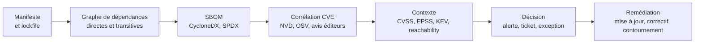
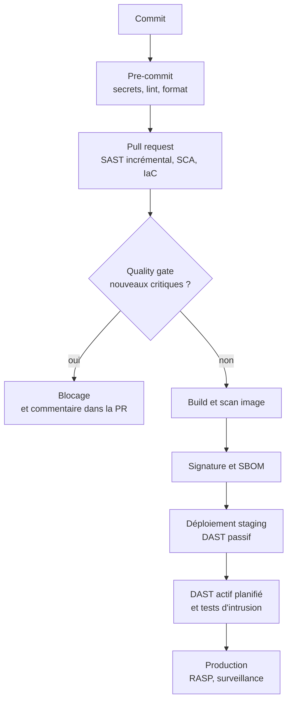

# SAST, DAST et SCA

Une application moderne contient rarement une seule catégorie de défauts : du code écrit par l'équipe, des dépendances tierces, une configuration d'infrastructure et un comportement qui n'émerge qu'à l'exécution. Ces dimensions ne se laissent pas observer par le même instrument : lire le code ne dit rien de la configuration de production, interroger l'application en marche ne dit rien de la ligne fautive, inventorier les dépendances ne dit rien de la logique métier. SAST, DAST et SCA répondent à trois questions différentes, et c'est pourquoi ils sont complémentaires plutôt que concurrents.

Cette note décrit le fonctionnement interne de chaque famille, les outils qui les incarnent, leur intégration dans un pipeline et les limites de leurs résultats. Elle s'appuie sur le cadre du [[Secure SDLC]], sur les menaces identifiées par le [[Threat Modeling]] et sur l'analyse des dépendances de [[Supply Chain Attacks]].

> [!abstract] Définition — Analyse de teinte
> L'**analyse de teinte** (*taint analysis*) suit la propagation d'une donnée non fiable depuis une **source** (requête HTTP, champ de formulaire) jusqu'à un **puits** sensible (requête SQL, appel système, rendu HTML), en vérifiant si un **assainisseur** (échappement, requête préparée, validation) intercepte le flux. Une vulnérabilité est signalée lorsqu'un chemin existe entre source et puits sans assainisseur : c'est ce qui distingue un vrai positif d'une simple occurrence de fonction dangereuse.

## Familles d'analyse et angles morts

| Famille | Ce qu'elle observe | Quand | Forces | Angles morts |
|---|---|---|---|---|
| SAST | Code source, bytecode, AST, flux de données | À chaque commit, en pré-commit | Couvre tout le code, localise la ligne, rapide sur les règles simples | Ne voit pas la configuration réelle, ni les dépendances, ni les chemins d'exécution dynamiques |
| DAST | Application en exécution, requêtes et réponses | Après déploiement en environnement de test | Voit le comportement réel, les erreurs de configuration, l'authentification | Aveugle sur le code, couverture dépendante du crawl, tests parfois destructifs |
| SCA | Graphe de dépendances, versions, SBOM | À chaque build et en continu | Détecte les CVE connues et les licences, couvre le transitif | Ignore le code maison, souffre de faux positifs de version et de reachability |
| Secrets | Dépôt, historique Git, images, fichiers | Pré-commit et CI | Bloque la fuite avant propagation | Ne détecte pas un secret déjà utilisé et révoqué |
| IaC | Manifestes Terraform, Kubernetes, CloudFormation | Avant le déploiement | Corrige la configuration avant création | Ne voit pas les dérives appliquées à la main |
| Conteneurs | Système de fichiers et paquets de l'image | Build et registre | Couvre l'OS, les bibliothèques et la base image | Ignore le code applicatif, dépend du rafraîchissement des bases |

La règle qui en découle : un pipeline mature exécute au moins un contrôle par ligne du tableau, et aucun ne doit être présenté comme couvrant le périmètre d'un autre.

## SAST — analyser sans exécuter

Un moteur SAST transforme le code en une représentation intermédiaire : arbre syntaxique abstrait, graphe de flot de contrôle, graphe d'appels, puis applique des règles syntaxiques ou sémantiques. La différence de puissance entre les deux explique l'écart de qualité entre les outils.

Une règle syntaxique repère `execute("SELECT ... " + valeur)` et produit beaucoup de bruit, car elle ignore si `valeur` vient de l'utilisateur ou d'une constante. Une analyse de flux construit le graphe définition-utilisation, propage la teinte à travers les affectations, les appels et les structures de données, puis élimine les chemins où un assainisseur intervient. C'est plus précis, plus coûteux, et limité par la capacité du moteur à modéliser les frameworks.

**Semgrep** occupe le terrain de l'analyse légère et personnalisable. Ses règles s'écrivent comme du code, avec des métavariables, et s'appliquent en quelques secondes.

```yaml
rules:
  - id: sql-injection-entree-requete
    languages: [python]
    message: "Requête SQL construite depuis une entrée de requête non validée"
    severity: ERROR
    mode: taint
    pattern-sources:
      - pattern: flask.request.args.get(...)
      - pattern: flask.request.form.get(...)
    pattern-sinks:
      - pattern: $CURSOR.execute($QUERY)
      - pattern: $CURSOR.executemany($QUERY)
    pattern-sanitizers:
      - pattern: uuid.UUID(...)
      - pattern: int(...)
```

```bash
# Exécution locale et sortie SARIF pour ingestion par le SCM
semgrep --config p/owasp-top-ten --config .semgrep/ --sarif --output semgrep.sarif .

# Ne signaler que les nouveautés d'une branche
semgrep ci --baseline-commit origin/main --config p/default
```

**CodeQL** adopte l'approche inverse : il compile le code en base de données relationnelle et interroge cette base avec le langage QL. Les requêtes sont précises, inter-procédurales, et capables de suivre la teinte à travers les bibliothèques standard modélisées.

```ql
import python
import semmle.python.dataflow.new.TaintTracking

from Call call, DataFlow::Node source, DataFlow::Node sink
where
  TaintTracking::localTaint(source, sink) and
  source.asExpr().(Attribute).getName() = "args" and
  sink = call.getArg(0) and
  call.getFunc().(Attribute).getName() = "execute"
select sink, "Entrée de requête propagée jusqu'à execute()"
```

```bash
codeql database create db --language=python --source-root .
codeql database analyze db codeql/python-queries:codeql-suites/python-security-extended.qls \
  --format=sarif-latest --output=codeql.sarif
```

**SonarQube** combine règles de qualité, détection de duplication, analyse de teinte et suivi de la dette. Sa force est organisationnelle : quality gate sur le code nouveau, historique par projet, interface lisible par les développeurs. Sa faiblesse est la tentation de traiter l'onglet « Security » comme un inventaire exhaustif. **Checkmarx** et **Fortify** ciblent les grands comptes avec des moteurs plus lourds, une couverture de frameworks étendue et des workflows de triage.

> [!warning] Piège
> Un SAST configuré pour échouer sur toute alerte critique sera désactivé par les équipes en quelques semaines : les faux positifs structurels (code généré, wrappers, validation centralisée non reconnue) finissent par saturer le pipeline. La bonne pratique est de démarrer en mode rapport, de mesurer le bruit, de désactiver les règles non pertinentes, puis d'imposer un blocage uniquement sur les nouvelles occurrences d'un jeu de règles restreint.

### Limites du SAST

Le SAST ne voit que ce qu'il peut modéliser. Les appels dynamiques, la réflexion, l'injection de dépendances, les templates interprétés et les configurations lues à l'exécution lui échappent. Le code généré produit des volumes d'alertes sans intérêt. Les faux négatifs sont fréquents sur les frameworks récents dont les modèles de flux n'existent pas encore. Enfin, un SAST ne remplace pas la revue de code : il ne juge ni l'intention, ni la logique d'autorisation, ni la pertinence d'un contrôle métier. La revue humaine reste le seul mécanisme capable d'évaluer une décision de conception.

## DAST — attaquer l'application en marche

Le DAST se place à l'extérieur : il analyse requêtes et réponses, sans accès au code. Son cycle est constant — cartographier, injecter des charges par fuzzing, comparer les réponses, confirmer.

Le **crawl** détermine tout. Une application monopage, une API sans lien hypertexte ou un parcours derrière authentification ne se découvrent pas par exploration de liens : il faut fournir une spécification OpenAPI, un fichier de parcours et des identifiants de test. Sans authentification, le scanner ne teste que la page de connexion et les ressources publiques, ce qui produit un faux sentiment de couverture.

**OWASP ZAP** propose deux modes complémentaires : le *baseline*, passif, qui se contente d'observer le trafic, et le *full scan*, actif, qui envoie des charges. Le second est à réserver à un environnement de test dont la base est restaurée après exécution.

```bash
# Scan passif : sûr, rapide, adapté à chaque pull request
docker run --rm -v "$PWD:/zap/wrk:rw" ghcr.io/zaproxy/zaproxy:stable \
  zap-baseline.py -t https://staging.exemple.com -r zap.html -J zap.json

# Scan actif avec authentification, sur un environnement dédié
docker run --rm -v "$PWD:/zap/wrk:rw" ghcr.io/zaproxy/zaproxy:stable \
  zap-full-scan.py -t https://staging.exemple.com \
  -z "-config replacer.full_list(0).enabled=true \
      -config replacer.full_list(0).matchstr=Authorization \
      -config replacer.full_list(0).replacement=Bearer\ $TOKEN"
```

**Burp Suite** reste la référence du test manuel : proxy, répéteur, intrus, extensions. En CI, son API REST dans l'édition Enterprise permet de lancer un scan et de récupérer un SARIF. **Nuclei** apporte une autre logique : des milliers de modèles YAML ciblés sur des CVE, des panneaux exposés ou des en-têtes manquants. Rapide et peu intrusif sur les modèles passifs, il reconnaît des signatures mais n'explore pas de parcours métier.

Pour les API, le DAST doit s'appuyer sur la spécification : ZAP importe OpenAPI et GraphQL, génère des requêtes à partir des schémas, puis teste les autorisations. Les failles dominantes décrites dans [[API Security]] — BOLA, BFLA, consommation non limitée — exigent des tests différentiels : deux jetons de niveaux différents, deux propriétaires de ressource, une comparaison des réponses. Un scanner générique ne voit pas qu'un utilisateur lit la commande d'un autre si rien ne le lui indique.

**IAST** instrumente l'application pendant les tests : un agent dans le runtime observe les flux réels et signale une teinte qui atteint un puits. Le taux de faux positifs chute et la localisation est précise, mais la couverture dépend des tests exécutés. **RASP** applique la même instrumentation en production, cette fois pour bloquer l'exploitation. Les deux approches sont puissantes et intrusives : elles modifient le runtime et peuvent provoquer des incidents si la politique de blocage est mal réglée.

> [!tip] Méthode
> Un DAST utile se juge à sa couverture, pas à son nombre d'alertes. Avant de régler les règles, vérifier que le scanner atteint les écrans authentifiés, qu'il connaît les identifiants de test, qu'il suit les parcours métier et qu'il dispose d'une base réinitialisée entre deux exécutions. Un scan actif sur une base partagée crée des données parasites et des effets de bord que les équipes finissent par interpréter comme des bugs applicatifs.

## SCA — la surface des dépendances

Le SCA construit le graphe des dépendances, directes et transitives, puis le confronte à des bases de vulnérabilités et de licences. Le fichier de verrouillage fait foi : `package-lock.json`, `poetry.lock`, `go.sum`, `Cargo.lock`. Analyser un `requirements.txt` non verrouillé revient à auditer des contraintes, pas des versions.



La corrélation produit souvent des centaines d'alertes. Le **CVSS** mesure la gravité théorique, l'**EPSS** la probabilité d'exploitation à trente jours, le catalogue **KEV** les vulnérabilités réellement exploitées. Une CVE critique à 0,2 % d'EPSS et absente du KEV n'a pas l'urgence d'une CVE moyenne avec un exploit public actif.

L'**analyse de reachability** ajoute une couche décisive : la fonction vulnérable est-elle réellement appelée ? Une bibliothèque de parsing XML peut contenir une XXE dans un module jamais importé. Certains outils construisent un graphe d'appels statique, d'autres observent l'exécution en test. Le résultat reste imparfait — l'appel peut être dynamique — mais réduit massivement le bruit des dépendances transitives.

| Outil | Périmètre | Particularité |
|---|---|---|
| Dependabot | Dépôts GitHub, écosystèmes majeurs | Pull requests automatiques, alertes natives, configuration simple |
| Renovate | Multi-plateformes, multi-écosystèmes | Règles de regroupement, calendrier, remplacement de registre |
| Trivy | Images, systèmes de fichiers, dépôts, IaC | Un seul binaire, sortie SARIF, mode client-serveur |
| Grype | Images et systèmes de fichiers | Couplé à Syft pour la SBOM, base de vulnérabilités téléchargeable |
| osv-scanner | Lockfiles, conteneurs, OSV | Base OSV agrégée, API de lot, intégration CI légère |
| OWASP Dependency-Check | Java, .NET, JS, Python | Base NVD locale, historique, rapports HTML |
| Snyk | Multi-écosystèmes | Reachability, correctifs proposés, tableau de bord |

```bash
# Scanner un dépôt à partir de ses lockfiles
osv-scanner scan source -r . --format sarif --output osv.sarif

# Scanner une image et ne conserver que les sévérités exploitables
trivy image --severity HIGH,CRITICAL --ignore-unfixed \
  --format sarif --output trivy.sarif registry.exemple.com/app:1.4.2

# Générer une SBOM puis l'interroger avec Grype
syft registry.exemple.com/app:1.4.2 -o cyclonedx-json > sbom.json
grype sbom:sbom.json --fail-on high
```

```yaml
version: 2
updates:
  - package-ecosystem: npm
    directory: "/"
    schedule:
      interval: weekly
    open-pull-requests-limit: 5
    groups:
      production:
        dependency-type: production
        update-types: ["minor", "patch"]
    ignore:
      - dependency-name: "*"
        update-types: ["version-update:semver-major"]
```

Deux angles morts subsistent. Le **paquet malveillant** n'a pas de CVE : il est publié sous un nom légitime et exécute du code à l'installation. Seuls la provenance, la réputation du mainteneur et le blocage des scripts d'installation le contrôlent. Le **code vendu ou copié** échappe au graphe de dépendances et ne sera jamais mis à jour par un gestionnaire de paquets.

## Secrets, IaC et conteneurs

Le **scan de secrets** doit tourner en pre-commit pour empêcher l'écriture, en CI pour rattraper les hooks contournés, et sur l'historique complet pour trouver ce qui y est déjà. `gitleaks` et `trufflehog` couvrent ces cas ; le second vérifie en outre l'activité de la clé, ce qui distingue un secret vivant d'une chaîne de test.

```bash
gitleaks detect --source . --report-format sarif --report-path gitleaks.sarif
trufflehog git file://. --only-verified --json
gitleaks protect --staged   # hook pre-commit
```

Un secret trouvé se traite comme une compromission, pas comme une alerte de qualité : rotation immédiate, révocation, recherche d'usage dans les journaux. La procédure est décrite dans [[Gestion des clés et HSM]].

Le **scan IaC** vérifie les manifestes avant que l'infrastructure n'existe. `Checkov` couvre Terraform, Kubernetes, CloudFormation, ARM et Helm, avec des centaines de règles et des politiques personnalisées. `tfsec`, désormais intégré à `Trivy`, cible Terraform avec un moteur rapide ; `KICS` privilégie la couverture multi-format, `tflint` se concentre sur la validité et les bonnes pratiques du fournisseur.

```bash
checkov -d infra --framework terraform --output sarif --output-file checkov.sarif
trivy config --severity HIGH,CRITICAL infra/
```

Le **scan de conteneurs** opère au build, pour empêcher la publication d'une image vulnérable, et en continu, car une image publiée hier devient vulnérable à la CVE de demain. Il distingue les vulnérabilités de l'image de base, des dépendances applicatives et du système. `Trivy`, `Grype`, `Clair` et `Docker Scout` couvrent ces couches avec des bases et des délais différents ; signature et attestation complètent le dispositif, car scanner une image ne dit rien de son authenticité.

## Intégration dans le pipeline

L'intégration vise un retour rapide, un blocage ciblé et une trace exploitable.



Le principe du **code nouveau** consiste à ne juger que ce que la branche ajoute. Une base existante contient des milliers d'alertes héritées, et imposer leur correction immédiate pousse à la désactivation. La comparaison avec la branche de référence bloque les régressions sans exiger une remise à niveau complète ; les outils incapables de différentiel doivent être filtrés par empreinte et par date.

```yaml
name: security
on:
  pull_request:
  push:
    branches: [main]

permissions:
  contents: read
  security-events: write

jobs:
  sast:
    runs-on: ubuntu-24.04
    steps:
      - uses: actions/checkout@11d5960a326750d5838078e36cf38b85af677262
        with:
          fetch-depth: 0
      - uses: returntocorp/semgrep-action@713efdd345f3035192eaa63f56867b88e63e4e5d
        with:
          config: p/owasp-top-ten
          generateSarif: "1"
      - uses: github/codeql-action/upload-sarif@d0bae162f31f17dd92c46ccdc4dfee5710f8dc67
        if: always()
        with:
          sarif_file: semgrep.sarif
          category: semgrep

  sca:
    runs-on: ubuntu-24.04
    steps:
      - uses: actions/checkout@11d5960a326750d5838078e36cf38b85af677262
      - name: OSV Scanner
        run: |
          curl -sSfL https://github.com/google/osv-scanner/releases/latest/download/osv-scanner_linux_amd64 \
            -o /usr/local/bin/osv-scanner
          osv-scanner scan source -r . --format sarif --output osv.sarif
      - uses: github/codeql-action/upload-sarif@d0bae162f31f17dd92c46ccdc4dfee5710f8dc67
        if: always()
        with:
          sarif_file: osv.sarif
```

La **quality gate** doit être explicite. Une politique courante bloque sur toute vulnérabilité critique nouvelle, toute vulnérabilité haute avec correctif disponible, tout secret détecté et toute erreur IaC haute. Les autres alertes créent des tickets avec un délai proportionné. Le SARIF, produit par la plupart de ces outils, sert de format pivot entre la CI et le tableau de bord. Le pipeline qui exécute ces contrôles est lui-même une cible, traitée dans [[Sécurité CI-CD et chaîne d'approvisionnement]].

Le **triage** est le coût caché. Chaque alerte doit avoir un propriétaire, une décision et une trace : vrai positif corrigé, faux positif documenté, risque accepté avec échéance. Une exception sans date devient une dette invisible ; une exception datée devient un rappel automatique.

| Métrique | Ce qu'elle mesure | Piège |
|---|---|---|
| Taux de couverture des dépôts | Proportion de dépôts avec SAST et SCA actifs | Un dépôt scanné sans triage ne vaut guère mieux que rien |
| Temps médian de correction | Délai entre détection et fermeture | Moyenne faussée par les alertes ignorées |
| Taux de faux positifs | Alertes classées non exploitables | Un taux bas peut signaler un triage laxiste |
| Taux d'évasion | Vulnérabilités trouvées en production ou en pentest | Indicateur le plus honnête de l'efficacité |
| Alertes par développeur et par semaine | Charge de triage | Au-delà d'un seuil, l'outil est contourné |

## Limites et détection

Les analyses automatiques détectent des classes de défauts, pas des intentions. Elles ne voient ni une autorisation mal placée, ni une logique métier détournée, ni une course critique. Leurs faux positifs érodent la confiance, leurs faux négatifs donnent une fausse assurance. Leur valeur dépend donc moins du moteur que du processus : propriété des alertes, délais, exceptions datées, revue humaine des cas ambigus.

La **détection de l'efficacité** se fait par des indicateurs et par des tests contradictoires. Injecter une vulnérabilité connue dans une branche et vérifier qu'elle est bloquée au bon stade mesure la couverture réelle ; comparer le SAST à un pentest sur le même périmètre mesure l'écart entre couverture déclarée et couverture effective. Les tableaux de bord doivent exposer la couverture, l'âge des alertes et le taux d'évasion, non le nombre de scans exécutés.

> [!quiz] Pourquoi un SAST parfaitement configuré ne dispense-t-il pas d'un DAST ?
> Parce que le SAST raisonne sur le code et sur des modèles de frameworks, pas sur le système déployé. Il ne voit ni la configuration réelle du serveur, ni les en-têtes de sécurité, ni les chemins d'authentification effectifs, ni les interactions entre composants. Le DAST observe le comportement en exécution, y compris les défauts introduits par le déploiement. Les deux peuvent manquer une faille de logique métier, que seul un test manuel guidé par le modèle de menace révèle.

> [!quiz] Pourquoi le CVSS seul est-il un mauvais critère de priorisation pour le SCA ?
> Parce qu'il mesure la gravité théorique d'une vulnérabilité, pas la probabilité qu'elle soit exploitée ni la possibilité que le code vulnérable soit atteint. EPSS apporte la probabilité d'exploitation à trente jours, le KEV l'exploitation observée, et l'analyse de reachability l'accessibilité réelle dans l'application. Une CVE critique non atteignable peut attendre ; une CVE moyenne atteignable et exploitée ne le peut pas.

> [!quiz] Un paquet malveillant publié sur un registre public sera-t-il détecté par le SCA ?
> Non, tant qu'aucune CVE ne lui est attribuée : le SCA compare des versions à des bases de vulnérabilités connues, il ne juge pas le comportement du code. La détection repose sur d'autres signaux — publication récente, mainteneur inconnu, script d'installation, écart entre le dépôt et le paquet publié, provenance. C'est pourquoi le SCA doit être complété par le contrôle des sources et l'épinglage par condensat.
