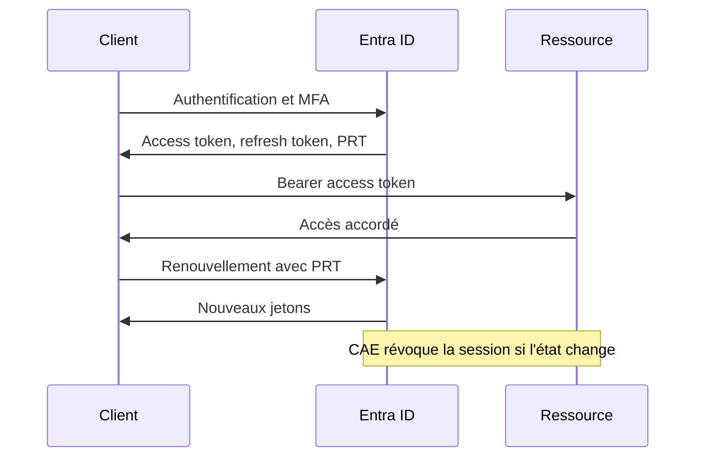

# Entra ID et Microsoft 365 Security

Entra ID, ex-Azure Active Directory, est le plan de contrôle d'identité de Microsoft 365, d'Azure et des SaaS fédérés. Le périmètre de sécurité n'y est plus le réseau mais le jeton : un access token, un refresh token ou un Primary Refresh Token (PRT) valide suffit à atteindre Exchange, SharePoint, Teams, Microsoft Graph et les abonnements Azure, où que soit le client. Une compromission d'identité cloud est souvent silencieuse, sans malware, et se lit d'abord dans les journaux d'authentification.

Cette note couvre les objets Entra, les rôles, l'authentification, les jetons, l'identité hybride, les attaques, Microsoft 365, la détection et le durcissement, en s'appuyant sur [[Azure Security]], [[Active Directory Security]] et [[OAuth et OIDC]].

> [!abstract] Définition — Plan de contrôle d'identité
> Couche qui décide qui obtient un jeton, pour quelle ressource et sous quelles conditions. Entra ID émet les jetons ; Exchange, SharePoint, Graph et Azure Resource Manager ne font que les valider et appliquer leurs autorisations. Compromettre ce plan revient à contourner les contrôles de la couche de données.

## Objets, tenant et Graphe

Un tenant est une instance isolée, identifiée par un GUID et associée à des domaines vérifiés. Il contient les utilisateurs, groupes, appareils, applications, principaux de service, identités managées et unités administratives.

| Objet | Fonction | Intérêt offensif |
|---|---|---|
| Utilisateur | Identité humaine ou compte cloud | Password spray, phishing, réinitialisation |
| Groupe | Regroupement statique, dynamique ou M365 | Ajout de membre pour élever les droits |
| Appareil | Enregistré, joint Entra ou joint hybride | Porteur du PRT et des certificats |
| Application | Objet global de l'enregistrement | Permissions déléguées et applicatives |
| Principal de service | Instance locale d'une application | Credentials, rôles, consentements |
| Identité managée | Identité sans secret d'une ressource Azure | Pivot latéral dans Azure |
| Unité administrative | Sous-périmètre d'administration | Angle mort si mal auditée |

L'objet application décrit le modèle, les URI de redirection, les permissions et les secrets ; le principal de service est l'instance locale qui reçoit les consentements, les rôles et les jetons. Une application multi-tenant possède un objet global et un principal par tenant. Toute la gestion passe par Microsoft Graph.

```bash
curl -H "Authorization: Bearer $TOKEN" https://graph.microsoft.com/v1.0/me
curl -H "Authorization: Bearer $TOKEN" \
  "https://graph.microsoft.com/v1.0/servicePrincipals?\$select=appId,displayName"
curl -H "Authorization: Bearer $TOKEN" \
  "https://graph.microsoft.com/v1.0/directoryRoles?\$expand=members"
```

## Rôles, PIM et gouvernance

Entra applique un RBAC d'annuaire ; Azure applique un RBAC d'abonnement. Les rôles les plus dangereux ne sont pas seulement les rôles globaux : tout rôle capable de modifier un objet privilégié hérite des privilèges de cet objet.

| Rôle | Pouvoir réel | Escalade typique |
|---|---|---|
| Administrateur général | Tout l'annuaire | Ajout de credentials, création d'applications |
| Administrateur de rôles privilégiés | Gère les affectations | S'octroie Administrateur général |
| Administrateur d'applications | Gère secrets et applications | Secret ajouté à une app privilégiée |
| Administrateur d'authentification | Gère les méthodes MFA | Réenregistre le MFA d'un admin |
| Administrateur d'utilisateurs | Gère les comptes | Réinitialise un mot de passe admin |
| Administrateur d'identité hybride | Gère Entra Connect | Modifie la synchronisation |
| Administrateur Exchange | Gère Exchange Online | Règles de transfert, accès aux boîtes |

PIM transforme une affectation permanente en affectation éligible, activée pour une durée limitée avec justification, MFA, approbation éventuelle et notification. Les revues d'accès vérifient la justification ; Entitlement Management automatise l'attribution et l'expiration des accès externes. Les comptes break-glass, hors politiques, doivent être surveillés et testés.

```powershell
Connect-MgGraph -Scopes "RoleManagement.Read.Directory"
Get-MgRoleManagementDirectoryRoleAssignmentScheduleInstance -All |
  Select-Object PrincipalId, RoleDefinitionId, AssignmentType, EndDateTime
```

Un rôle lecteur n'est pas anodin : Global Reader, Security Reader ou Reports Reader donnent la configuration, les journaux et les données de sécurité, assez pour cartographier les chemins d'attaque. La sensibilité d'un rôle se mesure à ce qu'il permet de lire autant qu'à ce qu'il permet de modifier.

## Authentification, passwordless et Conditional Access

La stratégie cible est le passwordless et le MFA résistant au phishing : clé FIDO2, Windows Hello for Business, certificat ou passkey Authenticator. Le push reste vulnérable au push bombing ; TOTP est phishable ; SMS et vocal sont faibles.

| Méthode | Résistance au phishing | Remarque |
|---|---|---|
| FIDO2 | Élevée | Liaison cryptographique au domaine |
| Windows Hello for Business | Élevée | Clé liée au TPM de l'appareil |
| Certificat | Élevée | Dépend de la protection de la clé privée |
| Push + number matching | Moyenne | Vulnérable à la tromperie utilisateur |

Conditional Access combine des signaux et des contrôles. Les affectations visent utilisateurs, groupes, rôles, invités et identités de charge de travail ; les conditions couvrent les risques utilisateur et de connexion d'Identity Protection, la plateforme, la localisation, l'application cliente, le flux d'authentification et l'état de l'appareil. Les contrôles bloquent, exigent MFA ou une force d'authentification, un appareil conforme ou joint hybride, une application approuvée, ou limitent la session.

Cinq axes suffisent : blocage de l'authentification héritée, MFA résistant au phishing pour les rôles privilégiés, appareil conforme pour Microsoft 365, défi renforcé sur les risques élevés, restrictions de session pour les applications sensibles. Chaque politique se déploie en report-only, s'analyse et s'active avec des exclusions documentées et revues comme des privilèges.

## Jetons, PRT et protection de session

| Jeton | Durée | Usage | Vol |
|---|---|---|---|
| Access token | 1 heure | Appel d'une ressource | Rejouable jusqu'à expiration |
| Refresh token | 90 jours glissants | Renouvellement | Persistance longue |
| ID token | 1 heure | Preuve d'identité | Ne doit pas autoriser une API |
| PRT | Environ 90 jours | SSO de l'appareil | Jetons pour toutes les applications |

Le PRT est à Entra ce que le TGT est à Kerberos : un artefact de confiance longue durée, lié à l'appareil et enrichi des revendications MFA. Son vol, via `sekurlsa::cloudap` ou le cache, permet de rejouer l'identité sans mot de passe ni nouvelle validation.



Continuous Access Evaluation réduit la fenêtre d'exploitation : la ressource interroge Entra sur les événements critiques (mot de passe changé, compte désactivé, session révoquée, localisation inhabituelle). `Revoke-MgUserSignInSession` invalide les refresh tokens et les sessions, mais les access tokens déjà émis vivent jusqu'à expiration sauf application de CAE. Token Protection lie le jeton à l'appareil et à sa clé TPM pour les clients de bureau compatibles ; elle ne protège ni les navigateurs ni les proxys d'attaque.

## Identité hybride et Golden SAML

| Modèle | Principe | Risque |
|---|---|---|
| PHS | Hash des hashes synchronisé | Le hash synchronisé devient une cible |
| PTA | Agent sortant valide auprès d'AD | Dépendance à la disponibilité de l'agent |
| Fédération ADFS | Entra fait confiance au STS | Compromission du STS = cloud compromis |
| Seamless SSO | Kerberos et compte machine | Poste joint au domaine requis |

Entra Connect utilise un compte de connecteur `MSOL_*` doté de droits de réplication (DCSync). Un attaquant qui contrôle le serveur de synchronisation peut extraire ses credentials, modifier les règles, changer le `sourceAnchor` ou synchroniser un compte contrôlé vers un objet cloud privilégié. Cette zone d'ambiguïté où la même identité possède deux représentations, avec des contrôles différents, est l'« identité brumeuse » (foggy identity) : chaque couche croit que l'autre est autoritaire et les journaux ne se recouvrent pas.

Golden SAML est l'équivalent SAML du Golden Ticket. L'attaquant obtient le certificat de signature de l'IdP et sa clé privée, puis forge une assertion pour n'importe quel utilisateur. L'assertion est correctement signée : le fournisseur de service ne peut pas la distinguer d'une assertion légitime.

1. Compromission du serveur ADFS ou extraction de la clé maîtresse DKM.
2. Export du certificat de signature et de la clé privée.
3. Forge d'une assertion avec un NomID administrateur et des groupes.
4. Accès à toutes les applications fédérées, sans mot de passe ni MFA.
5. Persistance jusqu'à la rotation du certificat.

La détection corrèle journaux ADFS et Entra : connexion réussie sans événement ADFS correspondant, attributs incohérents, durée de vie anormale, IP inhabituelle. La réponse exige rotation du certificat de signature, révocation des refresh tokens, audit du serveur et, si AD est compromis, réinitialisation de `krbtgt` comme décrit dans [[Kerberos Attacks]]. Un passage temporaire à PHS ou PTA isole le cloud de la fédération compromise.

> [!abstract] Définition — Golden SAML
> Forge d'assertions SAML rendue possible par le vol du certificat de signature de l'IdP. Elle ne casse pas SAML : elle produit des assertions valides aux yeux du fournisseur de service. La détection ne peut donc pas reposer sur la signature, mais sur la cohérence entre assertion, journaux de l'IdP et comportement.

## Attaques contre les identités cloud

| Attaque | Signature | Contre-mesure |
|---|---|---|
| Password spray | Échecs sur de nombreux comptes, peu d'IP | Smart lockout, MFA |
| MFA fatigue | Rafale de push après un mot de passe correct | Number matching, FIDO2 |
| Device code phishing | Connexion sur `microsoft.com/devicelogin` | Bloquer le flux si inutile |
| Consentement OAuth illicite | App inconnue, scopes larges | Restreindre le consentement |
| Abus de permissions applicatives | Secret ou rôle ajouté à un principal | Gouvernance des applications |
| Vol de jeton | Cookie ou refresh token rejoué | CAE, Token Protection |
| Abus de PRT | Extraction puis génération de jetons | Protection de l'appareil, EDR |
| Golden SAML | Assertion valide sans trace ADFS | Rotation des certificats |

Le device code flow contourne les défenses centrées sur l'URL : la victime s'authentifie sur le domaine légitime de Microsoft avec un code fourni par l'attaquant.

```bash
curl -X POST "https://login.microsoftonline.com/organizations/oauth2/v2.0/devicecode" \
  -d "client_id=d3590ed6-52b3-4102-aeff-aad2292ab01c" \
  -d "scope=https://graph.microsoft.com/.default offline_access"

curl -X POST "https://login.microsoftonline.com/organizations/oauth2/v2.0/token" \
  -d "grant_type=urn:ietf:params:oauth:grant-type:device_code" \
  -d "client_id=d3590ed6-52b3-4102-aeff-aad2292ab01c" \
  -d "device_code=<device_code>"
```

Le consentement OAuth illicite exploite la confiance dans le domaine Microsoft. L'attaquant enregistre une application multi-tenant, demande `offline_access`, `Mail.Read`, `Files.Read.All` ou `Contacts.Read`, puis envoie un lien de consentement. Le refresh token obtenu survit au changement de mot de passe. L'abus de principal de service est la face machine du même problème : avec `Application.ReadWrite.All`, l'attaquant ajoute un secret à une application existante et s'authentifie en son nom.

```powershell
Connect-MgGraph -Scopes "Application.ReadWrite.All"
$sp = Get-MgServicePrincipal -Filter "displayName eq 'Payroll Sync'"
(Add-MgServicePrincipalPassword -ServicePrincipalId $sp.Id).SecretText
```

La réinitialisation de mot de passe est une attaque d'ingénierie sociale : l'attaquant se fait passer pour un utilisateur auprès du support, fait changer sa méthode MFA puis déclenche un reset. La contre-mesure est procédurale autant que technique : vérification d'identité, Temporary Access Pass pour les admins, MFA pour SSPR et revue des méthodes.

## Microsoft 365 : la surface de données

| Charge de travail | Contrôles clés | Risque principal |
|---|---|---|
| Exchange Online | Auth moderne, transport, forwarding, permissions | Règle de transfert, délégation |
| SharePoint et OneDrive | Partages, liens, sensibilité, rétention | Lien anonyme, partage excessif |
| Teams | Fédération, invités, politiques d'apps | Exfiltration par chat ou app tierce |
| Power Platform | DLP, connecteurs, environnements | Flux Power Automate exfiltrant |
| Defender for Office 365 | Safe Links, Safe Attachments, anti-phishing | Contournement par domaine neuf |
| Defender for Cloud Apps | Découverte, gouvernance OAuth, session | Applications non sanctionnées |
| Purview | Audit, rétention, eDiscovery, DLP | Preuves incomplètes |

Exchange reste la cible du business email compromise : règle de boîte masquée, adresse de transfert, permission `FullAccess` sur la boîte d'un dirigeant.

```powershell
Get-Mailbox -ResultSize Unlimited |
  Select-Object UserPrincipalName, ForwardingSmtpAddress, DeliverToMailboxAndForward
Get-InboxRule -Mailbox "direction@contoso.com" |
  Where-Object { $_.ForwardTo -or $_.RedirectTo }
```

SharePoint et OneDrive exposent les données par les liens de partage. Un lien « Anyone » ne demande aucune authentification et peut fuiter par courriel. Les paramètres de tenant doivent limiter le partage externe, expirer les liens et aligner la sensibilité des sites sur leur contenu. Teams ajoute la fédération, les invités et les applications tierces qui peuvent lire les messages. Power Platform est souvent oublié : un flux Power Automate peut lire SharePoint, interroger Exchange et envoyer le résultat vers un connecteur HTTP externe sans passer par un poste. Les politiques DLP Power Platform doivent bloquer les connecteurs HTTP personnalisés en production.

## Détection : journaux, KQL et chemins d'attaque

| Source | Contenu | Table |
|---|---|---|
| Connexions interactives | Utilisateur, app, IP, risque, MFA | `SigninLogs` |
| Connexions non interactives | Refresh tokens, flux silencieux | `AADNonInteractiveUserSignInLogs` |
| Principaux de service | Identités applicatives | `AADServicePrincipalSignInLogs` |
| Audit d'annuaire | Rôles, apps, consentements | `AuditLogs` |
| Activité Graph | Requêtes API, agents, volumes | `MicrosoftGraphActivityLogs` |
| Microsoft 365 | Exchange, SharePoint, Teams | `OfficeActivity` |

```kusto
// Device code flow
AADSignInEventsBeta
| where Timestamp > ago(7d)
| where AuthenticationProtocol =~ "deviceCode"
| project Timestamp, AccountUpn, Application, IPAddress, Country, UserAgent
```

```kusto
// Consentements et ajout de credentials
AuditLogs
| where OperationName has_any ("Consent to application", "Add OAuth2PermissionGrant",
    "Add service principal credentials", "Certificates and secrets management")
| extend Acteur = tostring(InitiatedBy.user.userPrincipalName)
| extend Cible = tostring(TargetResources[0].displayName)
| project TimeGenerated, OperationName, Acteur, Cible, Result
```

```kusto
// Règles de boîte suspectes
OfficeActivity
| where Operation in ("New-InboxRule", "Set-InboxRule", "UpdateInboxRules")
| where Parameters has_any ("ForwardTo", "RedirectTo", "ForwardAsAttachmentTo")
| project TimeGenerated, UserId, Operation, ClientIP, Parameters
```

Les outils offensifs laissent des signatures : AzureHound (BloodHound) collecte via Graph et Azure Resource Manager, ROADTools énumère l'annuaire, AADInternals combine reconnaissance, extraction de PRT et création de jetons. La détection repose sur l'agent utilisateur, le volume et la diversité des endpoints Graph, l'identifiant d'application et la corrélation avec une connexion inhabituelle. Une collecte lente reste difficile à distinguer d'une administration légitime : le comportement de l'acteur compte plus que l'outil.

| Technique | ATT&CK | Télémétrie |
|---|---|---|
| Compte cloud valide | T1078.004 | Connexion réussie, changement d'IP |
| Password spraying | T1110.003 | Échecs répartis sur de nombreux comptes |
| Vol de jeton applicatif | T1528 | Requêtes Graph hors contexte |
| Utilisation de jeton d'accès | T1550.001 | Cookie ou bearer rejoué |
| Modification de l'authentification | T1556 | Méthode MFA ou fédération modifiée |
| Génération de requêtes MFA | T1621 | Rafale de push |

## Durcissement

| Priorité | Mesure | Effet |
|---|---|---|
| 1 | MFA résistant au phishing pour les admins | Bloque phishing et push bombing |
| 2 | Blocage de l'authentification héritée | Ferme les protocoles sans MFA |
| 3 | PIM court avec approbation | Réduit l'exposition des admins |
| 4 | Restriction du consentement utilisateur | Empêche le consentement illicite |
| 5 | Appareil conforme pour Microsoft 365 | Limite le vol de jeton |
| 6 | Token Protection et CAE | Réduit la vie d'un jeton volé |
| 7 | Gouvernance des principaux de service | Empêche la persistance applicative |
| 8 | Restrictions de tenant et revue des invités | Réduit l'exfiltration |

Le Secure Score est un indicateur de départ, pas un objectif : il ne mesure ni la qualité des exclusions CA, ni la pertinence des consentements, ni la couverture des journaux. Chaque principal de service doit avoir un propriétaire, des credentials à durée limitée, des permissions minimales et une justification. Les permissions applicatives se revoient comme des comptes à privilèges.

## Limites et angles morts

- Les flux non interactifs et les connexions de principaux de service sont souvent exclus des règles.
- Les politiques CA en report-only ou avec exclusions permanentes donnent une fausse couverture.
- Le vol de jeton post-MFA ne produit aucun échec : seule la cohérence appareil ou localisation alerte.
- Les journaux ADFS et Entra ne partagent pas toujours le même identifiant de corrélation, ce qui gêne la détection de Golden SAML.
- Les applications consenties avant la gouvernance et les activités d'administration légitimes restent difficiles à distinguer des énumérations d'AzureHound ou de ROADTools.

La rétention par défaut des journaux Entra est courte ; l'export vers un [[SIEM (Security Information and event Management)]] ou Sentinel est indispensable. Les journaux Microsoft 365 sont conservés 180 jours, plus avec Purview Audit Premium.

> [!quiz] Pourquoi le device code flow est-il difficile à bloquer par une passerelle de messagerie ?
> Parce que la victime s'authentifie sur le domaine légitime `microsoft.com`, avec le certificat valide de Microsoft. Le lien ne contient aucune URL imitée : seule l'intention de l'utilisateur, invitée à saisir un code reçu par courriel, peut être suspecte. La contre-mesure est de bloquer le flux d'authentification device code dans Conditional Access lorsqu'il n'est pas nécessaire.

> [!quiz] Un attaquant ajoute un secret à un principal de service disposant de `Mail.Read`. Changer le mot de passe de l'administrateur suffit-il ?
> Non. Le secret appartient au principal de service et reste valide jusqu'à expiration ou suppression. Il faut supprimer le credential, révoquer les consentements et les sessions de l'application, puis auditer les autres principaux et affectations de rôles.

> [!quiz] Pourquoi faire tourner le certificat ADFS après un Golden SAML, malgré la reconstruction du serveur ?
> Parce que l'attaquant peut conserver la clé privée exfiltrée et continuer à forger des assertions valides. La reconstruction ne change pas la clé de confiance. Il faut générer un nouveau certificat, publier les métadonnées et invalider les jetons et sessions émis.
