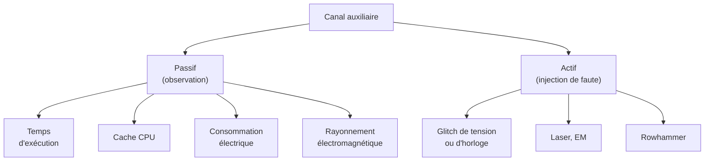
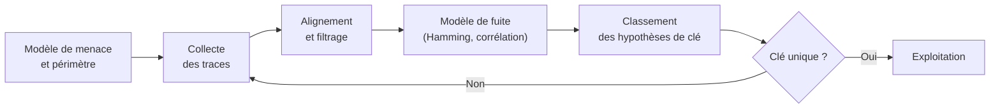

# Attaques par canal auxiliaire

Un algorithme cryptographique peut être mathématiquement irréprochable et néanmoins trahir sa clé par la façon dont il s'exécute. Une comparaison qui s'arrête au premier octet différent, une table de substitution indexée par un octet secret, un multiplicateur qui consomme plus d'énergie lorsqu'il traite un bit à 1 : autant de fuites physiques qui ne dépendent ni de la taille de clé ni de la solidité de la primitive. Les attaques par canal auxiliaire exploitent le décalage entre le modèle abstrait de la cryptographie et son implémentation réelle sur un processeur, une carte à puce ou un serveur mutualisé.

Cette note couvre les canaux classiques (temps, cache, consommation, rayonnement électromagnétique, injection de fautes), les attaques microarchitecturales contemporaines comme Spectre et Meltdown, les contre-mesures de code constant-time et de masquage, ainsi que les méthodes de détection statistique. Les fondements mathématiques sont dans [[Cryptographie]] ; l'exploitation bas niveau dans [[Binary Exploitation]].

> [!abstract] Définition — Canal auxiliaire
> Un canal auxiliaire est une source d'information non fonctionnelle émise par un système lors de son exécution : durée, consommation, rayonnement, comportement du cache, réponse à une perturbation. Une attaque par canal auxiliaire corrèle ces grandeurs observables avec des données secrètes pour reconstruire une clé ou un message, sans casser la primitive mathématique elle-même.

## Taxonomie et modèle de menace

Les canaux auxiliaires se classent selon deux axes. Le premier distingue les canaux passifs, où l'attaquant observe sans intervenir, des canaux actifs, où il perturbe le système pour provoquer un comportement anormal révélateur. Le second distingue les attaques locales, qui supposent un accès au même hôte ou au même matériel, des attaques distantes, menées à travers le réseau.



Le modèle de menace conditionne tout : une clé de signature sur carte à puce n'affronte pas les mêmes adversaires qu'un secret dans un conteneur cloud partagé. Un attaquant local avec un oscilloscope mesure directement la consommation ; un attaquant distant n'obtient un signal qu'au prix de millions de mesures bruitées et d'un traitement statistique lourd.

| Canal | Accès requis | Bande passante | Exemple |
|---|---|---|---|
| Temps | Local ou distant | Faible à moyenne | Comparaison non constante |
| Cache | Local, co-résident | Élevée | AES à tables T |
| Consommation | Local, contact | Élevée | RSA sans blinding |
| EM | Local, sans contact | Élevée | Sonde de champ proche |
| Faute | Local, physique | Élevée | Glitch sur RSA-CRT |
| Microarchitectural | Local, sans privilège | Élevée | Spectre, Meltdown |

## Attaques temporelles

Une attaque temporelle mesure le temps d'exécution d'une opération et en déduit des bits du secret. Le cas d'école est la comparaison de chaînes : si le code sort dès le premier octet différent, le temps révèle la longueur du préfixe correct, ce qui permet de reconstruire une valeur octet par octet. Le même principe s'applique à une exponentiation modulaire dont le temps dépend des bits de l'exposant, à une réduction modulaire dont la durée varie selon la valeur, ou à une décompression dont la longueur de sortie révèle un contenu.

Kocher a formalisé ces attaques en 1996 sur Diffie-Hellman, RSA, DSS et d'autres systèmes. Sur les implémentations modernes, les fuites les plus fréquentes ne sont pas dans les primitives mais dans le code d'assemblage : la fonction d'avertissement `memcmp`, la vérification d'un MAC, le rejet d'un padding, ou une opération de décalage dont la durée dépend d'une entrée secrète. Les attaques distantes exigent un traitement statistique soigneux : synchronisation, filtrage du bruit réseau, répétition, puis test d'hypothèse sur les bits candidats.

La contre-mesure est la comparaison à temps constant, qui parcourt toujours toute la longueur et n'utilise aucune sortie anticipée. Elle est intégrée aux bibliothèques modernes sous des noms comme `hmac.compare_digest`, `secrets.compare_digest` ou `cryptography.hazmat.primitives.constant_time.bytes_eq`.

```python
import hmac

a = b"jeton recu"
b = b"jeton attendu"

if hmac.compare_digest(a, b):
    ...
```

## Attaques par cache

Le cache est un canal très riche, car son état dépend des adresses mémoire accédées, elles-mêmes souvent dérivées de données secrètes. Trois techniques dominent.

Flush+Reload exploite une ligne de cache partagée entre deux processus, typiquement via la déduplication mémoire ou les pages partagées. L'attaquant vide une ligne, laisse la victime s'exécuter, puis mesure le temps de rechargement : une ligne rechargée rapidement a été touchée par la victime. Prime+Probe ne nécessite pas de partage de mémoire : l'attaquant remplit des ensembles du cache, laisse la victime accéder à des adresses qui les évincents, puis mesure quels ensembles ont été perturbés. Evict+Time observe le temps d'une opération dépendant des lignes évincées.

L'exemple historique est AES avec des tables T indexées par des octets de la clé : chaque accès révèle la ligne de cache touchée, soit environ 6 bits de l'index sur une ligne de 64 octets. Bernstein a montré en 2005 que ces fuites suffisent à reconstruire une clé. Les contre-mesures sont AES-NI, l'implémentation bitsliced, ou l'absence d'accès mémoire dépendant du secret. Toute table indexée par un secret est concernée, dans RSA, ECC ou une S-box. Les attaques cross-VM exploitent la co-résidence de machines virtuelles partageant le dernier niveau de cache.

## Consommation et rayonnement

Un circuit CMOS consomme selon les valeurs manipulées. Une analyse simple (SPA) interprète une trace unique : distinguer un carré d'une multiplication révèle la séquence d'opérations. Une analyse différentielle (DPA) ou par corrélation (CPA) accumule de nombreuses traces et corrèle chaque échantillon temporel avec un modèle de fuite, souvent le poids de Hamming des bits manipulés, pour chaque hypothèse de sous-clé. La sous-clé qui maximise la corrélation est retenue.

Le rayonnement électromagnétique est un canal équivalent, mesurable sans contact avec une sonde de champ proche, parfois à distance pour certaines fréquences. Il est plus difficile à protéger physiquement qu'une voie électrique, car un blindage parfait est illusoire. L'alignement des traces est l'étape critique : la gigue d'horloge et les variations d'exécution étalent les traces, et il faut les recaler par corrélation croisée ou par détection des pics d'activité avant de corréler.

Les contre-mesures se répartissent en masquage, qui randomise la représentation des valeurs intermédiaires, et en dissimulation, qui randomise le temps ou l'amplitude des opérations.

## Injection de fautes

Une attaque active provoque une erreur pendant un calcul sensible et exploite le résultat erroné. Le cas fondateur est l'attaque de Bellcore : une seule signature RSA-CRT fautive permet de retrouver la factorisation du module par un simple PGCD entre la signature erronée et la bonne. Les attaques par analyse de fautes différentielles (DFA) sur AES déduisent la dernière sous-clé à partir de quelques chiffrements fautifs.

Les moyens sont variés : glitch de tension ou d'horloge, impulsion laser localisée, injection électromagnétique, ou perturbation mémoire. Certaines fautes n'exigent aucun matériel : Plundervolt manipule la tension via l'interface de gestion des fréquences, et Rowhammer bascule des bits par accès mémoire répétés.

Les contre-mesures classiques sont la redondance : recalculer une opération critique et comparer, ou vérifier un invariant avant de différer le résultat. Elles se heurtent à la faisabilité d'une double exécution constante. Des capteurs de tension, de fréquence, de lumière et de température, ainsi que des détecteurs spécialisés, complètent le dispositif dans les cartes à puce certifiées.

## Attaques microarchitecturales

Spectre et Meltdown, révélés en 2018, ont changé d'échelle en montrant que des optimisations internes des processeurs fuient des données à travers des canaux cachés, sans faille d'implémentation cryptographique. Le fondement est l'exécution spéculative : le processeur exécute des instructions en avance sur le chemin de contrôle, puis annule le résultat si la prédiction était fausse. L'annulation rétablit l'état architectural mais pas les effets sur le cache.

Meltdown exploite une violation de privilège temporaire : une lecture de mémoire noyau échoue après avoir chargé la donnée dans le pipeline, et une seconde opération spéculaire transmet la valeur via le cache, reconstruite par Flush+Reload. La contre-mesure principale est la séparation des tables de pages (KPTI), qui retire la mémoire noyau de l'espace d'adressage utilisateur.

Spectre est plus large : la variante 1 détourne l'exécution conditionnelle en manipulant le prédicteur de branchement, la variante 2 empoisonne le tampon de cibles de branchement, la variante 4 (Speculative Store Bypass) court-circuite la désambiguïsation mémoire. Des dérivés comme L1TF, MDS, Retbleed et Inception ont suivi. Les mitigations combinées incluent l'instruction de sérialisation `lfence`, le masquage d'index, les microcodes de contrôle des prédicteurs, les vérifications de cibles de retour et, dans les cas extrêmes, la désactivation de l'hyperthreading.

Ce canal est dangereux en cloud mutualisé : deux machines virtuelles co-résidentes suffisent, sans privilège. Il déplace la frontière du modèle de menace : du JavaScript dans un navigateur peut, en théorie, lire la mémoire d'autres processus si les mitigations sont absentes.

## Attaques sur implémentations

De nombreuses failles crypto célèbres sont des canaux auxiliaires applicatifs déguisés. Le padding oracle exploite la différence de comportement entre un déchiffrement dont le padding est valide et un padding invalide, pour déchiffrer CBC sans clé. Bleichenbacher a appliqué ce principe à RSA PKCS#1 v1.5 en 1998, et l'attaque ROBOT en a montré la persistance vingt ans plus tard. Lucky13 exploite un MAC CBC dont le temps de vérification dépend du contenu. Toutes ces failles disparaissent avec un AEAD et une gestion d'erreur uniforme.

D'autres fuites viennent de la génération aléatoire : Debian OpenSSL en 2008 réduisait l'entropie des clés à quelques milliers de valeurs à cause d'une ligne désactivée, et ROCA a touché un générateur RSA d'Infineon présent dans des millions de cartes. Un canal auxiliaire peut donc être une simple prédictibilité accidentelle.

Enfin, l'ECDSA est vulnérable au moindre biais sur le nonce `k`. Réutiliser `k` pour deux signatures révèle immédiatement la clé privée, ce qui a compromis la PlayStation 3. Un biais partiel, même de quelques bits, suffit à une attaque par réseaux de réseaux euclidiens. La norme RFC 6979 recommande un nonce déterministe dérivé du message et de la clé, éliminant la dépendance à un générateur aléatoire.

## Contre-mesures : constant-time, blinding, masquage

Le code constant-time impose trois règles : aucun branchement, aucun accès mémoire à adresse et aucune instruction à durée dépendant d'un secret (division, décalage variable). La comparaison à temps constant en est le cas minimal.

```c
#include <stdint.h>
#include <stddef.h>

/* Retourne 0 si a == b, non nul sinon. Parcourt toujours n octets. */
uint8_t ct_diff(const uint8_t *a, const uint8_t *b, size_t n) {
    uint8_t diff = 0;
    for (size_t i = 0; i < n; i++) {
        diff |= (uint8_t)(a[i] ^ b[i]);
    }
    return diff;
}

/* Sélection sans branchement : r = cond ? x : y */
static inline uint32_t ct_select(uint32_t cond, uint32_t x, uint32_t y) {
    uint32_t masque = (uint32_t)0 - (cond & 1u);
    return (x & masque) | (y & ~masque);
}
```

Le piège est le compilateur : il peut réintroduire un branchement, une vectorisation ou une transformation qui casse la propriété. La vérification passe par la lecture de l'assemblage généré, des outils comme ctgrind sous Valgrind, qui marque les secrets comme non initialisés et signale toute dérivation de flux ou d'adresse, ou des tests statistiques.

```python
from cryptography.hazmat.primitives.constant_time import bytes_eq

if bytes_eq(signature_calculee, signature_recue):
    ...
```

Le blinding randomise les valeurs intermédiaires pour casser la corrélation entre trace et secret. Pour RSA, on choisit un `r` aléatoire inversible, on calcule la signature de `c · r^e mod n` puis on multiplie par `r^-1` : la trace observée correspond à une valeur aléatoire, et une faute éventuelle ne permet plus de factoriser. Pour l'ECC, le scalar blinding remplace `k` par `k + u · ordre` avec `u` aléatoire, et le point blinding randomise les coordonnées de la base.

Le masquage découpe une valeur secrète en plusieurs parts, typiquement par XOR, et n'utilise jamais la valeur en clair dans une seule opération. Il est facile sur les opérations linéaires, mais les S-box non linéaires exigent un rafraîchissement et des schémas dédiés comme ISW ou les threshold implementations. Un masquage au premier ordre est défaits par une analyse au second ordre, qui combine deux échantillons ; la résistance croît avec l'ordre, mais le coût aussi. La dissimulation complète le masquage par des opérations factices, du shuffling et des délais aléatoires.

## Local contre distant

Le modèle de menace local est le plus favorable à l'attaquant : il peut exécuter du code sur la même machine, réutiliser le cache, mesurer avec précision, et parfois profiter de la co-résidence cloud. Un conteneur mal isolé, une page mémoire dédupliquée ou un hyperviseur partagé suffisent.

Le modèle distant est plus contraint : gigue réseau, milliers de mesures, traitement statistique robuste et bande passante limitée. Il a pourtant produit des attaques réelles sur le padding RSA, la compression HTTP (CRIME, BREACH) et la vérification de MAC (Lucky13). Le code constant-time est indispensable localement et souvent suffisant à distance, tandis que le blinding et les capteurs matériels relèvent du local physique.

## Détection

### Tests statistiques sur le code

Le test de Welch compare deux populations de durées d'exécution obtenues avec des entrées fixes et des entrées aléatoires. Une différence significative trahit une dépendance au secret. La méthode dudect popularise ce test avec un seuil de `|t| > 4.5` et un échantillonnage adaptatif. Plus l'écart est faible, plus il faut de mesures.

```python
import numpy as np
from scipy import stats

def welch_t(fixe: np.ndarray, aleatoire: np.ndarray) -> float:
    t, _ = stats.ttest_ind(fixe, aleatoire, equal_var=False)
    return abs(t)
```

Les tests valgrind/ctgrind détectent statiquement les dépendances de flux et d'adresse à des secrets. Cachegrind trace les accès mémoire et met en évidence les indexations secrètes. Sur matériel, l'évaluation TVLA compare un jeu fixe et un jeu aléatoire et calcule un t-test par échantillon temporel ; un dépassement du seuil sur la première ou la seconde trace signale une fuite d'ordre 1 ou 2. Pour une primitive matérielle, l'analyse CPA fournit une mesure plus directe : nombre de traces nécessaire pour obtenir le rang 1 de la clé.

### Bruteforce de traces

Une attaque réelle suit une chaîne reproductible : collecte de traces, alignement, réduction de dimensionnalité, puis recherche de la clé. L'attaquant teste chaque hypothèse de sous-clé avec un modèle de fuite, classe les hypothèses et itère jusqu'à isoler la clé. Les métriques qui mesurent la difficulté sont le rang de la clé, l'entropie de devinette et le taux de succès en fonction du nombre de traces.



### Détection en production

En production, il faut détecter non pas une fuite théorique mais une exploitation active. Les compteurs de performance (`perf`) révèlent une activité anormale de cache ou de branches compatible avec Spectre. Les capteurs de tension, de température et d'horloge d'un HSM ou d'une carte à puce signalent une tentative de glitch. Les générateurs aléatoires doivent subir des tests de santé en continu selon les recommandations NIST SP 800-90B, car une défaillance du hasard est à la fois une cause et un symptôme. Enfin, des secrets canaris placés en mémoire, dont la valeur est connue et surveillée, permettent de détecter une exfiltration par canal caché ou une corruption de mémoire.

| Signal | Source | Interprétation |
|---|---|---|
| Pic de défauts de cache corrélé à un processus | `perf` | Activité type Flush+Reload |
| Variation de tension ou d'horloge | Capteur matériel | Tentative de glitch |
| Échec des tests de santé du RNG | SP 800-90B | Défaillance ou manipulation |
| Variance anormale d'un endpoint sensible | APM, logs | Fuite temporelle exploitable |
| Lecture de secret canari | Mémoire surveillée | Canal caché actif |

## Limites

Les attaques distantes restent probabilistes : le bruit réseau, la mise en cache, la charge et les protections limitent la quantité d'information récupérable, et un signal faible demande un volume de mesures parfois irréalisable. Les attaques locales physiques exigent un accès matériel souvent hors de portée d'un attaquant purement réseau.

Les contre-mesures ont un coût. Le code constant-time est plus lent, parfois plusieurs fois, et difficile à garantir face à un compilateur changeant. Le blinding ajoute des opérations et un besoin d'aléa de qualité. Le masquage d'ordre élevé croît exponentiellement en surface et en consommation. Sur les canaux microarchitecturaux, la mitigation complète est un problème ouvert : chaque génération de processeurs révèle de nouvelles variantes, et la désactivation totale des optimisations coûte des performances inacceptables.

Enfin, le canal auxiliaire est rarement isolé : une fuite temporelle combine souvent un défaut de code, un choix d'algorithme et une configuration système. La défense efficace est en profondeur, pas une contre-mesure unique.

> [!quiz] Pourquoi une comparaison de MAC classique peut-elle être dangereuse même si le MAC est une primitive sûre ?
> Réponse — Si la comparaison s'arrête au premier octet différent, le temps d'exécution révèle la longueur du préfixe correct, ce qui permet de reconstruire le MAC octet par octet puis de forger des messages valides. La primitive HMAC n'est pas en cause : c'est l'implémentation de la vérification qui fuit. La parade est une comparaison à temps constant sur toute la longueur.

> [!quiz] Un serveur cloud mutualisé exécute différentes charges clientes sur le même socket. Quel canal est le plus préoccupant et pourquoi ?
> Réponse — Le cache, partagé au niveau du dernier niveau et parfois de pages dédupliquées. Un locataire peut espionner les accès mémoire d'un autre par Prime+Probe ou Flush+Reload, et les attaques microarchitecturales comme Spectre exploitent cette proximité sans privilège. La segmentation forte, le masking d'index et les microcodes atténuent, mais ne suppriment pas le risque.
