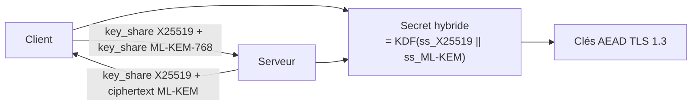
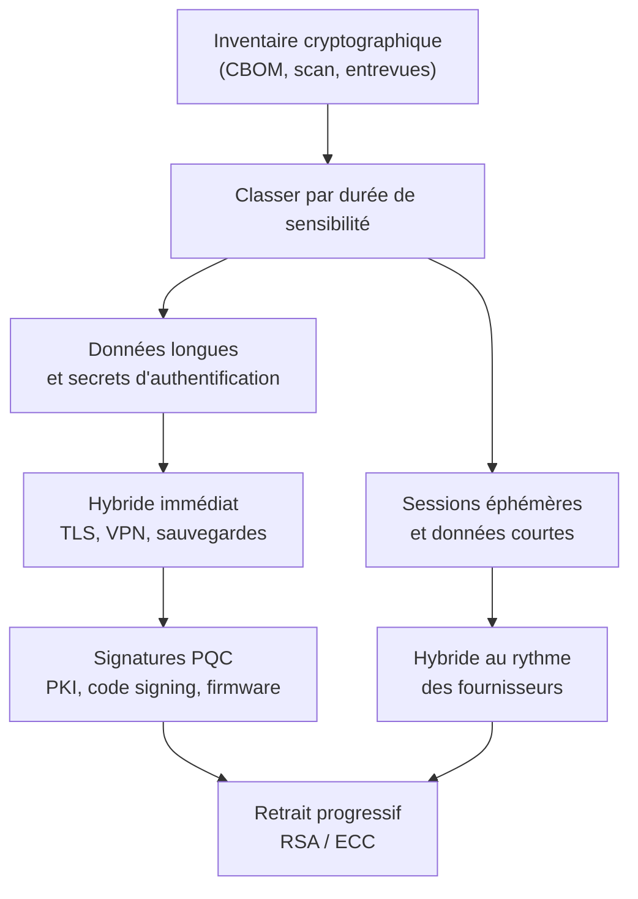

# Cryptographie post-quantique

La cryptographie post-quantique désigne les algorithmes conçus pour résister à un adversaire disposant d'un ordinateur quantique capable d'exécuter l'algorithme de Shor. Elle ne repose pas sur des ordinateurs quantiques : ce sont des algorithmes classiques, exécutés sur le matériel actuel, dont la sécurité s'appuie sur des problèmes mathématiques que les algorithmes quantiques connus ne savent pas résoudre efficacement. Le terme « post-quantique » prête à confusion : il ne signifie pas « après l'avènement du quantique », mais « résistant au quantique ».

L'enjeu est asymétrique dans le temps. La menace contre les données confidentielles est immédiate, via la collecte massive de trafic chiffré destiné à être déchiffré plus tard. La menace contre les signatures est différée, mais elle frappe des objets à très longue durée de vie : racines de confiance, firmware signé, certificats de code. C'est pourquoi la migration a commencé avant l'existence d'un ordinateur quantique utile, et pourquoi elle est déjà en cours dans les navigateurs et les grandes infrastructures.

> [!abstract] Définition — CRQC
> *Cryptographically Relevant Quantum Computer* : ordinateur quantique tolérant aux fautes, doté d'un nombre de qubits logiques suffisant pour exécuter l'algorithme de Shor sur les tailles de clés réellement déployées, en un temps exploitable. Les estimations varient de plusieurs millions à plusieurs dizaines de millions de qubits physiques, avec des hypothèses de correction d'erreur encore spéculatives.

## Ce que Shor et Grover changent

L'algorithme de Shor (1994) résout en temps polynomial deux problèmes sur lesquels repose presque toute la cryptographie asymétrique déployée : la factorisation d'entiers et le logarithme discret, dans un groupe multiplicatif ou sur une courbe elliptique.

```text
Factorisation :   n = p × q          → Shor : O((log n)^3)
Log discret   :   y = g^x mod p      → Shor : O((log p)^3)
Log discret EC:   Y = x·G            → Shor : O((log p)^3)
```

Concrètement, RSA-2048, DH-2048, ECDSA P-256 et X25519 tombent tous. Ce n'est pas une accélération marginale : c'est un changement de classe de complexité, de sous-exponentiel à polynomial. Augmenter la taille des clés ne sauve pas RSA — doubler la taille multiplie le coût quantique par un facteur polynomial, pas exponentiel. Il n'existe pas de « RSA-8192 quantique-proof ».

L'algorithme de Grover (1996) apporte une accélération quadratique à la recherche non structurée. Il divise par deux le niveau de sécurité effectif des algorithmes symétriques : AES-128 se comporte comme AES-64 face à un adversaire quantique, AES-256 comme AES-128. Cette accélération est souvent présentée comme une catastrophe ; elle ne l'est pas. Grover est intrinsèquement séquentiel : les 2^128 itérations nécessaires pour casser AES-256 ne peuvent pas être parallélisées efficacement, et la profondeur du circuit dépasse largement ce qu'un matériel réaliste peut maintenir avec correction d'erreur. La recommandation pratique est simple : AES-256 et SHA-384/512 offrent une marge confortable, sans changer d'algorithme.

| Primitive | Impact quantique | Action |
|---|---|---|
| RSA (chiffrement, signature) | Cassé par Shor | Migrer vers ML-KEM / ML-DSA |
| DH, ECDH, ECDSA, EdDSA | Cassé par Shor | Migrer vers ML-KEM / ML-DSA |
| AES-128 | Sécurité effective ~64 bits (Grover) | Passer à AES-256 |
| AES-256 | Sécurité effective ~128 bits | Conserver |
| SHA-256 | Sécurité effective ~128 bits en préimage | Conserver, SHA-384 pour la marge |
| SHA-3, BLAKE2/3 | Résistants | Conserver |

## Harvest now, decrypt later

La partie la plus urgente du problème n'est pas le futur, c'est le présent. Un adversaire peut enregistrer aujourd'hui des téraoctets de trafic TLS, de sauvegardes ou de courriels chiffrés, et attendre. Si la donnée reste sensible dans dix ou quinze ans, le déchiffrement futur a la même valeur qu'un déchiffrement immédiat. C'est l'attaque « harvest now, decrypt later » (HNDL), parfois appelée « store now, decrypt later ».

Elle impose un raisonnement sur la durée de vie de l'information, pas sur la date du CRQC. Une donnée dont la sensibilité expire en 2028 n'a pas besoin d'être protégée contre un CRQC de 2035. Une donnée d'état civil, un secret industriel, une clé privée de signature de firmware ou un dossier médical, en revanche, restent sensibles bien après leur émission. La règle empirique :

```text
Si (date de compromission probable du chiffrement) + (durée de sensibilité) > (date estimée du CRQC)
alors la migration est prioritaire dès maintenant.
```

C'est ce qui justifie de déployer des échanges de clés hybrides immédiatement, alors que les signatures peuvent attendre quelques années de plus — sauf pour les racines de confiance et le code signing, dont la durée de vie dépasse largement la fenêtre de transition.

## Les familles d'algorithmes

Le NIST a lancé son processus de standardisation en 2016 et publié les trois premiers standards en août 2024. Quatre familles mathématiques sont en jeu.

| Famille | Problème | Avantages | Inconvénients |
|---|---|---|---|
| Réseaux euclidiens (lattices) | LWE, SIS, SVP | Clés et signatures compactes, rapide | Complexité d'implémentation, sensibilité aux canaux auxiliaires |
| Hachage | Résistance des fonctions de hachage | Confiance minimale, analyse simple | Signatures énormes, signature lente |
| Codes correcteurs | Décodage de codes aléatoires | Très bonnes performances | Clés publiques volumineuses, historique d'attaques |
| Multivarié | Résolution de systèmes quadratiques | Signatures très courtes | Clés publiques énormes, confiance limitée |

La famille des isogénies a été durablement discréditée par le cassage de SIKE en 2022, en quelques heures sur un ordinateur classique, par une attaque exploitant une courbe de torsion mal gérée. Leçon utile : la jeunesse d'un schéma est un risque en soi, et la standardisation ne remplace pas l'analyse indépendante.

### ML-KEM (FIPS 203)

ML-KEM, dérivé de CRYSTALS-Kyber, est un mécanisme d'encapsulation de clé (KEM) fondé sur Module-LWE. Il remplace l'échange de clés Diffie-Hellman dans TLS, SSH, QUIC et les VPN. Trois paramétrages couvrent les niveaux de sécurité du NIST.

| Paramètre | Niveau NIST | Clé publique | Clé privée | Chiffré | Secret |
|---|---|---|---|---|---|
| ML-KEM-512 | 1 (≈ AES-128) | 800 o | 1 632 o | 768 o | 32 o |
| ML-KEM-768 | 3 (≈ AES-192) | 1 184 o | 2 400 o | 1 088 o | 32 o |
| ML-KEM-1024 | 5 (≈ AES-256) | 1 568 o | 3 168 o | 1 568 o | 32 o |

Le fonctionnement tient en trois étapes. Le destinataire publie une matrice et un vecteur bruité ; l'émetteur tire un message aléatoire `m`, en dérive une clé et un aléa, puis chiffre `m` avec la clé publique pour produire le chiffré `c`. Le destinataire retrouve `m` par déchiffrement approximatif puis dérive la même clé. Le détail crucial est le rejet implicite : si le déchiffrement échoue, l'implémentation ne renvoie pas d'erreur mais une clé pseudo-aléatoire dérivée du chiffré. Cela empêche une attaque par oracle de déchiffrement, qui transformerait sinon le KEM en oracle de décapsulation.

```python
import oqs  # liboqs-python

with oqs.KeyEncapsulation("ML-KEM-768") as kem:
    cle_publique = kem.generate_keypair()
    chiffre, secret_emetteur = kem.encap_secret(cle_publique)

with oqs.KeyEncapsulation("ML-KEM-768") as kem:
    kem.generate_keypair()
    secret_destinataire = kem.decap_secret(chiffre)

assert secret_emetteur == secret_destinataire
```

### ML-DSA (FIPS 204)

ML-DSA, dérivé de CRYSTALS-Dilithium, est un schéma de signature fondé sur Module-LWE et Module-SIS, construit selon le paradigme Fiat-Shamir with aborts. La signature est un engagement, une réponse et un défi ; la génération recommence si la réponse sort d'une plage de normes, ce qui garantit qu'elle ne fuit pas la clé secrète.

| Paramètre | Niveau | Clé publique | Clé privée | Signature |
|---|---|---|---|---|
| ML-DSA-44 | 2 | 1 312 o | 2 528 o | 2 420 o |
| ML-DSA-65 | 3 | 1 952 o | 4 032 o | 3 301 o |
| ML-DSA-87 | 5 | 2 592 o | 4 896 o | 4 627 o |

ML-DSA-65 est le choix par défaut raisonnable pour les certificats et le code signing : niveau 3, signature d'environ 3,3 ko, vérification rapide. La taille pose un problème concret dans les chaînes de certificats et dans les handshakes TLS : une chaîne complète peut dépasser 10 ko, ce qui dépasse la taille typique d'un paquet TCP initial et provoque de la fragmentation.

### SLH-DSA (FIPS 205)

SLH-DSA, dérivé de SPHINCS+, est une signature sans état fondée uniquement sur des fonctions de hachage. Sa sécurité ne dépend d'aucune hypothèse structurelle : même si les réseaux euclidiens s'effondrent, SLH-DSA tient, à condition que SHA-2 ou SHAKE tienne. C'est le choix de repli, celui qu'on utilise quand on veut minimiser les hypothèses.

Le prix est élevé : les signatures vont de 7,8 ko à près de 50 ko, la génération de clé et la signature sont lentes (de l'ordre de la milliseconde à la dizaine de millisecondes selon la variante), et la clé publique reste minuscule (32 à 64 octets). Les variantes `s` privilégient la compacité, les variantes `f` la vitesse. SLH-DSA convient aux racines de confiance, au firmware et aux environnements où la taille de signature importe moins que la confiance dans les hypothèses.

### FN-DSA (Falcon)

FN-DSA, dérivé de Falcon, repose sur des réseaux NTRU et produit des signatures compactes (environ 666 octets pour Falcon-512) avec une clé publique d'environ 897 octets. Son intérêt est la taille, son inconvénient la complexité : l'échantillonnage discret gaussien et l'arithmétique en virgule flottante sont difficiles à implémenter en temps constant. Le standard n'était pas finalisé au moment de la rédaction, et son usage devrait rester limité aux contraintes de taille fortes.

## Hybridation

Pendant la transition, la pratique recommandée est l'hybridation : combiner un algorithme classique et un algorithme post-quantique, et dériver la clé de session des deux secrets. La sécurité tient si au moins l'un des deux composants tient. Si ML-KEM s'avère cassé, ECDHE protège encore ; si ECDHE tombe face à Shor, ML-KEM protège.



En TLS 1.3 (voir [[TLS 1.3]]), le groupe hybride `X25519MLKEM768` (code point 0x11EC) est déployé par Chrome, Firefox, Cloudflare et une large partie des CDN. Il n'exige aucune modification du protocole : le `key_share` est simplement plus gros, et le secret partagé est la concaténation ordonnée des deux secrets avant passage dans le key schedule HKDF. SSH suit avec `mlkem768x25519-sha256`, et les VPN IPsec et WireGuard ont leurs propres variantes.

L'hybridation a un coût : le `ClientHello` dépasse souvent la taille d'un seul paquet, ce qui peut provoquer une fragmentation et des échecs sur certains middleboxes mal configurés. C'est un argument pour déployer tôt, afin de découvrir ces problèmes avant qu'ils ne soient critiques.

> [!warning] Piège
> Un groupe hybride mal implémenté peut être plus faible que chacun de ses composants : si les deux secrets sont concaténés sans séparation de domaine, ou si l'un des deux est ignoré en cas d'échec, la sécurité revient au plus faible. La dérivation doit utiliser un KDF avec un label explicite et une longueur de sortie fixe, jamais une simple concaténation passée telle quelle à AES.

## Migration et crypto-agilité

La migration n'est pas un remplacement d'algorithme, c'est un chantier d'architecture. Trois principes la structurent.

**Inventaire d'abord.** On ne migre pas ce qu'on ne voit pas. Un inventaire cryptographique recense les algorithmes, les bibliothèques, les protocoles, les clés et les certificats, avec leur emplacement, leur propriétaire et leur date d'expiration. Le format CBOM (Cryptography Bill of Materials), normalisé dans CycloneDX 1.6, permet de versionner cet inventaire à côté du SBOM.

**Crypto-agilité ensuite.** Le code doit pouvoir changer d'algorithme sans réécriture. Cela implique des identifiants d'algorithme explicites, pas de tailles codées en dur, des interfaces d'abstraction (KEM, signature) et des tests de négociation. Une application qui suppose une clé RSA de 2048 octets ou une signature de 64 octets ne pourra pas migrer sans intervention.

**Priorisation par risque.** Le NIST (IR 8547) prévoit la dépréciation de RSA et ECC en 2030 et leur interdiction en 2035. La CNSA 2.0 américaine fixe 2030 pour les systèmes de sécurité nationale, 2033 pour les navigateurs et serveurs, 2035 pour l'ensemble. L'ANSSI recommande l'hybridation pour les produits de sécurité et exige une trajectoire de migration documentée.



Les priorités concrètes, dans l'ordre :

1. **TLS et VPN sortants** : hybridation immédiate, car le trafic est déjà collectable.
2. **Sauvegardes et archives** : chiffrement hybride ou symétrique renforcé, avec gestion de clés adaptée.
3. **PKI interne** : racines et intermédiaires ML-DSA, avec période de double signature (voir [[PKI en profondeur]]).
4. **Code signing et firmware** : signatures PQC, car la durée de vie des dispositifs dépasse la transition.
5. **Matériel contraint** : SLH-DSA ou ML-DSA selon la taille, souvent après renouvellement du parc.

## Limites et pièges d'implémentation

Les algorithmes post-quantiques sont jeunes, et leur sécurité réelle dépend autant de l'implémentation que des mathématiques.

**Canaux auxiliaires.** Les schémas à réseaux utilisent des opérations sur des polynômes dont le temps d'exécution peut dépendre des données. Les attaques par analyse de traces, par cache ou par fautes ont déjà cassé des implémentations de Kyber et de Dilithium. Les bibliothèques de référence (liboqs, BoringSSL, OpenSSL 3.5+) intègrent des contre-mesures, mais le code maison est à proscrire.

**Échecs de décapsulation.** Un KEM qui renvoie une erreur distincte sur un chiffré invalide devient un oracle. Le rejet implicite de ML-KEM est obligatoire, pas optionnel.

**Tailles.** Les clés et signatures plus grosses cassent les hypothèses de MTU, les buffers fixes, les champs de base de données et les protocoles binaires. Un certificat ML-DSA dans un en-tête de 4 ko ne passe pas.

**Certification.** Les HSM et modules certifiés FIPS 140-3 doivent supporter les nouveaux algorithmes ; tous ne le font pas, et la validation prend des années. C'est souvent le vrai goulot d'étranglement pour les infrastructures régulées (voir [[Gestion des clés et HSM]]).

**Confiance.** Les réseaux euclidiens sont étudiés depuis vingt ans, mais moins longtemps que RSA. La diversification (hybride, SLH-DSA en secours) est une assurance contre une surprise cryptanalytique.

## Détection et inventaire cryptographique

La « détection » en post-quantique recouvre deux activités distinctes : détecter l'usage de cryptographie obsolète, et détecter les signes d'une migration mal faite ou d'une compromission.

**Scanner l'exposition.** Les outils réseau identifient les protocoles et les suites négociées.

```bash
# Versions et suites TLS d'un service
testssl.sh --quiet --protocols --cipher-per-proto exemple.fr:443

# Groupes d'échange négociés, y compris hybrides
openssl s_client -connect exemple.fr:443 -groups X25519MLKEM768 -brief

# Algorithmes de host key et KEX d'un serveur SSH
ssh -o HostKeyAlgorithms=+ssh-ed25519 -Q key
nmap --script ssh2-enum-algos -p 22 exemple.fr

# Certificats et tailles de clé
openssl s_client -connect exemple.fr:443 </dev/null 2>/dev/null |
    openssl x509 -noout -text | grep -E "Public Key Algorithm|Public-Key"
```

**Scanner le code et les dépendances.** Les analyseurs statiques repèrent les appels à RSA, ECDSA, DH, les tailles de clé codées en dur et les bibliothèques obsolètes. OpenSSL 3.x expose ses algorithmes via le provider `default` ; un binaire lié à OpenSSL 1.0.2 est un indicateur de dette.

```bash
# Recherche grossière dans une base de code
grep -rnE "RSA_generate_key|EC_KEY_new|EVP_PKEY_RSA|TLSv1_2_method" src/

# Empreinte d'un binaire et de ses dépendances
ldd ./service | grep -E "ssl|crypto"
strings ./service | grep -E "OpenSSL [0-9]"
```

**Surveiller les journaux.** Les journaux TLS et les journaux de proxy doivent exposer la version et le groupe négociés. Une chute brutale de la proportion de connexions hybrides, ou l'apparition de connexions en TLS 1.2 sur un segment migré, signale un client ancien, un middlebox ou une régression de configuration.

**Détecter l'usage illégitime.** Une clé privée post-quantique n'est pas plus facile à voler qu'une clé RSA, mais sa taille rend certains stockages bricolés dangereux (fichiers de configuration, variables d'environnement, images de conteneur) : voir [[Gestion des clés et HSM]] pour les principes de protection. La recherche de secrets dans les dépôts et les images reste la détection la plus rentable.

**Limites.** Un scan ne voit que ce qui parle ; les bibliothèques statiques, le code embarqué et les protocoles propriétaires échappent à l'inventaire réseau. Le CBOM doit donc combiner scan automatisé et déclaration des équipes, sinon il devient une fiction rassurante.

> [!quiz] Pourquoi doubler la taille d'une clé RSA ne protège-t-il pas contre l'algorithme de Shor ?
> Parce que Shor ne cherche pas la clé par force brute : il exploite la structure algébrique de la factorisation pour obtenir un algorithme polynomial. Doubler la taille de la clé ne fait qu'augmenter le degré du polynôme, alors qu'une attaque classique par force brute verrait son coût multiplié exponentiellement. Seuls des problèmes différents, non réduits par Shor, peuvent résister.

> [!quiz] Un attaquant qui vole aujourd'hui une clé privée ECDSA peut-il déchiffrer les sessions TLS passées ?
> Non, grâce à la confidentialité persistante : les clés de session viennent d'un ECDHE éphémère et ne dépendent pas de la clé de signature. En revanche, il peut usurper le serveur pour de nouvelles connexions et, s'il enregistre le trafic, il pourra déchiffrer les sessions dont l'ECDHE sera cassé par un futur CRQC. Les deux menaces sont distinctes et appellent des migrations distinctes.
