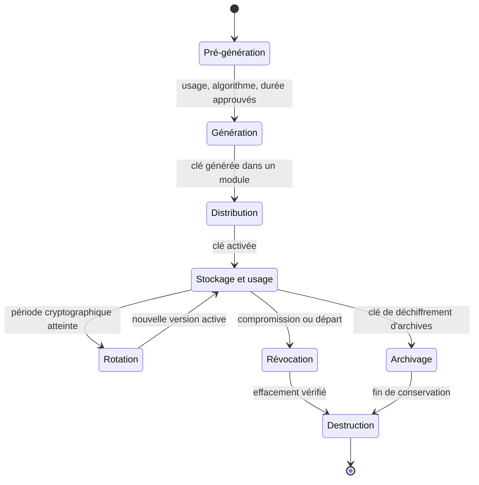
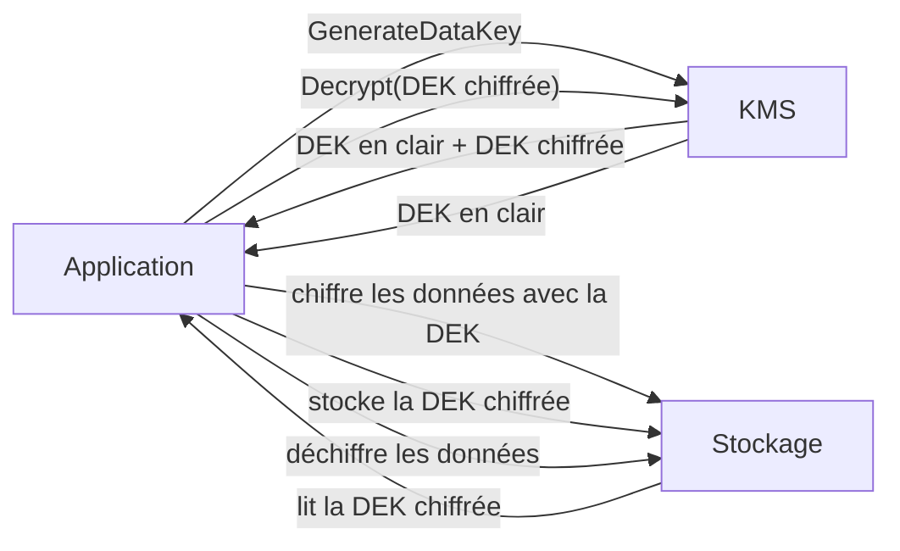

# Gestion des clés et HSM

Un algorithme cryptographique est public, révisé, implémenté dans des bibliothèques ouvertes. La clé, elle, est le seul secret du système. Toute la sécurité repose donc sur un objet de quelques dizaines d'octets, qu'il faut générer sans biais, transporter sans exposition, utiliser sans fuite, renouveler sans interruption et détruire sans résidu. La gestion des clés est la partie de la cryptographie où les échecs sont les plus fréquents, parce qu'ils sont organisationnels autant que techniques : une clé versionnée par erreur dans un dépôt, un HSM mal segmenté ou une rotation jamais testée annulent des années d'ingénierie cryptographique.

Cette note couvre le cycle de vie des clés, les architectures de protection (KMS, HSM, TPM, enclaves) et la gestion des secrets en CI/CD. Elle complète [[Cryptographie]] pour les primitives et [[PKI en profondeur]] pour les certificats.

> [!abstract] Définition — KEK et DEK
> Une **DEK** (Data Encryption Key) chiffre les données. Une **KEK** (Key Encryption Key) chiffre les DEK. Cette séparation permet de changer la KEK sans réchiffrer les données : il suffit de déchiffrer puis réchiffrer les DEK. C'est le principe de l'*envelope encryption*, qui limite le volume de matériel cryptographique exposé et permet de confier la KEK à un HSM ou à un KMS.

## Le cycle de vie

NIST SP 800-57 décrit le cycle de vie d'une clé en phases distinctes. Chaque transition doit être tracée, autorisée et réversible autant que possible.



La **pré-génération** est administrative mais décisive : quel usage, quel algorithme, quelle taille, quel propriétaire, quelle durée de conservation, quelles contraintes réglementaires. Une clé créée sans ces réponses finit souvent surexposée, jamais tournée, ou conservée au-delà du nécessaire.

La **période cryptographique** est la durée pendant laquelle une clé peut protéger des données. Elle dépend de l'algorithme, du volume chiffré et de la sensibilité. Une clé symétrique de chiffrement de données se compte en mois ou en années ; une clé de signature de racine de confiance se compte en décennies. La rotation doit être planifiée dès la génération, pas découverte lors d'un audit.

## Génération

La qualité d'une clé tient à son aléa. Un générateur prévisible rend l'algorithme le plus robuste inutile.

Utiliser un CSPRNG du système (`getrandom(2)`, `BCryptGenRandom`, `SecRandomCopyBytes`), jamais `rand()`, `Math.random()` ou l'horloge. Vérifier que la source d'entropie est disponible au démarrage, en particulier dans les machines virtuelles et les conteneurs, où l'entropie peut manquer. Ne pas générer de clé dans un environnement dont l'image ou l'hyperviseur est suspect.

```bash
# Linux : vérifier la disponibilité de l'entropie
cat /proc/sys/kernel/random/entropy_avail
cat /proc/sys/kernel/random/boot_id

# Générer une clé AES-256 et une clé Ed25519 avec OpenSSL
openssl rand -out aes.key 32
openssl genpkey -algorithm ED25519 -out ed25519.key

# Vérifier la taille et le type
openssl pkey -in ed25519.key -text -noout
```

Pour les clés à forte valeur (racine de PKI, clé de signature de code, clé maître d'un HSM), la génération se fait lors d'une **cérémonie** : salle contrôlée, personnel en double contrôle, procédure écrite, witnesses, enregistrement vidéo, composants matériels scellés. Le secret est souvent divisé en parts selon un schéma de Shamir, de sorte qu'aucune personne seule ne puisse reconstituer la clé. Ces rituels répondent à une menace interne réelle : l'administrateur qui détient seul la clé de tous les autres.

> [!warning] Piège
> Une clé générée « à la main » avec `openssl rand -hex 32` puis collée dans un fichier de configuration n'est pas une clé gérée : c'est un secret d'application. Elle ne sera ni tournée, ni révoquée, ni auditée. La distinction n'est pas sémantique : elle détermine si un départ d'employé ou une fuite de dépôt compromet définitivement les données.

## Distribution

Une clé ne se transmet jamais en clair, ni par courriel, ni par chat, ni dans un ticket. Trois mécanismes remplacent l'échange manuel.

**Le wrapping** chiffre la clé à distribuer avec une KEK déjà partagée. La clé transportée reste chiffrée de bout en bout ; le destinataire la déballe dans son propre module.

**L'accord de clés** (ECDH, ML-KEM) permet à deux parties de dériver un secret commun sans jamais transmettre la clé. C'est le mécanisme des protocoles TLS et SSH, et de plus en plus des échanges HSM à HSM.

**Le provisionnement à la demande** consiste à ne délivrer une clé qu'au moment de l'usage, pour une identité authentifiée et une durée courte. C'est le modèle des secrets dynamiques de Vault ou des jetons temporaires des clouds.

Le transport physique reste nécessaire pour les racines hors ligne : support chiffré, double contrôle, accusé de réception et numéro de série vérifié.

## Rotation

Tourner une clé, c'est remplacer la clé active par une nouvelle version, tout en conservant l'ancienne pour déchiffrer les données existantes. Trois opérations différentes sont souvent confondues.

| Opération | Ce qui change | Données à réchiffrer |
|---|---|---|
| Rekey | Nouvelle clé de même usage | Aucune |
| Rotation de KEK | Nouvelle KEK, DEK réenveloppées | Aucune (uniquement les DEK) |
| Rotation de DEK | Nouvelle DEK | Toutes les données de cette DEK |

La rotation de KEK est peu coûteuse et doit être fréquente. La rotation de DEK impose un réchiffrement complet, parfois progressif, avec double lecture pendant la transition. Les systèmes sérieux conservent un identifiant de version avec chaque objet chiffré, ce qui permet de savoir quelle clé utiliser sans essayer toutes les clés.

```json
{
  "ciphertext": "base64...",
  "key_id": "kek/2026-10/v3",
  "algorithm": "AES-256-GCM",
  "nonce": "base64...",
  "wrapped_dek": "base64..."
}
```

La rotation ne sert à rien si elle n'est pas testée. Un exercice annuel qui restaure une sauvegarde chiffrée avec l'ancienne clé révèle les dépendances oubliées : job de sauvegarde resté sur la clé v1, service n'ayant pas rechargé la nouvelle version, cache conservant l'ancienne.

## KMS et envelope encryption

Un KMS (Key Management Service) est un service centralisé qui génère, stocke et utilise des clés sans les exposer à l'appelant. L'application ne voit jamais la KEK ; elle demande au KMS de chiffrer ou déchiffrer une DEK. AWS KMS, Google Cloud KMS, Azure Key Vault et HashiCorp Vault suivent ce modèle, largement décrit dans [[Cloud Security]].



```python
import boto3, base64

kms = boto3.client("kms")

# Génération : le KMS renvoie la DEK en clair et sa version chiffrée
reponse = kms.generate_data_key(KeyId="alias/app-data", KeySpec="AES_256")
dek_clair = reponse["Plaintext"]
dek_chiffree = reponse["CiphertextBlob"]

# Stockage : on ne garde que la DEK chiffrée
enregistrement = {
    "dek": base64.b64encode(dek_chiffree).decode(),
    "blob": chiffrer_aes_gcm(dek_clair, donnees),
}

# Déchiffrement : le KMS déballe la DEK, l'application fait le reste
dek = kms.decrypt(CiphertextBlob=base64.b64decode(enregistrement["dek"]))["Plaintext"]
clair = dechiffrer_aes_gcm(dek, enregistrement["blob"])
```

Ce modèle a plusieurs vertus : le KMS ne voit jamais les données, seulement des DEK de 32 octets ; les autorisations sont centralisées dans des politiques auditables ; la rotation de la KEK ne touche pas aux données ; et la limite de débit ne s'applique qu'aux opérations sur les DEK.

Il a aussi des limites : sans le KMS, plus de déchiffrement. Les quotas d'appels peuvent étrangler une application mal conçue qui appelle `Decrypt` à chaque requête au lieu de mettre la DEK en cache. Et le modèle de confiance reste celui du fournisseur : l'utilisateur délègue la protection de la KEK, ce qui est acceptable pour beaucoup d'usages mais pas pour une racine de PKI.

## HSM

Un HSM (Hardware Security Module) génère et utilise des clés sans jamais les exporter en clair. Il est conçu pour résister à l'extraction physique : boîtier scellé, détection d'ouverture, capteurs de température et de tension, mémoire effacée en cas d'intrusion. Les clés vivent dans une zone protégée et les opérations cryptographiques s'exécutent à l'intérieur.

| Niveau FIPS 140-3 | Exigence | Usage typique |
|---|---|---|
| 1 | Composants standard, pas de sécurité physique | Développement, tests |
| 2 | Détection d'intrusion, rôles et authentification | PME, appliances réseau |
| 3 | Détection et réponse, interfaces isolées, identité vérifiée | PKI, banque, cloud KMS |
| 4 | Enveloppe physique complète, détection environnementale | Racines de confiance, paiement |

Un HSM de niveau 3 est le minimum pour une autorité de certification ou une clé de paiement ; le niveau 4 ajoute la résistance aux attaques par voltage et température.

Les usages typiques :

- **PKI** : génération et conservation des clés de racine et d'intermédiaire, signature des certificats et des CRL.
- **Paiement** : gestion des clés de terminal, vérification des PIN, émission EMV.
- **Code signing** : protection des clés de signature de logiciels et de firmware.
- **Chiffrement de bases de données** : TDE avec clés non exportables.
- **Cloud** : AWS CloudHSM, Azure Managed HSM, Google Cloud HSM, avec des clés locataires.

Un HSM ne protège pas contre une application compromise qui a le droit d'utiliser la clé. Si l'attaquant peut appeler l'API de signature, il signe. La protection porte sur l'extraction de la clé, pas sur l'usage abusif : c'est pourquoi les politiques d'usage, les quotas et la journalisation sont aussi importants que le matériel.

### PKCS#11

PKCS#11 (Cryptoki) est l'interface standard entre une application et un HSM ou un token. Elle définit des objets (clés, certificats), des sessions et des mécanismes. Le modèle est en C, avec des handles opaques.

```c
CK_FUNCTION_LIST *p11;
CK_SESSION_HANDLE session;
CK_OBJECT_HANDLE cle;
CK_MECHANISM mech = { CKM_AES_KEY_GEN, NULL, 0 };

C_GetFunctionList(&p11);
p11->C_Initialize(NULL);
p11->C_OpenSession(slot, CKF_SERIAL_SESSION | CKF_RW_SESSION, NULL, NULL, &session);
p11->C_Login(session, CKU_USER, pin, strlen(pin));

CK_ATTRIBUTE attrs[] = {
    { CKA_CLASS, &(CK_OBJECT_CLASS){CKO_SECRET_KEY}, sizeof(CK_OBJECT_CLASS) },
    { CKA_KEY_TYPE, &(CK_KEY_TYPE){CKK_AES}, sizeof(CK_KEY_TYPE) },
    { CKA_VALUE_LEN, &(CK_ULONG){32}, sizeof(CK_ULONG) },
    { CKA_ENCRYPT, &(CK_BBOOL){CK_TRUE}, sizeof(CK_BBOOL) }
};
p11->C_GenerateKey(session, &mech, attrs, 4, &cle);
```

```bash
# Explorer un HSM ou un token avec OpenSC
pkcs11-tool --module /usr/lib/softhsm/libsofthsm2.so -L
pkcs11-tool --module /usr/lib/softhsm/libsofthsm2.so -O --login
pkcs11-tool --module /usr/lib/softhsm/libsofthsm2.so --keygen --key-type AES:32 --label app-key
```

L'API est puissante mais piégeuse : chaque code de retour doit être vérifié, les sessions fermées, et les attributs `CKA_SENSITIVE` et `CKA_EXTRACTABLE` décident si la clé peut sortir. Une clé générée avec `CKA_EXTRACTABLE = CK_TRUE` annule une partie de l'intérêt du HSM.

## TPM et enclaves

Le **TPM 2.0** équipe la plupart des ordinateurs professionnels. Il offre trois services utiles : le stockage scellé (une clé n'est libérée que si les PCR correspondent à un état de démarrage attendu), l'attestation (prouver l'état du système à un tiers) et la génération de clés. BitLocker, measured boot et Windows Hello s'appuient dessus.

```bash
# Sceller un secret sur l'état courant des PCR
tpm2_createprimary -C o -c primary.ctx
tpm2_create -C primary.ctx -u key.pub -r key.priv -i secret.bin
tpm2_load -C primary.ctx -u key.pub -r key.priv -c key.ctx
tpm2_unseal -c key.ctx -o secret.out

# Attestation : produire une quote signée par l'AK
tpm2_quote -c ak.ctx -l sha256:0,1,2,7 -q nonce.bin -m quote.msg -s quote.sig
```

Le TPM protège contre le vol de disque et l'altération du démarrage, pas contre un administrateur local ni une attaque sur le bus SPI. Il ne remplace pas un HSM pour une clé de CA.

Les **enclaves sécurisées** (Intel SGX, AMD SEV-SNP, ARM TrustZone, Intel TDX) isolent le code et les secrets du système hôte. Elles libèrent une clé si le code mesuré correspond à une valeur attendue, ce qui sert au confidential computing face à un hyperviseur compromis. Leur historique de vulnérabilités (Foreshadow, Plundervolt, canaux auxiliaires) en fait une défense en profondeur, pas une garantie absolue.

## Gestion des secrets

Les secrets applicatifs (mots de passe, jetons d'API, clés de chiffrement) obéissent aux mêmes règles : jamais dans le code, jamais dans l'image de conteneur, jamais dans les journaux.

**Vault** et les gestionnaires équivalents proposent des secrets dynamiques : une base de données génère un compte éphémère à la demande, avec un bail (lease) et une révocation automatique. Le secret n'existe que le temps de l'usage, ce qui réduit fortement la valeur d'une fuite.

```bash
# Lire un secret statique
vault kv get -field=password secret/app/db

# Générer un compte éphémère sur une base PostgreSQL
vault read database/creds/app-readonly
# → username, password, lease_id, lease_duration

# Révoquer immédiatement un bail compromis
vault lease revoke database/creds/app-readonly/abcd1234
```

**Kubernetes** stocke les Secrets en base64, pas chiffrés par défaut (voir [[Kubernetes Security]]). Le chiffrement au repos dans etcd est une option à activer, et le RBAC sur les Secrets est souvent trop large. External Secrets Operator ou Secrets Store CSI Driver vont chercher les secrets dans un KMS au démarrage du pod.

**CI/CD** est le point le plus exposé : clés cloud en variables permanentes, secrets imprimés dans les logs, artefacts contenant des `.env`, runners partagés. La bonne pratique est la fédération d'identité : le runner présente un jeton OIDC signé par la plateforme, le cloud l'échange contre des credentials temporaires, et aucune clé statique n'existe.

```yaml
# GitHub Actions : credentials AWS temporaires via OIDC
permissions:
  id-token: write
  contents: read

steps:
  - uses: aws-actions/configure-aws-credentials@v4
    with:
      role-to-assume: arn:aws:iam::123456789012:role/ci-deploy
      aws-region: eu-west-3
```

La politique de confiance du rôle doit rester stricte : repository, branche, environnement. Un rôle qui accepte `repo:*` annule le bénéfice de l'OIDC.

## Destruction

Détruire une clé, c'est rendre les données qu'elle protège définitivement inaccessibles. Pour un support physique, NIST SP 800-88 décrit les niveaux de sanitisation (clear, purge, destroy). Pour une clé, la destruction logique peut suffire si aucune copie ne subsiste : c'est le **crypto-shredding**. Effacer la KEK qui protège les DEK rend l'ensemble des données illisible, sans passer par un effacement physique de chaque support.

Le crypto-shredding est séduisant pour la conformité (droit à l'effacement) mais dangereux s'il est mal compris. Il ne fonctionne que si toutes les copies de la KEK sont détruites, y compris sauvegardes, répliques et caches. Une KEK archivée annule l'effacement, et un attaquant qui a déjà copié données et clé n'est pas concerné.

## Détection

La compromission d'une clé ne produit pas d'alerte antivirus. Elle se détecte par corrélation de signaux faibles : volume, identité, moment, emplacement.

| Signal | Source | Interprétation |
|---|---|---|
| Pic de `Decrypt` | CloudTrail, journaux KMS | Exfiltration ou service mal configuré |
| `GenerateDataKey` anormal | KMS | Chiffrement massif, ransomware, abus de rôle |
| `ScheduleKeyDeletion` | KMS | Sabotage ou tentative de crypto-shredding |
| Modification de politique de clé | KMS, IAM | Élévation de privilèges, persistance |
| Connexion HSM hors horaires | Journal HSM | Opération administrateur suspecte |
| Échecs d'authentification répétés | HSM, Vault | Force brute sur un PIN ou un token |
| Clé utilisée depuis une nouvelle IP/ASN | KMS, Vault | Vol de credentials |
| Secret détecté dans un dépôt | gitleaks, trufflehog | Fuite, à traiter comme une compromission |

**Journaux KMS.** AWS CloudTrail enregistre chaque appel `Decrypt`, `Encrypt`, `GenerateDataKey`, `CreateGrant`, `PutKeyPolicy`. Une requête d'analyse simple révèle les volumes anormaux.

```sql
-- Athena : décryptions par principal et par heure sur 24 h
SELECT useridentity.arn, date_trunc('hour', from_iso8601_timestamp(eventtime)) AS h,
       count(*) AS appels
FROM cloudtrail_logs
WHERE eventname = 'Decrypt'
  AND from_iso8601_timestamp(eventtime) > now() - interval '24' hour
GROUP BY 1, 2
ORDER BY appels DESC
LIMIT 50;
```

**Journaux HSM.** Les HSM journalisent les connexions, les échecs de PIN, les créations et suppressions d'objets, les opérations d'administration. Ces journaux sont souvent négligés parce qu'ils sont difficiles à parser ; ils sont pourtant la seule trace de l'usage réel d'une clé non exportable.

**Scan de secrets.** Les outils de détection de secrets doivent tourner à trois endroits : pre-commit, CI et historique Git complet. Une clé supprimée dans un commit ultérieur reste dans l'historique.

```bash
# Scanner un dépôt et son historique
gitleaks detect --source . --report-format sarif --report-path gitleaks.sarif
trufflehog git file://. --only-verified

# Vérifier qu'une clé AWS trouvée est encore active
aws sts get-caller-identity --profile suspect
```

**Métriques de rotation.** Une clé dont l'âge dépasse la politique est un risque silencieux. Exposer l'âge des clés et des certificats dans le tableau de bord, avec alerte à 80 % de la période, transforme une tâche oubliée en incident visible. Ces métriques ont leur place dans le SIEM ([[SIEM (Security Information and event Management)]]) aux côtés des journaux KMS.

**Limites.** Un KMS compromis peut déchiffrer sans trace si l'attaquant contrôle le compte : les journaux doivent donc vivre dans un compte séparé, avec une rétention immuable. Et un secret volé jamais utilisé ne produit aucun signal.

> [!quiz] Pourquoi la rotation de la KEK ne nécessite-t-elle pas de réchiffrer les données ?
> Parce que les données sont chiffrées avec des DEK, et que seules les DEK sont chiffrées avec la KEK. Rotation de KEK revient à déballer puis réemballer chaque DEK. Le volume réchiffré est celui des DEK, pas des données. Rotation de DEK, en revanche, impose de réchiffrer toutes les données associées.

> [!quiz] Un HSM empêche-t-il un attaquant de signer du code avec une clé volée ?
> Non : il empêche l'extraction de la clé, pas son usage par un appelant autorisé. Avec un accès à l'API de signature, les droits et le PIN, l'attaquant fait signer ce qu'il veut. La parade est l'authentification forte, le moindre privilège, les quotas et la journalisation des signatures.
