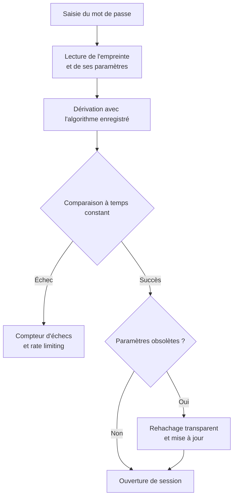

# Hachage de mots de passe

Un serveur d'authentification ne stocke jamais un mot de passe, seulement une empreinte. Le jour où la base fuit, cette empreinte devient la seule barrière entre l'attaquant et les comptes. Sa valeur dépend d'une question économique : retrouver le mot de passe coûte-t-il plus cher que l'attaquant n'est prêt à dépenser ? D'où le paradoxe : une fonction de hachage doit être rapide pour un fichier, mais volontairement lente et coûteuse en mémoire pour un secret humain, faible et réutilisé.

Les techniques de cassage sont détaillées dans [[Hash Cracking]] ; les primitives sous-jacentes dans [[Cryptographie]].

> [!abstract] Définition — Fonction de dérivation de clé (KDF)
> Une KDF transforme un secret de faible entropie, comme un mot de passe, en une empreinte de taille fixe, en appliquant un coût calculatoire et mémoire paramétrable. Ce coût est le mécanisme de défense : il ralentit chaque tentative de l'attaquant sans dégrader l'expérience légitime au-delà de quelques centaines de millisecondes.

## Pourquoi les hashes rapides sont inadaptés

SHA-256, SHA-1, MD5 et NTLM sont conçus pour être rapides. Un GPU récent calcule des centaines de milliards de hachages NTLM par seconde et des dizaines de milliards de SHA-256. Cette vitesse est une qualité pour vérifier l'intégrité d'un disque, une catastrophe pour vérifier un mot de passe.

Le raisonnement est purement économique. Un mot de passe de huit caractères tiré d'un alphabet de 62 symboles représente environ 2,2 × 10^14 combinaisons. À 200 milliards d'essais par seconde, l'espace complet tombe en une vingtaine de minutes. Avec bcrypt au coût 12, qui tourne autour de quelques dizaines de milliers d'essais par seconde sur la même carte, il faut plusieurs siècles. Seul le coût unitaire de la tentative a changé.

| Primitive | Coût mémoire | Débit GPU (ordre de grandeur) | Usage recommandé |
|---|---|---|---|
| MD5, SHA-1, SHA-256 | Négligeable | 10^10 à 10^11 H/s | Jamais pour un mot de passe |
| NTLM | Négligeable | 10^11 H/s | Protocole hérité, à déprécier |
| PBKDF2-HMAC-SHA256 | Négligeable | 10^5 à 10^6 H/s | Compatibilité FIPS, legacy |
| bcrypt (coût 12) | Quelques KiB | 10^4 à 10^5 H/s | Standard éprouvé |
| scrypt (128 MiB) | 128 MiB | 10^2 à 10^3 H/s | Alternative memory-hard |
| Argon2id (64 MiB, t=3) | 64 MiB | 10^2 à 10^3 H/s | Recommandation actuelle |

Un hash rapide non salé est également vulnérable aux rainbow tables : des tables précalculées associent des milliards d'empreintes à leurs clairs, et une recherche devient presque instantanée. Le sel, valeur aléatoire unique par utilisateur stockée avec l'empreinte, rend ces tables inutilisables, car il faudrait en recalculer une par sel. Il ne rend pas un mot de passe individuel plus difficile à deviner ; il empêche de mutualiser le travail entre comptes.

Chiffrer les mots de passe est une autre erreur : la réversibilité transforme la clé en point unique de compromission. Le hachage côté client ne remplace pas non plus le hachage serveur, car l'empreinte cliente devient un secret réutilisable.

## Argon2id

Argon2, gagnant de la Password Hashing Competition 2015 et standard RFC 9106, existe en trois variantes : Argon2d, rapide mais sensible aux fuites temporelles, Argon2i, résistante aux canaux auxiliaires, et Argon2id, hybride qui combine les deux modes. Argon2id est le choix par défaut recommandé par l'OWASP et l'ANSSI.

Ses paramètres sont `m` (mémoire en KiB), `t` (itérations), `p` (parallélisme), le sel (16 octets minimum), la longueur de sortie (32 octets) et une clé secrète optionnelle, le « pepper » natif d'Argon2.

La mémoire est le paramètre structurant : un attaquant peut acheter des GPU, mais il ne peut pas compresser 64 MiB par essai sans perdre l'avantage. Les recommandations OWASP minimales sont `m=19456` (19 MiB), `t=2`, `p=1`. Un serveur moderne doit viser 64 MiB, `t=3`, `p=4`, pour une vérification de 100 à 300 ms.

```python
from argon2 import PasswordHasher
from argon2.exceptions import VerifyMismatchError

ph = PasswordHasher(time_cost=3, memory_cost=65536, parallelism=4,
                    hash_len=32, salt_len=16)

empreinte = ph.hash("mot de passe")

try:
    ph.verify(empreinte, "mot de passe")
except VerifyMismatchError:
    pass

if ph.check_needs_rehash(empreinte):
    nouvelle = ph.hash("mot de passe")
```

Le format PHC encapsule l'algorithme, la version, les paramètres, le sel et le tag dans une seule chaîne, par exemple `$argon2id$v=19$m=65536,t=3,p=4$...`. Chaque empreinte sait comment se vérifier, ce qui rend la migration possible sans colonne supplémentaire.

## bcrypt

bcrypt dérive de Blowfish et applique un schéma de génération de clé itératif, Eksblowfish. Son paramètre est un facteur de coût `c`, et le nombre d'itérations vaut 2^c. Le sel fait 16 octets, la sortie 24 octets, et l'empreinte complète 60 caractères. Les variantes `$2a$`, `$2b$` et `$2y$` diffèrent par la gestion de cas limites ; `$2b$` est la forme moderne.

bcrypt reste un choix solide, éprouvé depuis 1999, mais il tronque le mot de passe à 72 octets : au-delà, les octets supplémentaires sont ignorés, et certaines implémentations s'arrêtent au premier octet nul. Pré-hacher avec SHA-256 puis encoder en base64 corrige la limite, mais le pré-hachage rapide réduit l'entropie et ouvre la voie au « password shucking » : l'attaquant casse d'abord un MD5 fuité, puis l'utilise comme mot de passe bcrypt. Un HMAC avec un pepper secret est préférable.

bcrypt n'est pas memory-hard : un ASIC ou un GPU parallélise massivement les instances, et son coût ne croît qu'en temps CPU. Le coût 12 est un plancher actuel ; le coût 14 devient raisonnable pour les comptes à forte valeur, au prix d'environ une seconde par authentification.

```python
import bcrypt

empreinte = bcrypt.hashpw(b"mot de passe", bcrypt.gensalt(rounds=12))
if bcrypt.checkpw(b"mot de passe", empreinte):
    ...
```

## scrypt

scrypt (RFC 7914) est la première KDF réellement memory-hard popularisée. Elle combine Salsa20/8, une grande zone mémoire et un paramètre de parallélisme. Ses paramètres sont `N` (coût, puissance de deux), `r` (taille de bloc) et `p` (parallélisme) ; la mémoire consommée vaut environ `128 × N × r` octets.

Les profils OWASP vont de `N=2^14, r=8, p=5` (16 MiB) à `N=2^17, r=8, p=1` (128 MiB). scrypt est simple à paramétrer et largement disponible, mais son modèle de coût est moins flexible qu'Argon2 et certaines implémentations fuient par le cache. Il reste une alternative valable lorsque Argon2 n'est pas disponible.

```python
import hashlib

sel = b"sel de 16 octets"
dk = hashlib.scrypt(b"mot de passe", salt=sel, n=2**17, r=8, p=1, dklen=32)
```

## PBKDF2

PBKDF2 (RFC 8018) applique un HMAC de façon itérative. C'est la plus ancienne KDF encore largement déployée, et la seule compatible FIPS 140 dans de nombreux environnements. Elle n'est pas memory-hard : seules les itérations freinent un attaquant équipé de GPU ou d'ASIC.

Les recommandations OWASP sont de 600 000 itérations pour HMAC-SHA256, 210 000 pour SHA-512 et 1 300 000 pour SHA-1. PBKDF2 reste acceptable pour des systèmes contraints ou des normes imposées, mais ne doit pas être choisie pour un nouveau service exposé.

```python
import hashlib

dk = hashlib.pbkdf2_hmac("sha256", b"mot de passe", sel, 600_000, dklen=32)
```

## Comparaison et compromis

| Critère | Argon2id | bcrypt | scrypt | PBKDF2 |
|---|---|---|---|---|
| Memory-hard | Oui, paramétrable | Non | Oui | Non |
| Résistance GPU/ASIC | Très bonne | Moyenne | Bonne | Faible |
| Canaux auxiliaires | Bonne (mode id) | Bonne | Variable | Bonne |
| Longueur max | Illimitée | 72 octets | Illimitée | Illimitée |
| Standard | RFC 9106 | De facto | RFC 7914 | RFC 8018, FIPS |
| Coût mémoire | 19 à 64 MiB | Quelques KiB | 16 à 128 MiB | Négligeable |

Le compromis central est entre sécurité et disponibilité. Augmenter la mémoire ou les itérations protège mieux une base volée, mais consomme des ressources et ouvre un vecteur de déni de service. Il faut plafonner la concurrence, appliquer un rate limiting par compte et par IP, et dimensionner pour le pic légitime, pas pour le benchmark isolé.

## Sel, poivre et stockage

Le sel est public et stocké avec l'empreinte. Il doit être unique par utilisateur, généré par un CSPRNG, et d'au moins 16 octets. Un sel global ou constant annule l'essentiel de son bénéfice. Le sel protège contre les tables précalculées et empêche de comparer deux comptes ayant le même mot de passe.

Le poivre est un secret applicatif distinct de la base, stocké dans un KMS, un HSM ou un secret manager. Il est appliqué avant la KDF, par exemple via HMAC-SHA256, ou utilisé comme clé secrète native d'Argon2. Il rend une base volée seule inexploitable, mais ne remplace ni le sel ni les paramètres coûteux. Il introduit un risque opérationnel : perdre le poivre invalide tous les mots de passe, et le changer impose une migration.

| Élément | Secret | Stockage | Rôle |
|---|---|---|---|
| Sel | Non | Avec l'empreinte | Unicité, anti-rainbow |
| Poivre | Oui | KMS, HSM, secret manager | Défense en profondeur si la base fuit |
| Paramètres | Non | Dans l'empreinte PHC | Rehachage et audit |
| Empreinte | Non | Base de données | Vérification |

Un poivre global complique la rotation : il faut versionner le poivre, stocker un identifiant de version avec l'empreinte, et rehacher progressivement. Un poivre par tenant limite le rayon d'action d'une fuite.

## Migration et rehachage

Aucune migration n'est instantanée, car le serveur ne connaît pas les clairs. La stratégie standard est le rehachage transparent à la connexion : vérifier avec l'ancien algorithme, puis recalculer avec le nouvel algorithme si l'empreinte est obsolète.



Les pièges sont nombreux. Une migration qui change le sel sans conserver l'ancien rend les comptes inaccessibles. Le discriminant doit être le préfixe PHC, non un numéro de version applicatif désynchronisé. Le rehachage doit être idempotent et résister aux connexions concurrentes : deux requêtes simultanées peuvent recalculer la même ligne, ce qui est acceptable si la dernière écriture gagne, mais dangereux si un verrouillage écrase une empreinte plus récente.

Le rehachage doit aussi être planifié pour les paramètres, pas seulement pour l'algorithme : une empreinte Argon2id à 19 MiB devient faible avec les progrès du matériel. Il faut recalculer périodiquement la cible et suivre la proportion d'empreintes conformes. Les comptes qui ne se connectent jamais restent sur l'ancien format ; une réinitialisation forcée pour les comptes inactifs ou à risque complète la migration.

## Attaques

L'attaque par dictionnaire teste des mots de passe connus, souvent issus de fuites massives, avec des règles de transformation : majuscule initiale, suffixe numérique, substitution de lettres. C'est l'attaque la plus rentable, car les humains choisissent des mots et les transforment de façon prévisible.

L'attaque exhaustive n'est rentable que sur des espaces restreints : PIN, mots de passe courts, politiques permissives. Les masques et l'hybridation mot + suffixe couvrent les motifs d'entreprise.

Les rainbow tables ne fonctionnent que sur des empreintes non salées. Elles sont obsolètes contre bcrypt, scrypt, Argon2 et PBKDF2 correctement salés, mais restent pertinentes contre des applications anciennes stockant des MD5 ou des NTLM bruts.

Le password spraying teste quelques mots de passe très courants contre un grand nombre de comptes. Il contourne les politiques de verrouillage par compte, qui ne voient qu'un ou deux échecs par identifiant, et vise les annuaires exposés, les VPN, les portails Microsoft 365 et les applications sans MFA. Sa détection repose sur la diversité des identifiants et la faible répétition par compte, pas sur le volume brut.

Le credential stuffing réutilise des couples identifiant/mot de passe fuités sur d'autres services. Il exploite la réutilisation, pas la faiblesse d'un mot de passe individuel ; le MFA et la détection de connexions impossibles en réduisent l'impact.

Le pass-the-hash, propre à NTLM, ne casse pas le mot de passe : il réutilise directement le hash comme authentifiant. Aucun durcissement de la KDF ne protège contre cette attaque ; il faut désactiver NTLM, segmenter et surveiller les authentifications réseau. Le Kerberoasting et l'AS-REP Roasting sont couverts dans [[Hash Cracking]] et [[Kerberos Attacks]].

## Détection et audit

### Auditer les paramètres stockés

Le premier contrôle est un inventaire : compter les empreintes par algorithme, par paramètres et par ancienneté, puis comparer à une politique. Un tableau de bord minimal répond à quatre questions : combien d'empreintes sont non salées, combien utilisent un algorithme rapide, combien ont des paramètres sous le seuil, combien sont éligibles au rehachage.

```python
from collections import Counter

PREFIXES = {
    "$argon2id$": "argon2id", "$argon2i$": "argon2i", "$argon2d$": "argon2d",
    "$2b$": "bcrypt", "$2a$": "bcrypt", "$2y$": "bcrypt",
    "$6$": "sha512crypt", "$5$": "sha256crypt", "$1$": "md5crypt",
}

def classifier(empreinte: str) -> str:
    for prefixe, nom in PREFIXES.items():
        if empreinte.startswith(prefixe):
            return nom
    return "non identifié"

def audit(empreintes):
    return Counter(classifier(e) for e in empreintes)
```

Un audit utile ne s'arrête pas au nom de l'algorithme : il parse les paramètres. Pour Argon2id, il vérifie `m >= 19456` et `t >= 2` ; pour bcrypt, `cost >= 12` ; pour PBKDF2, le nombre d'itérations et le PRF ; pour scrypt, `N`, `r`, `p`. Il vérifie aussi la longueur de la colonne, qui doit accueillir les empreintes PHC modernes, et l'absence de troncature silencieuse.

L'audit doit inclure le code et la configuration : rechercher `md5(`, `sha1(`, `hashlib.sha256` appliqué à un mot de passe, `PasswordHasher` mal configuré, ou des secrets de test en dur.

### Détecter les attaques en ligne

Les attaques hors ligne ne produisent aucun journal applicatif : une fois la base exfiltrée, le cassage se fait ailleurs. La détection porte donc sur l'exfiltration, les accès anormaux à la base et les dumps mémoire, pas sur la KDF.

Les attaques en ligne laissent en revanche des traces. Le spraying se reconnaît à un grand nombre d'identifiants distincts testés avec un très petit nombre de mots de passe, souvent depuis des IP réparties. Les journaux Windows 4625, 4771 et 4768, les connexions Azure AD et les logs applicatifs doivent être corrélés sur une fenêtre glissante. Le credential stuffing se distingue par un volume élevé et une faible diversité de couples.

Le Kerberoasting se détecte via des demandes de tickets de service chiffrés en RC4 anormalement fréquentes, l'AS-REP Roasting via des demandes sans pré-authentification. Le DCSync se repère par des opérations de réplication inhabituelles ; l'accès à la mémoire de LSASS relève de la télémétrie EDR.

Les comptes canaris complètent le dispositif : un compte factice au mot de passe faible déclenche une alerte dès qu'il est utilisé, ce qui signale une attaque ciblée avant la compromission d'un compte réel.

### Détecter les fuites de mots de passe

La vérification contre les corpus de fuites est une mesure préventive et détective. L'API Have I Been Pwned expose un endpoint à divulgation partielle : le client envoie les cinq premiers caractères du SHA-1, reçoit les suffixes correspondants et compare localement. Le mot de passe complet ne quitte jamais le client.

```python
import hashlib
import requests

def occurrences_fuite(mot_de_passe: str) -> int:
    h = hashlib.sha1(mot_de_passe.encode()).hexdigest().upper()
    prefixe, suffixe = h[:5], h[5:]
    r = requests.get(f"https://api.pwnedpasswords.com/range/{prefixe}", timeout=5)
    for ligne in r.text.splitlines():
        candidat, compte = ligne.split(":")
        if candidat == suffixe:
            return int(compte)
    return 0
```

Cette vérification doit être faite à la création du mot de passe et périodiquement pour les comptes existants, avec un changement progressif. Elle ne doit jamais devenir un oracle public permettant de tester des mots de passe sans authentification.

### Indicateurs et métriques

| Indicateur | Cible | Signal |
|---|---|---|
| Empreintes Argon2id/bcrypt conformes | > 95 % | Dette de migration |
| Empreintes non salées ou rapides | 0 | Vulnérabilité critique |
| Temps médian de vérification | 100 à 300 ms | Paramètres mal dimensionnés |
| Taux de rehachage réussi | > 90 % des connexions obsolètes | Migration bloquée |
| Comptes avec mot de passe fuité | < 1 % | Risque de credential stuffing |

## Limites

Le hachage protège la confidentialité des secrets stockés, pas l'authentification dans son ensemble. Il n'empêche ni le phishing, ni le vol de session, ni le contournement du MFA, ni le pass-the-hash, ni l'exploitation d'une faille applicative. Il ne protège pas non plus un mot de passe faible si les paramètres sont trop bas.

Les paramètres memory-hard ont un coût réel : chaque vérification consomme de la RAM et peut devenir un vecteur de déni de service. Des files d'attente bornées et des limites par compte sont indispensables.

Le poivre déplace le problème vers la gestion des clés : une rotation mal préparée ou un secret perdu peuvent rendre le système indisponible. Enfin, bcrypt reste limité par ses 72 octets et son absence de memory-hardness ; Argon2id est préférable pour tout nouveau déploiement, sauf contrainte de compatibilité ou de certification.

> [!quiz] Pourquoi un sel unique par utilisateur ne suffit-il pas à protéger un mot de passe faible ?
> Réponse — Le sel empêche de réutiliser une table précalculée ou le cassage d'un compte pour un autre, mais il ne change pas l'entropie du mot de passe. Un attaquant qui cible un compte précis peut toujours tester des dictionnaires contre ce seul sel. Seuls le coût de la KDF, une politique de longueur et la détection des mots de passe fuités réduisent réellement la probabilité de succès.

> [!quiz] Un serveur stocke des empreintes bcrypt au coût 8. Que faut-il faire en priorité ?
> Réponse — Rehacher au coût cible à la prochaine connexion réussie, puis forcer une réinitialisation pour les comptes inactifs. Le coût 8 est trop bas face aux GPU modernes ; attendre une migration massive n'est pas nécessaire, mais il faut mesurer la couverture et suivre les comptes qui ne se connectent jamais.
