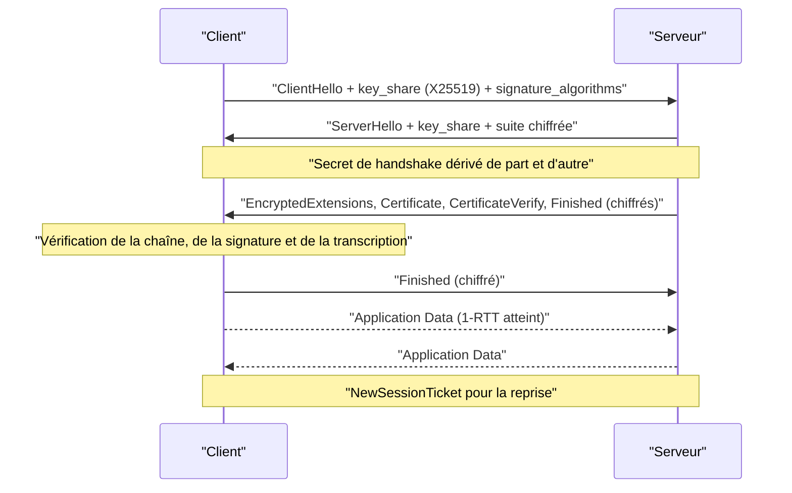
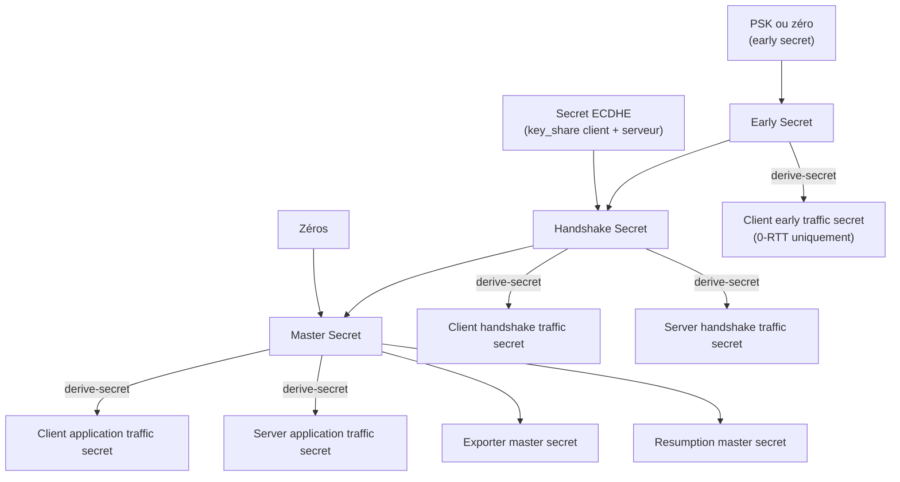

# TLS 1.3

TLS 1.3 (RFC 8446, août 2018) est la refonte du protocole qui protège la majorité du trafic Internet. TLS 1.2 avait accumulé quinze ans d'extensions et d'algorithmes optionnels : négociation de versions descendante, chiffrement par blocs en CBC, transport de clé RSA sans confidentialité persistante, renégociation, compression. Chaque option augmentait la surface d'attaque et la complexité des implémentations. TLS 1.3 inverse la logique : au lieu d'interdire progressivement les mauvais choix, il ne définit qu'un ensemble minimal de mécanismes sûrs et supprime tout le reste du protocole.

Le résultat tient en trois décisions structurantes. Un seul aller-retour est nécessaire pour établir une session authentifiée. Toutes les poignées de main après le `ServerHello` sont chiffrées, certificat compris. Et seuls des algorithmes AEAD, avec échange de clés éphémère, sont autorisés. Ces choix expliquent aussi les limites du protocole : TLS 1.3 protège le contenu, pas la destination, et l'interception légitime reste possible dès qu'une autorité de certification est installée sur le poste.

> [!abstract] Définition — Confidentialité persistante (forward secrecy)
> Propriété d'un échange de clés selon laquelle la compromission ultérieure d'une clé privée à long terme ne permet pas de déchiffrer les sessions passées. Elle est obtenue en dérivant chaque clé de session d'un secret éphémère (ECDHE, DHE) détruit à la fin de la connexion, et non de la clé statique du serveur.

## Ce que TLS 1.3 supprime

| Élément | TLS 1.2 | TLS 1.3 |
|---|---|---|
| Établissement | 2-RTT (ou 1-RTT avec reprise) | 1-RTT, 0-RTT en reprise |
| Échange de clés | RSA statique, DHE, ECDHE | (EC)DHE obligatoire, ou PSK |
| Chiffrement | CBC, RC4, GCM, CCM | AEAD uniquement (GCM, ChaCha20-Poly1305, CCM) |
| Authentification serveur | RSA PKCS#1 v1.5, ECDSA | RSA-PSS, ECDSA, EdDSA |
| Compression | Optionnelle (CRIME) | Supprimée |
| Renégociation | Autorisée | Supprimée, remplacée par `KeyUpdate` |
| Chiffrement du handshake | À partir du `ChangeCipherSpec` | À partir du `ServerHello` |
| Signal de downgrade | Aucun | Octets `DOWNGRD` dans le random serveur |

La suppression de RSA statique est la plus lourde de conséquences. En TLS 1.2, le client chiffrait le pré-master secret avec la clé publique RSA du serveur : un attaquant qui enregistrait le trafic et obtenait plus tard la clé privée pouvait tout déchiffrer. En TLS 1.3, la clé privée ne sert plus qu'à signer la transcription du handshake (`CertificateVerify`) ; elle n'intervient jamais dans la dérivation des clés de session. Une clé de serveur volée permet donc d'usurper le serveur pour de nouvelles connexions, pas de lire les anciennes.

## Le handshake 1-RTT



Le client envoie dès son premier message une part de clé publique (`key_share`) pour le groupe qu'il parie que le serveur va choisir, presque toujours X25519. Si le serveur accepte, le secret partagé est calculé immédiatement et le premier vol serveur suffit : c'est le 1-RTT. Si le client s'est trompé de groupe, le serveur répond par un `HelloRetryRequest` qui coûte un aller-retour supplémentaire. Ce message porte un random spécial (`CF 21 AD 74 ...`) qui le distingue d'un `ServerHello` ordinaire, afin d'éviter les confusions de transcription.

Le client peut envoyer ses données applicatives juste après son `Finished`, sans attendre confirmation. Il a déjà vérifié la signature du serveur : l'authentification est complète de son côté, même si le serveur n'a pas encore validé son propre `Finished`. C'est ce qui rend le 1-RTT utile et pas seulement théorique.

Point souvent mal compris : le SNI (`server_name`) circule en clair dans le `ClientHello`, car le serveur doit choisir le bon certificat avant de pouvoir négocier un chiffrement. Encrypted Client Hello (ECH) corrige cela en chiffrant le vrai SNI sous une clé publique publiée dans le DNS, au prix d'une dépendance forte au résolveur et d'une compatibilité encore partielle.

## Le key schedule

TLS 1.3 remplace le « PRF » de TLS 1.2 par HKDF (RFC 5869) et une hiérarchie explicite de secrets. Chaque étage ne peut être calculé qu'à partir du précédent, ce qui garantit qu'aucune clé de trafic ne fuit si un secret d'un autre étage est compromis.



La dérivation utilise `HKDF-Extract` pour combiner un secret d'entrée avec du sel, puis `HKDF-Expand-Label`, variante de HKDF-Expand qui préfixe le label par `"tls13 "` et inclut le contexte de transcription. Les labels sont normalisés : `"c hs traffic"`, `"s hs traffic"`, `"c ap traffic"`, `"s ap traffic"`, `"exp master"`, `"res master"`, `"key"`, `"iv"`, `"finished"`.

```python
from cryptography.hazmat.primitives.kdf.hkdf import HKDFExpand
from cryptography.hazmat.primitives import hashes

def hkdf_expand_label(secret: bytes, label: str, context: bytes, length: int) -> bytes:
    full_label = b"tls13 " + label.encode()
    info = length.to_bytes(2, "big") + bytes([len(full_label)]) + full_label \
        + bytes([len(context)]) + context
    return HKDFExpand(algorithm=hashes.SHA256(), length=length, info=info).derive(secret)
```

Le `Finished` est un HMAC sur la transcription avec la clé `finished` dérivée du secret de handshake. Comme la transcription inclut tous les messages échangés, toute modification en vol — y compris un `key_share` substitué — invalide le HMAC. C'est ce qui rend l'attaque par homme du milieu détectable même face à un attaquant actif.

## Enregistrements AEAD et limites cryptographiques

Le layer record de TLS 1.3 n'a plus qu'un seul type externe utile : `application_data` (23). Le type réel est déplacé à l'intérieur du contenu chiffré, avec le padding, pour qu'un observateur ne puisse pas distinguer un `handshake` d'une alerte ou d'une donnée applicative. Chaque enregistrement est chiffré avec AEAD et authentifié avec les données associées suivantes :

```text
additional_data = opaque_type (1 octet) || legacy_version (2 octets) || length (2 octets)
nonce = static_iv XOR sequence_number (padded à 12 octets)
```

Le numéro de séquence est implicite, incrémenté par enregistrement, et jamais transmis. Il ne doit jamais être réutilisé avec la même clé : c'est la seule règle absolue de GCM. Un `KeyUpdate` permet de renouveler les clés de trafic sans nouveau handshake. Les limites de confidentialité sont fixées par la RFC : environ 2^24,5 enregistrements pour AES-GCM, 2^62 pour ChaCha20-Poly1305. Les bibliothèques sérieuses déclenchent le renouvellement automatiquement.

Le padding interne est utile contre l'analyse de taille : sans lui, la longueur des enregistrements révèle la taille des requêtes HTTP, ce qui suffit parfois à identifier une page consultée ou un formulaire rempli.

## 0-RTT et reprise de session

Après une première connexion, le serveur envoie un ou plusieurs `NewSessionTicket` contenant un PSK dérivé du `resumption master secret`. Lors d'une reconnexion, le client peut présenter ce PSK et chiffrer des données dès le premier vol (`early_data`) : latence nulle en aller-retour, au prix de trois propriétés dégradées.

| Propriété | Handshake complet | 0-RTT |
|---|---|---|
| Confidentialité persistante | Oui | Non (dérivé du PSK) |
| Résistance au rejeu | Oui | Non par conception |
| Authentification du serveur avant envoi | Oui | Non |
| Protection contre le rejeu | Native | À la charge du serveur |

Le rejeu est inhérent : un attaquant qui capture le premier vol 0-RTT peut le rejouer tel quel, et le serveur le déchiffrera de nouveau. La RFC impose donc que les données 0-RTT soient idempotentes et que le serveur implémente une défense : ticket à usage unique, fenêtre temporelle courte, cache des tickets déjà vus. Les API sensibles (voir [[API Security]]) doivent refuser l'early data, et les développeurs doivent résister à la tentation d'envoyer un `POST` de paiement en 0-RTT.

> [!warning] Piège
> Beaucoup d'implémentations acceptent 0-RTT par défaut côté client sans que l'application sache qu'elle envoie une requête rejouable. Le symptôme typique est une commande dupliquée ou un compteur incrémenté deux fois après une coupure réseau. La parade n'est pas cryptographique : il faut marquer explicitement les requêtes idempotentes et refuser l'early data sur tout le reste.

## Authentification, certificats et épinglage

Le certificat serveur est envoyé dans `Certificate`, puis `CertificateVerify` signe la transcription avec la clé privée. La signature couvre un contexte de 64 octets (`"TLS 1.3, server CertificateVerify"`) suivi d'un zéro, ce qui empêche de réutiliser la signature dans un autre protocole. Le client valide ensuite selon les règles classiques de la PKI, décrites dans [[PKI en profondeur]] : chaîne jusqu'à une racine de confiance, validité temporelle, `basicConstraints`, `keyUsage`, correspondance du SAN avec le nom demandé, révocation.

Trois mécanismes complètent cette validation.

**HSTS** (`Strict-Transport-Security`) impose au navigateur de n'utiliser que HTTPS pour un domaine pendant une durée donnée, et `preload` inscrit le domaine dans une liste embarquée dans les navigateurs. Sans HSTS, un attaquant qui contrôle le réseau peut intercepter la première requête HTTP et rediriger vers une page factice avant que TLS ne s'applique.

**Certificate Transparency** impose que tout certificat publiquement approuvé soit inscrit dans des journaux vérifiables. Les SCT (`Signed Certificate Timestamp`) sont intégrés au certificat ou à l'extension TLS. Un certificat émis pour un domaine sans entrée CT correspondante est un signal fort de mauvaise configuration, voire d'émission frauduleuse.

**Certificate pinning** consiste à coder en dur l'empreinte SPKI attendue. Efficace contre une autorité compromise, il est aussi fragile : un renouvellement de clé non coordonné casse l'application pour tous les utilisateurs, sans possibilité de correctif côté client. Les navigateurs ont abandonné le pinning natif au profit de CT ; le pinning reste pertinent dans les applications mobiles à condition de prévoir une clé de secours et une durée de vie alignée sur celle des certificats.

## Interception légitime et proxy TLS

L'inspection TLS en entreprise place un proxy entre le client et le serveur. Le proxy termine la connexion côté client avec un certificat signé par une autorité interne, puis ouvre une seconde connexion vers le serveur. Le client doit faire confiance à cette autorité, généralement déployée par GPO ou MDM. Le proxy voit alors tout le plaintext : URL, en-têtes, corps, cookies, jetons.

Cette architecture a des conséquences qu'on sous-estime souvent.

| Conséquence | Détail |
|---|---|
| Rupture de bout en bout | Le contenu est lisible par l'appliance et ses journaux |
| Pinning cassé | Les applications qui épinglent leur refusent la connexion |
| mTLS cassé | Le certificat client ne traverse pas le proxy |
| Surface d'attaque | Le proxy devient un point unique de compromission et de fuite |
| Conformité | Journalisation de données sensibles, base légale à documenter |
| Détection | Le certificat émetteur n'est plus celui attendu |

Les proxies modernes tentent de gérer le pinning par contournement ciblé, ce qui revient à désactiver une protection de sécurité sans le consentement de l'éditeur. Côté défense, un certificat émis par une autorité d'entreprise sur un domaine public, l'absence de SCT valide, ou un JA3/JA4 qui ne correspond pas au client annoncé sont des indices d'interception. ECH complique encore la tâche : le proxy ne voit plus le SNI réel et ne peut plus router par nom.

Le cadre juridique varie : en France, l'inspection doit respecter le RGPD, informer les salariés, et éviter de capturer les communications privées ou les données de santé. Une interception techniquement possible n'est pas pour autant licite.

## Attaques et mauvaises configurations

Le catalogue ci-dessous recoupe les attaques réseau classiques décrites dans [[Attaques Réseau]] ; ce qui change avec TLS 1.3, c'est la surface disponible.

| Attaque | Mécanisme | Efficacité sur TLS 1.3 |
|---|---|---|
| Downgrade vers 1.2 | Blocage des ClientHello 1.3 par un middlebox, ou modification de version | Détecté par le random `DOWNGRD`, mais un client forcé en 1.2 reste vulnérable à ses faiblesses |
| MITM avec certificat valide | Autorité compromise ou ajoutée au store | Possible si l'utilisateur ne vérifie pas l'émetteur |
| Rejeu 0-RTT | Rejeu du premier vol | Possible par conception, dépend des défenses serveur |
| Bypass de pinning | Hook, proxy, ou clé extraite de l'APK | Possible sur client compromis |
| Compression | CRIME/BREACH | Supprimée dans TLS 1.3, mais la compression HTTP reste dangereuse |
| Fuite de clé de ticket | Tickets chiffrés avec une clé partagée entre nœuds | Déchiffrement de sessions reprises si la clé fuite |
| Mauvais paramètres DH | Groupe faible ou réutilisation | TLS 1.3 impose des groupes nommés, mais les bibliothèques mal configurées existent |
| Épuisement de ressources | Flood de handshakes, `HelloRetryRequest` | DoS applicatif, pas une rupture cryptographique |

La configuration importe plus que la version. Un serveur TLS 1.3 qui accepte encore TLS 1.0 pour de vieux clients, qui partage la même clé de ticket entre tous ses nœuds, ou qui présente une chaîne incomplète, reste vulnérable. Les tests automatisés (`testssl.sh`, `sslyze`, `nmap --script ssl-enum-ciphers`) doivent vérifier la version, les suites, la chaîne, HSTS, OCSP stapling et les paramètres de reprise.

## Détection

La détection TLS combine trois plans : les journaux applicatifs, la télémétrie réseau et l'analyse des certificats.

**Journaux serveur et proxy.** Nginx expose `$ssl_protocol`, `$ssl_cipher`, `$ssl_server_name` et `$ssl_client_verify`. Une augmentation des négociations en TLS 1.2 sur un parc censé être en 1.3, ou des échecs de handshake corrélés à une IP, signale un balayage ou un client mal configuré. Ces événements ont vocation à rejoindre le SIEM ([[SIEM (Security Information and event Management)]]) pour être corrélés avec les identités : une requête sortante vers un domaine rare, juste après une connexion au proxy d'entreprise, mérite un examen.

```nginx
log_format tls '$remote_addr [$time_local] "$request" '
                'proto=$ssl_protocol cipher=$ssl_cipher '
                'sni=$ssl_server_name verify=$ssl_client_verify';
access_log /var/log/nginx/tls.log tls;
```

**Télémétrie réseau.** Zeek produit un `ssl.log` riche : version négociée, suite, SNI, statut de validation, JA3 et JA3S. Sur un capteur passif, l'absence de `server_name` ou un `validation_status` anormal est un signal. Un IDS ou un WAF (voir [[IDS-IPS-WAF]]) peut aussi alerter sur des `ClientHello` malformés ou des tentatives répétées de négociation descendante. Sur du trafic chiffré, l'analyse de taille et de périodicité reste possible et suffit souvent à repérer un beacon.

```zeek
event ssl_established(c: connection) {
    if ( c$ssl?$version && c$ssl$version == "TLSv12" )
        NOTICE([$note=Notice::ACTION_LOG,
                $msg=fmt("TLS 1.2 négocié vers %s", c$ssl$server_name),
                $conn=c]);
}
```

**Empreintes JA3 et JA4.** JA3 hache la version, les suites, les extensions, les courbes et les formats de point du `ClientHello`. JA4, plus récent, normalise davantage et produit trois composantes (transport, version, SNI) plus une empreinte ALPN. Ces empreintes identifient une bibliothèque ou un outil, pas un utilisateur : un JA3 de `curl` sur un poste Windows, ou un JA3 connu de framework offensif, est un signal de contexte. Elles restent visibles en TLS 1.3 puisque le `ClientHello` est en clair, mais elles sont faciles à imiter et ne constituent pas une preuve.

```bash
# Extraire JA3 d'une capture
tshark -r capture.pcap -Y "tls.handshake.type == 1" \
  -T fields -e ip.src -e tls.handshake.ja3

# Négociation observée côté client
openssl s_client -connect exemple.fr:443 -servername exemple.fr -brief
```

**Certificats.** La surveillance des journaux CT (`crt.sh`, ou un flux certstream) permet de détecter l'émission d'un certificat pour un domaine de l'organisation par une autorité inattendue. Côté client, un certificat auto-signé, une chaîne incomplète, un SAN qui ne correspond pas, une validité anormalement longue ou un émetteur interne sur un domaine public sont des indicateurs d'interception ou d'usurpation.

**Limites.** TLS 1.3 chiffre le certificat, donc un capteur passif ne peut plus l'observer sans clé de session. Le SNI reste lisible sauf ECH. JA3/JA4 décrivent le client, pas l'intention. Et l'interception légitime produit elle-même des faux positifs massifs : toute détection doit être calibrée sur l'infrastructure de l'organisation avant d'alerter.

> [!quiz] Pourquoi TLS 1.3 est-il immunisé contre le rejeu du handshake complet, mais pas contre le rejeu des données 0-RTT ?
> Parce que le handshake complet dérive ses clés d'un ECDHE aléatoire frais pour chaque connexion : rejouer les messages produirait un secret différent et échouerait au `Finished`. En 0-RTT, les données sont chiffrées avec une clé dérivée d'un PSK de reprise, sans aléa nouveau ; un attaquant peut donc renvoyer le même premier vol et le serveur le déchiffrera à l'identique. La résistance au rejeu doit être ajoutée au niveau applicatif ou par une gestion stricte des tickets.

> [!quiz] Un certificat de serveur volé permet-il de déchiffrer les sessions TLS 1.3 enregistrées auparavant ?
> Non. La clé privée ne sert qu'à signer `CertificateVerify` ; les clés de session viennent d'ECDHE et ne sont jamais chiffrées avec elle. C'est exactement la propriété de confidentialité persistante. La clé volée permet en revanche d'usurper le serveur pour de nouvelles connexions, à condition de contrôler le réseau ou le DNS.
