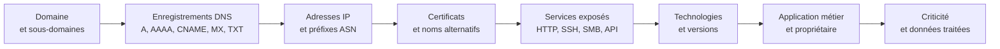
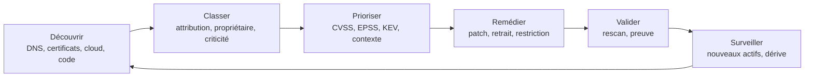

# Attack Surface Management

Une organisation ne peut protéger que ce qu'elle connaît, et elle connaît rarement l'intégralité de ce qu'elle expose. Le CMDB décrit les serveurs déclarés, pas le sous-domaine créé par une équipe marketing pour une campagne, ni le bucket de stockage ouvert par un développeur, ni l'instance cloud lancée pour un test et jamais éteinte. La surface d'attaque réelle est celle que l'attaquant observe depuis internet, et elle diverge systématiquement de l'inventaire officiel.

L'Attack Surface Management (ASM) est la discipline qui réduit cet écart. Elle consiste à découvrir en continu les actifs exposés, à les rattacher à l'organisation et à leurs propriétaires, puis à prioriser les corrections selon le risque réel. Elle emprunte ses techniques à la reconnaissance offensive, mais les applique à son propre périmètre, avec une exigence de couverture et de répétabilité qui distingue un programme industriel d'un pentest ponctuel.

> [!abstract] Définition — Attack Surface Management
> L'ASM est le processus continu de découverte, d'inventaire, de classification et de priorisation des actifs exposés d'une organisation, afin d'identifier les chemins d'attaque possibles et de réduire la surface avant qu'un adversaire ne l'exploite. Il combine des sources passives, des scans actifs autorisés et des intégrations aux systèmes internes.

## EASM, CAASM et DRPS

| Discipline | Périmètre | Sources | Sortie principale |
|---|---|---|---|
| EASM | Surface externe visible depuis internet | DNS, certificats, BGP, scanners, OSINT | Inventaire externe, expositions, risques |
| CAASM | Actifs internes et externes déjà instrumentés | API EDR, CMDB, cloud, VM, IAM, MDM | Inventaire consolidé, angles morts, propriétaires |
| DRPS | Risque numérique et réputationnel | Web, réseaux sociaux, dark web, places de marché | Usurpation, fuites, menaces de marque |

L'EASM répond à la question « que voit un attaquant sans aucun accès préalable ? ». Il ne nécessite aucun agent et ne dépend pas de la bonne volonté des équipes. Le CAASM agrège ce que les outils internes savent déjà, déduplique et révèle les actifs présents dans une source mais absents d'une autre. Un serveur vu par l'EDR mais absent du CMDB est un angle mort de gouvernance ; un serveur du CMDB absent de l'EDR est un angle mort de détection.

Les DRPS couvrent domaines ressemblants, applications mobiles frauduleuses, comptes compromis, fuites de données et places de marché criminelles. Ils rejoignent l'ASM lorsque l'usurpation d'un domaine prépare une campagne de phishing.

Dans la pratique, les frontières s'estompent : les plateformes récentes combinent découverte externe, intégration interne et veille sur les fuites. L'important est de savoir quel problème chaque brique résout.

## Cartographie de la surface

Un actif exposé se décrit par une chaîne : un nom de domaine pointe vers une adresse IP, qui héberge un certificat, qui présente un service, qui exécute une technologie, qui appartient à une application métier, qui dépend d'un propriétaire.



Les catégories à couvrir dépassent largement les serveurs web : domaines et sous-domaines, plages IP et ASN, certificats, services réseau, applications et API, comptes cloud et buckets, dépôts de code, applications mobiles, tenants SaaS, identités exposées, objets connectés et systèmes industriels, sans oublier les tiers et les filiales.

L'attribution est le problème central. Une adresse IP peut être partagée par un CDN, un hébergeur mutualisé ou un fournisseur SaaS. Un certificat peut mentionner des dizaines de noms. Un domaine peut appartenir à une filiale acquise mais non intégrée. La découverte produit du bruit ; l'attribution transforme ce bruit en inventaire. Les techniques incluent la vérification d'un fichier de preuve déposé sur le serveur, l'analyse des enregistrements TXT, la correspondance avec les plages ASN déclarées, l'analyse des certificats et la confrontation avec les registres de marques.

## Sources de découverte

| Source | Ce qu'elle révèle | Limite |
|---|---|---|
| DNS passif et historique | Sous-domaines, changements d'infrastructure | Données parfois incomplètes ou payantes |
| Certificate Transparency | Noms présents dans les certificats | Ne voit que le HTTPS |
| BGP et ASN | Préfixes annoncés, hébergeurs, acquisitions | Ne dit rien des services |
| WHOIS et RDAP | Titulaires, contacts, dates | Souvent masqué par les registres |
| Moteurs de scan (Shodan, Censys) | Services, bannières, technologies | Index partiel et daté |
| API cloud | Instances, buckets, équilibreurs, fonctions | Nécessite des droits de lecture |
| EDR, CMDB, MDM | Actifs gérés et agents | Aveugle aux actifs non gérés |
| Journaux SSO et CASB | Applications SaaS utilisées | Dépend de la couverture de l'IdP |
| Dépôts de code | Domaines, clés, endpoints internes | Volume et faux positifs élevés |
| App stores | Applications mobiles, SDK, backends | Analyse parfois lourde |
| Fuites de données | Identifiants, emails, endpoints | Usage éthique et légal encadré |

Les journaux de Certificate Transparency sont une source particulièrement rentable. Chaque certificat émis pour un domaine y est publié, avec ses noms alternatifs. Une requête sur `crt.sh` révèle souvent des sous-domaines oubliés et des environnements de test exposés par erreur.

```bash
curl -s "https://crt.sh/?q=%25.example.com&output=json" \
  | jq -r '.[].name_value' \
  | sed 's/\*\.//g' \
  | tr ',' '\n' \
  | sort -u > ct_subdomains.txt
```

Les moteurs de scan externes complètent la vue. Shodan et Censys indexent les bannières et permettent des recherches par certificat, par hash de favicon ou par en-tête. SecurityTrails et VirusTotal apportent l'historique DNS, theHarvester collecte emails et sous-domaines, et Nuclei teste les expositions connues sur les services découverts.

```bash
shodan search 'ssl:"example.com" http.title:"Dashboard"' \
  --fields ip_str,port,hostnames,http.title

censys search 'services.tls.certificates.leaf_data.subject.common_name: example.com'
```

L'analyse des préfixes annoncés affine le périmètre. Un ASN dédié donne une vue fiable des adresses réellement détenues, à condition de distinguer les annonces de transit des annonces propres.

```bash
whois -h whois.radb.net -- '-i origin AS64500' | grep '^route'
curl -s "https://api.bgpview.io/asn/64500/prefixes" | jq -r '.data.ipv4_prefixes[].prefix'
```

## Techniques d'énumération

La découverte de sous-domaines combine sources passives et résolution active. Subfinder agrège des dizaines de sources ; Amass offre une cartographie plus profonde, avec brute-force et corrélation DNS.

```bash
subfinder -d example.com -all -silent -o subs_passive.txt

amass enum -active -d example.com -brute \
  -w /usr/share/seclists/Discovery/DNS/subdomains-top1million-5000.txt \
  -o subs_amass.txt

cat subs_passive.txt subs_amass.txt | sort -u > subs_all.txt
```

Les permutations exploitent les conventions de nommage : `dev-`, `stg-`, `-old`, `-backup`, `api-`, `admin-`. Alterx génère ces variantes à partir des noms observés, ce qui révèle souvent des environnements non référencés.

```bash
alterx -l subs_all.txt -enrich -silent | dnsx -silent -a -resp -o subs_resolved.txt
```

La résolution doit filtrer les jokers DNS, qui font répondre n'importe quel nom et produisent des milliers de faux positifs. Un domaine qui résout tous les noms vers la même adresse est un piège classique.

```bash
dnsx -l subs_all.txt -wd example.com -silent -a -resp -o resolved.txt
```

Une fois les hôtes résolus, le probing HTTP identifie les services réellement actifs et les technologies.

```bash
cat resolved.txt | httpx -silent \
  -title -status-code -tech-detect -web-server -tls-grab \
  -favicon -jarm \
  -o live_services.jsonl
```

Le scan de ports doit rester ciblé et respectueux des limites. Naabu ou Nmap sur les ports les plus exposés suffisent pour une première passe ; un scan complet se justifie sur les actifs critiques, avec autorisation et fenêtre de maintenance.

```bash
naabu -list resolved.txt -top-ports 1000 -silent -o open_ports.txt

nmap -iL resolved.txt -p 22,80,443,445,3389,5432,6379,9200,27017 \
  --open -T3 -oG exposed_services.gnmap
```

Le hash de favicon permet de retrouver des instances d'une même application derrière des domaines différents : un panneau d'administration déployé plusieurs fois partage souvent la même icône.

```python
import codecs
import mmh3
import requests

resp = requests.get("https://example.com/favicon.ico", timeout=10)
print(mmh3.hash(codecs.encode(resp.content, "base64")))
```

La valeur obtenue se recherche ensuite dans Shodan (`http.favicon.hash:-123456789`), ce qui révèle les autres instances exposées.

L'inventaire cloud complète la vue externe. Les requêtes natives permettent d'énumérer les ressources sans agent.

```kusto
Resources
| where type in~ ('microsoft.compute/virtualmachines', 'microsoft.storage/storageaccounts')
| project name, resourceGroup, location, tags, properties
```

Le code source est une source souvent négligée. Les dépôts publics exposent des endpoints internes, des noms d'hôtes, des clés d'API et des configurations. La recherche doit se limiter aux dépôts de l'organisation, et les secrets découverts doivent être révoqués avant toute analyse approfondie.

```bash
trufflehog github --org=example-org --only-verified
gitleaks detect --source . --report-format json --report-path leaks.json
```

Les applications mobiles contiennent fréquemment des endpoints de test, des clés de SDK et des URL de backend non documentées.

```bash
apktool d app-release.apk -o apk_out
grep -RhoE 'https://[a-zA-Z0-9./_-]+' apk_out | sort -u
```

SpiderFoot automatise l'enchaînement de ces sources pour un domaine donné.

```bash
spiderfoot -s example.com -t DOMAIN_NAME,IP_ADDRESS,EMAILADDR -o csv -q
```

## De la découverte à l'inventaire

Brut, le résultat est inutilisable : doublons, hôtes morts, domaines tiers, adresses de CDN. La normalisation consiste à canonicaliser les noms, dédupliquer par couple nom/port/certificat, résoudre les alias, écarter les jokers et rattacher chaque actif à une entité.

Un inventaire utile porte, pour chaque actif : identifiant stable, nom canonique, adresses, ports, technologies et versions, certificat et date d'expiration, fournisseur cloud et compte, environnement, application métier, propriétaire, criticité, date de première et de dernière observation. La date de dernière observation est essentielle : un actif non revu depuis trois mois est peut-être éteint, ou peut-être simplement invisible pour la source courante.

Le graphe d'actifs relie ces entités et fait apparaître les chemins. Un domaine expose une application qui s'authentifie auprès d'un IdP, qui fédère vers un tenant cloud, qui contient une base de données accessible par un rôle trop permissif. Ce chemin, et non la vulnérabilité isolée, constitue le risque réel.

## Scoring et priorisation

Le CVSS mesure la gravité théorique d'une vulnérabilité, pas l'urgence de la corriger. Trois compléments sont devenus standard : EPSS, qui estime la probabilité d'exploitation dans les trente jours ; le catalogue KEV de la CISA, qui liste les vulnérabilités activement exploitées ; et les facteurs contextuels que sont l'exposition, la criticité métier et la reachability.

| Facteur | Question | Effet |
|---|---|---|
| CVSS | Quelle est la gravité si exploitée ? | Pondération de base |
| EPSS | Quelle est la probabilité d'exploitation ? | Priorise les CVE réellement attaquées |
| KEV | L'exploitation est-elle confirmée ? | Traitement prioritaire |
| Exposition | L'actif est-il joignable depuis internet ? | Multiplicateur fort |
| Reachability | La vulnérabilité est-elle réellement atteignable ? | Réduit les faux positifs |
| Criticité métier | Que perd-on si l'actif tombe ? | Pondération métier |
| Données | Quelles données l'actif traite-t-il ? | Impact réglementaire |
| Identité | L'actif donne-t-il accès à un domaine privilégié ? | Élévation du risque |

Une formule simple combine ces dimensions :

```text
risque = impact_metier × exposition × exploitabilite × confiance
```

`exploitabilite` peut être dérivée de KEV (1,0), d'un EPSS élevé (0,8), d'un exploit public (0,6) ou de l'absence d'exploit connu (0,2). `confiance` reflète la qualité de la découverte.

Le framework SSVC propose une alternative sous forme d'arbre de décision : exploitation observée, exposition, automatisation, impact. Il produit quatre catégories — Track, Track*, Attend, Act — plus faciles à opérer qu'un score numérique.

Les SLA se déduisent de la combinaison, pas du seul CVSS.

| Situation | Exemple | Délai cible |
|---|---|---|
| KEV sur actif exposé | CVE connue exploitée sur une passerelle VPN | 24 à 48 h |
| Critique exposé, EPSS élevé | RCE non authentifiée sur un portail | 72 h |
| Critique interne | RCE sur un serveur non joignable | 7 à 14 j |
| Élevé exposé | Traversée de répertoire sans impact direct | 14 j |
| Moyen | Fuite d'information mineure | 30 à 90 j |

La priorisation doit aussi tenir compte des chemins d'attaque. Une vulnérabilité moyenne sur un serveur qui permet de rebondir vers le contrôleur de domaine pèse davantage qu'une vulnérabilité critique sur une machine isolée.

## Processus continu



La cadence dépend de la volatilité. La surface externe se découvre quotidiennement, les inventaires cloud plusieurs fois par jour, les dépôts de code à chaque changement. Une revue trimestrielle suffit pour les partenaires et les filiales.

Chaque écart doit avoir un propriétaire. Un actif sans propriétaire est un actif non corrigé : la première action n'est pas technique, elle est organisationnelle. Les tickets se créent par actif et non par vulnérabilité, afin d'éviter la duplication.

La validation est l'étape la plus souvent omise. Un patch déclaré n'est pas un patch vérifié : il faut rescanner, confirmer la disparition du service ou de la version vulnérable, et consigner la preuve. Sans cette boucle, l'indicateur de remédiation mesure des intentions.

## Intégration

| Système | Usage | Bénéfice |
|---|---|---|
| Gestion des vulnérabilités | Consolidation des findings par actif | Vue unique, déduplication |
| SIEM | Alertes sur nouveaux actifs et expositions | Détection contextuelle |
| SOAR | Enrichissement, ouverture de tickets, takedown | Réduction du temps de réponse |
| ITAM et CMDB | Propriétaire, criticité, cycle de vie | Attribution et gouvernance |
| Threat intelligence | IOC croisés avec la surface | Priorisation par menace réelle |
| EDR et CASB | Couverture réelle des actifs | Détection des angles morts |
| Équipe marque et juridique | Usurpation, contenu frauduleux | Retrait et protection |
| Bug bounty | Découverte externe continue | Signal complémentaire |

L'intégration à la threat intelligence est particulièrement rentable. Une adresse IP ou un domaine observé dans une campagne contre le secteur peut être confronté à l'inventaire : s'il appartient à l'organisation, la compromission est probable ; s'il ressemble à un domaine interne, il s'agit peut-être d'une usurpation.

## Détection

Les alertes d'ASM ne sont pas des alertes de compromission : ce sont des signaux de dérive de la surface. Elles se classent en plusieurs familles.

| Signal | Mécanisme | Réponse |
|---|---|---|
| Nouveau sous-domaine | Diff entre deux snapshots DNS ou CT logs | Vérifier propriétaire et intention |
| Nouveau certificat | Flux Certificate Transparency | Détecter les émissions non autorisées |
| Certificat expiré | Date d'expiration | Renouveler ou retirer |
| Service nouvellement exposé | Apparition d'un port ou d'une bannière | Restreindre ou fermer |
| Port sensible exposé | 3389, 445, 6379, 9200, 27017 | Isolation immédiate |
| Bucket public | API cloud et scan | Blocage et revue des données |
| Identifiants fuités | Veille de breach, dépôts publics | Révocation et rotation |
| Domaine ressemblant | dnstwist, DRPS | Surveillance, blocage, retrait |
| Application mobile frauduleuse | App stores, DRPS | Signalement et retrait |
| SaaS non sanctionné | Journaux SSO, CASB | Revue et régularisation |

Un différentiel simple entre deux inventaires suffit à produire l'alerte la plus utile du programme.

```bash
subfinder -d example.com -silent | sort -u > inventory_today.txt
comm -13 inventory_yesterday.txt inventory_today.txt > new_assets.txt
```

Pour les certificats, un flux de type certstream permet de réagir en quasi-temps réel. Une règle de surveillance compare les noms émis aux domaines légitimes et aux motifs autorisés.

```python
import certstream

def on_message(message, context):
    if message["message_type"] != "certificate_update":
        return
    leaf = message["data"]["leaf_cert"]
    for domain in leaf.get("all_domains", []):
        if domain.endswith(".example.com"):
            print("certificat observé:", domain, leaf.get("fingerprint"))

certstream.listen_for_events(on_message)
```

La détection d'usurpation de marque s'appuie sur la génération de variantes : fautes de frappe, homoglyphes, ajout de suffixes, changements de TLD.

```bash
dnstwist --registered example.com --format csv --output lookalikes.csv
```

Ces alertes doivent être enrichies avant le triage : propriétaire, environnement, date de création, correspondance avec une campagne connue.

## Limites

La découverte externe ne voit que ce qui est joignable. Les services authentifiés, les API privées, les réseaux partenaires et l'IPv6 mal cartographié échappent souvent aux scanners. Les CDN et hébergeurs mutualisés brouillent l'attribution.

Les actifs éphémères défient l'inventaire. Une instance cloud créée pour un test vit quelques heures ; un conteneur redéployé change d'adresse. Sans intégration aux API cloud, l'ASM photographie une surface qui n'existe déjà plus.

Le scan actif pose des questions juridiques. On ne scanne que ce que l'on possède ou ce pour quoi on dispose d'une autorisation écrite. Un scan mal cadré peut être qualifié d'atteinte à un système de traitement automatisé de données, même sur une filiale. Les limites de débit et la coordination avec l'exploitation ne sont pas des précautions accessoires.

Enfin, l'ASM produit une illusion de complétude. Un tableau de bord avec 12 000 actifs ne dit rien de ce qui manque. Les métriques utiles sont la couverture des sources, le taux d'actifs attribués et le taux de remédiation vérifiée, pas le nombre d'actifs affichés.

> [!quiz] Quelle est la différence entre EASM et CAASM ?
> Réponse — L'EASM découvre la surface visible depuis internet sans agent, à partir de sources externes (DNS, certificats, BGP, scanners). Le CAASM agrège les données des outils internes (EDR, CMDB, cloud, IAM) pour produire un inventaire consolidé et révéler les écarts entre sources. L'EASM voit ce que l'attaquant voit ; le CAASM voit ce que l'organisation croit gérer.

> [!quiz] Pourquoi un score CVSS de 9,8 ne justifie-t-il pas nécessairement un patch en urgence ?
> Réponse — Le CVSS mesure l'impact théorique, pas la probabilité d'exploitation ni l'exposition réelle. Une vulnérabilité critique sur un service non joignable, sans exploit public et avec un EPSS faible, présente un risque moindre qu'une vulnérabilité moyenne sur une passerelle exposée et déjà exploitée dans la nature. La décision combine KEV, EPSS, exposition, reachability et criticité métier.
