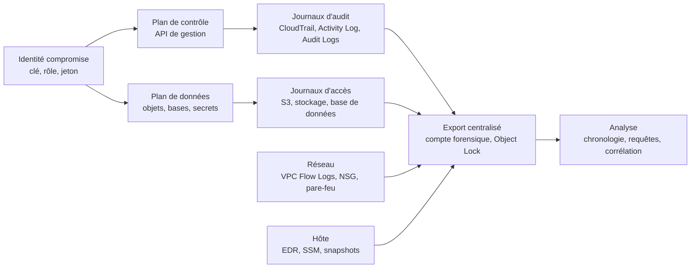

# Cloud Forensics et IR

La forensique cloud applique les principes du [[DFIR]] à des systèmes dont l'analyste ne possède ni le matériel, ni l'hyperviseur, ni les journaux complets. Le périmètre est défini par des API, des identités et des politiques, non par un boîtier que l'on peut débrancher. Cette différence change la nature de la preuve, l'ordre des opérations de confinement et la répartition des responsabilités entre client et fournisseur.

Un incident cloud laisse peu de traces locales. Une clé d'accès utilisée depuis un pays étranger, un rôle assumé par une fonction Lambda, un snapshot partagé vers un compte inconnu ou une politique de bucket modifiée ne produisent aucun fichier suspect sur un disque. La preuve est un événement d'API horodaté, souvent conservé quatre-vingt-dix jours, parfois désactivé par l'attaquant. L'enquêteur reconstitue une chronologie à partir de plans de contrôle distribués, puis contient l'identité compromise sans détruire les traces.

> [!abstract] Définition — Forensique cloud
> Discipline qui consiste à collecter, préserver, analyser et présenter des preuves numériques hébergées chez un fournisseur cloud, principalement via ses API de journalisation, de snapshot et d'export. Elle inclut la reconstruction des actions du plan de contrôle et du plan de données, la préservation des artefacts volatils et la documentation de la chaîne de possession.

## Défis structurels

| Défi | Conséquence pratique |
|---|---|
| Éphémère | Conteneurs, fonctions et instances peuvent disparaître avant toute acquisition |
| Distribué | Une application s'étend sur plusieurs comptes, régions et fournisseurs |
| Multi-tenant | Le matériel et l'hyperviseur sont partagés, hors du périmètre du client |
| API-first | Tout passe par des appels authentifiés, donc par des journaux et des permissions |
| Absence d'accès physique | Pas de copie disque directe, pas de write-blocker, pas de RAM sans agent |
| Juridictions | Les données et les journaux peuvent résider dans un autre pays |
| Volumétrie | Des téraoctets de logs pour quelques heures d'activité |

Deux conséquences en découlent. La journalisation doit être décidée avant l'incident : on ne peut pas acquérir un log qui n'a jamais été activé. Et le confinement entre en conflit avec la préservation plus vite qu'en environnement traditionnel : arrêter une instance détruit sa mémoire, et remplacer un groupe de sécurité peut couper le canal SSM ou EDR qui permettait la collecte.

## Plan de contrôle, plan de données et preuve

La forensique cloud distingue deux plans. Le plan de contrôle comprend les API de gestion : identités, politiques, ressources, réseau. Le plan de données comprend les accès aux contenus : lecture d'un blob, requête dans une base, téléchargement d'un secret. Les journaux de contrôle sont généralement activés par défaut ; ceux de données sont optionnels et facturés, ce qui crée un angle mort majeur.



La responsabilité de la preuve suit le modèle de [[Cloud Security|responsabilité partagée]]. Le fournisseur détient les journaux d'infrastructure, les métadonnées de facturation et parfois les journaux de bordure ; le client détient ceux de ses comptes, identités et applications. Une enquête sérieuse combine les deux, ce qui suppose une procédure de contact, parfois une réquisition judiciaire.

## Sources de preuve

### AWS

| Source | Contenu | Rétention et limites |
|---|---|---|
| CloudTrail | Événements de gestion, identité appelante, IP, paramètres | 90 jours dans l'historique, illimité si exporté |
| CloudTrail Lake | Requêtes SQL sur un magasin d'événements | Rétention configurable jusqu'à 10 ans |
| VPC Flow Logs | Métadonnées des flux réseau | Pas de charge utile, pas de trafic vers le metadata |
| GuardDuty | Findings comportementaux | 90 jours, détection managée |
| S3 access logs | Requêtes sur les objets | Activation par bucket, latence de diffusion |
| EKS audit logs | Appels au serveur d'API Kubernetes | À activer vers CloudWatch |
| Snapshots EBS et RDS | État disque ou base | Pas de mémoire, chiffrement lié à la clé KMS |
| Logs Lambda | Journaux d'exécution | Rétention par groupe de logs, souvent courte |

CloudTrail avec validation d'intégrité produit des fichiers de digest signés et chaînés toutes les heures. Cette validation détecte une altération après coup ; elle ne prouve pas que l'attaquant n'a pas désactivé le trail avant d'agir.

### Azure

| Source | Contenu | Rétention et limites |
|---|---|---|
| Activity Log | Opérations du plan de contrôle Azure | 90 jours, export requis au-delà |
| Entra sign-in logs | Connexions, échecs, MFA, Conditional Access | 30 jours, 7 en offre gratuite |
| Entra audit logs | Créations, rôles, applications, consentements | 30 jours par défaut |
| Defender for Cloud | Alertes et posture | Rétention dépendante du plan |
| VNet flow logs | Flux réseau des machines virtuelles | Remplace les NSG flow logs, métadonnées seules |
| Snapshots de disques | État des disques managés | Pas de mémoire, export par SAS temporaire |

Les journaux Entra sont la source la plus importante pour un incident d'identité : création d'application, ajout de credential à un service principal, consentement OAuth, élévation PIM. Ils sont aussi les plus fragiles, car leur rétention par défaut est courte et leur export dépend d'un diagnostic setting configuré à l'avance.

### GCP

| Source | Contenu | Rétention et limites |
|---|---|---|
| Cloud Audit Logs — Admin Activity | Modifications de configuration | 400 jours, toujours activés |
| Cloud Audit Logs — Data Access | Lectures et écritures de données | 30 jours par défaut, souvent désactivés |
| VPC Flow Logs | Flux des interfaces | Échantillonnage, agrégation, métadonnées |
| Security Command Center | Findings et chemins d'attaque | Rétention selon le niveau |
| Snapshots Persistent Disk | État des disques | Pas de mémoire |

La distinction Admin Activity et Data Access structure l'enquête : une exfiltration se voit rarement dans Admin Activity, car lire un objet n'est pas une opération de gestion. Si Data Access n'était pas activé, il faut s'appuyer sur les journaux d'accès du service, les flux réseau et les journaux applicatifs.

## Acquisition et chaîne de possession

L'ordre de volatilité de la RFC 3227 s'adapte : mémoire et connexions d'abord, puis état des ressources, puis snapshots, puis journaux exportés. En cloud, la première étape est souvent de geler l'identité et de capturer les journaux avant qu'ils n'expirent, car les journaux sont la preuve la plus périssable.

```bash
# 1. Figer la zone : snapshot avant toute modification destructive
aws ec2 create-snapshot \
  --volume-id vol-0123456789abcdef0 \
  --description "IR-2026-042 volume systeme" \
  --tag-specifications 'ResourceType=snapshot,Tags=[{Key=case,Value=IR-2026-042}]'

# 2. Copier vers un compte forensique, avec ré-encryption
aws ec2 copy-snapshot \
  --source-region eu-west-1 --source-snapshot-id snap-0123456789abcdef0 \
  --region eu-west-3 --encrypted --kms-key-id alias/forensic

# 3. Capturer la mémoire avant isolation si SSM est le seul canal
aws ssm send-command \
  --document-name "AWS-RunShellScript" \
  --instance-ids i-0123456789abcdef0 \
  --parameters commands=["/opt/avml /tmp/mem.lime"]

# 4. Empreinte de l'artefact après export
sha256sum mem.lime disk.raw
```

Trois précautions conditionnent la valeur de la preuve. Le snapshot est étiqueté avec le dossier, la date UTC et l'opérateur. La copie doit être chiffrée avec une clé hors du contrôle de l'attaquant. Le hash doit être calculé sur l'artefact conservé, puis recalculé à chaque transfert.

| Champ de chaîne de possession | Exemple |
|---|---|
| Identifiant de dossier | IR-2026-042 |
| Source | Compte 123456789012, eu-west-1, volume vol-... |
| Méthode | `ec2 create-snapshot` puis `copy-snapshot` |
| Opérateur | analyste, horodatage UTC, ticket |
| Empreinte | SHA-256 du snapshot exporté et du fichier téléchargé |
| Stockage | compte forensique, bucket Object Lock, région |
| Transferts | destination, destinataire, hash avant et après |

S3 Object Lock, en mode compliance, empêche la suppression et l'altération des objets pendant la durée de rétention, y compris par le compte root. C'est le contrôle de préservation le plus solide du marché AWS. Il exige toutefois d'être activé à la création du bucket et ne protège que les objets déposés dans ce bucket.

## Endiguement

Le confinement cloud vise trois objectifs : couper l'action de l'attaquant, préserver la possibilité d'enquêter, éviter la destruction de preuves.

| Action | Commande ou méthode | Précaution |
|---|---|---|
| Isoler une instance | Remplacer le security group par un SG sans ingress ni egress | Coupe SSM et EDR ; capturer avant |
| Empêcher la suppression | Activer la protection contre la résiliation | À faire avant toute manipulation |
| Désactiver une clé | `aws iam update-access-key --status Inactive` | Conserver la clé pour l'enquête |
| Révoquer des sessions | Politique Deny sur `aws:TokenIssueTime` | Les jetons déjà émis restent valides sinon |
| Désactiver un compte | `Update-MgUser -AccountEnabled:$false` | Révoquer aussi les jetons |
| Retirer un rôle | Détacher le profil d'instance, supprimer les credentials | Vérifier les autres porteurs du rôle |
| Isoler un réseau | NACL ou pare-feu de sous-réseau | Ne pas supprimer les logs de flux |

```json
{
  "Version": "2012-10-17",
  "Statement": [{
    "Effect": "Deny",
    "Action": "*",
    "Resource": "*",
    "Condition": {
      "DateLessThan": {"aws:TokenIssueTime": "2026-10-20T12:00:00Z"}
    }
  }]
}
```

Cette politique, attachée à un rôle, invalide les sessions émises avant l'heure indiquée. Elle ne supprime pas les clés d'accès longue durée, qui doivent être désactivées séparément, et ne protège pas un attaquant qui dispose d'un autre rôle ou d'un compte hors périmètre.

> [!warning] Piège fréquent
> Isoler une instance EC2 en lui retirant son accès réseau peut rendre impossible la capture mémoire via SSM ou EDR, et empêcher l'agent de remonter ses derniers journaux. L'ordre correct est mémoire, snapshot, puis isolation réseau. Si l'instance est déjà isolée, il faut un canal hors bande ou accepter de perdre la mémoire.

## Incidents d'identité

L'identité est le périmètre d'attaque principal du cloud. Quatre cas dominent.

La clé d'accès compromise se détecte par un usage depuis une IP ou un pays inhabituel, un changement de user-agent, ou des appels d'énumération (`ListBuckets`, `DescribeInstances`, `GetCallerIdentity`). La clé peut être désactivée immédiatement ; il faut ensuite rechercher toutes les actions réalisées avec elle, y compris la création de nouvelles clés ou de nouveaux utilisateurs.

Le rôle assumé indûment se détecte par un `AssumeRole` depuis un principal inattendu, ou par une chaîne d'appels incompatible avec le service censé l'utiliser. La révocation passe par la suppression des sessions et, si nécessaire, par la modification de la trust policy. Un rôle de service compromis peut avoir créé des ressources persistantes dans plusieurs régions.

Le service principal compromis concerne Azure et GCP : ajout d'un secret ou d'un certificat à une application, attribution d'une permission application, consentement OAuth illicite. La détection repose sur les journaux d'audit Entra et l'inventaire des grants OAuth. La révocation exige de supprimer les credentials ajoutés, pas seulement de changer le mot de passe de l'administrateur.

Le jeton OAuth volé est le cas le plus difficile. Un access token reste valide jusqu'à une heure, un refresh token beaucoup plus longtemps. Révoquer les sessions est nécessaire mais parfois insuffisant si l'application a obtenu un jeton auprès d'un autre tenant. Il faut révoquer les consentements, désactiver l'application et vérifier les journaux d'accès.

| Technique ATT&CK | Usage dans un incident cloud |
|---|---|
| T1078.004 | Compte cloud légitime utilisé sans credential volé visible |
| T1098.001 | Ajout de credentials à un compte ou service principal |
| T1098.003 | Ajout de rôle ou élévation de privilège |
| T1552.005 | Vol de credentials via le service de métadonnées |
| T1530 | Accès aux données d'un stockage objet |
| T1537 | Transfert de données vers un compte cloud tiers |
| T1567.002 | Exfiltration vers un stockage cloud externe |
| T1486 | Chiffrement de données pour impact |
| T1490 | Suppression des sauvegardes et snapshots |
| T1562.008 | Désactivation des journaux cloud |

## Rançongiciel cloud

Le [[Ransomware|rançongiciel]] cloud ne chiffre pas nécessairement des fichiers locaux : il peut supprimer des snapshots, désactiver la versioning, détruire des sauvegardes ou programmer la suppression d'une clé KMS. L'impact est obtenu par indisponibilité, pas par cryptographie sur les objets.

| Contrôle | Effet | Limite |
|---|---|---|
| Versioning S3 | Conserve les versions antérieures | L'attaquant peut supprimer les versions |
| Object Lock compliance | Immuabilité pendant la rétention | À activer à la création, coût de stockage |
| MFA delete | Protège la suppression de versions | Nécessite un facteur MFA |
| AWS Backup Vault Lock | Verrouille le coffre de sauvegarde | Couvre les ressources intégrées au plan |
| Snapshot cross-account | Copie hors du périmètre compromis | Clé KMS et politique de partage à gérer |
| Séparation des clés KMS | Une clé par domaine, admin distinct | Complexité opérationnelle |
| Restauration testée | Prouve que la sauvegarde est utilisable | Nécessite des exercices réguliers |

La suppression programmée d'une clé KMS est réversible pendant la fenêtre d'attente de sept à trente jours. `aws kms cancel-key-deletion` annule la suppression si elle est détectée à temps, à condition que la clé n'ait pas déjà été désactivée et que les données chiffrées soient encore présentes.

> [!important] Idée clé
> Une sauvegarde cloud n'est réellement une sauvegarde que si elle est dans un compte différent, avec des identités différentes, un chiffrement dont l'attaquant n'a pas la clé, et une restauration testée. Trois copies dans le même compte sous le même rôle administrateur constituent une seule cible.

## Playbook cloud

| Phase | Actions spécifiques |
|---|---|
| Préparation | Trail multi-région, export central, Object Lock, contacts fournisseur, accès forensique testé |
| Détection et triage | Qualifier l'identité, la région, le plan touché, la présence de données personnelles |
| Confinement | Désactiver l'identité, révoquer les sessions, isoler le réseau, snapshot avant destruction |
| Éradication | Supprimer les credentials ajoutés, les ressources persistantes, les politiques malveillantes |
| Rétablissement | Restaurer depuis une sauvegarde saine, rotation des secrets, surveillance renforcée |
| Retour d'expérience | Chronologie, coût, délais, lacunes de journalisation, actions correctives |

Le triage répond à quatre questions avant d'agir : quel principal est compromis, quelles régions et quels comptes sont concernés, quelles données ont pu être lues, et quelles traces restent disponibles. La réponse conditionne la décision de contenir immédiatement ou d'observer pour cartographier l'étendue.

Le rétablissement inclut la rotation de tous les secrets exposés : clés, jetons et certificats. Les ressources créées par l'attaquant sont inventoriées puis supprimées après snapshot.

## Outils

| Outil | Usage |
|---|---|
| CloudTrail Lake, Athena | Requêtes SQL sur les journaux AWS |
| Prowler, ScoutSuite | Inventaire et posture, utile pour le triage |
| Steampipe | Requêtes SQL sur l'inventaire multi-cloud |
| Velociraptor, OSQuery | Collecte hôte, processus, artefacts |
| AzureHound, ROADTools | Cartographie des identités et chemins Azure |
| Microsoft Sentinel, Splunk | Corrélation SIEM et détection |

```sql
SELECT eventtime, eventname, useridentity.arn, sourceipaddress, errorcode
FROM cloudtrail_events
WHERE eventtime > '2026-10-01 00:00:00'
  AND eventname IN ('CreateAccessKey', 'AttachUserPolicy', 'PutBucketPolicy',
                    'ScheduleKeyDeletion', 'StopLogging')
ORDER BY eventtime DESC;
```

## Limites et détection

| Signal | Source | Interprétation |
|---|---|---|
| Root login sans MFA | CloudTrail, Entra | Compromission ou erreur grave |
| Nouvelle clé d'accès | CloudTrail | Persistance d'identité |
| `StopLogging`, `DeleteTrail` | CloudTrail | Effacement de traces |
| Partage de snapshot | CloudTrail | Exfiltration de disque |
| Suppression massive d'objets | S3 data events | Rançongiciel ou sabotage |
| `ScheduleKeyDeletion` | CloudTrail, KMS | Destruction planifiée |
| Impossible travel | Entra, GCP | Vol de session ou de mot de passe |

```kql
SigninLogs
| where TimeGenerated > ago(7d)
| summarize Countries = make_set(Location), IPs = make_set(IPAddress) by UserPrincipalName
| where array_length(Countries) > 2
```

GuardDuty, Defender for Cloud et Security Command Center corrèlent ces signaux, avec une rétention courte et une couverture liée aux plans.

Les limites sont structurelles : journaux de données souvent absents, rétention courte des journaux d'identité, journalisation désactivable par un attaquant administrateur. Les VPC Flow Logs ne contiennent pas la charge utile et ignorent le trafic vers le service de métadonnées, ce qui masque des vols de credentials. Les snapshots ne capturent pas la mémoire, et l'acquisition mémoire dépend d'un agent et d'un canal réseau.

La juridiction ajoute une difficulté non technique : un journal stocké dans un autre pays peut exiger une procédure légale, et les délais de conservation ne sont pas négociables. L'horodatage doit être normalisé en UTC, faute de quoi la chronologie devient incohérente.

> [!quiz] Question
> Une instance EC2 est identifiée comme compromise. L'équipe veut immédiatement remplacer son security group par un groupe sans aucun flux. Pourquoi est-ce une mauvaise première action, et que faire à la place ?
>
> **Réponse** : l'isolation réseau coupe le canal SSM ou EDR utilisé pour capturer la mémoire et remonter les journaux ; la mémoire et les connexions actives disparaissent si l'instance est arrêtée ou si l'agent perd le réseau. Il faut d'abord capturer la mémoire, créer un snapshot du volume, hacher les artefacts, puis isoler et désactiver l'identité. Si l'instance est déjà isolée, il faut un canal hors bande ou accepter la perte de la mémoire.

La forensique cloud récompense la préparation plus que l'improvisation : un trail exporté dans un compte immuable, des journaux d'identité exportés, des snapshots chiffrés avec une clé distincte et un playbook testé valent mieux que n'importe quel outil utilisé trop tard.
