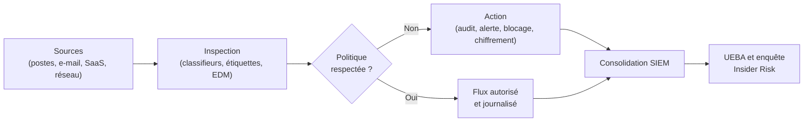

# DLP et protection des données

Le périmètre réseau ne protège plus les données. Un fichier confidentiel peut quitter le système par un lien de partage anonyme, une pièce jointe vers une adresse personnelle, une clé USB, une impression, une capture collée dans un assistant conversationnel ou une synchronisation vers un cloud non sanctionné. Les contrôles de périmètre supposent un intérieur et un extérieur ; la donnée circule pourtant entre services internes et externes, avec les mêmes identités et les mêmes canaux légitimes.

La prévention de fuite de données, ou DLP (Data Loss Prevention), répond à ce déplacement du contrôle : au lieu de protéger un réseau, elle protège une information en appliquant des politiques au contenu, au contexte et au canal. Elle repose sur une classification crédible, des moteurs capables de reconnaître une donnée sensible, des points d'application couvrant les usages réels, et un processus de réponse qui distingue l'erreur de la malveillance.

> [!abstract] Définition — DLP
> Le DLP est l'ensemble des technologies et processus qui identifient des données sensibles, appliquent des règles de circulation et d'usage, et journalisent les violations. Il combine classification, inspection de contenu, contrôle de contexte et actions de prévention, sur les postes, le réseau, la messagerie, le cloud et les applications SaaS.

## La classification comme socle

Une politique DLP sans classification est une liste de motifs sans intention. La classification définit ce qui est sensible, pourquoi, et quelles règles s'appliquent. Elle se décline en quatre niveaux.

| Niveau | Définition | Exemples | Traitement type |
|---|---|---|---|
| Public | Destiné à la diffusion externe | Documentation produit, communiqués | Aucune restriction |
| Interne | Usage interne, diffusion limitée | Notes de réunion, procédures | Partage externe contrôlé |
| Confidentiel | Impact significatif en cas de fuite | Contrats, données clients, finances | Chiffrement, destinataires validés |
| Restreint | Impact majeur, données réglementées | Données de santé, secrets industriels, identifiants | Blocage, DRM, accès nominatif |

La classification doit être portée par la donnée, sous forme d'étiquette ou de métadonnée, et non par le seul emplacement. Un document étiqueté « Confidentiel » conserve son niveau lorsqu'il est copié, envoyé ou déposé dans le cloud. Les plateformes modernes propagent l'étiquette et peuvent appliquer un chiffrement lié.

L'étiquetage manuel ne tient pas à l'échelle : les utilisateurs choisissent la valeur par défaut ou se trompent. Il faut une détection automatique, des étiquettes par défaut et une justification lors d'un changement de niveau.

> [!warning] Piège
> Une classification trop fine devient inutilisable. Si personne ne distingue « Confidentiel restreint diffusion limitée » de « Confidentiel restreint diffusion contrôlée », les utilisateurs choisissent au hasard et les politiques produisent des faux positifs massifs. Mieux vaut quatre niveaux stables que dix niveaux que personne n'applique.

## Les trois états de la donnée

| État | Où | Contrôles principaux | Capteurs DLP |
|---|---|---|---|
| Au repos | Postes, partages, bases, objets cloud, sauvegardes | Chiffrement, étiquettes, droits d'accès, inventaire | Agent endpoint, scan API, CASB, DSPM |
| En transit | Réseau, mail, web, API, synchronisation | Inspection de flux, TLS, proxy, passerelle mail | Proxy ICAP, CASB inline, passerelle SMTP |
| En usage | Mémoire, presse-papiers, écran, impression, USB | Contrôle des périphériques, filigrane, DRM, isolation | Agent endpoint, DLP navigateur, EDR |

Cette distinction structure l'architecture. Un DLP réseau voit ce qui sort, pas ce qui est copié sur une clé USB. Un DLP endpoint voit les manipulations locales, pas les flux d'une application SaaS non instrumentée. Un DLP cloud en mode API inspecte les contenus stockés, avec un délai et sans blocage temps réel.

## Architecture et points d'application



Le DLP endpoint intercepte les opérations locales : périphérique amovible, impression, presse-papiers, partage réseau, upload navigateur, capture d'écran. Il est le seul à voir l'usage réel d'un fichier déjà téléchargé, mais dépend du déploiement de l'agent.

Le DLP réseau inspecte les flux sortants via un proxy ou un équipement en ICAP : HTTP, SMTP, parfois FTP et API. Il devient aveugle lorsque le trafic est chiffré de bout en bout ou lorsqu'un client contourne le proxy.

Le DLP de messagerie s'intègre à la passerelle ou au service cloud (Exchange Online, Google Workspace). Il inspecte pièces jointes, corps de message, destinataires externes et règles de transfert, et reste le point le plus rentable pour les fuites accidentelles.

Le DLP cloud et SaaS fonctionne en mode API, pour scanner les fichiers au repos et les partages, ou en mode inline via un CASB, pour inspecter et bloquer le trafic vers les applications sanctionnées et non sanctionnées.

| Mode | Visibilité | Temps réel | Angle mort |
|---|---|---|---|
| Agent endpoint | Contenu et contexte local | Oui | Postes non gérés, contournement |
| Proxy inline | Flux réseau | Oui | TLS de bout en bout, hors proxy |
| API cloud | Contenus stockés, partages | Non | Données jamais stockées dans le service |
| Passerelle mail | Pièces jointes et destinataires | Oui | Canaux alternatifs (USB, web) |
| CASB API | SaaS sanctionné et shadow IT | Partiel | Applications non connectées |

## Moteurs de détection de contenu

La qualité d'un DLP tient à ses moteurs. Un moteur faible produit trop de faux positifs et les analystes désactivent les règles ; un moteur trop strict laisse passer les fuites réelles.

| Technique | Principe | Force | Faiblesse |
|---|---|---|---|
| Expression régulière | Motif de caractères | Rapide, précis sur les formats | Ne comprend pas le contexte |
| Validation | Somme de contrôle (Luhn, IBAN) | Élimine les faux positifs | Limitée aux formats normés |
| Mots-clés et proximité | Termes sensibles dans une fenêtre | Simple à régler | Contournable, dépendant de la langue |
| Dictionnaire | Liste de termes métier | Couvre le vocabulaire interne | Maintenance lourde |
| Empreinte documentaire | Hachage de fragments | Reconnaît un document connu | Insensible aux modifications |
| EDM | Correspondance exacte sur un jeu de données | Très précis sur les enregistrements | Nécessite un référentiel à jour |
| Classifieur ML | Apprentissage supervisé | Adapté aux contenus non structurés | Opaque, dérive, biais |
| OCR | Lecture d'images et de PDF scannés | Couvre les captures et scans | Coût de calcul, erreurs |
| Étiquette | Sensibilité déclarée ou héritée | Contexte fiable | Dépend de la discipline d'étiquetage |

L'EDM (Exact Data Match) indexe un référentiel de données sensibles — numéros de clients, IBAN, identifiants de santé — sous forme de hachages salés, puis compare les empreintes extraites du contenu. La correspondance exacte réduit fortement les faux positifs, à condition que l'index soit frais.

L'empreinte documentaire découpe un document en fragments et calcule une empreinte de chaque fragment. Elle reconnaît un document renommé ou converti, mais pas un document reconstruit.

Les classifieurs ML traitent les contenus non structurés, avec des scores à calibrer. L'OCR lit le texte des images, captures et PDF scannés, au prix d'un coût de calcul.

## Écrire une politique

Une politique DLP combine conditions, seuils et actions. Les conditions portent sur le contenu (type, étiquette, empreinte), le contexte (utilisateur, appareil, destination, pays, heure) et le canal. Les actions vont de la journalisation au blocage, en passant par l'avertissement, la justification, le chiffrement et la quarantaine.

```yaml
nom: "Clients - sortie externe"
priorite: 10
conditions:
  contenu:
    - type: "EDM_CLIENTS"
      seuil: 5
    - etiquette: "Confidentiel"
  contexte:
    - destination: "externe"
    - appareil: "non conforme"
actions:
  - type: "bloquer"
    message: "Envoi bloqué : données clients hors périmètre."
  - type: "notifier"
    destinataires: ["dlp@example.com", "proprietaire-donnees@example.com"]
  - type: "journaliser"
    severite: "high"
exceptions:
  - groupe: "Direction financiere"
    justification: "Reporting réglementaire vers autorité de contrôle"
    expiration: "2026-12-31"
```

Dans Microsoft Purview, la même logique s'exprime par des cmdlets : une politique porte des emplacements, des règles portent conditions et actions.

Le réglage des seuils est décisif. Un seuil à un seul numéro de carte déclenche sur chaque facture ; un seuil trop élevé laisse passer une extraction de dix enregistrements. Le seuil se fixe par type de donnée, puis se teste sur des données historiques avant le mode blocage.

La progressivité s'impose : audit, mesure des faux positifs, ajustement, puis avertissement et blocage. Un déploiement direct en blocage produit un pic d'incidents et un contournement organisé.

## Technologies du marché

| Solution | Périmètre | Points forts | Points d'attention |
|---|---|---|---|
| Microsoft Purview | M365, endpoint, cloud, Insider Risk | Intégration native aux étiquettes et à Entra | Complexité des licences, dépendance à l'écosystème |
| Google Workspace DLP | Drive, Gmail, Chat | Règles simples, classification par étiquettes | Couverture limitée hors Workspace |
| Symantec (Trellix) DLP | Réseau, endpoint, stockage | Moteurs matures, EDM, OCR | Administration lourde, héritage multiple |
| Forcepoint DLP | Réseau, endpoint, CASB | Couverture des canaux, gestion des incidents | Coût, complexité de déploiement |
| Netskope | SSE, CASB, DLP cloud | Visibilité SaaS, mode API et inline | Dépend de la couverture du trafic |
| Zscaler | Proxy, CASB, DLP | Intégration SASE, inspection TLS | Nécessite une architecture de confiance certificats |
| Palo Alto Enterprise DLP | Réseau, SASE | Intégration pare-feu et Prisma | Écosystème propriétaire |

Purview articule étiquettes, politiques DLP, protection endpoint, Insider Risk et Defender for Cloud Apps. Sa force est l'intégration : une étiquette appliquée dans SharePoint suit le fichier lorsqu'il est téléchargé, imprimé ou envoyé.

## Chiffrement, tokenisation et masquage

Le chiffrement est le dernier recours. Au repos, il prend la forme d'un chiffrement de disque, de base (TDE), de colonne ou d'enveloppe avec une clé dans un KMS. En transit, TLS protège le canal, pas contre un destinataire autorisé qui diffuse ensuite le contenu.

| Technique | Principe | Réversible | Usage |
|---|---|---|---|
| Chiffrement de disque | Protège le support | Oui, avec clé | Postes, serveurs, sauvegardes |
| TDE | Chiffre les fichiers de base | Oui, transparent | Bases de données au repos |
| Chiffrement de colonne | Chiffre certaines colonnes | Oui, avec clé | Données sensibles ciblées |
| Tokenisation | Remplace par un jeton | Oui, via coffre | Paiement, CRM, analytique |
| Masquage statique | Remplace définitivement | Non | Environnements de test |
| Masquage dynamique | Masque à l'affichage | Non pour l'utilisateur | Support, développement |
| Pseudonymisation | Substitue un identifiant | Oui, avec table | Analyse, corrélation |
| DRM / IRM | Contrôle les droits d'usage | Selon politique | Documents sensibles, contrats |

La tokenisation est utile lorsque l'application n'a pas besoin de la valeur réelle. Un système de paiement stocke un jeton, pas le numéro de carte ; le coffre conserve la correspondance. Le format-preserving conserve le format d'origine, mais reste réversible : ce n'est pas de l'anonymisation.

Le masquage dynamique présente une vue partielle selon le rôle : quatre derniers chiffres pour un conseiller, davantage pour un superviseur. Il réduit l'exposition sans dupliquer les données, mais ne protège pas contre une extraction par un compte privilégié.

Le DRM ou IRM attache une politique d'usage au document : lecture seule, interdiction d'impression, expiration, révocation, filigrane nominatif. Il protège le document hors du périmètre si le lecteur applique la politique, mais se contourne par capture d'écran. Le filigrane visible identifie la source d'une fuite ; le tatouage numérique encode un identifiant, parfois résistant à la compression.

## Sécurité des bases de données

Les données sensibles sont en base. La protection combine authentification, autorisation fine, chiffrement, audit et surveillance. Les sauvegardes chiffrées, la rétention bornée et la destruction vérifiée complètent le dispositif.

Le chiffrement transparent (TDE) protège les fichiers au repos, pas les accès via SQL. Le chiffrement de colonne protège les valeurs les plus sensibles, au prix d'une gestion de clés. La row-level security filtre les lignes selon l'identité, ce qui évite de dupliquer les vues. L'audit natif et le DAM (Database Activity Monitoring) détectent les accès anormaux.

Un DAM surveille le trafic SQL, normalise les requêtes et alerte sur les comportements déviants : compte de service lisant une table client pour la première fois, extraction de 500 000 lignes, requête hors heures. Il complète le DLP, qui ne voit pas les accès directs à la base.

## Menaces et cas d'usage

| Menace | Manifestation | Contrôle |
|---|---|---|
| Fuite accidentelle | Mail au mauvais destinataire, partage public | DLP mail, étiquettes, avertissement |
| Insider malveillant | Téléchargement massif avant départ | UEBA, Insider Risk, restriction |
| Compte compromis | Extraction via API, partages externes | Détection comportementale, révocation |
| Mauvaise configuration | Bucket public, lien anonyme | CSPM, scan cloud, DLP API |
| Shadow data | Copies non inventoriées, exports BI | DSPM, cartographie, rétention |
| SaaS non sanctionné | Synchronisation vers un service personnel | CASB, blocage, sensibilisation |
| Usage de l'IA | Copie de données dans un chatbot public | DLP navigateur, CASB, politique |
| Support amovible | Copie sur clé USB | DLP endpoint, chiffrement, contrôle |
| Mauvais destinataire | Pièce jointe sensible | Classification, confirmation, rappel |
| Secret dans le code | Clé commitée dans un dépôt | Scan de secrets, révocation |

La séquence d'exfiltration reste stable : collecte, regroupement, compression ou chiffrement, puis transfert. Le DLP intervient au dernier stade, mais les signaux précédents sont souvent plus détectables : accès inhabituel à des partages, création d'archives, pics de lecture. C'est le rôle de l'UEBA et de l'Insider Risk Management que de corréler ces signaux faibles.

## Détection et réponse

Les alertes DLP doivent être normalisées vers le SIEM : utilisateur, politique, sévérité, type de donnée, destination et action. Sans cela, elles ne sont jamais corrélées.

Les scénarios utiles combinent plusieurs signaux : téléchargement massif suivi d'une copie vers un support amovible, envoi vers une adresse personnelle, liens de partage externes hors heures ouvrées, accès RH par un compte technique, pic d'impression avant un départ, dépôt dans un service non sanctionné.

```kusto
CloudAppEvents
| where ActionType in ("FileDownloaded", "FileShared", "FileUploaded")
| summarize fichiers = count(), externes = countif(IsExternalUser == true)
    by AccountDisplayName, bin(TimeGenerated, 1h)
| where fichiers > 200 or externes > 20
| join kind=leftouter (
    IdentityInfo | project AccountUpn, Department, Manager
) on $left.AccountDisplayName == $right.AccountUpn
| order by fichiers desc
```

Le playbook de réponse comporte quatre niveaux : vérifier (usage légitime, exception, faux positif), contenir (révoquer un partage, isoler un poste, réinitialiser un mot de passe), investiguer (volumes, autres canaux, compromission de compte), notifier (responsable métier, DPO, juridique).

La proportionnalité est essentielle : un DLP ne doit pas devenir un outil de surveillance individuelle. Les alertes sont traitées par des équipes habilitées, avec journalisation des accès aux preuves, conservation limitée et séparation entre sécurité et ressources humaines.

## Alignement RGPD

Le DLP traite des données personnelles à deux titres : il inspecte les contenus, et il produit des journaux nominatifs. Il exige une base légale, une finalité déterminée et une analyse de proportionnalité.

L'intérêt légitime est fréquemment invoqué, mais il ne dispense pas d'une mise en balance documentée. La surveillance des salariés est encadrée : information préalable, consultation des représentants du personnel, absence de contrôle continu, proportionnalité des moyens. Un DLP qui enregistre les captures d'écran en continu ou journalise la frappe clavier dépasse ce qui est nécessaire.

Une analyse d'impact est recommandée, voire obligatoire, lorsque le dispositif combine surveillance systématique et données sensibles. Elle décrit les données inspectées, les personnes concernées, les destinataires et la conservation.

Les journaux DLP sont protégés comme des données sensibles : accès restreint, chiffrement, purge automatique. Conserver des extraits complets pendant des années constitue une nouvelle base à risque ; mieux vaut minimiser et justifier l'accès.

La conformité ne s'arrête pas au RGPD : données de santé, secrets d'affaires et obligations sectorielles imposent des règles spécifiques. Le DLP s'articule avec [[Sécurité des données]] pour le cycle de vie.

## Limites

Le chiffrement de bout en bout et le TLS sans inspection rendent le contenu invisible. Un DLP qui déchiffre doit déployer une autorité de certification interne, ce qui crée un point de confiance critique.

Les faux positifs restent le principal échec : une politique large bloque des flux légitimes, une politique étroite rassure à tort.

La détection de contenu ne comprend pas l'intention. Un employé qui envoie un contrat à son avocat et un attaquant qui exfiltre le même contrat produisent des événements similaires. Le DLP doit être corrélé au contexte : identité, appareil, horaire, destination.

Enfin, le DLP ne protège pas les données auxquelles l'utilisateur a légitimement accès. La minimisation, le moindre privilège et la détection comportementale restent les mesures de fond.

> [!quiz] Pourquoi l'EDM réduit-il les faux positifs par rapport à une expression régulière ?
> Réponse — Parce qu'il ne se contente pas de reconnaître un format : il compare les valeurs extraites à un référentiel d'enregistrements réellement sensibles, sous forme de hachages. Un numéro qui respecte le format mais n'appartient pas au référentiel ne déclenche pas. Le gain dépend de la fraîcheur et de la couverture de l'index.

> [!quiz] Un DLP qui bloque les envois vers l'extérieur suffit-il à empêcher une exfiltration ?
> Réponse — Non. Il ne couvre ni les canaux non inspectés (USB, impression, capture d'écran, application chiffrée), ni les données déjà accessibles via un partage public, ni les transferts fragmentés ou chiffrés. Le DLP est une couche parmi d'autres : classification, moindre privilège, chiffrement, CASB, UEBA et réponse à incident restent nécessaires.
