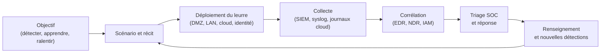

# Deception et honeypots

La détection classique souffre d'un déséquilibre structurel : elle doit reconnaître un comportement malveillant parmi des millions d'événements légitimes, alors que l'attaquant n'a besoin de réussir qu'une fois. Les leurres inversent ce rapport. Un objet déployé dans le seul but d'être touché n'a, par construction, aucune raison d'être consulté par un utilisateur légitime : toute interaction devient un signal à forte valeur, souvent sans nécessiter de règle complexe ni de corrélation probabiliste.

Cette propriété explique l'intérêt croissant pour la deception opérationnelle, distincte du honeypot de recherche des années 2000. Il ne s'agit plus seulement de capturer des malwares, mais de parsemer le système d'information de leurres crédibles — comptes, partages, documents, clés d'API, services — pour détecter la reconnaissance, le mouvement latéral et l'exfiltration à des stades où les outils classiques restent muets. La deception ne remplace ni l'EDR ni le SIEM : elle ajoute une télémétrie à faible bruit, dont la valeur dépend de la crédibilité du leurre et du processus qui l'entoure.

> [!abstract] Définition — Deception
> La deception est l'ensemble des mesures défensives qui consistent à déployer des leurres, des appâts et des environnements factices pour amener un adversaire à révéler sa présence, ses outils et ses intentions. Le honeypot en est l'implémentation historique ; les jetons canaris, les comptes leurres et les partages factices en sont les formes contemporaines, plus légères et plus faciles à disséminer.

## Économie de la tromperie

Un honeypot ne produit que trois types d'événements : du bruit de fond internet (scanners automatisés), des interactions malveillantes ciblées, et de rares faux positifs internes (scan de vulnérabilités, inventaire, chercheur). Le taux de faux positifs est donc structurellement bas, à condition de qualifier correctement le bruit de fond. Un analyste peut traiter une alerte de leurre sans reconstruire un contexte applicatif complexe.

La deception produit également du renseignement : adresse source, identifiants essayés, commandes exécutées, fichiers déposés, parfois la chaîne d'outils complète. Ces artefacts alimentent la threat intelligence, les règles de détection et les exercices purple team. Le leurre devient un capteur de TTPs, pas seulement une alarme.

Elle a cependant un coût de crédibilité. Un honeypot mal déployé se repère à sa latence, à ses bannières ou à un système de fichiers incohérent. Un leurre d'identité mal nommé — compte `honeypot_admin` dans une OU `Test` — ne trompe personne. La qualité du scénario compte plus que le nombre de leurres.

## Vocabulaire et cadre de référence

| Terme | Définition | Exemple |
|---|---|---|
| Honeypot | Système ou service déployé pour être attaqué | Serveur SSH factice en DMZ |
| Honeynet | Réseau de honeypots hétérogènes | VLAN complet simulant un LAN |
| Honeytoken | Donnée factice dont l'usage révèle une compromission | Clé d'API, identifiant, document |
| Canari | Jeton de détection disséminé dans les données ou les flux | Sous-domaine unique dans un PDF |
| Tarpit | Leurre qui ralentit volontairement l'attaquant | Service qui répond en plusieurs minutes |
| Leurre | Objet crédible sans fonction réelle | Partage `Finance_2026`, GPO factice |
| Client honeypot | Système qui visite activement des contenus piégés | Navigateur instrumenté en VM |

Le cadre MITRE Engage structure la démarche en deux phases. La préparation définit l'objectif, le récit couvert et l'infrastructure. L'engagement se décline en exposition (déployer des leurres), en affect (ralentir, fatiguer) et en elicitation (apprendre des TTPs). L'opérationnalisation collecte, analyse et partage les résultats. Cette grille évite de réduire la deception à un honeypot isolé : chaque leurre sert un objectif explicite.

## Typologie technique

Le degré d'interaction détermine le compromis entre réalisme, coût et risque.

| Niveau | Principe | Avantages | Risques |
|---|---|---|---|
| Faible interaction | Émulation de bannières et de services | Déploiement trivial, faible surface | Détection facile, peu d'artefacts |
| Interaction moyenne | Protocole partiellement implémenté, faux système de fichiers | Bon compromis, capture de commandes | Fingerprinting possible |
| Forte interaction | Système réel, parfois complet | Crédibilité maximale, capture riche | Compromission réelle, pivot, maintenance lourde |

Les honeypots de production servent la détection opérationnelle et sont intégrés au SIEM. Les honeypots de recherche, souvent à forte interaction, visent la collecte de malwares et l'étude d'écosystèmes ; ils exigent une isolation stricte et ne doivent jamais partager d'infrastructure avec la production.

Les honeypots client instrumentent un navigateur ou un poste pour visiter des URL suspectes et détecter les drive-by downloads, les exploit kits et les redirections malveillantes. Les honeypots industriels émulent Modbus, S7comm ou DNP3 : Conpot en est l'exemple canonique. Ils détectent une reconnaissance vers l'OT et observent les outils spécialisés, mais exigent une isolation irréprochable.

Dans le cloud, les leurres prennent la forme de buckets S3 factices, de fonctions Lambda exposées, de clés d'API à permissions minimales ou de rôles IAM inutilisés. Leur efficacité repose sur la journalisation native : CloudTrail, Azure Activity Log, journaux d'accès S3. Une clé canari utilisée hors de son périmètre produit un événement exploitable en quelques minutes.

## Leurres d'identité et Active Directory

L'identité est devenue la surface d'attaque dominante, et donc le terrain le plus rentable pour la deception. Un compte leurre crédible doit ressembler aux comptes réels : nom conforme à la convention de l'organisation, appartenance à un groupe plausible, date de création ancienne, propriétaire fictif, dernière connexion cohérente. Il doit surtout posséder une propriété qui attire une technique précise.

| Leurre | Propriété attirante | Technique visée | Télémétrie |
|---|---|---|---|
| Compte de service avec SPN | Kerberoastable | T1558.003 | 4769, chiffrement RC4 |
| Compte avec droits de réplication | DCSync | T1003.006 | 4662, 4624 type 3 |
| Identifiants en clair dans `description` | Credential access | T1552.001 | 4624, 4625, 4768 |
| Compte membre de Domain Admins inactif | Privilege escalation | T1078.002 | 4624, 4672 |
| Partages factices | Collection | T1039 | 5140, 5145 |
| GPO leurre | Modification de politique | T1484.001 | 5136, 4662 |
| Modèle de certificat permissif | ESC1 | T1649 | 4886, 4887 |

La détection repose sur une corrélation simple : ces comptes ne doivent jamais s'authentifier en usage normal. Toute ouverture de session, toute demande de ticket de service ou toute modification d'ACL les concernant est un signal. Le compte leurre doit être exclu des revues d'accès automatiques qui pourraient le désactiver, mais documenté dans le registre de deception pour éviter qu'un administrateur légitime ne le supprime.

Les identifiants leurres suivent le même principe : un mot de passe plausible déposé dans un fichier de configuration ou un script de déploiement. Leur utilisation déclenche une alerte, à condition que le compte associé soit surveillé et ne serve à aucune tâche légitime. Les canaris de type « clé AWS » suivent une logique identique : la clé existe, possède des permissions minimales, et toute utilisation est journalisée.

> [!warning] Piège
> Un leurre d'identité mal isolé peut devenir une porte d'entrée réelle. Un compte leurre doté de droits élevés, d'un mot de passe faible et d'un accès aux systèmes de production transforme une mesure de détection en vulnérabilité exploitable. Le leurre doit attirer sans donner accès : permissions minimales, aucun droit effectif, journalisation exhaustive, et révocation immédiate dès la première interaction.

## Canaris de données et de secrets

Les canaris de données sont des artefacts disséminés dans les espaces où circulent les informations sensibles. Leur valeur vient de leur unicité : chaque jeton porte un identifiant propre, ce qui permet de savoir quel document a fuité et depuis quel partage.

Les formes courantes incluent les documents bureautiques (DOCX, PDF, XLSX) contenant une ressource distante unique, les fichiers texte déposés sur des partages, les URL uniques dans les bases de connaissances, les clés d'API, les identifiants SMTP et les jetons de dépôt Git. L'ouverture du document provoque une requête DNS ou HTTP vers une infrastructure contrôlée, qui enregistre l'adresse IP, l'horodatage et parfois le client utilisé.

Un canari DNS exploite un sous-domaine unique, par exemple `a7f3c9.veille.example.net`, dont la zone est hébergée par un serveur autoritaire instrumenté. Un canari HTTP utilise une image ou un pixel espion, plus riche mais plus facilement bloqué par un proxy. Un canari de clé cloud s'appuie sur les journaux du fournisseur : son utilisation déclenche une alerte CloudTrail ou une détection GuardDuty.

Le placement compte davantage que la quantité : partages historiques, exports de base, dépôts de code, espaces collaboratifs, sauvegardes accessibles. Un canari dans un dossier jamais consulté ne produit rien.

## Déploiement opérationnel



L'isolation est la première contrainte. Un honeypot de production réside dans un VLAN dédié, sans route vers les systèmes internes, avec un filtrage sortant explicite. Les interactions doivent être capturées, pas seulement bloquées : un flux refusé renseigne moins qu'un flux observé vers un serveur instrumenté. Les machines virtuelles sont snapshottées avant exposition et restaurées après compromission. Aucun identifiant réel, aucune donnée personnelle, aucun certificat de production ne doit s'y trouver.

Le placement dépend de l'objectif. En DMZ, les honeypots captent la reconnaissance internet. Sur le réseau interne, ils détectent le balayage latéral. Dans le cloud, ils surveillent l'usage de clés et l'accès aux stockages. Sur les postes, les canaris détectent la collecte et l'exfiltration. Sur l'identité, les comptes leurres détectent le Kerberoasting et le DCSync.

> [!tip] Méthode
> Commencer petit et mesurer. Un honeypot SSH et trois comptes leurres bien instrumentés produisent plus de valeur qu'une ferme de leurres non maintenus. Chaque leurre doit avoir un propriétaire, une date de revue, un runbook d'alerte et un critère de retrait. Sans ce cycle de vie, la deception devient une dette technique silencieuse.

## Outils

| Outil | Type | Usage |
|---|---|---|
| OpenCanary | Honeypot faible interaction | Services factices (SSH, FTP, HTTP, SMB), alertes JSON |
| Cowrie | Honeypot SSH/Telnet moyenne interaction | Faux système de fichiers, capture de sessions |
| Dionaea | Honeypot à faible/moyenne interaction | Capture de malwares via SMB, HTTP, MySQL |
| T-Pot | Plateforme multi-honeypots | Agrégation Docker, Elasticsearch, Kibana |
| Canarytokens | Jetons hébergés | DNS, HTTP, clés cloud, documents |
| Thinkst Canary | Appliance commerciale | Honeypots matériels et virtuels, console cloud |
| Conpot | Honeypot ICS | Émulation Modbus, S7comm, DNP3 |
| HoneyDB | Source communautaire | Renseignement sur les scans internet |

OpenCanary se configure par un fichier JSON et journalise vers syslog ou un fichier. Un exemple minimal expose un service SSH factice et un partage SMB leurre :

```json
{
  "device_name": "srv-archives-02",
  "logtype": "file",
  "logfile": "/var/log/opencanary.log",
  "ftp.enabled": false,
  "ssh.enabled": true,
  "ssh.port": 22,
  "ssh.version": "SSH-2.0-OpenSSH_8.9p1 Ubuntu-3ubuntu0.4",
  "smb.enabled": true,
  "smb.file": "/srv/partage/",
  "http.enabled": true,
  "http.port": 8080,
  "http.banner": "Apache/2.4.52 (Ubuntu)"
}
```

Cowrie s'exécute généralement en conteneur, avec un volume persistant pour les journaux de session :

```bash
docker run -d --name cowrie \
  -p 2222:2222 \
  -v /opt/cowrie/etc:/etc/cowrie \
  -v /opt/cowrie/log:/cowrie/cowrie-git/var/log/cowrie \
  cowrie/cowrie:latest
```

T-Pot agrège une dizaine de senseurs derrière une stack Elasticsearch et Kibana. Il est adapté à la recherche et à l'observation d'internet, moins à un déploiement discret en production, où l'empreinte de la plateforme est identifiable. Thinkst Canary cible l'inverse : appliances autonomes, console de gestion, tokens intégrés et alertes par webhook, sans administration lourde.

## Détection et réponse

Une alerte de leurre doit être enrichie avant d'être présentée à l'analyste : réputation de la source, historique de l'IP dans le pare-feu et le proxy, compte utilisé, actif ciblé, technique ATT&CK probable. Question de triage : l'interaction est-elle automatisée, interne ou ciblée ? Un scan de masse sur le port 22 n'a pas la même valeur qu'une authentification réussie avec un identifiant leurre, suivie de commandes de reconnaissance.

Le playbook type comporte cinq étapes : qualifier la source, déterminer si le leurre a été compromis, rechercher la même source dans les journaux de production, contenir si nécessaire, puis documenter et convertir en détection. La containment doit être proportionnée : bloquer une IP de scanner peut priver d'observation ; isoler un compte leurre utilisé est en revanche immédiat.

Les faux positifs proviennent des scanners de vulnérabilités internes, des outils d'inventaire et des chercheurs de bonne foi. Ils doivent être identifiés par plage d'adresses et par signature, puis exclus avec prudence : une exclusion trop large crée un angle mort qu'un attaquant peut exploiter en usurpant l'empreinte d'un scanner.

Quelques requêtes typiques :

```spl
index=honeypot sourcetype=opencanary
| stats count by src_ip, dst_port, logtype
| where count > 1
| sort - count
```

Une règle Sigma peut cibler l'utilisation d'un compte leurre dont le nom est connu :

```yaml
title: Authentication to Decoy Service Account
id: 5b1f7c2e-3d4a-4f8b-9c21-7e6d0a9b1c33
status: experimental
description: Détecte toute authentification sur un compte leurre de deception
logsource:
  product: windows
  service: security
detection:
  selection:
    EventID:
      - 4624
      - 4625
      - 4768
      - 4769
    TargetUserName|startswith:
      - 'svc_backup_old'
      - 'adm_archive'
  condition: selection
falsepositives:
  - Revue d'accessibilité ou test de restauration mal documenté
level: high
tags:
  - attack.credential_access
  - attack.t1078
```

La corrélation avec les journaux de production est l'étape décisive. Une IP qui touche un leurre puis tente une authentification sur un serveur réel révèle une campagne ciblée ; une IP qui ne touche que le honeypot est probablement un scanner.

## Juridique, conformité et éthique

En France, un honeypot passif est licite : il consiste à exposer un service et à journaliser les interactions. La ligne rouge est la provocation à l'infraction. Inciter activement un tiers à commettre un délit, par exemple en lui proposant explicitement des données à dérober ou en l'amenant à pénétrer un système par une manœuvre, expose à des qualifications pénales et fragilise la procédure. La contre-attaque, la destruction de données offensives ou le retour d'un exploit sont illégaux, quelle que soit la provocation subie.

Les journaux de honeypot contiennent des adresses IP, parfois des identifiants ou des contenus transmis par l'attaquant. Ce sont des données personnelles lorsque la personne est identifiable. Il faut donc une base légale — l'intérêt légitime est le plus courant —, une finalité documentée, une durée de conservation limitée et une information des personnes concernées. La CNIL encadre la surveillance des salariés : les canaris de fichiers et les comptes leurres doivent être proportionnés, connus des représentants du personnel et ne pas servir à surveiller l'activité individuelle au-delà de la détection d'incidents.

Le déploiement doit aussi prévoir la responsabilité civile : un honeypot compromis et utilisé comme pivot peut engager l'organisation. L'isolation, la journalisation et la capacité de coupure rapide sont des mesures de réduction de risque. Les preuves collectées suivent une chaîne de possession : horodatage fiable, hachage des artefacts, stockage en lecture seule, traçabilité des accès.

## Métriques

| Métrique | Définition | Lecture |
|---|---|---|
| Couverture | Segments et types d'actifs couverts par au moins un leurre | Mesure la dispersion, pas l'efficacité |
| Densité | Nombre de leurres par segment | Trop faible : angle mort ; trop élevé : bruit |
| Taux de contact | Leurres touchés / leurres exposés | Indicateur d'exposition réelle |
| Unicité des sources | Nombre d'ASN ou d'IP distinctes | Distingue bruit de fond et ciblage |
| Temps de première interaction | Délai entre exposition et premier contact | Teste la crédibilité |
| Temps de présence | Durée de session sur un honeypot interactif | Mesure l'engagement obtenu |
| Taux de faux positifs | Alertes non malveillantes / total | Doit rester marginal |
| Conversion | Nombre de règles ou d'investigations issues des leurres | Mesure la valeur réelle |
| Coût par interaction | Coût d'exploitation / interactions qualifiées | Arbitrage budgétaire |

Ces métriques se lisent ensemble. Un taux de contact élevé avec une faible unicité des sources signale du bruit de fond, pas une campagne.

## Limites

La deception ne couvre que ce qu'elle expose. Un attaquant qui ne touche jamais les leurres, parce qu'il connaît l'environnement ou parce qu'il opère via des comptes réels compromis, ne sera pas détecté par ce canal. Elle complète la détection comportementale, elle ne la remplace pas.

Les leurres s'usent. Les bannières et les systèmes de fichiers émulés sont fingerprintables ; les attaquants sophistiqués testent la cohérence d'un service avant d'interagir. La maintenance est réelle : mise à jour des bannières, rotation des jetons, revue des comptes. Un programme sans propriétaire devient un ensemble de services obsolètes qui alertent dans le vide.

Enfin, la deception pose une question de proportionnalité. Multiplier les canaris dans les documents personnels des salariés, surveiller les accès individuels ou piéger des collègues pour tester leur loyauté transforme un outil de sécurité en dispositif de contrôle social, avec les risques juridiques et sociaux associés. La finalité doit rester la détection d'intrusion, pas l'évaluation des personnes.

> [!quiz] Un honeypot SSH exposé sur internet reçoit 4 000 tentatives d'authentification en une journée. Est-ce un incident ?
> Réponse — Non, pas en soi. Il s'agit très probablement de bruit de fond provenant de scanners et de botnets. La valeur vient de la qualification : identifiants testés, adresses réutilisées contre des services de production, commandes exécutées après une connexion réussie. Une tentative isolée n'est un incident que si elle s'accompagne d'une interaction ciblée ou d'une corrélation avec d'autres capteurs.

> [!quiz] Pourquoi un compte leurre ne doit-il jamais disposer de droits élevés ?
> Réponse — Parce qu'un attaquant qui découvre le leurre peut l'utiliser comme point d'appui réel. Le leurre doit attirer par sa crédibilité et sa visibilité, pas par les privilèges qu'il confère. Des droits minimaux, une journalisation exhaustive et une surveillance de toute authentification suffisent à produire le signal, sans créer de chemin d'escalade.
