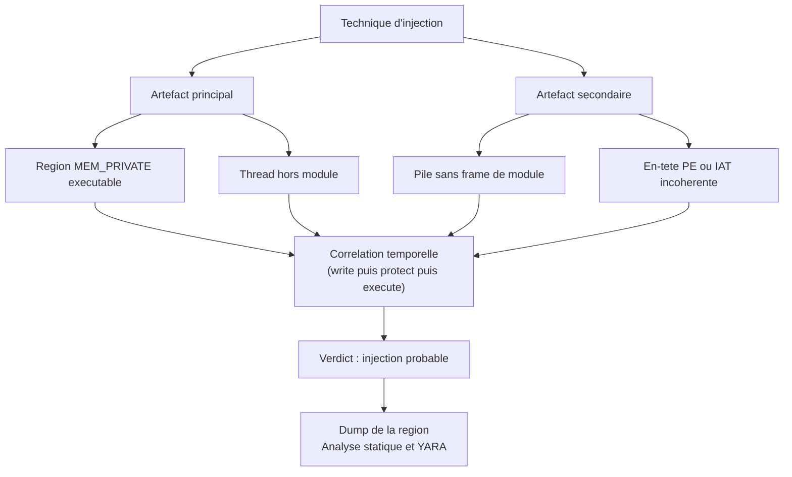

# Détection mémoire des injections

Une injection de code ne laisse, par construction, aucun artefact indispensable sur le disque. Le binaire hôte est souvent un exécutable signé et légitime ; le code malveillant n'existe que dans des pages allouées à l'exécution, écrites par un autre processus, puis rendues exécutables. L'antivirus qui analyse les fichiers ne voit rien, et pourtant le code tourne. La mémoire est donc le seul plan où l'artefact est complet au moment où il produit ses effets.

Cette note décrit ce qu'une injection laisse observable dans un espace d'adressage Windows, comment l'acquérir et l'interpréter, et pourquoi la majorité des signaux mémoire sont ambigus. Elle complète [[Memory Analysis]] et [[Volatility 3]] — qui couvrent l'acquisition et l'analyse forensique générale — en se concentrant sur la mécanique de l'injection et sur les décisions de triage qu'elle impose.

> [!abstract] Définition — Injection de code
> Fait, pour un processus, d'exécuter du code qui n'a pas été chargé par le loader Windows depuis un fichier sur disque. Le code peut être écrit dans une nouvelle allocation, dans une section mappée, dans l'image d'un module légitime ou dans la pile d'un thread existant. L'injection n'est pas une technique unique mais une famille : ATT&CK la regroupe sous T1055 avec une quinzaine de sous-techniques.

> [!important] Idée clé
> Aucun indicateur mémoire n'est une preuve à lui seul. Une région privée exécutable est le comportement normal de tout moteur JIT ; un thread dont l'entrée n'est pas un module est le comportement normal de tout runtime managé. La détection sérieuse ne cherche pas l'indicateur, elle cherche la **combinaison improbable** : une région privée exécutable écrite par un autre processus, exécutée par un thread dont la pile ne contient aucun frame de module signé, dans un processus qui n'a aucune raison d'en avoir.

## Pourquoi la mémoire est le bon plan

| Plan d'observation | Ce qu'on y voit | Ce que l'attaquant peut retirer |
|---|---|---|
| Disque | Fichier, imports, signature, chaînes | Chiffrer le payload, le télécharger à l'exécution, ne jamais l'écrire |
| Registre et persistance | Clés, services, tâches | Utiliser un mécanisme légitime, ou une persistance en mémoire seule |
| Journaux de processus | Lignée, ligne de commande | Utiliser un LOLBin, un parent légitime, une commande banale |
| Mémoire | Pages réellement exécutées, threads, piles, handles | Chiffrer au repos, spoofer les piles, masquer les régions |

La mémoire a une propriété que les autres plans n'ont pas : elle contient le code **au moment où il s'exécute**, donc après tout déchiffrement, unpacking ou résolution dynamique d'API. C'est l'argument qui justifie l'API hooking côté EDR : voir les arguments après déchiffrement. L'analyse mémoire l'étend hors du temps réel, sur un dump, avec le recul de l'analyste.

Le prix à payer est double : la mémoire est volatile, un dump n'est qu'une photographie, et elle est extrêmement bruitée par les navigateurs, les runtimes .NET, la JVM et les EDR eux-mêmes, qui produisent en permanence des pages exécutables sans backing fichier.

## Ce que l'injection laisse dans l'espace d'adressage

Windows décrit chaque plage de l'espace d'adressage d'un processus par un VAD (*Virtual Address Descriptor*). Chaque région possède un état (`MEM_COMMIT`, `MEM_RESERVE`, `MEM_FREE`), une protection et surtout un **type** qui dit d'où vient la mémoire.

| Type | Origine | Backing fichier | Interprétation |
|---|---|---|---|
| `MEM_IMAGE` | Section d'image (`NtCreateSection` sur un fichier PE) | Oui, nommée | Code d'un module chargé par le loader |
| `MEM_MAPPED` | Section non-image (fichier de données, pagefile, partage) | Variable | Données partagées, cache, IPC |
| `MEM_PRIVATE` | Commit privé (`VirtualAlloc`, tas, pile) | Non | Données du processus — ou payload injecté |

Le signal de base tient en une phrase : **une région `MEM_PRIVATE` à la fois engagée et exécutable est anormale dans la majorité des processus**. Le loader ne crée jamais de code exécutable privé ; il mappe des images. Les seules exceptions légitimes sont les générateurs de code à l'exécution et quelques mécanismes internes du système.

À cela s'ajoutent quatre observations qui, prises ensemble, décrivent presque toutes les variantes d'injection.

### Régions non mappées et absence de backing

Une région injectée n'a pas de nom de fichier associé. `VirtualQueryEx` ne fournit pas cette information : il faut interroger `NtQueryVirtualMemory` avec `MemoryMappedFilenameInformation`, ou `GetMappedFileName`, pour obtenir le chemin du fichier qui backing la région. Une région exécutable pour laquelle cet appel échoue est, par définition, sans backing fichier.

Attention : les sections créées avec `SEC_IMAGE_NO_EXECUTE`, les pages de cache .NET compilées à la volée et les allocations des moteurs JIT sont dans le même cas.

### RWX et transitions de protection

`PAGE_EXECUTE_READWRITE` est l'indicateur historique, et il est devenu minoritaire. Les loaders modernes font `VirtualAlloc(PAGE_READWRITE)`, écrivent, puis `VirtualProtect(PAGE_EXECUTE_READ)`. D'autres utilisent `PAGE_EXECUTE_READWRITE` uniquement pendant la copie, puis rétrogradent. Chercher uniquement RWX rate donc une grande partie des injections contemporaines.

Ce qu'il faut surveiller est la **séquence** : une allocation privée non exécutable qui devient exécutable après écriture, surtout si l'écriture provient d'un autre processus (`NtWriteVirtualMemory`) ou d'un thread distant. C'est un événement ETW, pas un état.

### Threads dont l'entrée n'est pas un module

Chaque thread possède une adresse de début (`Win32StartAddress`) et une pile. Dans un processus sain, cette adresse tombe dans la plage d'un module chargé — `kernel32!BaseThreadInitThunk` pour un thread créé par `CreateThread`, `ntdll!TppWorkerThread` pour un thread de pool.

Un thread dont l'adresse de début pointe dans une région privée, ou dans une page non mappée, est un signal fort. On l'obtient par `CreateToolhelp32Snapshot(TH32CS_SNAPTHREAD)` puis `NtQueryInformationThread(ThreadQuerySetWin32StartAddress)`, ou côté EDR par les événements de création de thread.

Le cas se complique avec les thread pools et `RtlCreateUserThread` : l'adresse de début peut être légitime tout en étant hors module, et seule la corrélation avec la région cible tranche.

### Piles d'appels incohérentes

C'est le signal le plus discriminant et le plus difficile à falsifier. Sur un thread injecté par `CreateRemoteThread`, la pile contient généralement `kernel32!BaseThreadInitThunk` → `ntdll!RtlUserThreadStart` → l'adresse injectée, ce qui est déjà suspect mais imitable. Sur un thread détourné, la pile peut ne contenir aucun frame de retour valide, ou des retours vers des pages non exécutables.

Un analyseur mémoire ou un EDR déroule la pile (`StackWalk64` avec les symboles, ou `RtlVirtualUnwind`) et vérifie que chaque adresse de retour appartient à une image connue. Les frames hors module, les retours vers le tas et les chaînes qui sautent directement de `ntdll` à une page privée sont des signaux de qualité.

### En-têtes, IAT et métadonnées

Un PE injecté conserve souvent son en-tête `MZ`/`PE` en tête de région, ce qui permet de le reconnaître et de le dumper. Mais les loaders évolués effacent l'en-tête, ou mappent le payload sans les premières pages. Inversement, un `MZ` isolé dans une page n'est pas une preuve : beaucoup de fichiers de données commencent par ces octets.

L'IAT d'une région injectée pointe souvent vers des résolutions dynamiques (`LoadLibrary`/`GetProcAddress`, API hashing) ; une table d'imports vide ou incohérente avec les sections déclarées est un bon indicateur de mapping manuel.



## Acquisition des artefacts

### Énumération à chaud

L'énumération à chaud est la seule qui corrèle l'état mémoire avec les processus vivants, les handles et les connexions. Elle est intrusive : un dump de processus volumineux peut prendre plusieurs minutes et modifier le comportement observé.

```c
#include <windows.h>
#include <stdio.h>

// Enumere les regions engagees et executables d'un processus distant.
// VirtualQueryEx ne donne pas le nom du fichier : utiliser ensuite
// GetMappedFileName ou NtQueryVirtualMemory(MemoryMappedFilenameInformation).
void EnumExecRegions(HANDLE hProc) {
    MEMORY_BASIC_INFORMATION mbi;
    BYTE *addr = NULL;

    while (VirtualQueryEx(hProc, addr, &mbi, sizeof(mbi)) == sizeof(mbi)) {
        BOOL exec = mbi.Protect & (PAGE_EXECUTE | PAGE_EXECUTE_READ |
                                   PAGE_EXECUTE_READWRITE | PAGE_EXECUTE_WRITECOPY);
        if (mbi.State == MEM_COMMIT && exec) {
            const char *type = (mbi.Type == MEM_IMAGE)  ? "IMAGE"  :
                               (mbi.Type == MEM_MAPPED) ? "MAPPED" : "PRIVATE";
            printf("%p  size=0x%llx  type=%s  prot=0x%lx\n",
                   mbi.BaseAddress, (unsigned long long)mbi.RegionSize,
                   type, mbi.Protect);
        }
        addr = (BYTE *)mbi.BaseAddress + mbi.RegionSize;
    }
}
```

| Besoin | API | Remarque |
|---|---|---|
| Lister les régions | `VirtualQueryEx` | Version userland, simple, pas de nom de fichier |
| Lister avec backing | `NtQueryVirtualMemory` + `MemoryMappedFilenameInformation` | Plus complet, non documenté |
| Lire le contenu | `ReadProcessMemory` | Peut échouer sur les pages gardées ou protégées |
| Énumérer les threads | `CreateToolhelp32Snapshot(TH32CS_SNAPTHREAD)` | Puis `OpenThread` et `NtQueryInformationThread` |
| Dérouler les piles | `StackWalk64`, `RtlVirtualUnwind` | Nécessite les symboles pour être lisible |
| Vérifier les handles | `NtQuerySystemInformation(SystemHandleInformation)` | Détecte les handles dupliqués vers `lsass.exe` |

> [!warning] Piège
> `VirtualQueryEx` renvoie des régions **contiguës de même état, type et protection**, pas des allocations. Deux allocations `VirtualAlloc` adjacentes avec la même protection sont fusionnées en une seule région. À l'inverse, un `VirtualProtect` sur une sous-page scinde la région. La taille affichée n'est donc pas la taille de l'allocation d'origine, ce qui fausse toute heuristique naïve du type « région de 4 Ko suspecte ».

### Télémétrie temps réel

Les capteurs qui produisent l'essentiel de la détection d'injection en production ne sont pas les scanners mémoire, mais les événements :

| Source | Événement | Ce qu'il révèle |
|---|---|---|
| Sysmon | 8 — `CreateRemoteThread` | Thread créé dans un autre processus, avec adresse de début |
| Sysmon | 10 — `ProcessAccess` | `OpenProcess` avec `PROCESS_VM_WRITE`, `VM_OPERATION` |
| Sysmon | 25 — `ProcessTampering` | Hollowing, image modifiée |
| ETW | `Microsoft-Windows-Kernel-Process` | Création de processus et de threads, chargement d'images |
| ETW TI | `Microsoft-Windows-Threat-Intelligence` | Allocations, écritures et protections mémoire, réservé aux éditeurs de sécurité |
| EDR | Télémétrie noyau | Callbacks `ObRegisterCallbacks`, minifiltres, captures mémoire ciblées |

Le point crucial est que ces événements décrivent des **transitions**, pas des états. Un scan mémoire périodique voit des régions ; la télémétrie voit l'écriture, puis le changement de protection, puis l'exécution. C'est la séquence qui a de la valeur.

### Acquisition hors ligne

Le dump complet reste indispensable en réponse à incident : il fige l'état et rend l'analyse reproductible. Les commandes utiles pour l'injection sont :

```bash
# Regions suspectes, avec désassemblage des premiers octets
vol -f mem.raw windows.malfind

# Dump des régions identifiées pour analyse statique
vol -f mem.raw windows.malfind --pid 4321 --dump

# Détail des VAD (protections, types, backing)
vol -f mem.raw windows.vadinfo --pid 4321

# Modules chargés : repérer une DLL hors System32 ou non signée
vol -f mem.raw windows.dlllist --pid 4321

# Threads et adresses de début, selon la version de Volatility
vol -f mem.raw windows.thrdscan

# Handles : détecter un handle dupliqué vers un processus sensible
vol -f mem.raw windows.handles --pid 4321
```

### YARA en mémoire

YARA est le complément naturel du scan de régions : il répond à la question « ce contenu ressemble-t-il à quelque chose de connu » là où `malfind` répond à « cette région a-t-elle une forme suspecte ». Les deux se combinent mal : un payload chiffré ne matchera aucune règle, et un payload inconnu ne matchera rien non plus.

```yara
rule Mem_Suspicious_Loader
{
    meta:
        description = "Chargeur PE compact avec résolution dynamique d'API"
        author = "SOC"
        date = "2026-10-20"
        reference = "interne"

    strings:
        $mz = { 4D 5A }
        $api1 = "VirtualAllocEx" ascii wide
        $api2 = "WriteProcessMemory" ascii wide
        $api3 = "CreateRemoteThread" ascii wide
        $api4 = "NtWriteVirtualMemory" ascii wide

    condition:
        $mz at 0 and
        uint32(uint32(0x3C)) == 0x00004550 and
        2 of ($api*) and
        filesize < 2MB
}
```

En mémoire, `filesize` désigne la taille du bloc analysé, pas celle de l'image : cette condition n'a de sens que si le scanner passe une région cohérente. De même, `$mz at 0` n'est valide que si la région commence à l'en-tête — ce qui est fréquent pour un PE injecté, rare pour un shellcode brut.

```bash
# Scan d'un dump complet via Volatility
vol -f mem.raw windows.yarascan.YaraScan --yara-file rules/mem.yar

# Scan ciblé d'un processus suspect
vol -f mem.raw windows.yarascan.YaraScan --yara-file rules/mem.yar --pid 4321
```

## Faux positifs structurels

La liste ci-dessous couvre la quasi-totalité des alertes `malfind` en environnement réel.

| Source de faux positif | Pourquoi | Comment la distinguer |
|---|---|---|
| JIT JavaScript (navigateurs, Node) | Génère du code machine dans des pages privées exécutables | Région de taille variable, contenu change en permanence, processus navigateur |
| CLR .NET et PowerShell | Compile du MSIL en code natif à l'exécution | Processus `powershell.exe`, `dotnet.exe`, assemblies managées visibles |
| JVM (Java) | JIT HotSpot, code caché, `CodeCache` | Processus `java.exe`, chemins de jars connus |
| EDR et agents de sécurité | Injectent leurs DLL, allouent des buffers exécutables | Signataire de l'image, chemins produit, cohérence avec l'inventaire |
| Packers et protecteurs commerciaux | Décompressent le code en mémoire puis sautent dessus | Section `.text` d'origine faible en entropie, imports cohérents |
| Hotpatching et CFG | Le système modifie des prologues de fonctions | Régions dans des images signées, adresses attendues |
| RPC, COM, services | Allocations exécutables pour stubs et trampolines | Processus système, pas de connexion réseau associée |
| Jeux et anti-cheat | Protection mémoire agressive, code dynamique | Contexte métier évident |

Le point commun de tous ces cas est qu'ils sont **explicables par le processus hôte**. Un `chrome.exe` avec quinze régions RWX est banal ; un `notepad.exe` avec une seule l'est beaucoup moins. La détection doit donc pondérer par le processus, pas seulement par la région.

## Mapping ATT&CK

| Sous-technique | Mécanisme | Signature mémoire dominante |
|---|---|---|
| T1055.001 — DLL Injection | `CreateRemoteThread` + `LoadLibrary` | DLL non signée dans `dlllist`, thread dont l'entrée est `LoadLibrary` |
| T1055.002 — PE Injection | Écriture d'un PE complet dans une allocation | En-tête `MZ` en région privée, IAT résolue manuellement |
| T1055.003 — Thread Execution Hijacking | `SuspendThread`, `SetThreadContext`, `ResumeThread` | Thread existant dont le RIP pointe hors module |
| T1055.004 — APC Injection | `QueueUserAPC` sur un thread alertable | Thread dont l'entrée est légitime mais la pile saute vers une région privée |
| T1055.005 — Thread Local Storage | Callbacks TLS dans un PE injecté | Callback exécuté avant le point d'entrée, région privée |
| T1055.011 — Extra Window Memory | `SetWindowLongPtr` sur une fenêtre légitime | Code exécuté depuis la mémoire d'une fenêtre, hors module |
| T1055.012 — Process Hollowing | `NtUnmapViewOfSection` puis réécriture | Image non mappée, en-tête absent, mismatch PEB/chemin |
| T1055.013 — Process Doppelgänging | Transaction NTFS + section | Image mappée depuis un fichier supprimé ou transitoire |
| T1055.014 — VDSO Hijacking | Détournement de `vDSO` (Linux) | Hors périmètre Windows, visible sur Linux |
| T1055.015 — ListPlanting | Injection dans la mémoire d'un contrôle liste | Région privée exécutable dans un processus GUI |

## Détection

Le triage opérationnel suit un ordre qui va du moins coûteux au plus coûteux.

1. **Qualifier le processus hôte.** Signé ? Chemin attendu ? Parent cohérent ? Ligne de commande ? Un processus non signé lancé depuis `%TEMP%` avec une région privée exécutable ne demande pas la même profondeur d'analyse qu'un `chrome.exe`.
2. **Qualifier la région.** Taille, protection, contenu, présence d'un en-tête PE, entropie. Une région de 4 Ko sans en-tête et à forte entropie est un stager probable.
3. **Qualifier le thread.** Adresse de début, pile, état. Un thread dont la pile ne contient aucun frame de module est le signal le plus fort.
4. **Qualifier la chronologie.** La région a-t-elle été écrite après le démarrage du processus ? Par quel PID ? Quel handle a été ouvert ?
5. **Confirmer.** Dump de la région, YARA, analyse statique rapide, recherche de la même signature sur les autres endpoints.

Une requête de chasse typique, en syntaxe EDR générique :

```text
process where event.type == "start"
  and process.code_signature.status != "trusted"
  and process.parent.name in ("winword.exe", "excel.exe", "outlook.exe")
| join (memory where region.protection : "execute" and region.type : "private")
  by process.entity_id
```

Et côté SIEM, la corrélation entre création de thread distant et accès mémoire :

```sql
-- Splunk : thread créé dans un processus qui n'est pas le sien
index=sysmon EventCode=8
| stats count values(SourceImage) as sources by TargetImage, NewThreadId
| where count > 0
| lookup known_injectors SourceImage OUTPUT legitimate
| where isnull(legitimate)
```

### Ce qu'il faut retenir pour le tuning

- Prioriser les processus à faible légitimité mémoire : `notepad.exe`, `calc.exe`, `rundll32.exe`, `dllhost.exe`, `svchost.exe` avec un parent inattendu.
- Exclure les processus dont le JIT est documenté, mais **par nom et par signataire**, jamais par simple correspondance de chemin.
- Corréler avec le réseau : une région privée exécutable sans connexion sortante est moins urgente qu'une région privée exécutable qui parle à une IP inconnue.
- Conserver les dumps des cas confirmés : ils alimentent les règles YARA et les tests de non-régression.

## Limites de l'approche mémoire

Un payload chiffré au repos, qui ne se déchiffre que quelques millisecondes avant l'appel système, est invisible pour un scan périodique. Une pile falsifiée par emprunt de frames légitimes déjoue l'analyse de call stack. Une injection dans un processus protégé (`PPL`) ne peut pas être lue sans privilège particulier. Enfin, un dump ne capture qu'un instant : les objets transitoires — sections supprimées, threads terminés, pages libérées — ont disparu.

La mémoire reste néanmoins le plan le plus rentable, parce que c'est le seul où l'attaquant doit, à un moment, écrire du code exécutable et transférer le contrôle. Toute la détection consiste à observer ce moment, ou ses conséquences.

> [!quiz] Pourquoi une région `PAGE_EXECUTE_READWRITE` n'est-elle plus l'indicateur principal des injections modernes ?
> Parce que les loaders contemporains allouent en `PAGE_READWRITE`, écrivent le payload, puis changent la protection en `PAGE_EXECUTE_READ` avant d'exécuter. Ce qu'il faut détecter est la transition — écriture, puis changement de protection, puis exécution — et non l'état final.

> [!quiz] Un thread dont l'adresse de début pointe hors module est-il nécessairement malveillant ?
> Parce que les runtimes managés, les thread pools et `RtlCreateUserThread` produisent des threads dont l'entrée n'est pas un module. Le signal devient exploitable quand il est corrélé à une région privée exécutable, à une pile sans frame de module et à un processus hôte qui n'a aucune raison légitime d'en créer.

> [!quiz] Quelle différence de nature existe entre un scan `malfind` et un événement Sysmon 8 ?
> `malfind` observe un état : une région exécutable sans backing fichier, à un instant donné. Sysmon 8 observe une transition : la création d'un thread dans un autre processus, avec son adresse de début. La transition est plus fiable pour attribuer une intention, l'état est plus fiable pour retrouver un artefact après coup.

> [!quiz] Pourquoi `VirtualQueryEx` ne suffit-il pas à prouver qu'une région n'a pas de backing fichier ?
> Parce que `VirtualQueryEx` renvoie un `MEMORY_BASIC_INFORMATION` sans nom de fichier. Il faut interroger `NtQueryVirtualMemory` avec `MemoryMappedFilenameInformation` ou appeler `GetMappedFileName`. Une région `MEM_PRIVATE` est sans backing par construction ; une région `MEM_MAPPED` exécutable, elle, doit être qualifiée par son nom.
