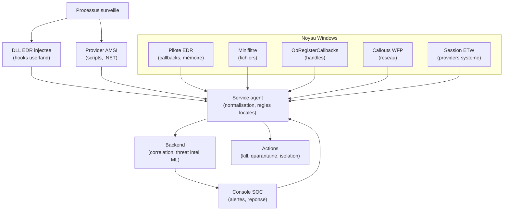

# EDR internals

Un EDR n'est pas un antivirus enrichi : c'est un système distribué composé d'un agent noyau, d'une couche userland injectée dans chaque processus, d'un service de collecte, d'un moteur de décision local et d'un backend d'analyse. [[Introduction aux EDR]] en donne le panorama fonctionnel et les grandes familles de capteurs. Cette note descend d'un niveau : elle décrit comment ces capteurs sont réellement construits, ce qu'ils voient, ce qu'ils ne voient pas, et par quels mécanismes précis ils peuvent être désactivés.

L'intérêt est double. Pour le défenseur, comprendre l'implémentation permet de distinguer une détection réelle d'un argument commercial, de vérifier qu'un agent est sain, et de savoir pourquoi une alerte manque. Pour l'attaquant, elle permet de cartographier les dépendances : un EDR qui repose à 80 % sur des hooks `ntdll` s'effondre avec un unhooking, un EDR qui repose sur des callbacks noyau ne s'effondre pas de la même façon.

> [!abstract] Définition — Agent EDR
> Ensemble logiciel installé sur un point de terminaison, composé au minimum d'un pilote noyau, d'un service userland privilégié et d'un canal de remontée vers un backend. L'agent collecte de la télémétrie, applique des règles localement, peut bloquer ou contenir, et doit rester opérationnel même si l'utilisateur ou un processus malveillant tente de l'arrêter.

## Architecture d'un agent



| Composant | Mode | Rôle | Point faible |
|---|---|---|---|
| Pilote principal | Noyau | Callbacks, protection de l'agent, scan mémoire | Signature, compatibilité, BSOD |
| Pilote ELAM | Noyau, au démarrage | Vérifie les pilotes chargés avant l'antivirus | Ne couvre que le démarrage |
| Service agent | Userland, `SYSTEM` | Orchestration, télémétrie, décision locale | Arrêtable si non protégé |
| DLL injectée | Userland, par processus | Hooks, inspection des arguments | Contournable par unhooking |
| Minifiltre | Noyau | Interception fichiers | Conflits d'altitude |
| Filtre réseau (WFP) | Noyau | Blocage et inspection des flux | Chiffrement de bout en bout |
| Backend | Cloud ou on-premise | Corrélation, rétrospection, modèles | Connectivité, latence |

Le pilote est chargé au démarrage par le gestionnaire de services, avant la plupart des logiciels applicatifs. Le pilote ELAM (*Early Launch Anti-Malware*) est chargé encore plus tôt, par le chargeur Windows, avec un type de démarrage `SERVICE_BOOT_START` et une classification qui lui permet d'inspecter les pilotes non-Microsoft avant leur initialisation. C'est la réponse de Microsoft au problème du bootkit : si l'EDR arrive après le rootkit, il analyse un système déjà compromis.

## Le capteur userland

### Injection de la DLL de l'agent

L'agent ne peut pas se contenter d'un service : pour voir les arguments d'un appel d'API dans le processus cible, il doit exécuter du code dans ce processus. La séquence classique est :

1. le pilote enregistre `PsSetCreateProcessNotifyRoutineEx` et reçoit une notification à chaque création de processus ;
2. à la première exécution du processus, le pilote ou le service mappe la DLL de l'agent dans l'espace d'adressage (souvent par `NtCreateThreadEx` ou par une APC en attente) ;
3. la DLL s'initialise, résout ses imports et installe ses hooks ;
4. le processus continue son exécution, surveillé.

Cette injection est elle-même un comportement d'injection. C'est l'une des raisons pour lesquelles les règles génériques « région privée exécutable » ou « thread hors module » produisent autant de faux positifs : elles détectent d'abord l'EDR.

### Hooks inline sur `ntdll`

La technique dominante reste le patch du prologue des fonctions de `ntdll.dll`. Un saut relatif de 5 octets (`E9 xx xx xx xx`) redirige vers le trampoline de l'EDR, qui inspecte les arguments, appelle éventuellement le moteur, puis réexécute les octets d'origine et saute dans la fonction.

```c
// Principe d'un hook inline, simplifies.
// 1. Sauvegarder les N premiers octets du prologue.
// 2. Ecrire un saut relatif vers le handler de l'EDR.
// 3. Le handler inspecte, puis execute le prologue sauve et reprend
//    l'execution apres le hook (trampoline).

BOOL InstallHook(PBYTE pTarget, PBYTE pHandler, BYTE *saved, SIZE_T len) {
    DWORD old;
    if (!VirtualProtect(pTarget, len, PAGE_EXECUTE_READWRITE, &old))
        return FALSE;

    memcpy(saved, pTarget, len);

    // jmp rel32 : E9 + (destination - source - 5)
    pTarget[0] = 0xE9;
    *(INT32 *)(pTarget + 1) = (INT32)(pHandler - pTarget - 5);

    VirtualProtect(pTarget, len, old, &old);
    FlushInstructionCache(GetCurrentProcess(), pTarget, len);
    return TRUE;
}
```

Les fonctions ciblées sont stables et documentées par l'usage : `NtCreateProcess`, `NtCreateThreadEx`, `NtWriteVirtualMemory`, `NtProtectVirtualMemory`, `NtMapViewOfSection`, `NtQueueApcThread`, `NtSetContextThread`, `NtOpenProcess`, `NtAllocateVirtualMemory`. Le hook voit les arguments **après** déchiffrement, ce qui est son avantage décisif sur l'analyse statique.

La variante plus discrète est l'**instrumentation callback** : `NtSetInformationProcess` avec la classe `ProcessInstrumentationCallback` installe une fonction appelée à chaque retour d'appel système, dans le contexte du thread. Elle ne modifie pas le code de `ntdll`, ce qui la rend plus difficile à détecter par comparaison avec le fichier sur disque.

### Limites structurelles du userland

- Seules les fonctions hookées sont observées. Un appel direct à `syscall` ne passe par aucun hook.
- Un unhooking restaure les prologues depuis la copie sur disque et supprime la surveillance (voir [[Unhooking de NTDLL]]).
- Les processus 32 bits sur Windows 64 bits utilisent `Wow64` et `wow64cpu.dll`, ce qui crée des chemins d'appel que certains hooks ignorent.
- Les runtimes managés peuvent exécuter du code compilé à la volée sans passer par les API surveillées au moment attendu.
- Un hook peut être détecté par l'attaquant (comparaison avec le disque, checksum, `NtQueryVirtualMemory`) et évité.

C'est pourquoi aucun EDR sérieux ne repose uniquement sur cette couche.

## Le capteur noyau

Le noyau fournit des points d'observation que le userland ne peut pas falsifier sans privilège noyau. Les EDR en utilisent une combinaison.

| Mécanisme | API d'enregistrement | Événement couvert | Peut bloquer |
|---|---|---|---|
| Notification de processus | `PsSetCreateProcessNotifyRoutineEx` | Création et fin de processus | Oui, via `CreationStatus` |
| Notification de thread | `PsSetCreateThreadNotifyRoutineEx` | Création et fin de thread | Non |
| Notification d'image | `PsSetLoadImageNotifyRoutine` | Mapping d'un PE ou d'un pilote | Non |
| Callback d'objet | `ObRegisterCallbacks` | Ouverture de handles processus et thread | Oui, par retrait de droits |
| Callback registre | `CmRegisterCallbackEx` | Lecture, écriture, création de clés | Oui |
| Minifiltre | `FltRegisterFilter` | Création, lecture, écriture, suppression de fichiers | Oui |
| Callout WFP | `FwpsCalloutRegister` | Flux réseau | Oui |

### `PsSetCreateProcessNotifyRoutineEx`

Le callback reçoit une structure `PS_CREATE_NOTIFY_INFO` qui contient le PID parent, le chemin de l'image, la ligne de commande et un champ `CreationStatus`. En écrivant `STATUS_ACCESS_DENIED` dans ce champ, le pilote annule la création du processus. C'est le mécanisme qui permet à un EDR de bloquer une exécution avant même que la première instruction du binaire ne s'exécute.

La variante `Ex2` existe pour les processus 32 bits sur un noyau 64 bits, et `PsSetCreateProcessNotifyRoutine` (sans `Ex`) reste présent pour compatibilité mais ne permet pas de bloquer. Un détail d'implémentation important : ces callbacks sont stockés dans un tableau noyau (`PspCreateProcessNotifyRoutine`), ce qui en fait une cible classique des attaques par écriture arbitraire en mémoire noyau.

### `ObRegisterCallbacks`

Ce mécanisme intervient sur la création de handles, avant que l'appelant ne les reçoive. Un EDR l'utilise typiquement pour retirer `PROCESS_VM_READ` et `PROCESS_VM_WRITE` des handles ouverts vers `lsass.exe` par un processus non autorisé : le handle est créé, mais avec des droits réduits, ce qui casse les outils de dump sans les bloquer frontalement.

L'enregistrement précise un `OB_OPERATION_REGISTRATION` par type d'objet (`PsProcessType`, `PsThreadType`), une altitude et des callbacks pre/post. Le callback pre intervient avant la création effective du handle : il peut réduire `DesiredAccess` ou retourner `STATUS_ACCESS_DENIED`, ce qui empêche l'ouverture.

C'est aussi le mécanisme qui protège l'agent lui-même : un handle vers le processus de l'EDR demandé avec `PROCESS_TERMINATE` peut être refusé.

### Minifiltres

Un minifiltre s'insère dans la pile de filtres du gestionnaire de fichiers, à une **altitude** déterminée. Plus l'altitude est élevée, plus le filtre est proche du système de fichiers. Chaque opération (`IRP_MJ_CREATE`, `IRP_MJ_WRITE`, `IRP_MJ_SET_INFORMATION`) peut être interceptée avant et après exécution.

```c
FLT_PREOP_CALLBACK_STATUS PreCreate(PFLT_CALLBACK_DATA Data,
                                   PCFLT_RELATED_OBJECTS FltObjects,
                                   PVOID *CompletionContext) {
    PFLT_FILE_NAME_INFORMATION nameInfo;
    if (NT_SUCCESS(FltGetFileNameInformation(Data,
            FLT_FILE_NAME_NORMALIZED | FLT_FILE_NAME_QUERY_DEFAULT, &nameInfo))) {
        // Inspecter nameInfo->Name, appliquer la politique, scanner le flux
        FltReleaseFileNameInformation(nameInfo);
    }
    return FLT_PREOP_SUCCESS_NO_CALLBACK;
}
```

C'est la couche qui permet l'analyse à l'écriture, la quarantaine, le blocage d'un fichier avant son ouverture et la journalisation fiable des accès — y compris ceux qui contournent les API userland.

### WFP et réseau

Le filtre de plateforme Windows (`WFP`) permet d'inspecter et de bloquer les flux au niveau noyau, indépendamment du processus émetteur. Les EDR l'utilisent pour l'isolation réseau d'un endpoint compromis : un appel de confinement installe des filtres qui laissent passer le canal de management de l'agent et bloquent tout le reste.

## ETW : la source que l'attaquant oublie

ETW (*Event Tracing for Windows*) est un bus d'événements noyau, avec des providers, des sessions et des consommateurs. Les EDR s'y abonnent en temps réel, souvent via une session `EVENT_TRACE_REAL_TIME_MODE`.

| Provider | Contenu |
|---|---|
| `Microsoft-Windows-Kernel-Process` | Processus, threads, images, jobs |
| `Microsoft-Windows-Kernel-File` | Créations, lectures, écritures, renommages |
| `Microsoft-Windows-Kernel-Registry` | Accès aux ruches |
| `Microsoft-Windows-Kernel-Network` | Connexions TCP/UDP |
| `Microsoft-Windows-DNS-Client` | Requêtes DNS |
| `Microsoft-Windows-PowerShell` | Blocs de script, modules |
| `Microsoft-Windows-Threat-Intelligence` | Allocations, écritures et protections mémoire |

Le dernier est particulier : il expose des événements d'allocation et d'écriture mémoire de très haute valeur, mais son accès est réservé aux produits de sécurité enregistrés et contrôlé par le niveau de signature du consommateur. C'est la source qui permet à un EDR de voir une injection sans hook userland.

ETW a deux faiblesses exploitables. D'abord, le provider userland (`EtwEventWrite` dans `ntdll`) peut être patché pour ne plus rien émettre. Ensuite, une session peut être arrêtée par un administrateur, et un attaquant qui obtient `SYSTEM` peut désactiver les sessions de l'agent — sauf si l'agent détecte la disparition de ses propres événements.

## AMSI

AMSI (*Antimalware Scan Interface*) est un point d'entrée d'analyse pour les contenus dynamiques : scripts PowerShell, VBScript, JScript, macros Office, assemblies .NET chargées en mémoire. Le flux est le suivant :

1. l'application appelle `AmsiInitialize`, puis `AmsiOpenSession` ;
2. elle soumet le contenu via `AmsiScanBuffer` ou `AmsiScanString` ;
3. AMSI transmet le buffer à chaque provider enregistré, dont celui de l'EDR ;
4. le résultat (`AMSI_RESULT_CLEAN`, `AMSI_RESULT_DETECTED`) est renvoyé à l'appelant, qui décide de bloquer.

Un provider implémente l'interface COM `IAntimalwareProvider` et s'enregistre via `AmsiRegisterAntimalwareProvider`. C'est ce qui permet à l'EDR de voir du code qui n'existe jamais sur disque — un script encodé en base64, une assembly chargée par réflexion.

Les contournements sont bien documentés : patch de `AmsiScanBuffer` pour retourner `S_OK` avec un résultat propre, corruption du contexte de session, chargement de `amsi.dll` depuis une copie non patchée, désactivation par variable d'environnement dans certains contextes. La contre-mesure consiste à vérifier l'intégrité de `amsi.dll` et à détecter les patches, ce qui est un jeu sans fin tant que l'attaquant a les droits d'écriture dans le processus.

## Télémétrie et moteur de décision

| Catégorie | Source privilégiée | Falsifiabilité | Valeur analytique |
|---|---|---|---|
| Création de processus | Callback noyau + ETW | Faible | Très haute |
| Chargement d'image | `PsSetLoadImageNotifyRoutine` | Faible | Haute |
| Handles | `ObRegisterCallbacks` | Faible | Haute (LSASS) |
| Fichiers | Minifiltre | Faible | Haute |
| Registre | `CmRegisterCallbackEx` | Faible | Haute |
| Réseau | WFP + ETW | Moyenne | Haute |
| Scripts | AMSI | Moyenne | Très haute |
| Mémoire | Instrumentation callback, scan | Élevée | Très haute |
| DNS | ETW, agent réseau | Moyenne | Moyenne |

Le moteur local combine généralement quatre familles de règles : signatures de fichiers, correspondance d'IOC (hash, domaine, IP), règles comportementales (séquences d'événements, arbres de décision) et modèles statistiques. Le backend ajoute la corrélation multi-endpoints, la réputation, le sandboxing cloud et la rétrospection.

La **réponse** est graduée : journalisation seule, alerte, blocage de l'action, terminaison du processus, quarantaine du fichier, isolation réseau, puis remédiation (suppression des artefacts de persistance, rollback des modifications). Chaque action est un événement de télémétrie en soi, ce qui permet de reconstruire la décision de l'agent.

## Tampering : désactiver l'agent

| Technique | Mécanisme | Effet | Détection |
|---|---|---|---|
| Unhooking | Restauration des prologues depuis le disque | Supprime les hooks userland | Comparaison mémoire/disque, intégrité |
| Syscalls directs | `syscall` sans passer par `ntdll` | Contourne les hooks, pas ETW TI | Écarts entre télémétrie userland et noyau |
| Patch ETW | `EtwEventWrite` → `ret` | Coupe les providers userland | Intégrité de `ntdll`, absence d'événements attendus |
| Patch AMSI | `AmsiScanBuffer` → code de retour fixe | Scripts non analysés | Intégrité de `amsi.dll` |
| Kill switch service | `sc stop`, `net stop` | Arrête la collecte | 7036, 7040, absence de heartbeat |
| Déchargement pilote | `fltmc unload`, `sc delete` | Retire minifiltre et callbacks | Sysmon 6, 7045, `fltmc filters` |
| BYOVD | Pilote signé vulnérable pour écrire en noyau | Retire les callbacks, tue l'agent | Chargement de pilote, blocklist, signature |
| Suppression de callbacks | Écriture dans `PspCreateProcessNotifyRoutine` | Création de processus invisible | Volatility `windows.callbacks`, incohérence |
| Exclusion administrateur | Ajout de chemins exclus dans la console | Angle mort volontaire | Audit de configuration |
| Démarrage alternatif | WinPE, disque externe, safe mode | Agent non chargé | Journaux de démarrage, absence de télémétrie |

Le **BYOVD** (*Bring Your Own Vulnerable Driver*) mérite une mention particulière, parce qu'il est devenu la méthode de contournement la plus fiable des EDR modernes. L'attaquant charge un pilote signé par un éditeur légitime mais vulnérable à une primitive d'écriture noyau arbitraire, puis l'utilise pour neutraliser les callbacks de l'agent ou pour terminer son processus protégé. La contre-mesure est triple : blocklist Microsoft des pilotes vulnérables, HVCI, et surtout surveillance du chargement de pilotes — un pilote signé mais inattendu sur un parc donné reste un signal fort.

> [!warning] Piège
> Un agent « vert » dans la console ne prouve pas qu'il fonctionne. Un attaquant qui supprime un seul callback peut laisser le service, le heartbeat et l'interface intacts tout en rendant la création de processus invisible. La santé d'un EDR se vérifie par des **tests de bout en bout** : exécuter une action connue et vérifier qu'elle apparaît bien dans le backend, pas seulement que l'agent répond au ping.

## Angles morts

- **Avant l'agent.** Les bootkits, les modifications UEFI et les pilotes malveillants chargés avant l'ELAM restent hors de portée d'un agent conventionnel.
- **Sous l'agent.** Un rootkit noyau qui retire les callbacks et falsifie les structures peut rendre l'agent aveugle tout en le laissant fonctionner.
- **À côté de l'agent.** Les accès directs au matériel (DMA), les hyperviseurs malveillants et les attaques hors bande ne passent par aucun capteur logiciel.
- **Dans le chiffrement.** Un flux TLS de bout en bout, un payload chiffré au repos et un C2 qui se fond dans un service SaaS légitime ne sont pas analysables sans inspection supplémentaire.
- **Dans les exclusions.** Les exclusions de chemins, de processus ou de signataires ajoutées pour la performance sont devenues des angles morts majeurs ; les attaquants les recherchent activement.
- **Dans la couverture.** Un endpoint non déployé, hors ligne, en double démarrage ou sur un OS non supporté n'existe pas pour le SOC.
- **Dans l'humain.** Un SOC saturé d'alertes finit par ignorer une détection correcte. La qualité du tuning compte autant que la couverture.

## Limites et détection

La validation d'un agent se fait par une matrice de tests reproductibles, exécutés en environnement de test puis en production contrôlée.

| Test | Ce qu'on vérifie | Preuve attendue |
|---|---|---|
| Création de processus banale | Collecte de base | Événement dans le backend sous quelques secondes |
| Injection `CreateRemoteThread` | Hooks + callbacks | Alerte ou événement mémoire corrélé |
| Accès LSASS avec `PROCESS_VM_READ` | `ObRegisterCallbacks` | Handle réduit ou alerte |
| Écriture d'un fichier dans `System32` | Minifiltre | Événement fichier avec chemin normalisé |
| `sc stop` sur le service agent | Protection de l'agent | Refus, ou alerte de tentative |
| Chargement d'un pilote non signé | ELAM + callback image | Blocage ou alerte |
| Patch de `AmsiScanBuffer` | Intégrité mémoire | Alerte de patch |
| Arrêt d'une session ETW | Surveillance interne | Alerte de rupture de télémétrie |

Côté SIEM, les événements à corréler sont peu nombreux mais décisifs : 7045 (nouveau service), 7036 (changement d'état), 7040 (type de démarrage modifié), Sysmon 6 (chargement de pilote), Sysmon 25 (tampering de processus), et les journaux propres de l'agent lorsqu'ils sont exportés.

```text
// Pseudo-requête : rupture de télémétrie sur un endpoint
agent.health where status == "ok"
| join (heartbeat where @timestamp > now - 15m) by host.id
| where isnull(heartbeat.@timestamp)
```

Un endpoint qui cesse d'émettre alors que son agent se déclare sain est plus suspect qu'un endpoint qui alerte. C'est le signal que le SOC doit surveiller en priorité, parce qu'il est le plus difficile à produire par accident.

> [!quiz] Pourquoi un EDR injecte-t-il nécessairement sa DLL dans les processus qu'il surveille, et pourquoi cela crée-t-il un faux positif ?
> Parce que l'inspection des arguments d'une API n'est possible qu'en exécutant du code dans l'espace d'adressage du processus cible : le hook doit être dans le processus. Cette injection produit exactement les artefacts recherchés par les détections d'injection — région privée exécutable, thread hors module — d'où la nécessité d'exclure l'agent par signataire et par chemin, et non par une règle générique.

> [!quiz] Quelle est la différence entre `PsSetCreateProcessNotifyRoutineEx` et `ObRegisterCallbacks` ?
> Le premier notifie la création ou la fin d'un processus et peut annuler la création via `CreationStatus`. Le second intercepte l'ouverture de handles vers des objets (processus, threads) et peut réduire les droits demandés ou refuser l'opération. Le premier voit l'existence d'un processus, le second voit qui cherche à l'atteindre.

> [!quiz] Pourquoi le BYOVD est-il plus dangereux pour un EDR qu'un simple unhooking ?
> Parce qu'il agit au niveau noyau, là où se trouvent les callbacks et la protection de l'agent. Un unhooking ne prive l'EDR que de sa couche userland ; un pilote vulnérable permet de retirer les callbacks, de tuer le processus protégé et de falsifier les structures, donc de rendre l'agent aveugle tout en le laissant apparemment sain.

> [!quiz] Un agent qui répond au ping et affiche un heartbeat est-il nécessairement opérationnel ?
> Non. La suppression ciblée d'un callback ou d'une session ETW laisse le service, le heartbeat et l'interface fonctionnels tout en supprimant une partie de la télémétrie. La vérification doit être fonctionnelle : exécuter une action connue et vérifier sa présence dans le backend.
