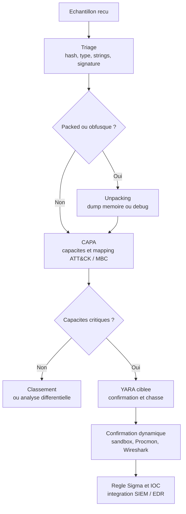

# YARA et CAPA

YARA et CAPA répondent à deux questions différentes, et c'est précisément pour cela qu'ils se complètent. YARA demande : « cette séquence d'octets est-elle présente dans ce contenu ? » C'est un moteur de correspondance, rapide, déterministe, sans compréhension du code. CAPA demande : « que sait faire ce programme ? » C'est un extracteur de capacités, qui identifie des combinaisons d'imports, de chaînes, de constantes et d'instructions, puis les nomme et les mappe sur des référentiels.

Confondre les deux conduit à deux erreurs symétriques : utiliser YARA pour décrire un comportement — ce qu'il ne sait pas faire — ou attendre de CAPA qu'il produise une signature exploitable en production — ce n'est pas son rôle. Cette note décrit la mécanique des deux outils, leurs limites respectives, et l'enchaînement qui va du triage d'un échantillon à une règle déployée dans un EDR ou un SIEM. Elle complète [[Malware Analysis]], qui traite l'analyse statique et dynamique dans son ensemble.

> [!abstract] Définition — Règle YARA
> Un ensemble nommé de chaînes (texte, hexadécimal ou expression régulière) associé à une condition booléenne. Une règle compile en bytecode ; le moteur extrait des *atomes* de quelques octets, les recherche avec un algorithme multi-motifs, puis vérifie les correspondances candidates. Une règle ne « comprend » rien : elle constate la présence ou l'absence de motifs.

> [!important] Idée clé
> La qualité d'une règle ne se mesure pas au nombre de malwares qu'elle attrape mais au nombre de bons logiciels qu'elle ne déclenche pas. Une règle qui matche `powershell` et `http://` attrape tout et ne sert à rien. Une règle utile est ancrée sur une séquence rare, contextualisée par des propriétés structurelles du fichier, et testée contre un corpus de logiciels légitimes.

## YARA : mécanique et syntaxe

### Anatomie d'une règle

```yara
rule Exemple
{
    meta:
        description = "Ce que la règle cherche"
        author = "SOC"
        date = "2026-10-20"
        reference = "interne"
        tlp = "amber"

    strings:
        $a = "CreateRemoteThread" ascii wide
        $b = { 48 8B ?? 89 [4-6] ( 01 02 | 03 04 ) }
        $c = /https?:\/\/[a-z0-9.\-]+\/(gate|panel)\.php/i

    condition:
        uint16(0) == 0x5A4D and
        filesize < 5MB and
        $a and
        ($b or $c)
}
```

Trois sections obligatoires ou utiles : `meta` (documentation, non évaluée), `strings` (les motifs), `condition` (l'expression booléenne). Les règles peuvent porter des `tags:` après le nom, être `private` (utilisables par d'autres règles sans apparaître dans les résultats), `global` (condition appliquée à toutes les règles du fichier) ou appartenir à un `namespace` distinct lors de la compilation.

### Les chaînes

| Type | Syntaxe | Usage |
|---|---|---|
| Texte | `"chaîne"` | Chaîne lisible, nom d'API, message |
| Hexadécimal | `{ 4D 5A 90 00 }` | Octets, en-têtes, constantes |
| Expression régulière | `/pattern/i` | Motifs variables, URLs, identifiants |

Les caractères génériques hexadécimaux sont plus expressifs qu'ils n'en ont l'air : `??` remplace un octet, `[4-6]` autorise un saut de 4 à 6 octets, et `( 01 02 | 03 04 )` propose des alternatives. C'est ce qui permet de suivre une instruction machine dont les opérandes changent, sans passer par une regex.

Les modificateurs changent la façon dont la chaîne est recherchée : `ascii`, `wide` (UTF-16LE), `nocase`, `fullword` (délimiteurs de mot), `xor` ou `xor(0x01-0xff)` (déchiffrement à un octet), `base64` et `base64wide` (variantes d'encodage), `private`. Ils se cumulent, et chacun a un coût : `xor` multiplie le nombre d'atomes à rechercher, `nocase` et `wide` aussi.

### Les conditions

Une condition YARA est une expression booléenne, avec quelques primitives propres au langage.

```yara
condition:
    uint16(0) == 0x5A4D and          // signature MZ
    uint32(uint32(0x3C)) == 0x00004550 and  // pointeur e_lfanew vers "PE\0\0"
    filesize < 2MB and
    2 of ($api*) and                  // au moins deux chaînes du groupe
    #suspicious > 3 and               // nombre d'occurrences
    @remote < 0x1000 and              // offset de la première occurrence
    for any i in (1..#remote) : ( @remote[i] < 0x2000 )
```

Les opérateurs les plus utiles sont `any of them`, `all of ($prefix*)`, `N of ($prefix*)`, les compteurs `#`, les offsets `@`, les longueurs `!`, et les quantificateurs `for any` / `for all`. Les fonctions intégrées `uint8/16/32` et `int8/16/32` lisent des entiers à un offset, ce qui suffit à vérifier un en-tête PE sans module.

### Les modules

| Module | Apport | Exemple |
|---|---|---|
| `pe` | Sections, imports, exports, ressources, version, signature, rich header | `pe.imports("kernel32.dll", "CreateRemoteThread")` |
| `math` | Entropie, moyenne, écart-type, comptage | `math.entropy(0, filesize) > 7.0` |
| `hash` | MD5, SHA1, SHA256 d'une plage | `hash.md5(0, filesize) == "..."` |
| `dotnet` | Assemblies, streams, GUIDs, typelib | `dotnet.number_of_streams > 4` |
| `elf` | Segments, sections, symboles dynamiques | `elf.type == elf.ET_EXEC` |
| `time` | Conversion et comparaison de timestamps | `pe.timestamp > time.now()` |
| `magic` | Type de fichier via libmagic | `magic.type() == "PE32"` |

Le module `pe` est celui qui change le plus la qualité d'une règle : il permet de raisonner sur la structure plutôt que sur des octets. Une règle qui exige `pe.is_pe`, un nombre de sections plausible, une entropie élevée et l'absence de signature est déjà beaucoup plus sélective qu'une liste de chaînes.

### Un exemple de règle robuste

```yara
import "pe"
import "math"

rule Loader_RemoteInjection_Generic
{
    meta:
        description = "Chargeur compact avec primitives d'injection distante"
        author = "SOC"
        date = "2026-10-20"
        reference = "https://attack.mitre.org/techniques/T1055/"
        tlp = "amber"

    strings:
        $api1 = "VirtualAllocEx" ascii wide fullword
        $api2 = "WriteProcessMemory" ascii wide fullword
        $api3 = "CreateRemoteThread" ascii wide fullword
        $api4 = "NtWriteVirtualMemory" ascii wide fullword

    condition:
        uint16(0) == 0x5A4D and
        pe.is_pe and
        filesize < 2MB and
        pe.number_of_sections <= 8 and
        not pe.is_signed and
        math.entropy(0, filesize) > 6.8 and
        2 of ($api*)
}
```

Cette règle reste imparfaite : un outil d'administration légitime peut réunir ces quatre imports. C'est assumé — elle sert à prioriser une file de triage, pas à bloquer automatiquement. Une règle destinée au blocage doit ajouter des contraintes propres à la campagne (mutex, chemin, ressource, version info) ou être complétée par une détection comportementale.

### Performance

Le coût d'une règle dépend presque entièrement de la qualité de ses atomes. Un atome est un fragment de 4 octets (par défaut) extrait d'une chaîne ; le moteur construit un automate multi-motifs sur ces atomes, puis vérifie les candidats.

- Les chaînes de moins de 4 octets produisent des atomes faibles ou nuls : elles forcent une vérification sur chaque octet du fichier.
- Les wildcards en début de motif hexadécimal (`?? 48 8B`) empêchent l'extraction d'un bon atome.
- Les regex non ancrées, surtout avec `.*`, sont coûteuses ; préférer un préfixe littéral.
- `xor` et `base64` multiplient les variantes à rechercher.
- Placer les conditions les moins coûteuses en premier (`filesize`, `uint16`, `pe.is_pe`) permet un court-circuit avant l'évaluation des chaînes.

À l'échelle d'un parc, on compile les règles une fois (`yarac`) et on parallélise le scan (`yara -p`). Pour les gros volumes, YARA-X — la réimplémentation en Rust — apporte des gains sensibles et une meilleure gestion des erreurs de compilation, au prix d'une compatibilité encore partielle avec certains modules.

```bash
# Scan récursif d'un répertoire
yara -r rules/ /chemin/echantillons/

# Afficher les chaînes correspondantes
yara -s rules/loader.yar sample.exe

# Compiler puis réutiliser
yarac rules/ compiled.yarc
yara compiled.yarc sample.exe

# Paralléliser sur 8 threads
yara -p 8 -r rules/ /chemin/
```

## YARA sur disque et en mémoire

| Aspect | Disque | Mémoire |
|---|---|---|
| Taille analysée | Le fichier entier | Une région, une page ou un bloc |
| `filesize` | Taille réelle du fichier | Taille du bloc courant |
| Offsets | Stables, absolus | Relatifs à la région ou au bloc |
| En-tête PE | Presque toujours présent | Souvent absent ou tronqué |
| Chaînes | Contiguës | Peuvent chevaucher deux pages |
| Coût | Faible à moyen | Élevé (Go de mémoire, pages non paginées) |

En mémoire, trois précautions sont indispensables. D'abord, `filesize` ne signifie plus rien : il faut le remplacer par des bornes sur la région. Ensuite, `uint16(0)` ne vaut que si la région commence à l'en-tête, ce qui n'est vrai que pour un PE injecté complet. Enfin, un motif peut être coupé à la frontière de deux blocs de lecture : tout scanner par blocs doit conserver un chevauchement au moins égal à la longueur du plus long motif.

```bash
# Scan d'un dump complet
vol -f mem.raw windows.yarascan.YaraScan --yara-file rules/mem.yar

# Scan ciblé d'un processus
vol -f mem.raw windows.yarascan.YaraScan --yara-file rules/mem.yar --pid 4321
```

```python
import yara

rules = yara.compile(filepath="rules/mem.yar")
CHUNK = 1024 * 1024
OVERLAP = 4096

for base, data in read_process_regions(4321):   # VirtualQueryEx + ReadProcessMemory
    for off in range(0, len(data), CHUNK):
        block = data[max(0, off - OVERLAP): off + CHUNK]
        for match in rules.match(data=block):
            print(hex(base + off), match.rule, [s.identifier for s in match.strings])
```

Le scan mémoire est la principale source de faux positifs YARA : les tas contiennent des fragments de DLL déchargées, des chaînes de configuration, des caches de navigateur. Une règle qui matche dans un dump ne prouve pas qu'un code est actif ; il faut corréler avec une région exécutable et un thread.

## CAPA : de l'échantillon aux capacités

CAPA extrait des caractéristiques d'un binaire — imports, chaînes, constantes, instructions, blocs de base — et les confronte à une bibliothèque de règles qui décrivent des capacités. Le résultat n'est pas une liste de fonctions mais une liste de comportements : « écrit dans un autre processus », « chiffre des données avec AES », « persiste via une clé Run », « détecte un environnement virtuel ».

### Fonctionnement

Par défaut, CAPA analyse statiquement le fichier avec vivisect, désassemble le code, identifie les fonctions, puis applique les règles à quatre portées : fichier, fonction, bloc de base, instruction. Il accepte aussi des rapports de sandbox (`cape`, `vmray`, `drakvuf`, `freeze`) pour travailler sur un comportement dynamique, et des shellcodes bruts.

Une règle CAPA ressemble à ceci :

```yaml
rule:
  meta:
    name: write process memory
    namespace: host-interaction/process/inject
    authors:
      - moritz.raabe@mandiant.com
    scope: function
    att&ck:
      - Defense Evasion::Process Injection [T1055]
    mbc:
      - Memory::Write Memory [C0032]
  features:
    - or:
      - api: kernel32.WriteProcessMemory
      - api: ntdll.NtWriteVirtualMemory
      - api: ntdll.ZwWriteVirtualMemory
```

Les features se combinent avec `and`, `or`, `optional` (au moins N parmi), et peuvent porter sur `api`, `string`, `number`, `bytes`, `characteristic`, `mnemonic`, `basic block`, `offset`, `section`, `import`, `export`, `function-name`, `arch`, `os`. La portée détermine ce que la règle peut référencer : une règle de portée `file` ne voit pas les instructions.

### Sortie et mapping

```bash
# Analyse lisible
capa -v sample.exe

# JSON pour intégration
capa -j sample.exe -o report.json

# Filtrer par tag ATT&CK
capa --tag "attack.persistence" sample.exe

# Utiliser un dépôt de règles précis
capa -r /opt/capa-rules sample.exe

# Analyser un rapport de sandbox CAPE
capa -f cape report.json
```

La sortie organise les capacités par espace de noms : `host-interaction/process/inject`, `data-manipulation/encryption/aes`, `communication/http/client`, `anti-analysis/anti-debugging`, `load-code/shellcode`, `persistence/registry`. Les métadonnées `att&ck` et `mbc` sont portées par les règles, ce qui permet d'obtenir un mapping sans travail manuel — avec la réserve que ce mapping est déclaratif et parfois approximatif.

```bash
capa -j sample.exe | jq -r '.. | .att_ck? // empty' | sort -u
```

### Limites de CAPA

- Un binaire packé ou obfusqué ne présente presque aucune feature : CAPA ne voit que le décompresseur.
- Les binaires Go et Rust embarquent un runtime volumineux qui génère des correspondances parasites ; les règles récentes filtrent une partie de ce bruit, pas la totalité.
- L'identification des bibliothèques statiques (FLIRT, signatures) conditionne la qualité : sans elle, du code de bibliothèque est attribué à l'échantillon.
- CAPA décrit des potentialités, pas une exécution : la présence d'une capacité de chiffrement ne prouve pas qu'elle est utilisée.
- La couverture des règles est inégale selon les plateformes ; Windows est bien mieux couvert qu'ELF ou Mach-O.

> [!warning] Piège
> Une sortie CAPA vide n'est pas une preuve de bénignité, et une sortie CAPA riche n'est pas une preuve de malveillance. Un outil d'administration légitime et un implant partagent souvent les mêmes capacités. CAPA sert à formuler des hypothèses et à prioriser l'analyse, pas à rendre un verdict.

## Workflow : triage, CAPA, YARA, confirmation



1. **Triage.** Hash, type de fichier, entropie, imports, chaînes. Cette étape élimine les faux positifs évidents et oriente la suite.
2. **CAPA.** Si le binaire n'est pas packé, CAPA donne en quelques secondes une cartographie des capacités. C'est le meilleur rapport information/temps de toute la chaîne.
3. **YARA.** Les capacités identifiées orientent la recherche de motifs : une chaîne de configuration, un mutex, un nom de ressource. La règle sert ensuite à chercher le même code ailleurs dans le parc.
4. **Confirmation dynamique.** L'exécution en sandbox ou en VM instrumentée valide ou infirme les hypothèses statiques. C'est la seule étape qui observe l'ordre des opérations et les effets réels.
5. **Industrialisation.** Les motifs confirmés deviennent une règle YARA versionnée, les comportements deviennent une règle Sigma, les IOC rejoignent le SIEM et l'EDR.

## Intégration SIEM et EDR

| Outil | Question posée | Donnée | Sortie |
|---|---|---|---|
| Sigma | Un événement de journal correspond-il à un comportement ? | Logs | Alerte SIEM |
| YARA | Ce contenu contient-il ce motif ? | Fichier, mémoire | Correspondance |
| CAPA | Que peut faire ce binaire ? | Binaire | Capacités |
| EDR | Que fait ce processus maintenant ? | Télémétrie temps réel | Alerte ou blocage |

YARA s'intègre à trois endroits : au moment de l'écriture d'un fichier (via un minifiltre ou un scanner de passerelle), lors de scans planifiés sur les endpoints, et en mémoire via l'agent EDR ou un outil de réponse. Les plateformes comme Velociraptor, THOR ou Loki permettent de lancer des scans YARA à l'échelle d'un parc et de rapatrier les correspondances.

Attention à un piège de nommage : **YARA-L 2.0**, utilisé par Google SecOps (ex-Chronicle), n'est pas une version de YARA. C'est un langage de règles sur des événements, plus proche de Sigma que de YARA, avec une syntaxe et un moteur différents. Les règles ne sont pas interchangeables.

La distribution des règles passe par un dépôt versionné, avec revue par les pairs, métadonnées de référence, niveau de TLP et tests de non-régression sur un corpus de logiciels légitimes. Sans ce cycle, une bibliothèque YARA devient en quelques mois un ensemble de règles obsolètes que personne n'ose plus activer.

## Faux positifs

| Cause | Exemple | Remède |
|---|---|---|
| Chaîne trop générique | `"powershell"`, `"http://"`, `".exe"` | Contexte structurel, `fullword`, combinaison de motifs |
| Motif court | Chaîne de 3 octets | Allonger, ou remplacer par un motif hexadécimal |
| Runtime embarqué | Go, Rust, .NET obfusqué | Filtrer le runtime, cibler le code applicatif |
| Outil dual | PsExec, archiveur, installateur | Contexte de campagne, signature, chemin |
| Résidu mémoire | DLL déchargée dans le tas | Exiger une région exécutable et un thread |
| Règle obsolète | Logiciel légitime mis à jour | Revue périodique, corpus de test |
| Module `pe` mal utilisé | `pe.imports` sur un binaire non PE | Garde `pe.is_pe` en tête de condition |

La mesure est simple : scanner un corpus de référence — `C:\Windows\System32`, les binaires métier, les outils bureautiques — et compter les correspondances. Une règle qui déclenche sur plus de 0,1 % de ce corpus doit être revue avant tout déploiement.

## Limites et détection

YARA et CAPA sont des outils d'analyse, pas des capteurs comportementaux. Ils ne voient ni l'ordre des opérations, ni les arguments réels, ni les effets sur le système. Un payload chiffré, un binaire packé, un code généré à l'exécution ou une API résolue par hachage les mettent en échec. Un attaquant qui connaît les règles publiques peut tester son échantillon contre elles avant de l'envoyer.

Leur valeur en détection est ailleurs : ils réduisent le temps de triage, alimentent la chasse rétrospective sur des volumes déjà collectés, et fournissent des artefacts stables — mutex, chaînes de configuration, constantes cryptographiques — que la télémétrie comportementale ne capture pas. La combinaison gagnante est toujours la même : YARA pour retrouver un artefact connu dans des données massives, CAPA pour comprendre un binaire inconnu, Sigma et EDR pour détecter le comportement au moment où il se produit.

> [!quiz] Pourquoi une chaîne de trois octets dégrade-t-elle fortement les performances d'une règle YARA ?
> Parce que le moteur extrait des atomes de quatre octets pour construire son automate de recherche. Une chaîne plus courte ne fournit pas d'atome exploitable, ce qui force une vérification sur chaque position du fichier. Il faut allonger le motif ou accepter un coût de scan très élevé.

> [!quiz] Quelle est la différence de nature entre une règle YARA et une règle CAPA ?
> Une règle YARA constate la présence d'une séquence d'octets, sans sémantique. Une règle CAPA décrit une combinaison de caractéristiques — imports, chaînes, constantes, instructions — et lui associe un nom de capacité et un mapping ATT&CK ou MBC. YARA répond « est-ce présent », CAPA répond « à quoi cela sert ».

> [!quiz] Pourquoi `filesize` est-il trompeur dans un scan mémoire ?
> Parce qu'en mémoire, le moteur ne reçoit pas un fichier mais une région ou un bloc. `filesize` renvoie alors la taille de ce bloc, qui dépend du découpage du scanner et non de l'objet analysé. Toute condition de taille doit être reformulée en bornes sur la région.

> [!quiz] Un binaire obtient une sortie CAPA vide. Que peut-on en conclure ?
> Presque rien. Le binaire peut être packé, obfusqué, écrit dans un langage peu couvert, ou simplement ne pas correspondre aux règles disponibles. Une sortie vide indique une absence de features reconnaissables, pas une absence de comportement malveillant.
