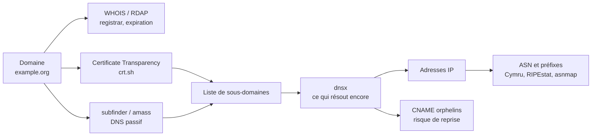

# Empreinte externe : domaines, DNS et certificats

Votre infrastructure a laissé des traces publiques bien avant que quiconque la scanne. Chaque nom de domaine est inscrit dans un registre, chaque sous-domaine résolu est un enregistrement DNS que des services collectent, chaque certificat TLS émis par une autorité reconnue est publié dans des journaux que tout le monde peut lire. En rassemblant ces traces, on reconstitue une bonne partie de la surface externe **sans envoyer un seul paquet** aux serveurs concernés : c'est la reconnaissance passive.

Cette note part d'un seul point d'entrée, un nom de domaine, et montre comment en déduire les sous-domaines, les adresses IP et les réseaux qui vous appartiennent. Dans les exemples, `example.org` tient la place de votre domaine et `203.0.113.0/24` celle de vos adresses (deux plages réservées à la documentation).

## Passif ou actif : une distinction qui compte

Une technique est **passive** quand elle interroge des tiers (registres, journaux de certificats, bases DNS historiques) et non les machines étudiées. Elle est **active** quand elle envoie du trafic vers la cible : résolution DNS directe, scan de ports, requête HTTP. La distinction a deux conséquences. Juridiquement, le passif consiste à lire des données publiques, alors que l'actif touche des systèmes et demande une autorisation. Techniquement, le passif est invisible pour la cible, mais il montre le passé : un journal de certificats ou une base DNS historique contient aussi des noms qui n'existent plus.

On commence donc toujours par le passif, pour dresser la liste des candidats, puis on vérifie activement, sur son propre périmètre, ce qui est encore vivant.

## Du domaine au registrant : WHOIS et RDAP

Le registre d'un domaine indique son registrar, ses dates de création et d'expiration et ses serveurs de noms. Le protocole historique est WHOIS ; son successeur structuré, RDAP, renvoie du JSON.

```bash
whois example.org
curl -s https://rdap.org/domain/example.org | jq '.events, .nameservers'
```

Pour son propre périmètre, deux informations comptent. La date d'expiration d'abord : un domaine qui expire peut être racheté par n'importe qui, avec tous les sous-domaines et adresses e-mail qui en dépendent. Les serveurs de noms ensuite, qui disent qui contrôle réellement la zone. Depuis le RGPD, les coordonnées du titulaire sont généralement masquées, ce qui limite l'usage de WHOIS pour retrouver les autres domaines d'une même organisation.

## Les certificats parlent : Certificate Transparency

Le mécanisme le plus riche est la **Certificate Transparency** (CT), décrite dans la RFC 6962. Pour qu'un certificat soit accepté par les navigateurs, l'autorité qui l'émet doit l'inscrire dans des journaux publics, en ajout seul, que n'importe qui peut auditer. Chrome l'exige pour les certificats émis depuis le 30 avril 2018. L'objectif était de détecter les certificats frauduleux ; l'effet secondaire est que chaque nom présent dans un certificat (le champ *Subject Alternative Name*) devient public au moment de l'émission.

Le site crt.sh, opéré par Sectigo, indexe ces journaux et offre une sortie JSON :

```bash
curl -s 'https://crt.sh/?q=%25.example.org&output=json' \
  | jq -r '.[].name_value' \
  | sed 's/^\*\.//' | sort -u
```

Le `%25` est le caractère `%` encodé, joker de la recherche. La commande renvoie tous les noms figurant dans les certificats émis pour `example.org` et ses sous-domaines. On y trouve souvent ce qu'on ne pensait pas publier : `staging.example.org`, `vpn.example.org`, `grafana.example.org`. Le simple fait de demander un certificat Let's Encrypt pour un service interne suffit à annoncer son nom au monde entier.

> [!warning] Piège
> Les journaux CT sont permanents. Un nom qui y figure ne peut plus en être retiré, même si le service a disparu. Choisir un certificat générique (`*.example.org`) évite d'y lister chaque sous-domaine, mais une même clé protège alors tous les services : sa compromission les touche tous.

## Agréger les sources : subfinder et amass

Au-delà de CT, des dizaines de services collectent des sous-domaines : bases de DNS passif (qui enregistrent les réponses DNS observées sur des résolveurs), moteurs de recherche, archives web, moteurs de scan. Plutôt que de les interroger un par un, on utilise un agrégateur. **subfinder**, de ProjectDiscovery, est conçu pour cela et reste passif par construction.

```bash
subfinder -d example.org -all -silent > candidats.txt
```

L'option `-all` active toutes les sources ; beaucoup demandent une clé d'API gratuite, à renseigner dans `~/.config/subfinder/provider-config.yaml`, sans quoi elles sont ignorées en silence. **OWASP Amass** offre la même fonction (`amass enum -passive -d example.org`) avec un modèle de données plus riche, au prix d'une prise en main plus longue.

## Vérifier ce qui résout encore : dnsx

La liste obtenue mélange noms vivants et noms disparus. Une résolution DNS (étape active, mais légère, qui passe par votre résolveur) fait le tri et donne les adresses associées.

```bash
dnsx -l candidats.txt -a -aaaa -cname -resp -silent
```

Trois cas sont à regarder de près. Un nom qui résout vers une adresse que vous ne reconnaissez pas peut être un service oublié chez un ancien hébergeur. Un `CNAME` qui pointe vers un service cloud (`*.github.io`, `*.azurewebsites.net`, un bucket) sans que ce service existe encore est un enregistrement **orphelin** : un tiers pourrait créer la ressource et servir son contenu sous votre nom, c'est la [[Subdomain Takeover]]. Enfin, un nom qui ne résout plus mais figure encore dans un certificat récent mérite une question au propriétaire.

On vérifie aussi que ses propres serveurs de noms refusent le **transfert de zone**, qui livrerait toute la zone d'un coup :

```bash
dig AXFR example.org @ns1.example.org   # doit échouer : "Transfer failed."
```

## Des adresses aux réseaux : ASN et plages

Une organisation d'une certaine taille possède ses propres plages d'adresses, annoncées sur internet par un **système autonome** (AS) identifié par un numéro (ASN). Retrouver l'ASN et ses préfixes donne d'un coup tout l'espace d'adresses à surveiller, y compris des machines sans aucun nom DNS.

```bash
# À quel AS appartient une adresse ?
whois -h whois.cymru.com " -v 203.0.113.10"

# Quels préfixes cet AS annonce-t-il ? (RIPEstat)
curl -s 'https://stat.ripe.net/data/announced-prefixes/data.json?resource=AS64500' \
  | jq -r '.data.prefixes[].prefix'

# Ou avec asnmap (ProjectDiscovery), à partir d'un nom d'organisation
asnmap -org "Mon Organisation" -silent
```

Pour un serveur personnel loué chez un hébergeur, l'ASN est celui de l'hébergeur et ne vous est d'aucune aide : votre périmètre se limite à vos quelques adresses. C'est le cas le plus fréquent pour un labo, et il simplifie beaucoup la suite.

## Le cas d'IPv6

Balayer tout l'espace IPv4 (environ 4,3 milliards d'adresses) prend quelques minutes à un outil spécialisé. Un seul sous-réseau IPv6 `/64` en contient 2⁶⁴, soit plus de quatre milliards de fois l'espace IPv4 entier : le balayage exhaustif est impossible. En IPv6, la découverte repose donc presque entièrement sur les noms (DNS, certificats) et sur des listes d'adresses observées. Ce n'est pas une protection pour autant : un enregistrement `AAAA` publié ou un certificat suffit à révéler la machine.

## Ce qu'on retient pour la suite



Le produit de cette étape est une liste de noms et d'adresses, chacun à rapprocher de l'inventaire. La note suivante, [[Moteurs de recherche d'appareils]], prend ces adresses et regarde ce que des scanners publics savent déjà des services qui y tournent.

> [!quiz] Pourquoi demander un certificat Let's Encrypt pour `grafana.example.org` révèle-t-il ce service ?
> Parce que tout certificat accepté par les navigateurs doit être inscrit dans les journaux publics de Certificate Transparency : le nom `grafana.example.org` y devient lisible par tous, par exemple sur crt.sh, dès l'émission.

> [!quiz] Qu'est-ce qu'un enregistrement DNS orphelin, et quel risque fait-il courir ?
> Un enregistrement (souvent un `CNAME`) qui pointe vers une ressource externe qui n'existe plus, comme un bucket ou une application cloud supprimés. Un tiers peut recréer la ressource sous ce nom et servir son contenu sous votre domaine : c'est la reprise de sous-domaine.

> [!quiz] Pourquoi la découverte en IPv6 passe-t-elle par les noms plutôt que par le balayage ?
> - [x] Un seul `/64` contient 2⁶⁴ adresses, ce qui rend tout balayage exhaustif impossible.
>   Les noms DNS et les certificats restent alors la principale source d'adresses.
> - [ ] Les pare-feu bloquent tout le trafic IPv6 entrant.
>   Ce n'est pas une règle générale ; beaucoup d'hôtes IPv6 sont joignables directement.
> - [ ] IPv6 n'est pas utilisé sur internet.
>   IPv6 transporte une part importante du trafic mondial.

> [!ordre] Les étapes de la reconnaissance passive, dans l'ordre
> 1. Partir du domaine et lire son registre (RDAP)
> 2. Extraire les noms des journaux de certificats
> 3. Agréger les sources de DNS passif
> 4. Résoudre les candidats pour garder ceux qui existent
> 5. Rattacher les adresses à leur ASN
