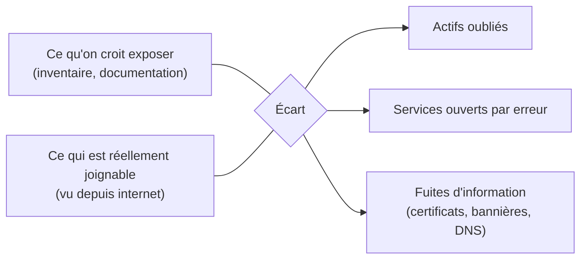
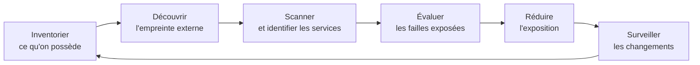

# Exposition internet : ce que voit un attaquant

Un attaquant opportuniste ne choisit pas sa victime : il choisit une faille, puis cherche sur internet tous les serveurs qui la présentent. Quelques heures après la publication d'une vulnérabilité grave dans un VPN ou un pare-feu, des milliers de machines sont déjà sondées, et les premières compromises appartiennent à des organisations qui ignoraient souvent qu'elles exposaient ce produit. La question « suis-je une cible intéressante ? » est donc mal posée. La bonne question est : « qu'est-ce que je publie, sans le savoir, à quiconque regarde ? »

Ce parcours apprend à y répondre de trois façons, dans cet ordre : tenir l'inventaire de ce qu'on possède, regarder son propre périmètre avec les outils d'un attaquant, puis réduire et surveiller ce qui reste visible. Cette première note pose le vocabulaire et l'idée centrale : l'écart entre ce qu'on croit exposer et ce qu'on expose réellement.

## Actif, exposition, surface d'attaque

Un **actif** est tout ce qui a de la valeur et qu'il faut protéger : un serveur, une machine virtuelle, un nom de domaine, un certificat, un compte cloud, un dépôt de code, une caméra IP. Un actif est **exposé** lorsqu'il est joignable depuis un réseau que l'on ne contrôle pas, le plus souvent internet. Un serveur web public est exposé par nature ; une base de données joignable sur son port 5432 depuis n'importe quelle adresse l'est par accident.

> [!abstract] Définition — Surface d'attaque externe
> L'ensemble des actifs d'une organisation joignables depuis internet, avec ce qu'ils révèlent : noms DNS, adresses IP, ports ouverts, services, versions logicielles, certificats et contenus publiés. C'est ce qu'un attaquant peut observer et tenter d'exploiter sans aucun accès préalable.

La surface d'attaque externe ne se limite pas aux ports ouverts. Un certificat TLS publié dans les journaux publics révèle le nom d'un serveur interne ; un enregistrement DNS oublié qui pointe vers un service cloud supprimé permet à un tiers de reprendre ce nom (voir [[Subdomain Takeover]]) ; une page d'administration indique sa version exacte dans son en-tête HTTP. Chacun de ces détails est une information gratuite pour qui prépare une attaque.

## L'écart entre l'inventaire et la réalité

Toute organisation a une idée de ce qu'elle expose : le site vitrine, la messagerie, le VPN. Cette idée vient d'un inventaire, d'une documentation, ou simplement de la mémoire de l'administrateur. Or la réalité diverge toujours, pour des raisons très ordinaires. Une machine de test a été ouverte « juste pour le week-end ». Un conteneur publie un port sur toutes les interfaces parce que la ligne `ports: "8080:8080"` d'un fichier compose écoute sur `0.0.0.0` par défaut. Un prestataire a créé un sous-domaine pour une campagne et ne l'a jamais supprimé. Une filiale rachetée a apporté ses propres serveurs. Ce phénomène porte un nom, le **shadow IT** : tout ce qui fonctionne sans être connu ni géré par ceux qui sont censés le protéger.

Tout le travail de ce parcours consiste à mesurer cet écart, puis à le réduire. On le mesure en partant des deux bouts : de l'intérieur, en recensant ce qu'on possède ; de l'extérieur, en observant ce que n'importe qui peut voir. Les actifs qui apparaissent d'un seul côté sont les plus intéressants : un serveur visible de l'extérieur mais absent de l'inventaire n'est surveillé par personne, et c'est précisément celui qu'un attaquant trouvera en premier.

## L'asymétrie entre l'attaquant et le défenseur

L'attaquant dispose aujourd'hui d'une vue d'internet presque complète, à très bas coût. Des moteurs comme Shodan ou Censys balaient en permanence l'espace IPv4 et indexent les réponses de chaque service ; un outil comme masscan peut sonder un port sur tout cet espace en quelques minutes depuis une seule machine bien connectée. Il suffit donc à l'attaquant d'une requête pour obtenir la liste des serveurs qui présentent une version vulnérable.

Le défenseur, lui, doit connaître la totalité de son périmètre, car il suffit d'un seul oubli. Cette asymétrie explique pourquoi les référentiels placent l'inventaire en tête. Les CIS Controls (version 8) commencent par le contrôle 1, « Inventaire et contrôle des actifs de l'entreprise », suivi du contrôle 2 consacré aux logiciels. Aux États-Unis, la directive BOD 23-01 de la CISA impose depuis 2023 aux agences fédérales une découverte automatisée de leurs actifs tous les sept jours et une recherche de vulnérabilités sur ces actifs tous les quatorze jours : la fréquence compte autant que l'exhaustivité.

> [!important] Idée clé
> On ne voit pas son exposition en lisant sa configuration, mais en se regardant de l'extérieur, avec les mêmes outils et la même méthode qu'un attaquant, puis en comparant ce qu'on trouve à ce qu'on croyait posséder.

## Le cycle que suit ce parcours

La gestion de l'exposition n'est pas un audit ponctuel mais une boucle. On inventorie, on découvre depuis l'extérieur, on identifie les services, on évalue les failles, on corrige, puis on recommence, car l'infrastructure change chaque semaine.

Les notes suivent cette boucle. [[Inventaire des actifs]] pose la source de vérité interne. [[Empreinte externe]] cherche, sans envoyer un seul paquet aux serveurs, les domaines, adresses et certificats qui vous appartiennent. [[Moteurs de recherche d'appareils]] montre ce que Shodan, Censys et leurs concurrents savent déjà de vous. [[Scan à l'échelle d'internet]] et [[Identification des services]] passent au scan actif, avec masscan, ZMap, naabu, nmap et httpx. [[Expositions et failles connues]] utilise nuclei et les catalogues de vulnérabilités exploitées pour décider quoi corriger d'abord. [[Réduire son exposition]] et [[Surveillance continue de l'exposition]] ferment la boucle, et [[Auditer son propre labo]] rassemble le tout en exercices pratiques.

## Un cadre légal à poser d'emblée

Les outils de ce parcours sont exactement ceux des attaquants. Ce qui sépare un audit d'une attaque, c'est l'autorisation. Consulter Shodan ou les journaux de certificats est une recherche dans des données publiques. Scanner activement des machines est autre chose : en droit français, l'article 323-1 du Code pénal punit l'accès ou le maintien frauduleux dans un système de traitement automatisé de données, et l'article 323-3-1 vise la détention d'outils conçus pour commettre ces infractions « sans motif légitime ». Un simple scan de ports n'est pas en lui-même un accès, mais la frontière devient floue dès qu'on teste une faille, et la plupart des hébergeurs interdisent dans leurs conditions d'utilisation de scanner des adresses qui ne vous appartiennent pas.

> [!warning] Règle de ce parcours
> Tous les scans actifs se font sur des adresses que vous possédez ou sur lesquelles vous avez une autorisation écrite : votre propre serveur, votre labo, des machines virtuelles locales. Les recherches passives (journaux de certificats, moteurs comme Shodan) restent possibles sur n'importe quel domaine, mais on n'agit jamais sur ce qu'elles révèlent chez autrui.

Pour approfondir le versant organisationnel, la note [[Attack Surface Management]] décrit les programmes d'entreprise (EASM, CAASM) qui industrialisent cette démarche.

> [!quiz] Pourquoi un serveur visible depuis internet mais absent de l'inventaire est-il le plus dangereux ?
> Parce que personne ne le surveille ni ne le met à jour : il échappe aux correctifs, aux sauvegardes et à la détection, alors qu'un attaquant le trouve aussi facilement que les autres.

> [!quiz] Que désigne le shadow IT ?
> L'ensemble des systèmes, services et comptes qui fonctionnent dans une organisation sans être connus ni gérés par l'équipe chargée de les protéger : une machine de test oubliée, un sous-domaine créé par un prestataire, un service cloud ouvert par une équipe.

> [!quiz] Que demande la directive BOD 23-01 de la CISA aux agences fédérales américaines ?
> - [ ] Un test d'intrusion externe par an.
>   C'est une pratique courante, mais la directive vise une découverte automatisée et fréquente.
> - [x] Une découverte automatisée des actifs tous les sept jours et une recherche de vulnérabilités tous les quatorze jours.
>   La fréquence est au cœur de la directive : l'infrastructure change trop vite pour un audit annuel.
> - [ ] La publication de leur inventaire sur internet.
>   L'inventaire reste interne ; le publier aiderait surtout les attaquants.

> [!quiz] Un fichier compose contient `ports: "5432:5432"` pour une base de données. Quel est le risque ?
> - [x] Le port est publié sur toutes les interfaces de l'hôte, donc potentiellement joignable depuis internet.
>   Sans adresse devant (`127.0.0.1:5432:5432`), la publication écoute sur `0.0.0.0`.
> - [ ] Aucun, un conteneur est isolé du réseau par défaut.
>   L'isolation ne vaut que pour les ports non publiés ; `ports:` ouvre précisément un accès depuis l'hôte.
> - [ ] Le conteneur ne démarre pas, car 5432 est réservé.
>   5432 est simplement le port par défaut de PostgreSQL, il n'est pas réservé.
