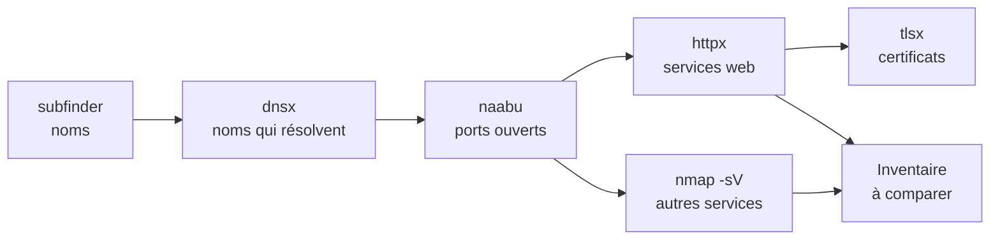

# Identification des services : nmap, httpx et empreintes

Savoir que le port 8443 est ouvert ne dit presque rien. Est-ce un panneau d'administration de routeur, un serveur Tomcat, une API interne, un Nextcloud ? Quelle version, et derrière quel nom ? C'est la réponse à ces questions qui permet de juger un risque : un port ouvert est un fait, un **service identifié** est une information exploitable, par vous comme par un attaquant.

Cette note passe de la liste des ports ouverts à une description de chaque service : protocole, produit, version, certificat, technologies web. Elle montre aussi les pièges qui font croire qu'on a tout vu.

## Le principe : faire parler le service

Identifier un service, c'est provoquer une réponse et la comparer à des modèles connus. Certains protocoles se présentent spontanément : un serveur SSH envoie sa bannière dès la connexion, un serveur SMTP salue avec son nom. D'autres ne disent rien tant qu'on ne leur parle pas dans leur langue : il faut envoyer une requête HTTP, ouvrir une session TLS ou poser une question propre au protocole. La réponse, même une erreur, trahit souvent le produit : la forme d'une page 404, l'ordre des en-têtes HTTP, le message d'un serveur de base de données à qui l'on envoie n'importe quoi.

## nmap : la détection de versions

nmap reste l'outil de référence pour cette étape. Son option `-sV` envoie à chaque port ouvert une série de sondes tirées de sa base `nmap-service-probes`, et compare les réponses à des milliers de signatures.

```bash
nmap -sV -p 22,80,443,8443 -Pn -oA serveur 203.0.113.10
```

`-Pn` considère l'hôte comme actif même s'il ne répond pas au ping, ce qui est fréquent derrière un pare-feu. `-oA` écrit les résultats dans trois formats, dont le XML, facile à exploiter par script. Le résultat ressemble à ceci :

```text
PORT     STATE SERVICE  VERSION
22/tcp   open  ssh      OpenSSH 9.2p1 Debian 2+deb12u3 (protocol 2.0)
443/tcp  open  ssl/http nginx
8443/tcp open  ssl/http Apache Tomcat (language: en)
```

On y lit déjà plusieurs choses : la distribution (Debian 12, d'après le suffixe `deb12u3`), le fait que nginx ne divulgue pas sa version (une bonne pratique), et un Tomcat sur 8443 qui n'était peut-être pas prévu. Les scripts NSE (`-sC` pour ceux de la catégorie `default`, `--script ssl-cert` pour un script précis) complètent l'information : certificat présenté, méthodes HTTP acceptées, titre de la page.

La bonne pratique sur un grand périmètre consiste à séparer découverte et identification : un scanner rapide trouve les ports ouverts, et nmap ne reçoit que ceux-là, ce qui évite de lancer des sondes de version sur 65 535 ports.

## httpx : décrire le web en masse

La majorité des services exposés parlent HTTP, sur le port 443 mais aussi sur 8080, 8443, 3000, 9000 et bien d'autres. **httpx**, de ProjectDiscovery, prend une liste d'hôtes ou de couples `hôte:port` et, pour chacun, détermine s'il répond en HTTP ou HTTPS, puis collecte l'essentiel.

```bash
httpx -l services.txt -sc -title -td -server -ip -cdn -tls-grab -j -o web.json
```

| Option | Ce qu'elle ajoute |
|---|---|
| `-sc` | Code de statut HTTP |
| `-title` | Titre de la page |
| `-td` | Technologies détectées (frameworks, CMS, serveurs), d'après les signatures de Wappalyzer |
| `-server` | En-tête `Server` |
| `-ip`, `-cdn` | Adresse résolue, et si elle appartient à un CDN connu |
| `-tls-grab` | Informations du certificat |
| `-j` | Sortie JSON, une ligne par service |

La colonne CDN est précieuse : une adresse qui appartient à un CDN n'est pas votre serveur, et un nom qui résout directement vers votre serveur alors que les autres passent par le CDN est une incohérence à examiner. Pour parcourir visuellement des centaines de services, des outils comme gowitness ou la capture d'écran intégrée à httpx (`-screenshot`) prennent une image de chaque page : un coup d'œil repère plus vite un panneau d'administration qu'une liste de titres.

## Ce que dit un certificat

Le certificat présenté par un service TLS est souvent plus bavard que le service lui-même. Ses noms alternatifs listent les autres sites hébergés, son émetteur dit s'il est public ou interne, ses dates disent s'il est expiré. Un certificat auto-signé avec un nom comme `localhost` ou le nom du produit par défaut trahit une installation laissée telle quelle. **tlsx**, du même éditeur, extrait ces informations en masse :

```bash
tlsx -l services.txt -san -cn -expired -self-signed -silent
```

## Empreintes : reconnaître sans lire de version

Quand un service masque sa version, on peut encore le reconnaître par son comportement. Plusieurs techniques d'**empreinte** existent.

- **Empreinte TLS du serveur.** JARM, publié par Salesforce en 2020, envoie dix poignées de main TLS différentes et résume les réponses en une empreinte. La famille JA4+, publiée par FoxIO en 2023, propose JA4S (réponse du serveur) et JA4X (structure du certificat). Deux serveurs avec la même empreinte utilisent très probablement le même logiciel avec la même configuration TLS, ce qui sert aussi à repérer des serveurs de commande de logiciels malveillants.
- **Icône du site.** L'empreinte du `favicon.ico`, vue dans [[Moteurs de recherche d'appareils]], identifie une application même sans bannière.
- **Contenu caractéristique.** Une page de connexion, un fichier JavaScript au nom propre à un produit, la forme d'une erreur 404.

Ces techniques rappellent qu'**effacer la bannière n'efface pas le service**. Masquer la version de nginx est utile, car cela retire une information gratuite, mais ne protège en rien un logiciel vulnérable : on ne retarde qu'un attaquant paresseux.

## Le piège des hôtes virtuels

Un même serveur, sur une même adresse et un même port 443, sert souvent plusieurs sites, choisis selon le nom demandé : c'est l'hébergement virtuel, qui repose sur l'en-tête `Host` en HTTP et sur l'extension SNI en TLS. Un scan qui interroge seulement l'adresse obtient le site par défaut, ou une erreur, et ignore tous les autres.

```bash
# Même adresse, deux noms, deux réponses différentes
curl -sk https://203.0.113.10/ -o /dev/null -w '%{http_code}\n'
curl -sk --resolve admin.example.org:443:203.0.113.10 https://admin.example.org/ -o /dev/null -w '%{http_code}\n'
```

C'est pourquoi l'identification doit toujours partir des **noms** trouvés à l'étape [[Empreinte externe]], et pas seulement des adresses. C'est aussi pourquoi le site par défaut d'un reverse proxy, celui qui répond quand le nom est inconnu, doit renvoyer une erreur plutôt qu'un service réel.

## La chaîne complète



En une ligne, pour un domaine qui vous appartient :

```bash
subfinder -d example.org -silent | dnsx -silent | naabu -top-ports 100 -silent | httpx -sc -title -td -silent
```

Le résultat est une description de chaque service exposé, à confronter à l'inventaire. Reste à savoir si ces services présentent des failles connues, ce que traite [[Expositions et failles connues]].

> [!quiz] Pourquoi masquer la version dans la bannière ne protège-t-il pas un service vulnérable ?
> Parce que le service reste reconnaissable par d'autres moyens (empreinte TLS, icône, comportement, contenu des pages), et surtout parce que la faille existe toujours : on retire seulement une information gratuite à l'attaquant le moins appliqué.

> [!quiz] Pourquoi un scan qui n'interroge que les adresses IP peut-il manquer des sites ?
> À cause de l'hébergement virtuel : un même serveur sert plusieurs sites sur la même adresse et le même port, choisis selon le nom demandé (en-tête `Host`, extension SNI). Sans le bon nom, on n'obtient que le site par défaut.

> [!quiz] nmap affiche `OpenSSH 9.2p1 Debian 2+deb12u3`. Qu'apprend-on en plus du produit ?
> - [x] La distribution et sa version : Debian 12, avec un numéro de mise à jour de sécurité.
>   Le suffixe `deb12u3` désigne le troisième correctif publié pour Debian 12.
> - [ ] Que le serveur est vulnérable à toutes les CVE d'OpenSSH 9.2.
>   Debian rétroporte les correctifs sans changer la version principale.
> - [ ] Que l'authentification par mot de passe est activée.
>   La bannière ne dit rien des méthodes d'authentification.

> [!associer] Relie chaque outil à ce qu'il apporte.
> | Outil | Apport |
> |---|---|
> | nmap -sV | Produit et version de tout service |
> | httpx | Statut, titre et technologies des services web |
> | tlsx | Noms et validité des certificats |
> | JARM | Empreinte de la configuration TLS du serveur |
