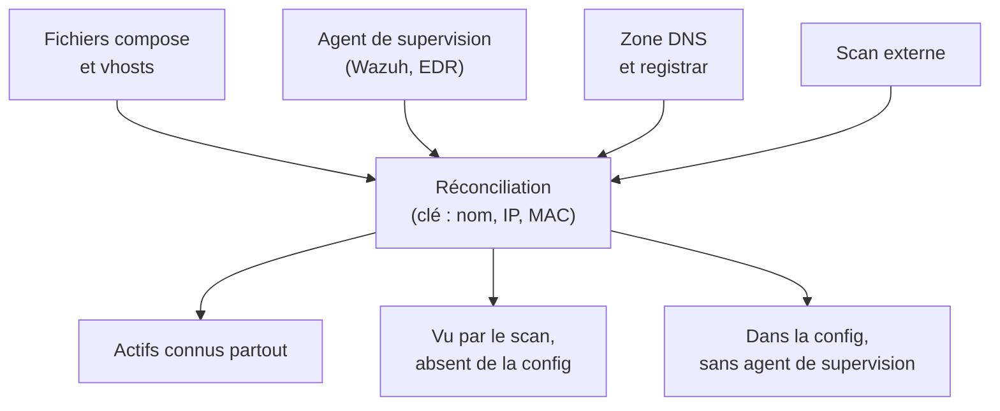

# Inventaire des actifs : savoir ce qu'on possède

Avant de chercher ce qui dépasse, il faut savoir ce qui devrait être là. Un scan externe qui trouve un port SSH ouvert sur une adresse ne dit rien de grave ou de rassurant tant qu'on ignore à quoi correspond cette adresse, qui l'administre et si ce port était prévu. L'inventaire est la référence contre laquelle toute découverte sera comparée : sans lui, on collectionne des résultats de scan ; avec lui, on trouve des écarts.

Cette note explique ce qu'un inventaire utile contient, où aller chercher l'information, et pourquoi le croisement de plusieurs sources compte plus que la perfection d'une seule.

## Ce qu'on inventorie

Un inventaire limité aux serveurs manque l'essentiel de la surface externe. Les attaquants exploitent aussi bien un nom de domaine expiré qu'une machine virtuelle. On recense donc plusieurs familles d'actifs, chacune avec sa source naturelle.

| Famille | Exemples | Source naturelle |
|---|---|---|
| Matériel et machines | Serveurs, VM, Raspberry Pi, routeurs, caméras | Hyperviseur, DHCP, agents de supervision |
| Services | Conteneurs, sites web, API, VPN, SSH | Fichiers compose, vhosts du reverse proxy, orchestrateur |
| Noms | Domaines, sous-domaines, enregistrements DNS | Registrar, zone DNS, fournisseur DNS |
| Adresses | IP publiques, plages, ASN | Hébergeur, fournisseur d'accès, RIR |
| Identité et cryptographie | Certificats, clés SSH, comptes de service | Autorité de certification, gestionnaire de secrets |
| Cloud et SaaS | Comptes, buckets, tenants, tunnels | Console et API du fournisseur |
| Logiciels | Images de conteneurs, paquets, versions | Registre d'images, gestionnaire de paquets, SBOM |

Le contrôle 1 des CIS Controls couvre les actifs matériels et le contrôle 2 les logiciels. Cette distinction est utile : savoir qu'un serveur existe ne suffit pas à savoir s'il est touché par une faille annoncée ce matin, il faut aussi connaître les versions qui y tournent.

## Les attributs qui rendent un inventaire exploitable

Une simple liste d'adresses ne permet pas d'agir. Pour chaque actif, quelques attributs transforment la liste en outil de décision.

- **Propriétaire** : la personne ou l'équipe qui décide de son sort. Un actif sans propriétaire ne sera jamais corrigé, parce que personne ne se sentira autorisé à le faire.
- **Exposition attendue** : public, restreint au VPN, interne. C'est cet attribut qui permet de dire qu'un port ouvert est une anomalie.
- **Criticité** : ce qu'il traite (données personnelles, secrets, simple vitrine) et ce que coûterait sa compromission.
- **Version et dépendances** : ce qui permet de répondre en minutes à « sommes-nous concernés par cette CVE ? ».
- **Dates** : création, dernière vue, fin de vie prévue. Un actif « vu pour la dernière fois » il y a six mois est soit éteint, soit hors de la supervision.

Prenons un petit serveur personnel qui héberge un site statique, un Nextcloud et une galerie de photos accessible seulement par VPN. Une ligne d'inventaire pour la galerie dirait : propriétaire « moi », exposition attendue « VPN uniquement », criticité « haute (photos privées) », version de l'image, date de mise en service. Le jour où un scan externe trouve le port de la galerie ouvert sur internet, la comparaison avec « VPN uniquement » signale immédiatement une anomalie grave, là où un résultat de scan brut serait passé inaperçu parmi d'autres.

## Où trouver l'information

Personne ne tient un inventaire à jour à la main très longtemps. La méthode robuste consiste à le **déduire des systèmes qui font déjà autorité** et à le reconstruire régulièrement, plutôt qu'à le saisir.

Dans une infrastructure décrite en code, la configuration est déjà un inventaire. Les fichiers compose listent les conteneurs, leurs images, leurs réseaux et les ports publiés ; les vhosts du reverse proxy listent les noms servis ; les inventaires Ansible listent les machines ; la zone DNS liste les noms publics. Un script qui lit ces fichiers produit un inventaire plus fiable qu'un tableur, parce qu'il change en même temps que l'infrastructure.

```bash
# Ports publiés par les conteneurs en cours d'exécution (docker ou podman)
podman ps --format '{{.Names}}\t{{.Ports}}'

# Sockets en écoute sur l'hôte, avec le processus propriétaire
ss -tulpn

# Noms servis par nginx
grep -rhoE 'server_name[^;]+' /etc/nginx/sites-enabled/ | sort -u
```

Ces trois commandes répondent à trois questions différentes. La première dit ce que les conteneurs demandent à publier, la deuxième ce que le système écoute réellement (y compris un service lancé hors des conteneurs), la troisième ce que le reverse proxy accepte de servir. Un écart entre elles est déjà une trouvaille : un port en écoute dans `ss` qui n'apparaît dans aucun fichier compose est un service que personne n'a déclaré.

À plus grande échelle, les sources se multiplient : baux DHCP, API des fournisseurs cloud, agents EDR ou de supervision (Wazuh en est un exemple), annuaire Active Directory, scanners de vulnérabilités. Chaque source voit une partie du parc, aucune ne le voit entièrement.

## Croiser les sources : l'idée du CAASM

Le **CAASM** (*Cyber Asset Attack Surface Management*) est le nom donné aux outils qui agrègent toutes ces sources, dédupliquent les actifs et signalent ceux qui manquent quelque part. L'intérêt ne vient pas de la liste consolidée, mais des absences qu'elle révèle.



Chaque absence a un sens précis. Un actif vu par le scan externe mais absent de la configuration est un service non déclaré, donc non maîtrisé. Un actif présent dans la configuration mais sans agent de supervision est un angle mort de détection : s'il est compromis, personne ne le verra. Un nom DNS qui ne correspond plus à aucun service est un enregistrement orphelin, candidat à la reprise de sous-domaine.

> [!tip] Commencer petit
> Pour un labo personnel, un fichier YAML ou CSV versionné dans le même dépôt que l'infrastructure suffit largement. L'important est qu'il soit relu à chaque changement et confronté régulièrement à un scan externe, ce que font les exercices de [[Auditer son propre labo]].

## L'inventaire comme source de vérité

Une fois l'inventaire établi, il devient la référence de tout le reste du parcours. La découverte externe ([[Empreinte externe]]) cherchera ce qui n'y figure pas. Le scan actif vérifiera que l'exposition réelle correspond à l'exposition attendue. La priorisation des failles s'appuiera sur la criticité et le propriétaire. Un inventaire n'est jamais terminé, mais un inventaire imparfait et comparé chaque semaine vaut mieux qu'un inventaire parfait et figé.

> [!quiz] Pourquoi l'attribut « exposition attendue » est-il indispensable dans un inventaire ?
> Parce qu'il permet de transformer un résultat de scan en anomalie : un port ouvert n'est un problème que s'il ne devait pas l'être. Sans cette attente, on ne peut pas distinguer le service public prévu du service exposé par erreur.

> [!quiz] Quelle différence entre `podman ps` et `ss -tulpn` pour inventorier les ports ?
> `podman ps` montre ce que les conteneurs publient ; `ss -tulpn` montre tout ce que l'hôte écoute réellement, y compris les services lancés hors des conteneurs. Comparer les deux révèle les services non déclarés.

> [!quiz] Un serveur figure dans la configuration Ansible mais n'a aucun agent de supervision. Comment qualifier ce constat ?
> - [ ] Un service non déclaré.
>   Il est au contraire déclaré dans la configuration ; c'est la supervision qui manque.
> - [x] Un angle mort de détection.
>   S'il est compromis, aucun outil ne remontera d'alerte.
> - [ ] Un enregistrement DNS orphelin.
>   Un orphelin est un nom qui ne pointe plus vers un service réel, ce n'est pas le cas ici.

> [!associer] Relie chaque famille d'actifs à sa source naturelle.
> | Famille | Source |
> |---|---|
> | Sous-domaines | Zone DNS |
> | Ports publiés par les conteneurs | Fichiers compose |
> | Certificats | Autorité de certification |
> | Plages d'adresses publiques | Hébergeur ou RIR |
