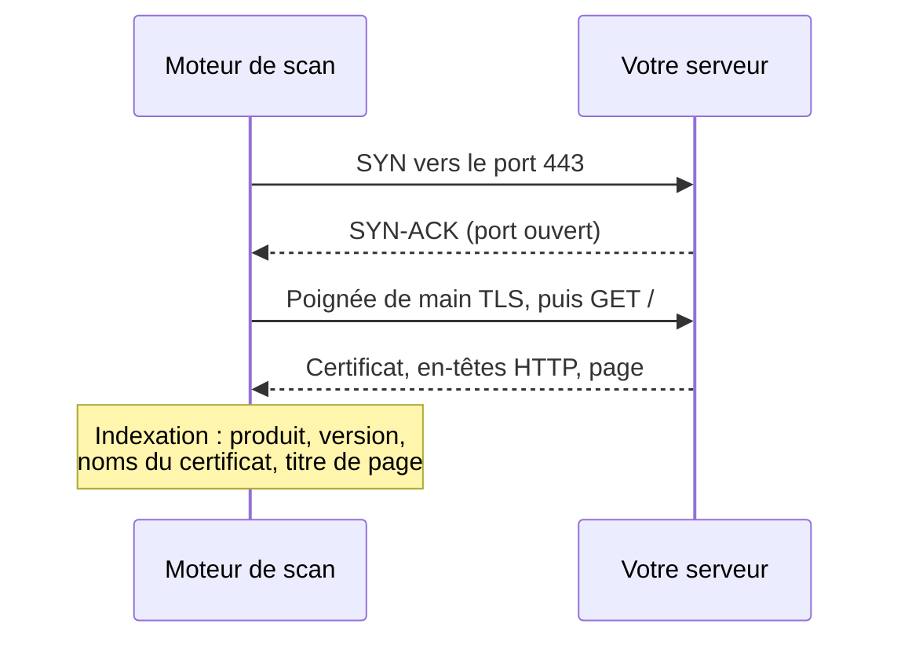

# Moteurs de recherche d'appareils : Shodan, Censys et les autres

Google indexe des pages ; Shodan indexe des machines. Depuis 2009, des moteurs spécialisés balaient en permanence l'espace d'adresses IPv4, se connectent aux ports qu'ils trouvent ouverts et enregistrent ce que chaque service répond : sa bannière, son certificat, sa page d'accueil, sa version. Le résultat est une base interrogeable de tout ce qui écoute sur internet. Un attaquant n'a donc plus besoin de scanner pour trouver des cibles : il lui suffit d'une requête.

Pour le défenseur, c'est une chance. Ces moteurs montrent son périmètre tel qu'un inconnu le voit, sans qu'il ait à envoyer un paquet. Cette note explique comment ils fonctionnent, comment les interroger sur ses propres adresses, et pourquoi leur silence ne prouve rien.

## Comment fonctionne un moteur de scan

Un moteur comme Shodan ou Censys répète trois opérations à grande échelle. Il **découvre** les ports ouverts avec des scanners rapides du type de ceux décrits dans [[Scan à l'échelle d'internet]]. Il **interroge** chaque port ouvert avec le protocole attendu : une requête HTTP sur le 80, une poignée de main TLS sur le 443, une connexion SSH sur le 22, et enregistre la réponse. Il **enrichit** enfin la réponse : géolocalisation, organisation propriétaire de l'adresse, produit et version reconnus, parfois CVE associées à cette version.



La bannière est le cœur du système. Un serveur SSH annonce spontanément `SSH-2.0-OpenSSH_9.2p1 Debian-2+deb12u3` ; un serveur web renvoie souvent un en-tête `Server: nginx/1.22.1`. Ces quelques octets suffisent à rattacher la machine à un produit, puis à une liste de vulnérabilités connues.

## Shodan

Shodan, créé par John Matherly, est le plus ancien et le plus connu. Il s'interroge par mots-clés et par **filtres** de la forme `nom:valeur`.

| Filtre | Ce qu'il cherche | Exemple |
|---|---|---|
| `hostname:` | Nom d'hôte (DNS inverse ou certificat) | `hostname:example.org` |
| `ssl.cert.subject.cn:` | Nom commun du certificat | `ssl.cert.subject.cn:example.org` |
| `net:` | Plage d'adresses | `net:203.0.113.0/24` |
| `port:` | Port | `port:3389` |
| `product:` | Produit reconnu | `product:"Grafana"` |
| `http.title:` | Titre de la page | `http.title:"Dashboard"` |
| `http.favicon.hash:` | Empreinte de l'icône du site | `http.favicon.hash:-1234567890` |

Pour regarder ses propres adresses, la ligne de commande est plus pratique que le site :

```bash
pip install shodan && shodan init VOTRE_CLE_API
shodan host 203.0.113.10                     # tout ce que Shodan sait de cette adresse
shodan search --fields ip_str,port,product 'ssl.cert.subject.cn:example.org'
shodan count 'net:203.0.113.0/24'
```

Shodan propose aussi **InternetDB**, une API gratuite et sans clé qui résume ce qu'il sait d'une adresse : ports ouverts, noms, identifiants de produits (CPE) et vulnérabilités supposées. C'est le moyen le plus rapide de vérifier son serveur.

```bash
curl -s https://internetdb.shodan.io/203.0.113.10 | jq
```

Les vulnérabilités qu'affiche Shodan sont **déduites de la version annoncée**, pas testées. Une distribution comme Debian corrige souvent une faille sans changer le numéro de version principal du logiciel : `OpenSSH_9.2p1 Debian-2+deb12u3` peut être corrigé alors que Shodan lui attribue des CVE d'OpenSSH 9.2. Ces résultats sont des pistes à vérifier, jamais des constats.

## Censys

Censys est né en 2015 à l'université du Michigan, dans l'équipe qui avait créé ZMap. Il couvre beaucoup de ports et se distingue surtout par son traitement des **certificats** : il indexe à la fois les certificats présentés par les serveurs et ceux des journaux de Certificate Transparency, et relie les uns aux autres. Cette force a une conséquence directe pour qui protège un site derrière un CDN.

Supposons que `www.example.org` passe par un CDN qui cache l'adresse réelle du serveur d'origine. Si ce serveur d'origine écoute aussi en direct sur son port 443 et présente le certificat de `www.example.org`, un moteur qui a scanné son adresse l'associe au nom. Une simple recherche sur le nom dans Censys révèle alors l'adresse que le CDN devait masquer, et permet de contourner le CDN et son pare-feu applicatif. C'est l'une des fuites les plus courantes, et [[Réduire son exposition]] montre comment l'éviter.

## Les autres moteurs

Aucun moteur ne voit tout : chacun scanne des ports différents, depuis des pays différents, à des fréquences différentes. Croiser plusieurs moteurs améliore nettement la couverture.

| Moteur | Origine | Particularité |
|---|---|---|
| Shodan | États-Unis, 2009 | Le plus connu, filtres riches, InternetDB gratuit, alertes sur ses plages (Shodan Monitor) |
| Censys | États-Unis, 2015 | Excellente couverture des certificats, fort pour l'attribution |
| ZoomEye | Chine (Knownsec) | Bonne couverture de l'Asie |
| FOFA | Chine | Syntaxe simple (`domain="example.org"`, `cert="example.org"`, `icon_hash=`), très utilisé en Asie |
| ONYPHE | France | Moteur orienté cyberdéfense, agrège scans et renseignement sur les menaces |
| Netlas | — | Scans, DNS et WHOIS dans une même interface |
| Criminal IP | Corée du Sud | Score de risque par adresse |
| LeakIX | — | Spécialisé dans les fuites : bases ouvertes, fichiers `.env` et `.git` exposés |

**GreyNoise** fait le travail inverse : il n'indexe pas les serveurs, mais les **scanners**. Ses capteurs écoutent le « bruit de fond » d'internet et classent les adresses qui balaient le réseau en bienveillantes (moteurs de recherche, chercheurs) ou malveillantes. Il sert surtout à trier les alertes : si votre pare-feu signale un scan venant d'une adresse que GreyNoise connaît comme scanner de masse, ce n'est probablement pas une attaque ciblée.

Pour interroger plusieurs moteurs d'un coup, **uncover** (ProjectDiscovery) uniformise les requêtes et les sorties :

```bash
uncover -q 'ssl:"example.org"' -e shodan,censys,fofa -silent
```

## Pivoter sur une empreinte : le favicon

Une technique élégante consiste à chercher non pas un nom ou une adresse, mais un **contenu** propre à vos services. L'icône d'un site (`favicon.ico`) en est un bon exemple. Shodan calcule une empreinte MurmurHash3 de l'icône encodée en base64 et permet de chercher tous les serveurs qui présentent la même.

```python
import base64, mmh3, requests

icone = requests.get("https://www.example.org/favicon.ico", timeout=10).content
print(mmh3.hash(base64.encodebytes(icone)))   # valeur à chercher avec http.favicon.hash:
```

Si votre application utilise une icône personnalisée, la recherche de cette empreinte retrouve chaque instance exposée, y compris une ancienne copie oubliée sur un autre serveur, ou l'origine cachée derrière un CDN. Le même principe s'applique au titre d'une page ou à une chaîne propre à votre code.

## Les limites : un silence n'est pas une preuve

Ces moteurs donnent une photographie, pas une vidéo. Un service ouvert hier peut ne pas encore y figurer, et un service fermé depuis un mois peut y apparaître encore. Ils ne scannent pas tous les ports de toutes les adresses à chaque passage, ils ne voient rien de ce qui est derrière un VPN ou réservé à certaines adresses sources, et ils ne connaissent un site hébergé derrière un nom virtuel que s'ils connaissent ce nom.

> [!important] Idée clé
> Si Shodan montre un service sur votre adresse, il est exposé (ou l'a été récemment). S'il ne montre rien, cela ne prouve pas que rien n'est exposé. Pour savoir ce qui est ouvert aujourd'hui, il faut scanner soi-même, ce que fait la note suivante.

Certains moteurs, comme Censys, publient leurs plages d'adresses et acceptent les demandes d'exclusion. Bloquer ces scanners rend votre exposition invisible dans leurs résultats, mais pas aux attaquants, qui ne demandent la permission à personne. On aveugle ainsi le défenseur plus que l'attaquant.

> [!quiz] Pourquoi les CVE que Shodan attribue à un serveur ne sont-elles que des pistes ?
> Parce qu'elles sont déduites du numéro de version annoncé dans la bannière, sans test. Une distribution peut avoir corrigé la faille sans changer la version principale (rétroportage), et la bannière peut être modifiée ou incomplète.

> [!quiz] Comment un moteur comme Censys peut-il révéler l'adresse d'un serveur caché derrière un CDN ?
> Si le serveur d'origine répond en direct sur internet et présente le certificat du site, le moteur, en scannant son adresse, l'associe au nom du certificat. Une recherche sur ce nom donne alors l'adresse réelle.

> [!quiz] Shodan ne montre aucun port ouvert sur votre adresse. Que pouvez-vous en conclure ?
> - [ ] Que votre serveur n'expose rien.
>   Les moteurs ne scannent pas tout, tout le temps ; leur silence ne prouve rien.
> - [x] Rien de certain : il faut scanner soi-même pour connaître l'état actuel.
>   Un moteur donne une photographie partielle et datée.
> - [ ] Que votre pare-feu bloque Shodan, donc les attaquants aussi.
>   Bloquer un scanner connu ne bloque pas les autres.

> [!quiz] À quoi sert GreyNoise, par opposition à Shodan ?
> - [x] À identifier les adresses qui scannent internet, pour trier les alertes.
>   Ses capteurs écoutent le bruit de fond et classent les scanners.
> - [ ] À indexer les bannières des serveurs exposés.
>   C'est le travail de Shodan et Censys, pas de GreyNoise.
> - [ ] À scanner vos adresses à la demande.
>   GreyNoise observe passivement ce qui arrive sur ses capteurs.
