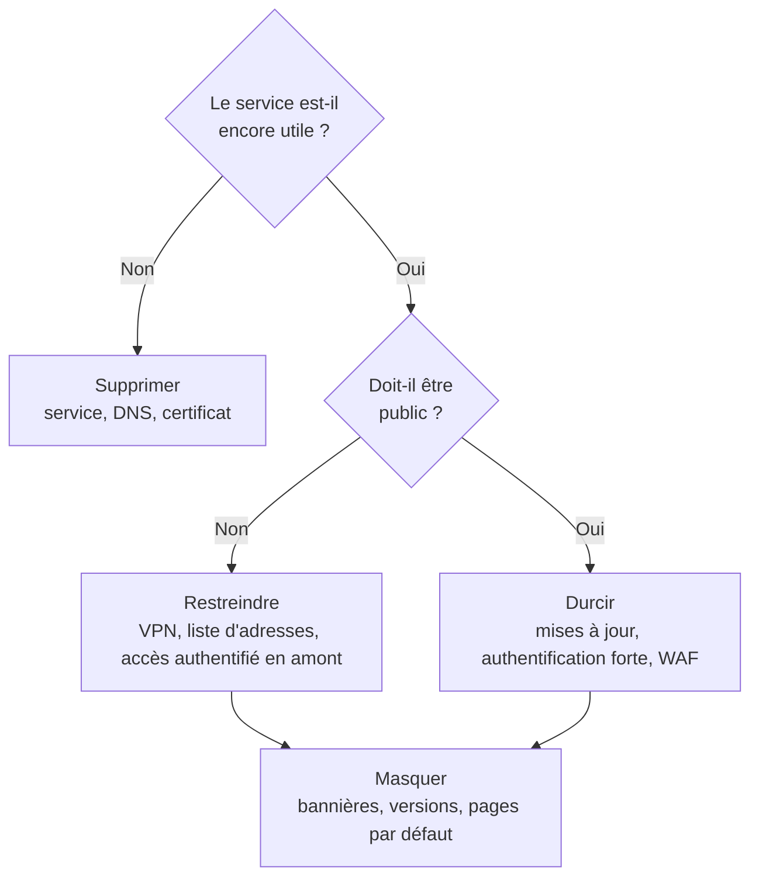

# Réduire son exposition : fermer, restreindre, masquer

Un service qui n'est pas joignable ne peut pas être attaqué depuis internet, quelles que soient ses failles. C'est la mesure la plus efficace de toute la sécurité périmétrique, et souvent la plus simple : là où corriger une faille demande d'attendre un correctif, de le tester et de redémarrer, fermer un accès prend une ligne de configuration. La note précédente l'a montré avec la priorisation : une faille critique sur un service réservé au VPN passe derrière une erreur banale sur internet.

Cette note classe les mesures de réduction de la plus forte à la plus faible, puis détaille les fuites les plus courantes : ports de conteneurs, serveur d'origine derrière un CDN, noms publiés dans les certificats et enregistrements DNS oubliés.

## Une hiérarchie des mesures

Toutes les mesures ne se valent pas. On les applique dans cet ordre, en ne descendant à la suivante que si la précédente est impossible.



**Supprimer** est la seule mesure définitive : un service éteint, son enregistrement DNS retiré, son certificat révoqué ou laissé expirer. **Restreindre** garde le service mais le rend invisible au public : il n'est joignable que par le VPN, depuis certaines adresses, ou derrière une passerelle qui exige une authentification avant même de transmettre la requête. **Durcir** concerne ce qui doit rester public : mises à jour, authentification multifacteur, pare-feu applicatif. **Masquer** les versions et les pages par défaut vient en dernier : c'est utile, mais cela ne fait que retirer de l'information, sans rien corriger.

## Le pare-feu par défaut fermé

La base est un pare-feu qui refuse tout ce qui entre, sauf ce qui est explicitement autorisé. Sur un serveur personnel, la liste autorisée tient souvent en trois lignes : le port du VPN, et éventuellement 80 et 443 si un site est servi en direct.

```bash
ufw default deny incoming
ufw default allow outgoing
ufw allow 51820/udp     # WireGuard, par exemple
ufw enable
```

> [!warning] Piège : les conteneurs contournent le pare-feu
> Docker, et selon sa configuration Podman, publient les ports des conteneurs en ajoutant leurs propres règles de traduction d'adresse (DNAT) dans le pare-feu du noyau. Le trafic redirigé passe alors par la chaîne `FORWARD` et non par la chaîne `INPUT` que filtre ufw : un port publié par un conteneur peut être joignable depuis internet alors qu'ufw affiche une politique fermée. Seul un scan externe le révèle.

La parade la plus simple est de ne publier un port que sur l'interface locale, et de laisser le reverse proxy être le seul point d'entrée :

```yaml
services:
  app:
    ports:
      - "127.0.0.1:8080:8080"   # joignable seulement depuis l'hôte
  db:
    # aucun "ports:" : la base n'est joignable que par le réseau interne des conteneurs
    networks: [interne]
```

Mieux encore, les conteneurs qui n'ont pas à être joints de l'extérieur ne publient aucun port : le reverse proxy les atteint par un réseau de conteneurs partagé, et les bases de données vivent sur un réseau interne sans accès au reste.

## Ne rien ouvrir du tout : les tunnels sortants

Une manière radicale de supprimer l'exposition d'un site public consiste à n'ouvrir **aucun port entrant**. Un démon installé sur le serveur, comme `cloudflared` pour Cloudflare Tunnel, établit des connexions sortantes vers le réseau du fournisseur, qui reçoit les visiteurs et leur relaie le trafic par ces connexions. Le serveur n'écoute rien sur internet : un scan de son adresse ne trouve aucun port ouvert, et aucun moteur ne peut associer son adresse au nom du site.

Le même principe, appliqué aux accès d'administration, est celui des passerelles d'accès de type *zero trust* : l'utilisateur s'authentifie auprès de la passerelle avant que la moindre requête n'atteigne le service. Le prix est une dépendance envers ce fournisseur, qui voit passer le trafic.

## Le serveur d'origine derrière un CDN

Beaucoup de sites passent par un CDN pour cacher leur adresse et profiter de son pare-feu applicatif. Cette protection ne vaut que si l'adresse d'origine reste secrète, et elle fuit souvent, par trois chemins vus dans les notes précédentes : l'origine répond en direct sur le port 443 avec le certificat du site, et un moteur comme Censys fait le rapprochement ; un ancien enregistrement DNS pointait directement vers l'origine avant la mise en place du CDN, et les bases de DNS historique s'en souviennent ; un sous-domaine secondaire (`mail`, `ftp`, `direct`) résout vers la même machine sans passer par le CDN.

Les parades suivent ces chemins : n'accepter sur l'origine que les connexions venant des plages publiées par le CDN, ou mieux, passer par un tunnel sortant ; configurer le site par défaut du reverse proxy pour qu'il refuse les requêtes sans nom connu ; et, si l'origine a déjà fuité, changer d'adresse.

## Ce que publient les certificats et le DNS

Chaque certificat public inscrit ses noms dans les journaux de Certificate Transparency, pour toujours. Pour les services internes, deux solutions évitent de les annoncer : une **autorité de certification interne** (step-ca, par exemple), dont les certificats ne sont pas journalisés publiquement, à condition d'installer sa racine sur les appareils qui s'y connectent ; ou un certificat générique `*.example.org`, qui ne liste pas chaque sous-domaine, au prix d'une clé partagée par tous les services.

Côté DNS, l'hygiène tient en une règle : **un nom suit le cycle de vie du service**. Quand un service disparaît, son enregistrement disparaît le même jour, sinon il devient orphelin et candidat à la [[Subdomain Takeover]]. Les noms purement internes n'ont rien à faire dans la zone publique ; un DNS interne (ou une vue séparée de la zone) les sert aux seuls clients du réseau privé.

## Masquer : utile, mais en dernier

Une fois l'essentiel fait, retirer les informations gratuites reste une bonne habitude. Avec nginx, `server_tokens off;` supprime la version de l'en-tête `Server` et des pages d'erreur. On retire aussi les pages d'installation et les fichiers de démonstration, on empêche le listage des répertoires et on bloque l'accès aux fichiers cachés (`.git`, `.env`) au niveau du reverse proxy :

```nginx
server_tokens off;
location ~ /\.(?!well-known) { deny all; }
```

L'exception `.well-known` laisse passer les validations Let's Encrypt et les fichiers standardisés comme `security.txt`.

## Vérifier, toujours depuis l'extérieur

Une mesure de réduction n'est acquise que lorsqu'un scan externe confirme son effet. Les pièges vus plus haut (pare-feu contourné par les conteneurs, sous-domaine qui court-circuite le CDN) ont en commun d'être invisibles dans la configuration et évidents de l'extérieur. Chaque changement se termine donc par un nouveau scan depuis une machine extérieure, comparé au précédent, ce qui conduit naturellement à automatiser cette comparaison dans [[Surveillance continue de l'exposition]].

> [!quiz] Pourquoi un port publié par un conteneur Docker peut-il rester joignable alors qu'ufw refuse tout trafic entrant ?
> Parce que Docker ajoute ses propres règles de traduction d'adresse : le trafic redirigé vers le conteneur traverse la chaîne `FORWARD`, alors qu'ufw filtre la chaîne `INPUT`. La politique d'ufw ne s'applique donc pas à ce trafic.

> [!quiz] Comment un tunnel sortant comme Cloudflare Tunnel supprime-t-il l'exposition d'un site ?
> Le serveur établit lui-même des connexions sortantes vers le fournisseur, qui y relaie le trafic des visiteurs. Aucun port n'est ouvert en entrée : un scan de l'adresse du serveur ne trouve rien, et aucun moteur ne peut associer cette adresse au site.

> [!quiz] Un service n'est plus utilisé. Quelle mesure prendre en priorité ?
> - [x] Le supprimer, avec son enregistrement DNS.
>   C'est la seule mesure définitive, et retirer le DNS évite un nom orphelin.
> - [ ] Le mettre derrière le VPN.
>   Restreindre un service inutile garde un actif à maintenir sans raison.
> - [ ] Masquer sa version dans les en-têtes.
>   Masquer ne corrige rien et laisse le service exposé.

> [!ordre] Les mesures de réduction, de la plus forte à la plus faible
> 1. Supprimer le service
> 2. Restreindre l'accès (VPN, liste d'adresses)
> 3. Durcir ce qui reste public
> 4. Masquer versions et pages par défaut
