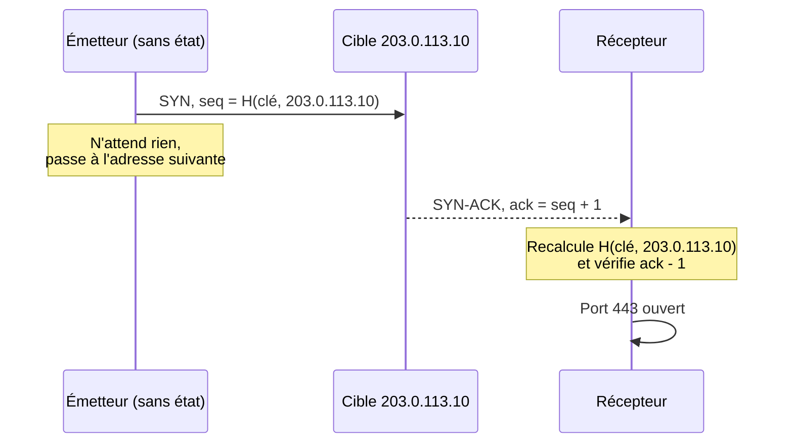

# Scan à l'échelle d'internet : masscan, ZMap et naabu

Les moteurs de recherche d'appareils donnent une photographie datée. Pour savoir ce qui est ouvert maintenant, il faut envoyer soi-même des paquets. Pendant longtemps, scanner une plage importante prenait des jours, et scanner internet entier relevait de la recherche académique. En 2013, l'outil ZMap a montré qu'on pouvait sonder un port sur tout l'espace IPv4 en moins de 45 minutes depuis une seule machine dotée d'une connexion gigabit. Ce qui était exceptionnel est devenu banal, et c'est ce qui permet aujourd'hui à un attaquant de trouver en une heure tous les serveurs touchés par une faille publiée le matin.

Cette note explique pourquoi ces outils sont si rapides, quand choisir l'un plutôt que l'autre, et comment s'en servir proprement sur son propre périmètre. Les rappels sur les drapeaux TCP et les types de scan classiques se trouvent dans [[Scanning]].

## Pourquoi nmap est lent, et pourquoi c'est normal

Un scan SYN classique, celui de nmap, envoie un paquet `SYN` vers un port ; un port ouvert répond `SYN-ACK`, un port fermé `RST`, un port filtré ne répond rien. nmap garde en mémoire chaque sonde envoyée, attend sa réponse, mesure les délais, retransmet si nécessaire et adapte sa vitesse au réseau. Cette comptabilité le rend précis et poli, mais elle a un coût : la mémoire et le temps croissent avec le nombre de sondes en vol.

## L'astuce des scanners sans état

ZMap et masscan suppriment cette comptabilité. Ils n'enregistrent rien de ce qu'ils envoient. Ils encodent à la place, dans les champs du paquet lui-même (le numéro de séquence TCP et le port source), une valeur calculée à partir de l'adresse visée et d'une clé secrète. Quand une réponse arrive, le scanner recalcule cette valeur à partir de l'adresse qui répond et vérifie que le numéro d'acquittement correspond : si oui, la réponse est authentique, et le port est ouvert. Aucune table, aucune attente : l'émetteur envoie à pleine vitesse pendant qu'un récepteur indépendant trie les réponses.



Le scanner ne complète pas la connexion : le noyau de la machine qui scanne, qui ne connaît pas cette connexion, répond à la cible par un `RST`. Ces outils parcourent aussi les adresses dans un ordre pseudo-aléatoire plutôt que séquentiel, pour ne pas inonder un même réseau de paquets consécutifs.

Le revers de cette vitesse est la fiabilité. Une réponse perdue n'est pas retransmise, un port filtré ne se distingue pas d'une adresse éteinte, et un débit trop élevé fait perdre des réponses dans les équipements intermédiaires. Un scan sans état trouve vite la grande majorité des ports ouverts, pas tous.

## Le calcul du débit

Le temps d'un scan se calcule simplement : nombre d'adresses multiplié par nombre de ports, divisé par le débit en paquets par seconde. L'espace IPv4 compte 2³² adresses, soit environ 4,3 milliards. À dix millions de paquets par seconde, le débit maximal revendiqué par masscan, un port sur tout IPv4 prend donc environ 430 secondes, un peu plus de sept minutes. Le débit par défaut de masscan est beaucoup plus prudent : 100 paquets par seconde.

```widget:subnet
value: 203.0.113.0
prefix: 24
objectif: masscan tourne à son débit par défaut, 100 paquets par seconde, sur un seul port. Trouvez le préfixe le plus large dont on balaie toutes les adresses en moins d'une minute.
cible: prefix=20
indice: En 60 secondes, on envoie 6 000 paquets. Quelle puissance de deux reste en dessous ?
erreur: prefix<20 → Trop large : un /19 compte 8 192 adresses, soit plus de 80 secondes. ;; prefix>20 → Ça tient, mais on peut élargir encore.
bravo: Un /20 compte 4 096 adresses, soit 41 secondes à 100 paquets par seconde. Le /19, deux fois plus grand, dépasse la minute.
```

## Trois outils, trois usages

| Outil | Auteur | Modèle | Point fort | À savoir |
|---|---|---|---|---|
| nmap | Gordon Lyon | Avec état | Précision, détection de versions, scripts NSE | Lent sur de grandes plages |
| masscan | Robert Graham | Sans état, pile TCP/IP propre | Syntaxe proche de nmap, plusieurs ports et plages | Le débit par défaut est de 100 paquets/s |
| ZMap | Université du Michigan | Sans état | Un port sur des réseaux immenses, très bien documenté scientifiquement | Un seul port par passage, couplé à ZGrab2 pour la couche applicative |
| naabu | ProjectDiscovery | SYN ou CONNECT | S'enchaîne avec httpx et nuclei, déduplique, transmet à nmap | Pensé pour des listes d'hôtes plutôt que pour internet entier |

Le choix dépend de la taille du périmètre. Pour un serveur personnel ou quelques dizaines d'adresses, nmap suffit et donne d'emblée les versions. Pour plusieurs milliers d'adresses, on découvre d'abord les ports ouverts avec un scanner rapide, puis on confie seulement les ports trouvés à nmap pour l'identification, ce que détaille [[Identification des services]].

## masscan

masscan reprend la syntaxe de nmap. Il exige des droits root, car il fabrique ses paquets lui-même.

```bash
sudo masscan 203.0.113.0/28 -p22,80,443,8000-8100 --rate 1000 -oL ouverts.txt
```

`-oL` produit une liste simple (`open tcp 443 203.0.113.10 …`), facile à traiter ensuite. `--excludefile` prend une liste de plages à ne jamais toucher. Parce que masscan possède sa propre pile TCP/IP, la récupération des bannières (`--banners`) demande une précaution : il faut lui attribuer une adresse source inutilisée, ou empêcher le noyau de répondre par un `RST` sur le port source qu'il utilise, sinon le noyau coupe les connexions que masscan tente d'établir.

## ZMap et ZGrab2

ZMap scanne un seul port par passage et produit la liste des adresses qui répondent. Il est livré avec une liste de blocage (`/etc/zmap/blocklist.conf`) qui exclut les plages réservées et privées, et sa documentation insiste sur les bonnes pratiques du scan de recherche.

```bash
sudo zmap -p 443 203.0.113.0/24 -r 1000 -o ouverts.csv
```

La couche applicative est confiée à **ZGrab2**, de la même équipe, qui se connecte aux adresses trouvées et récupère bannières, certificats ou pages selon le module choisi. C'est la chaîne qu'utilise Censys à grande échelle.

## naabu

naabu, écrit en Go par ProjectDiscovery, est le scanner de ports de l'écosystème qui comprend subfinder, httpx et nuclei. Il fait un scan SYN s'il a les droits root, et un scan CONNECT sinon.

```bash
naabu -host 203.0.113.10 -top-ports 1000 -silent
naabu -list hotes.txt -p - -rate 500 -silent        # -p - : les 65 535 ports
naabu -host 203.0.113.10 -p - -nmap-cli 'nmap -sV'  # transmet les ports trouvés à nmap
```

Son intérêt est de s'insérer dans une chaîne : sa sortie (`hôte:port`) est directement l'entrée de httpx, ce qui permet de passer d'une liste de sous-domaines à une liste de services web en une ligne.

## D'où scanner : le point de vue compte

Un scan lancé depuis le réseau local ou depuis le VPN ne voit pas ce que voit internet. Le pare-feu peut autoriser le réseau local, le routeur peut rediriger différemment le trafic interne, et un service réservé au VPN apparaîtra ouvert alors qu'il est fermé au public. Pour mesurer l'exposition, il faut scanner **depuis l'extérieur** : une petite machine louée chez un autre hébergeur, ou un ordinateur connecté au partage de connexion d'un téléphone. Comparer ce scan externe à un scan depuis le VPN montre précisément ce qui est réservé aux accès privés.

## Scanner proprement

> [!warning] Sur son propre périmètre uniquement
> Ces outils peuvent générer en quelques minutes plus de trafic que beaucoup de réseaux n'en voient en une journée. Scannez uniquement des adresses qui vous appartiennent ou pour lesquelles vous avez une autorisation écrite, et vérifiez que les conditions de votre hébergeur et de votre fournisseur d'accès le permettent.

Même sur son propre périmètre, quelques règles évitent les ennuis. On limite le débit à ce que la connexion et les équipements supportent : une box domestique saturée par masscan coupe tout le foyer. On fournit une liste d'exclusion pour ne jamais déborder de sa plage par une faute de frappe dans un préfixe (un `/16` au lieu d'un `/26`). Les chercheurs qui scannent internet ajoutent en plus un enregistrement DNS inverse explicite et une page web sur l'adresse source qui décrit le projet et permet de demander une exclusion. Enfin, si vous avez des sondes de détection (Suricata, Fail2Ban, Wazuh), attendez-vous à ce qu'elles réagissent : c'est un excellent test, à condition de ne pas vous bannir vous-même de votre serveur.

> [!quiz] Comment un scanner sans état sait-il qu'un SYN-ACK répond bien à l'une de ses sondes ?
> Il a encodé dans le numéro de séquence (et le port source) une valeur calculée à partir de l'adresse visée et d'une clé secrète. À la réception, il recalcule cette valeur pour l'adresse qui répond et la compare au numéro d'acquittement moins un.

> [!quiz] Pourquoi un scan sans état peut-il manquer des ports ouverts ?
> Parce qu'il ne retransmet pas les sondes : une réponse perdue en route, ou abandonnée par un équipement saturé quand le débit est trop élevé, fait passer le port pour fermé.

> [!quiz] Combien de temps faut-il pour sonder un port sur tout IPv4 à dix millions de paquets par seconde ?
> - [x] Environ sept minutes.
>   2³² ≈ 4,3 milliards d'adresses, divisé par 10⁷ paquets/s, donne environ 430 secondes.
> - [ ] Environ sept heures.
>   Ce serait le cas à un peu moins de 200 000 paquets par seconde.
> - [ ] Environ sept secondes.
>   Il faudrait plus de 600 millions de paquets par seconde.

> [!quiz] Vous voulez savoir ce que votre serveur expose au public. D'où lancez-vous le scan ?
> - [ ] Depuis le serveur lui-même, sur `localhost`.
>   Vous verriez les services en écoute, pas ce que le pare-feu laisse passer.
> - [ ] Depuis le VPN.
>   Le VPN a souvent des droits que le public n'a pas ; les services réservés au VPN paraîtraient exposés.
> - [x] Depuis une machine extérieure, sur un autre réseau.
>   C'est le seul point de vue qui reproduit celui d'un inconnu sur internet.
