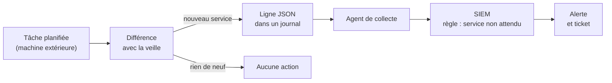

# Surveillance continue de l'exposition : de l'instantané à l'EASM

Un audit d'exposition est juste le jour où on le fait. La semaine suivante, un conteneur a été ajouté, un certificat a été demandé pour un nouveau sous-domaine, une règle de pare-feu a été assouplie pour un test, et une faille a été publiée dans un logiciel qu'on pensait sûr. Les attaquants, eux, scannent en continu. Le défenseur doit donc passer de la photographie au film : refaire les mêmes mesures à intervalle régulier, et ne regarder que ce qui a changé.

Cette note transforme les étapes du parcours en une surveillance automatique : ce qu'il faut suivre, comment détecter les nouveautés sans relire tout à chaque fois, et quels outils font ce travail à plus grande échelle.

## Ce qui change, et à quel rythme

Tous les éléments de la surface externe ne bougent pas à la même vitesse, et ne justifient donc pas la même fréquence de mesure.

| Élément | Comment le suivre | Rythme raisonnable |
|---|---|---|
| Nouveaux certificats et sous-domaines | Journaux de Certificate Transparency, subfinder | Quotidien, voire en temps réel |
| Ports et services ouverts | Scan externe (naabu, nmap) depuis une machine extérieure | Quotidien à hebdomadaire |
| Technologies et versions | httpx, nmap `-sV` | Hebdomadaire |
| Expositions et failles connues | nuclei, catalogue KEV | Hebdomadaire, et dès qu'une faille majeure est publiée |
| Expiration des domaines et certificats | RDAP, tlsx `-expired` | Hebdomadaire |

La directive BOD 23-01 de la CISA, citée dans [[Exposition internet]], retient sept jours pour la découverte et quatorze pour la recherche de vulnérabilités : c'est un plancher pour une organisation, et un rythme largement suffisant pour un labo.

## Ne regarder que les différences

Relire chaque semaine la liste complète des services exposés est le meilleur moyen de ne plus la lire. La surveillance repose donc sur la **différence** entre deux mesures : une ligne apparue est une alerte, une ligne disparue est une information. L'outil `anew`, de Tom Hudson, fait exactement cela : il ajoute à un fichier les lignes qu'il ne contient pas encore, et n'affiche que celles-là.

```bash
#!/usr/bin/env bash
# exposition.sh — à lancer depuis une machine EXTÉRIEURE au périmètre surveillé
set -euo pipefail
cd /var/lib/exposition
DOMAINE=example.org

subfinder -d "$DOMAINE" -all -silent | dnsx -silent > noms.txt
cat noms.txt adresses-fixes.txt | naabu -top-ports 1000 -silent > services-du-jour.txt

# Services jamais vus auparavant
anew services-connus.txt < services-du-jour.txt > nouveaux.txt

# Services vus auparavant mais absents aujourd'hui
sort -u services-du-jour.txt > aujourdhui.trie
sort -u services-connus.txt | comm -23 - aujourdhui.trie > disparus.txt

if [ -s nouveaux.txt ]; then
  curl -s -H "Title: Nouveaux services exposés" --data-binary @nouveaux.txt \
       https://ntfy.sh/un-sujet-difficile-a-deviner
fi
```

Le script tourne chaque nuit par une tâche cron ou un minuteur systemd. Son point le plus important est écrit en commentaire : il doit s'exécuter **depuis l'extérieur**, sinon il mesure ce que voit le serveur lui-même, pas ce que voit internet. Une petite machine louée chez un autre hébergeur convient très bien.

Le premier passage remplit `services-connus.txt` sans rien signaler d'utile ; ce fichier devient ensuite la référence. Il est sain de le confronter régulièrement à l'inventaire de [[Inventaire des actifs]], pour qu'un service apparu un jour ne soit pas définitivement accepté par simple ancienneté.

## Brancher la surveillance sur le SOC

Une notification sur un téléphone suffit pour un labo. Dès qu'un SOC existe, la surveillance de l'exposition gagne à y entrer comme une source de journaux parmi d'autres. Il suffit d'écrire chaque nouveauté sous forme d'une ligne JSON dans un fichier que l'agent de collecte (Wazuh, par exemple) surveille, puis d'écrire une règle qui lève une alerte pour tout service nouveau sur une adresse marquée « VPN uniquement » dans l'inventaire.



Ce branchement a un second intérêt : il permet de corréler. Si le scan de la nuit découvre un port ouvert et que le SIEM voit, le même jour, des connexions réussies sur ce port depuis des adresses inconnues, l'incident a peut-être déjà commencé.

## Les outils qui industrialisent la démarche

Le script ci-dessus est un EASM minimal. Des outils libres vont beaucoup plus loin.

- **BBOT** (Black Lantern Security) enchaîne récursivement des dizaines de modules : chaque nom, adresse ou URL trouvé relance la découverte. `bbot -t example.org -p subdomain-enum` en donne un aperçu.
- **OWASP Amass** construit une base de données de l'infrastructure découverte et suit son évolution d'un passage à l'autre.
- **reNgine** propose une interface web autour des outils de ProjectDiscovery, avec planification et comparaison des résultats.
- **Shodan Monitor** surveille les plages d'adresses qu'on lui déclare et envoie une alerte quand un nouveau service ou une faille y apparaît : on délègue le scan, au prix de la fraîcheur.

Les plateformes commerciales d'EASM ajoutent surtout l'attribution automatique des actifs, l'intégration aux outils internes et le suivi des corrections, décrits dans [[Attack Surface Management]].

## Mesurer pour progresser

Quelques indicateurs suffisent à savoir si la surveillance sert à quelque chose : le nombre de services exposés et sa tendance, la part de services exposés qui figurent dans l'inventaire, le délai entre l'apparition d'un service non prévu et sa détection, et le délai entre la détection et la correction. Le troisième est le plus révélateur : un service ouvert par erreur le vendredi soir et découvert le lundi a passé un week-end entier à la merci des scanners automatiques.

Les exercices de [[Auditer son propre labo]] mettent en place cette chaîne de bout en bout.

> [!quiz] Pourquoi le script de surveillance doit-il tourner depuis une machine extérieure au périmètre ?
> Parce que depuis le serveur ou le réseau interne, on voit ce qui écoute, pas ce que le pare-feu laisse passer depuis internet. Seul un point de vue extérieur reproduit celui d'un attaquant.

> [!quiz] Que fait l'outil `anew` dans une chaîne de surveillance ?
> Il ajoute à un fichier de référence les lignes qui n'y figurent pas encore et n'affiche que celles-là. On obtient ainsi uniquement les nouveautés depuis le passage précédent, sans relire toute la liste.

> [!quiz] Quel indicateur révèle le mieux l'efficacité de la surveillance de l'exposition ?
> - [x] Le délai entre l'apparition d'un service non prévu et sa détection.
>   C'est la durée pendant laquelle le service est exposé sans que personne le sache.
> - [ ] Le nombre total de scans lancés par mois.
>   Lancer beaucoup de scans ne dit rien de ce qu'on en tire.
> - [ ] Le nombre de modèles nuclei installés.
>   La taille de la bibliothèque ne mesure ni la couverture ni la réactivité.
