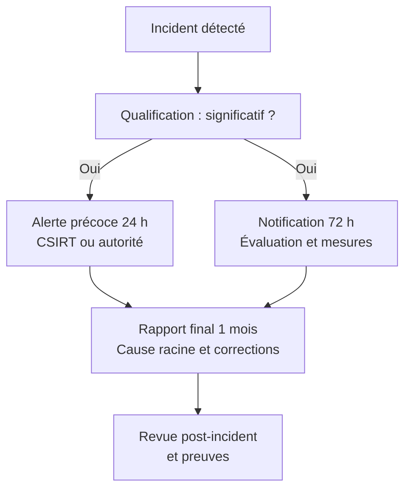

# NIS2 et DORA

Deux textes européens structurent désormais la cybersécurité réglementaire : la directive NIS2 (UE) 2022/2555 et le règlement DORA (UE) 2022/2554. Tous deux dépassent la logique de la conformité documentaire : ils exigent une capacité démontrable à prévenir, détecter, notifier et surmonter un incident, y compris lorsque celui-ci provient d'un fournisseur. NIS2 élargit le périmètre sectoriel et impose une gouvernance de la cybersécurité ; DORA organise la résilience opérationnelle du secteur financier, avec des tests, un registre des tiers et une surveillance des prestataires critiques.

Cette note présente le périmètre et les obligations des deux textes, leurs recoupements avec le RGPD, ISO 27001, le NIST CSF et [[EBIOS RM]], puis une méthode de mise en œuvre et les preuves attendues. Elle s'appuie sur [[Compliance]], [[Gestion des Vulnérabilités]] et [[Business Continuity et Disaster Recovery]].

> [!abstract] Définition — Résilience opérationnelle
> Capacité d'une organisation à prévenir les perturbations, à limiter leur impact, à poursuivre ses activités critiques et à restaurer ses services dans des délais acceptables. Elle ne se confond pas avec la sécurité de l'information : elle inclut la continuité, la dépendance aux tiers, la capacité de test et la gouvernance de crise.

## NIS2 : périmètre et logique

NIS2 remplace la directive NIS de 2016. Adoptée le 14 décembre 2022, elle est entrée en vigueur le 16 janvier 2023 ; les États membres devaient la transposer au plus tard le 17 octobre 2024, pour une application à partir du 18 octobre 2024. Contrairement à un règlement, elle doit être transposée en droit national : les obligations précises, les autorités compétentes et les sanctions varient donc d'un État à l'autre.

Le périmètre repose sur trois critères : le secteur, la taille et la criticité. Les entités sont classées en essentielles ou importantes.

| Catégorie | Secteurs | Critère principal |
|---|---|---|
| Essentielle | Énergie, transport, banque, infrastructures de marché financier, santé, eau, infrastructure numérique, gestion des services TIC, administration publique, espace | Grande entité de l'annexe I, ou entité critique quelle que soit sa taille |
| Importante | Poste, déchets, chimie, alimentation, fabrication, fournisseurs numériques, recherche | Entité moyenne de l'annexe I, ou entité moyenne ou grande de l'annexe II |

Le seuil vise les entités d'au moins 50 salariés ou 10 millions d'euros de chiffre d'affaires annuel. Certaines entités sont couvertes quel que soit leur taille : fournisseurs de réseaux de communications électroniques, services de confiance qualifiés, registres de noms de domaine de premier niveau, fournisseurs de DNS, gestionnaires de services TIC et fournisseurs de réseaux publics.

> [!abstract] Définition — Entité essentielle
> Entité qui fournit un service critique pour l'économie ou la société et dont la perturbation aurait un impact significatif. Elle est soumise aux obligations renforcées de NIS2, à la surveillance des autorités et, dans la plupart des transpositions, à des sanctions plus élevées que les entités importantes. La qualification dépend du secteur, de la taille et de la criticité, pas de la seule volonté de l'entreprise.

NIS2 impose aux États membres de tenir un registre des entités et de désigner des autorités compétentes ainsi qu'un CSIRT. En France, l'ANSSI et le dispositif national de réponse aux incidents jouent ce rôle ; les modalités exactes dépendent de la loi de transposition. L'entité doit s'enregistrer, fournir ses coordonnées et déclarer ses services, puis mettre à jour ces informations.

## Obligations NIS2

L'article 21 impose des mesures de gestion du risque de cybersécurité. La liste n'est pas une checklist fermée : elle définit un socle que l'entité doit adapter à son risque.

- Analyse des risques et politiques de sécurité des systèmes d'information.
- Gestion des incidents de cybersécurité.
- Continuité d'activité, gestion des sauvegardes, reprise après sinistre et gestion de crise.
- Sécurité de la chaîne d'approvisionnement, y compris les relations avec les fournisseurs et les sous-traitants.
- Sécurité dans l'acquisition, le développement et la maintenance des systèmes, avec gestion des vulnérabilités et divulgation responsable.
- Politiques et procédures d'évaluation de l'efficacité des mesures.
- Hygiène cyber de base et formation.
- Cryptographie et chiffrement.
- Sécurité des ressources humaines, contrôle d'accès et gestion des actifs.
- Authentification multifacteur, communications sécurisées et communications d'urgence fiables.

L'article 20 ajoute une obligation de gouvernance : l'organe de direction approuve les mesures, en assure la supervision et suit une formation. La responsabilité n'est donc pas déléguée au seul RSSI : elle remonte à la direction, avec une possible responsabilité personnelle des dirigeants dans les transpositions nationales.

L'article 23 organise la notification des incidents significatifs. Un incident est significatif s'il cause une perturbation opérationnelle ou une perte financière grave, ou s'il affecte d'autres personnes en perturbant la fourniture d'un service. Le calendrier est strict :

| Échéance | Contenu | Destinataire |
|---|---|---|
| 24 heures | Alerte précoce : incident suspecté, caractère malveillant éventuel, conséquences transfrontalières | CSIRT ou autorité compétente |
| 72 heures | Notification : évaluation initiale, gravité, indicateurs de compromission, mesures prises | CSIRT ou autorité compétente |
| 1 mois | Rapport final : description, cause racine, impact, mesures correctives | CSIRT ou autorité compétente |

L'alerte précoce n'exige pas une analyse complète : elle informe de l'incident et de son caractère potentiellement significatif. La notification à 72 heures peut être incomplète mais doit être substantielle. Le rapport final peut être complété par des rapports intermédiaires à la demande de l'autorité. Les délais courent à partir de la prise de connaissance, pas de la survenue.

L'article 24 encourage le recours à des schémas européens de certification de cybersécurité. L'article 22 encadre la sécurité de la chaîne d'approvisionnement : l'entité reste responsable de ses fournisseurs et doit évaluer leur sécurité, contractuellement et techniquement.

Les sanctions varient selon la transposition. Le cadre européen prévoit, pour les entités essentielles, une amende maximale d'au moins 10 millions d'euros ou 2 % du chiffre d'affaires mondial annuel, et pour les entités importantes, 7 millions d'euros ou 1,4 %. Les autorités peuvent aussi ordonner des mesures correctives, des audits, une suspension de certification ou une interdiction d'exercer certaines fonctions pour les dirigeants.

## DORA : quatre piliers

DORA est un règlement directement applicable : il n'y a pas de transposition nationale. Adopté le 14 décembre 2022, il s'applique depuis le 17 janvier 2025. Il vise les entités financières (établissements de crédit, établissements de paiement, établissements de monnaie électronique, entreprises d'investissement, prestataires de services sur crypto-actifs, dépositaires centraux, contreparties centrales, marchés, gestionnaires de fonds, assurances, fonds de pension, crowdfunding, etc.) et, par leurs contrats, les prestataires TIC tiers.

| Pilier | Contenu | Livrables typiques |
|---|---|---|
| Risque TIC | Gouvernance, stratégie, cadre de gestion du risque, inventaire, protection, détection, réponse, reprise | Politique, registre des actifs, analyse de risque, plan de continuité |
| Incidents | Détection, classification, notification, apprentissage | Procédure, registre, rapports initiaux et finaux |
| Tests de résilience | Tests annuels, tests avancés, TLPT | Plan de tests, rapports, remédiation |
| Risque tiers | Registre, contrats, concentration, surveillance des prestataires critiques | Registre des informations, due diligence, plans de sortie |

Le premier pilier exige un cadre de gestion du risque TIC intégré au dispositif global, avec une stratégie approuvée par la direction, un inventaire des actifs et des dépendances, des mesures de protection et de prévention, une capacité de détection, un plan de réponse et de reprise, et une boucle d'apprentissage. Les petites entités peuvent utiliser un cadre simplifié, mais elles restent soumises aux principes essentiels.

Le deuxième pilier impose de classer les incidents selon des critères : clients et contreparties affectés, pertes de données, criticité des services, durée, étendue géographique, impact économique. Un incident majeur doit être notifié à l'autorité compétente selon un calendrier resserré :

- Notification initiale dans les 4 heures suivant la classification, et au plus tard 24 heures après la prise de connaissance.
- Rapport intermédiaire dans les 72 heures.
- Rapport final dans le mois.

Le troisième pilier impose des tests de résilience proportionnés. Les entités financières concernées réalisent au moins une fois tous les trois ans un TLPT (Threat-Led Penetration Testing), test piloté par la menace, fondé sur le renseignement, couvrant les fonctions critiques et réalisé par des testeurs qualifiés. Le TLPT s'ajoute aux scans, aux pentests et aux exercices de continuité.

Le quatrième pilier impose un registre des informations sur tous les accords contractuels avec des prestataires TIC, y compris les fonctions externalisées, les données, les localisations, la sous-traitance et les plans de sortie. Le registre est remis annuellement à l'autorité compétente. Les prestataires TIC critiques (CTPP) sont désignés par les autorités européennes de surveillance et soumis à un superviseur principal, avec des recommandations et des astreintes pouvant atteindre 1 % du chiffre d'affaires mondial moyen journalier.

Le calendrier DORA s'articule autour du 17 janvier 2025, avec des normes techniques de réglementation et d'exécution adoptées en 2024 et applicables progressivement. La première remise du registre des informations intervient au printemps 2025. Les sanctions relèvent des États membres : amendes administratives, mesures correctives, publication des décisions. DORA ne fixe pas un plafond unique comparable à celui de NIS2, mais les régimes nationaux doivent être effectifs, proportionnés et dissuasifs.

> [!abstract] Définition — Prestataire TIC critique
> Prestataire tiers dont les services sont essentiels au fonctionnement d'entités financières et dont une défaillance pourrait affecter la stabilité du système financier européen. Il est désigné par les autorités européennes de surveillance et placé sous la supervision d'un superviseur principal, indépendamment de sa nationalité.

## Recoupements et différences

| Référentiel | Nature | Périmètre | Usage pour NIS2 et DORA |
|---|---|---|---|
| RGPD | Règlement | Données personnelles | Base légale, minimisation, notification des violations |
| ISO 27001 | Norme certifiable | Système de management de la sécurité | Socle de contrôles et preuves, non suffisant seul |
| NIST CSF 2.0 | Cadre volontaire | Gouvernance et fonctions de cybersécurité | Modèle de maturité et de pilotage |
| EBIOS RM | Méthode d'analyse de risque | Scénarios stratégiques et opérationnels | Analyse de risque exigée par l'article 21 |
| NIS2 | Directive | Entités essentielles et importantes | Obligations de moyens, notification, gouvernance |
| DORA | Règlement | Entités financières et prestataires TIC | Résilience, tests, registre, surveillance des tiers |

NIS2 et DORA se recoupent sur la gouvernance, la gestion des incidents, la continuité et le risque fournisseur. DORA est cependant plus prescriptif sur les tests, le registre et la surveillance des prestataires critiques ; NIS2 est plus large sectoriellement et repose sur une transposition nationale. Pour les entités financières couvertes par DORA, le règlement s'applique comme lex specialis : les obligations NIS2 correspondantes ne se cumulent pas, mais les prestataires TIC non financiers peuvent relever de NIS2.

Le RGPD poursuit un objectif différent : protéger les personnes, pas la continuité des services. Une violation de données personnelles déclenche une notification à l'autorité de protection des données dans les 72 heures ; un incident significatif NIS2 déclenche une alerte au CSIRT dans les 24 heures ; un incident majeur DORA déclenche une notification à l'autorité financière dans les 4 heures suivant la classification. Les trois obligations peuvent coexister sur le même événement, avec des destinataires et des contenus différents. Une cellule de crise unique doit produire une chronologie commune et des messages cohérents.

ISO 27001 fournit un système de management et un catalogue de contrôles utiles, mais la certification ne prouve ni la conformité NIS2, ni la capacité de notification, ni la résilience DORA. Elle constitue une preuve de maturité, pas une exemption. Le NIST CSF 2.0 offre un langage de pilotage (Govern, Identify, Protect, Detect, Respond, Recover) qui facilite la cartographie des mesures. [[EBIOS RM]] fournit la méthode d'analyse de risque et de scénarios attendue par NIS2 ; [[Threat Modeling]] complète l'analyse au niveau des systèmes.

## Mise en œuvre

La mise en œuvre se conduit comme un programme, pas comme un projet documentaire. L'ordre importe : le périmètre détermine les obligations, les obligations déterminent les contrôles, les contrôles déterminent les preuves.

| Phase | Activités | Durée indicative |
|---|---|---|
| Cadrage | Identifier les entités, services, autorités, seuils et dépendances | 1 à 2 mois |
| Gap analysis | Comparer l'existant aux exigences, scorer la maturité | 2 à 3 mois |
| Analyse de risque | EBIOS RM, BIA, scénarios, cartographie des tiers | 2 à 4 mois |
| Construction | Politiques, incidents, continuité, sécurité fournisseur, MFA | 6 à 12 mois |
| Tests | Exercices, pentests, TLPT, tests de restauration | Annuel et tous les 3 ans |
| Amélioration | Indicateurs, audit interne, revue de direction | Continu |

Le cadrage doit répondre à des questions simples : quelles entités juridiques sont dans le périmètre, quels services sont essentiels, quelles autorités sont compétentes, quels fournisseurs sont critiques, quels incidents seraient significatifs. La cartographie des dépendances est souvent le livrable le plus utile : elle révèle les fournisseurs uniques, les sous-traitants opaques et les concentrations géographiques.

La gestion des tiers doit être contractuelle et vérifiable. Les clauses minimales couvrent la sécurité, la notification d'incident, l'audit, la localisation des données, la sous-traitance, la réversibilité et les délais de rétablissement. Pour DORA, le registre des informations impose une granularité supplémentaire : fonctions supportées, données traitées, pays, sous-traitants, criticité et stratégie de sortie.

La continuité doit être testée, pas seulement documentée. Les exercices couvrent la perte d'un fournisseur critique, la compromission d'un compte à privilèges, le chiffrement par rançongiciel et l'indisponibilité d'un site. Les résultats alimentent le plan de traitement et la revue de direction.

Selon le secteur, les contrôles techniques à prouver diffèrent : [[OT Security avancé]] pour les opérateurs industriels, [[Télécom et 5G Security]] pour les opérateurs mobiles et [[Sécurité des API bancaires]] pour les établissements financiers. NIS2 et DORA fixent le cadre et la preuve ; les notes sectorielles fournissent les mécanismes.

## Preuves et conformité continue

Les preuves doivent être datées, versionnées, accessibles et cohérentes avec les journaux.

| Domaine | Preuves attendues |
|---|---|
| Gouvernance | Politique approuvée, mandat du comité, comptes rendus, formation des dirigeants |
| Risques | Analyse EBIOS RM, registre des risques, plan de traitement, acceptation formelle |
| Incidents | Tickets, chronologie, classification, notifications envoyées, post-mortem |
| Tiers | Contrats, due diligence, registre, plans de sortie, attestations |
| Tests | Rapports de pentest, TLPT, exercices de crise, tests de restauration |
| Vulnérabilités | Inventaire, scans, SLA de remédiation, exceptions justifiées |
| Surveillance | Journaux centralisés, alertes, tableaux de bord, revues d'accès |

La conformité continue repose sur quelques indicateurs fiables : délai de qualification d'un incident, délai de notification, pourcentage de fournisseurs critiques évalués, couverture des tests, délai moyen de remédiation des vulnérabilités critiques, taux de comptes à privilèges protégés par MFA. Ces indicateurs doivent provenir de sources automatisées.

Le SOC est central : il détecte, qualifie et documente. Une règle de [[Detection Engineering]] peut alerter sur un incident potentiellement significatif ; le processus de conformité prend ensuite le relais pour la classification, la notification et la conservation des preuves. Les délais réglementaires se mesurent à l'heure : l'horodatage des journaux, la trace des décisions et la preuve d'envoi doivent être conservés.

Un tableau de bord de conformité, revu trimestriellement, vaut mieux qu'un rapport annuel exhaustif. L'audit interne vérifie la cohérence entre politique, configuration et journal ; la revue de direction acte les écarts et les moyens.

## Limites et angles morts

- La transposition nationale de NIS2 crée des différences de périmètre, d'autorité et de sanction : un groupe européen doit cartographier pays par pays.
- Les seuils de taille et la notion de groupe laissent des filiales hors périmètre alors que leurs services sont critiques.
- La qualification d'incident significatif reste une décision d'interprétation, souvent prise dans l'urgence et sans toutes les informations.
- Le registre DORA est volumineux et évolue avec chaque contrat ; il devient obsolète sans propriétaire et sans processus de mise à jour.
- Le TLPT exige des testeurs qualifiés et une autorisation préalable : il ne s'improvise pas et peut révéler des dépendances non documentées.
- La certification ISO 27001 peut donner une fausse assurance : elle ne couvre ni la notification en 24 heures, ni le registre des tiers, ni les tests pilotés par la menace.
- La chaîne de sous-traitance reste l'angle mort principal : le fournisseur de rang 1 peut lui-même dépendre d'un prestataire non déclaré.

NIS2 et DORA ne remplacent pas une démarche de sécurité : ils en fixent le socle, la preuve et la cadence. Une organisation qui sait qualifier un incident, notifier dans les délais, tester sa continuité et cartographier ses fournisseurs est mieux préparée que celle qui accumule des politiques.

> [!quiz] NIS2 impose-t-elle une notification dans les 24 heures de la survenue de l'incident ?
> Non. Le délai court à partir du moment où l'entité prend connaissance de l'incident, et l'alerte précoce de 24 heures n'exige pas une analyse complète. La notification substantielle intervient à 72 heures, le rapport final dans le mois.

> [!quiz] Une entité financière couverte par DORA doit-elle aussi appliquer les obligations NIS2 de notification ?
> En principe non : DORA s'applique comme lex specialis aux entités financières qu'il couvre. Les obligations NIS2 correspondantes ne se cumulent pas. En revanche, les prestataires TIC non financiers peuvent relever de NIS2, et les obligations RGPD restent applicables si des données personnelles sont concernées.

> [!quiz] Pourquoi la certification ISO 27001 ne suffit-elle pas à démontrer la conformité DORA ?
> Parce qu'ISO 27001 certifie un système de management et un ensemble de contrôles, pas la capacité à notifier un incident majeur en 4 heures, à tenir un registre exhaustif des contrats TIC ou à réaliser un TLPT tous les trois ans. La certification est une preuve de maturité, pas une preuve de conformité réglementaire.
