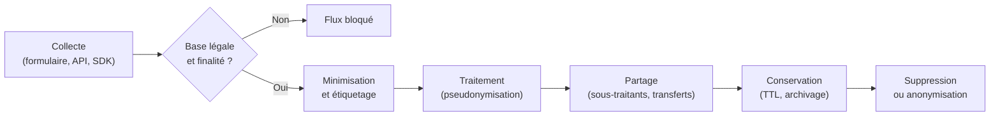

# Privacy Engineering

La conformité à la protection des données n'est pas un exercice de rédaction juridique : c'est un ensemble de propriétés que le système doit garantir à l'exécution. Une politique de confidentialité peut décrire une minimisation parfaite alors que l'application journalise des identifiants en clair, conserve des exports indéfiniment et transmet des événements à quinze partenaires. Le privacy engineering consiste à traduire les principes du RGPD en choix d'architecture, en contrôles techniques et en preuves vérifiables.

Cette note complète [[Compliance]], qui couvre le cadre réglementaire, et [[Threat Modeling]], qui fournit la méthode d'analyse des flux. Elle se concentre sur les mécanismes techniques et l'audit continu. La mise en œuvre opérationnelle côté stockage, accès et chiffrement est détaillée dans [[Sécurité des données]] ; la prévention des fuites par les canaux utilisateur dans [[DLP et protection des données]].

> [!abstract] Définition — Privacy Engineering
> Le privacy engineering est l'application systématique de principes de protection des données dès la conception, puis tout au long du cycle de vie : spécifier les finalités, limiter les données collectées, choisir des techniques de protection proportionnées, implémenter les droits des personnes et démontrer la conformité par des preuves techniques.

## Privacy by design et by default

L'article 25 du RGPD impose la protection dès la conception et par défaut. La formulation juridique se traduit par sept principes opérationnels, hérités de Cavoukian : approche proactive plutôt que réactive, protection par défaut, intégration dans la conception, fonctionnalité complète, sécurité de bout en bout, visibilité et transparence, respect des choix de l'utilisateur.

Dans la pratique, cela modifie des décisions très concrètes. Un formulaire ne collecte que les champs nécessaires ; une case de consentement n'est jamais pré-cochée ; un identifiant interne n'est pas l'adresse e-mail ; une fonctionnalité d'export est limitée par défaut ; les données de test sont synthétiques ou pseudonymisées ; les journaux ne contiennent pas de données personnelles.

Le « by default » est souvent négligé. Une plateforme peut offrir des réglages de confidentialité excellents, mais si le partage est activé par défaut, elle ne respecte pas l'article 25. La valeur par défaut est un choix d'architecture, pas un réglage utilisateur.

## Minimisation, finalité, conservation

La minimisation (article 5.1.c) consiste à ne collecter et ne traiter que ce qui est adéquat, pertinent et limité au nécessaire. Elle s'applique à la granularité : une date de naissance complète est rarement nécessaire, un mois et une année suffisent souvent ; une adresse IP complète peut être tronquée ; un identifiant de compte peut être un pseudonyme.

La finalité (article 5.1.b) interdit de réutiliser une donnée pour un objectif incompatible avec celui de la collecte. Techniquement, cela suppose d'étiqueter chaque donnée avec ses finalités autorisées et de faire respecter ces étiquettes par les applications. Une donnée collectée pour la facturation ne doit pas alimenter un modèle marketing sans base légale distincte.

La conservation (article 5.1.e) impose une durée proportionnée à la finalité. Une durée n'est pas une politique écrite : c'est un travail d'ingénierie. Chaque jeu de données doit avoir une durée de vie, un mécanisme de suppression ou d'archivage, et une preuve que la suppression a eu lieu, y compris dans les sauvegardes, les caches, les index de recherche et les entrepôts analytiques.

| Principe | Question technique | Contrôle |
|---|---|---|
| Minimisation | Quels champs sont réellement nécessaires ? | Revue de schéma, politique de collecte |
| Finalité | À quoi cette donnée peut-elle servir ? | Étiquetage, contrôle d'accès par finalité |
| Conservation | Quand la donnée doit-elle disparaître ? | TTL, purge, archivage légal |
| Exactitude | Comment corriger une donnée fausse ? | Workflow de rectification, propagation |
| Sécurité | Qui peut lire ou modifier ? | Chiffrement, moindre privilège, journalisation |



## Pseudonymisation et anonymisation

La pseudonymisation remplace un identifiant direct par un pseudonyme, tout en conservant séparément la correspondance. Elle réduit le risque, mais la donnée reste personnelle au sens du RGPD : avec la table de correspondance ou des informations supplémentaires, la réidentification reste possible. L'article 4.5 la définit comme le traitement de données de telle sorte qu'elles ne puissent plus être attribuées à une personne sans avoir recours à des informations supplémentaires conservées séparément.

Techniquement, la pseudonymisation peut utiliser un identifiant de substitution, un chiffrement réversible, un HMAC avec clé, ou une tokenisation. Un HMAC-SHA256 avec une clé secrète produit un pseudonyme stable, non réversible sans la clé, et permet de corréler des enregistrements sans exposer l'identifiant d'origine.

L'anonymisation est irréversible : aucune information raisonnablement susceptible d'être utilisée ne permet de réidentifier la personne. Le considérant 26 du RGPD retient un critère de probabilité raisonnable, tenant compte de tous les moyens raisonnablement mobilisables. L'anonymisation n'est donc pas un état binaire, mais une propriété relative à un adversaire et à un contexte.

Le groupe de travail Article 29 propose trois tests : l'isolement (singling out), qui vérifie qu'on ne peut pas isoler un individu dans un jeu de données ; la corrélation (linkability), qui vérifie qu'on ne peut pas relier deux enregistrements ou deux jeux ; et l'inférence, qui vérifie qu'on ne peut pas déduire une information sur un individu. Un jeu qui échoue à l'un de ces tests n'est pas anonyme.

| Technique | Réversibilité | Statut RGPD | Usage |
|---|---|---|---|
| Chiffrement avec clé séparée | Réversible avec clé | Donnée personnelle | Stockage, transfert |
| Tokenisation | Réversible via coffre | Donnée personnelle | Paiement, CRM |
| HMAC pseudonyme | Non réversible sans clé | Donnée personnelle | Corrélation, analytique |
| Agrégation | Non | Anonyme si k suffisant | Statistiques |
| Bruit différentiel | Non | Anonyme sous conditions | Requêtes, publications |

## k-anonymity et ses limites

Le k-anonymat, formalisé par Sweeney, impose que chaque enregistrement soit indistinguable d'au moins `k-1` autres sur un ensemble de quasi-identifiants : code postal, âge, sexe, date d'admission. On obtient ce résultat par généralisation (remplacer une valeur précise par une catégorie) et suppression (retirer une colonne ou une ligne).

```sql
SELECT code_postal, tranche_age, COUNT(*) AS k
FROM patients
GROUP BY code_postal, tranche_age
HAVING COUNT(*) < 5;
```

Un `k` de 5 est souvent cité, mais il ne garantit rien contre l'homogénéité : si tous les membres d'un groupe partagent la même maladie, le groupe est indistinguable mais l'information reste révélée. L'attaque par connaissance d'arrière-plan permet à un attaquant qui connaît l'âge et le code postal d'une personne de déduire son état de santé. `l-diversity` impose la diversité des valeurs sensibles dans chaque groupe, et `t-closeness` borne la distance entre la distribution du groupe et celle de la population.

Le k-anonymat est utile pour des jeux de données statiques et peu dimensionnels, mais il devient inefficace sur des données à forte dimensionalité, typiques des traces comportementales. La généralisation détruit alors beaucoup d'utilité sans garantir l'anonymat.

## Vie privée différentielle

La vie privée différentielle, formalisée par Dwork, offre une garantie mathématique indépendante de la connaissance de l'attaquant. Un mécanisme `M` est `ε`-différentiellement privé si, pour deux jeux de données voisins `D` et `D'` différant d'un seul individu, et pour tout ensemble de sorties `S` :

```
P(M(D) ∈ S) ≤ e^ε × P(M(D') ∈ S)
```

Le paramètre `ε` mesure la perte de vie privée : plus il est petit, plus la garantie est forte et plus le bruit est important. La sensibilité globale `Δf` d'une requête `f` est le changement maximal de sa valeur lorsqu'un individu est ajouté ou retiré. Le mécanisme de Laplace ajoute un bruit de paramètre `Δf/ε` ; le mécanisme gaussien, utilisé avec un `δ` toléré, ajoute un bruit calibré sur `Δf` et `ε`.

```python
import numpy as np

def compte_prive(valeurs, epsilon: float) -> float:
    sensibilite = 1.0
    bruit = np.random.laplace(0.0, sensibilite / epsilon)
    return len(valeurs) + bruit
```

La garantie est composée : deux requêtes de budget `ε1` et `ε2` consomment au plus `ε1 + ε2` en composition basique, moins en composition avancée ou Rényi. Il faut donc tenir un budget par utilisateur ou par jeu de données, et refuser les requêtes qui le dépassent. Un budget épuisé ne se réinitialise pas au gré des analyses.

La DP peut être centrale, avec un serveur de confiance qui ajoute le bruit, ou locale, avec un bruit ajouté sur l'appareil avant l'envoi. La DP centrale offre une bien meilleure utilité, mais suppose que le collecteur soit digne de confiance. La DP locale protège contre le collecteur, au prix d'un bruit beaucoup plus élevé.

## Technologies de protection (PETs)

Les privacy-enhancing technologies couvrent un spectre de garanties et de coûts.

Le chiffrement reste la première PET : en transit avec TLS, au repos avec AES-GCM, au niveau du champ pour les données les plus sensibles, et en enveloppe avec une clé maîtresse dans un KMS.

L'agrégation sécurisée permet de calculer une somme ou une moyenne sans exposer les contributions individuelles. Les participants partagent des masques qui s'annulent deux à deux, et seul le total est reconstruit. Combinée à la DP, elle permet un apprentissage fédéré sans que le serveur voie les gradients individuels.

Les requêtes privées à un index (PIR) permettent de récupérer un enregistrement sans révéler lequel. Les ensembles d'intersection privée (PSI) permettent à deux parties de calculer l'intersection de leurs contacts sans échanger les listes complètes. Ces primitives servent la découverte de contacts, la fraude ou la publicité, mais restent coûteuses et complexes à déployer.

Le calcul multipartite sécurisé (SMPC) et le chiffrement homomorphe permettent de calculer sur des données chiffrées. Le chiffrement homomorphe complet reste limité en performance pour la plupart des charges, mais le chiffrement partiellement homomorphe (Paillier, par exemple) est utilisé pour des agrégations. Les environnements d'exécution de confiance (TEE) offrent une isolation matérielle, avec des garanties qui dépendent du fournisseur et restent sensibles aux canaux auxiliaires.

| PET | Garantie | Coût | Cas d'usage |
|---|---|---|---|
| Chiffrement | Confidentialité au repos et en transit | Faible | Tous les systèmes |
| Tokenisation | Décorrélation de l'identifiant | Moyen | Paiement, CRM |
| Agrégation sécurisée | Totaux sans contributions | Moyen | Télémétrie, fédéré |
| PIR | Index de requête caché | Élevé | Annuaires, recherche |
| PSI | Intersection sans fuite | Élevé | Contacts, fraude |
| SMPC | Calcul sans révélation | Très élevé | Consortium, santé |
| TEE | Isolation d'exécution | Moyen | Traitement tiers |

## RGPD technique

Le RGPD s'implémente par des contrôles concrets. La base légale (article 6) doit être enregistrée et associée à chaque traitement ; elle détermine ce que le système a le droit de faire, pas seulement ce qu'il doit afficher. Le consentement (article 7) doit être libre, spécifique, éclairé, univoque, et aussi facile à retirer qu'à donner. Un bandeau cookie qui propose « Tout accepter » en un clic et le retrait en cinq écrans n'est pas conforme.

Les droits des personnes (articles 15 à 22) exigent une chaîne d'ingénierie : vérification d'identité, découverte des données dans tous les systèmes, export dans un format structuré, suppression propagée, et délai d'un mois. L'effacement ne se limite pas à la base principale : il faut traiter les caches, les journaux, les sauvegardes, les index de recherche, les entrepôts analytiques, les fichiers exportés et les sous-traitants. Les sauvegardes posent un cas particulier : une suppression immédiate peut être impossible, mais la donnée doit être exclue des restaurations ou supprimée au prochain cycle.

Le registre des traitements (article 30) est un inventaire structuré : finalité, base légale, catégories de personnes, catégories de données, destinataires, transferts hors UE, durée de conservation, mesures de sécurité. Un registre utile est relié au catalogue de données et aux flux réels, sinon il devient une fiction juridique.

La DPIA (article 35) est obligatoire pour les traitements à risque élevé : profilage à grande échelle, données sensibles à grande échelle, surveillance systématique, nouvelles technologies. Elle décrit le traitement, évalue la nécessité et la proportionnalité, analyse les risques pour les personnes et définit les mesures. Si le risque résiduel reste élevé, l'article 36 impose une consultation préalable de l'autorité. La DPIA complète [[EBIOS RM]] : EBIOS analyse les menaces contre les biens de l'organisation, la DPIA analyse les atteintes aux droits et libertés des personnes.

Les transferts hors UE relèvent du chapitre V : décision d'adéquation, clauses contractuelles types, règles d'entreprise contraignantes, et analyse des risques de transfert. Un transfert vers un pays sans protection équivalente exige des mesures supplémentaires, pas seulement une clause signée.

## Droits et consentement en pratique

Un système de gestion du consentement doit conserver la preuve : identifiant, date, version de la politique, finalités acceptées, moyens utilisés. Il doit propager le retrait à tous les consommateurs : tags analytics, pixels publicitaires, CRM, outils marketing. Un consentement stocké mais non appliqué est un risque juridique et un mensonge technique.

| Droit | Implémentation | Piège fréquent |
|---|---|---|
| Accès | Agrégation multi-systèmes, export | Oublier les logs et les sauvegardes |
| Rectification | Propagation aux dérivés | Corriger la base, pas l'entrepôt |
| Effacement | Suppression en cascade, TTL | Laisser les copies analytiques |
| Limitation | Drapeau de gel, filtrage | Le drapeau n'est pas respecté |
| Portabilité | Export JSON/CSV documenté | Format propriétaire illisible |
| Opposition | Désinscription par finalité | Retrait non propagé aux partenaires |

Le consentement n'est pas la seule base légale, et le choix de la base ne doit pas être un réflexe marketing. Lorsqu'un traitement est nécessaire à l'exécution d'un contrat, demander un consentement peut être trompeur et fragiliser la conformité. À l'inverse, un intérêt légitime exige une mise en balance documentée et un droit d'opposition effectif.

## Audit des flux et du consentement

Un audit de vie privée commence par une cartographie des flux : quelles données entrent, par quel canal, pour quelle finalité, vers quels systèmes, avec quels sous-traitants, dans quels pays, pendant combien de temps. Cette cartographie doit être reliée au code et à l'infrastructure, pas seulement à des entretiens.

Les techniques d'audit incluent l'analyse des journaux réseau et des requêtes API, l'inventaire des SDK et des tags, le scan des cookies, l'analyse de la lignée des données dans l'entrepôt, et la recherche de données personnelles dans les logs, les URL, les messages d'erreur et les exports. Un `email` dans un paramètre de requête GET est une fuite vers les journaux proxy, les historiques de navigateur et les outils d'observabilité.

Les tests de conservation sont particulièrement révélateurs : créer un enregistrement canari avec une date ancienne, vérifier qu'il est purgé au cycle prévu, et contrôler qu'il n'existe plus dans les sauvegardes restaurées. Sans test, une politique de conservation reste une intention.

L'audit du consentement compare ce qui est déclaré à ce qui est réellement exécuté : un utilisateur refuse les cookies analytiques, mais un événement part quand même vers un partenaire ; un consentement est retiré, mais la campagne continue. La comparaison entre l'état de consentement et les événements émis est un contrôle automatisable.

## Détection et surveillance

La surveillance de la vie privée repose sur des alertes et des indicateurs.

Les alertes couvrent l'apparition d'un nouveau champ personnel non étiqueté, l'augmentation anormale d'un volume d'export, un transfert vers un pays non autorisé, un événement analytics émis sans consentement, un accès massif à des dossiers sensibles, ou l'échec d'une purge planifiée. Les leurres — enregistrements canaris, adresses factices, comptes appât — détectent une exfiltration ou un accès indu.

Les indicateurs mesurent la couverture et l'effectivité : pourcentage de systèmes cartographiés, pourcentage de champs étiquetés, taux de respect du délai de réponse aux demandes, taux de suppression vérifiée, budget différentiel consommé, taux de consentement, nombre de cookies non déclarés. Un tableau de bord qui ne mesure que la conformité documentaire passe à côté de l'essentiel.

Les tests de réidentification sont un contrôle avancé : tenter de relier un jeu pseudonymisé à une source auxiliaire, mesurer l'unicité des combinaisons de quasi-identifiants, vérifier qu'un `k` annoncé est réellement atteint après les transformations. Ces tests doivent être menés dans un environnement isolé, avec des données de test.

## Limites

L'anonymisation parfaite est un idéal difficile à atteindre sur des données riches. Plus un jeu est utile, plus il contient de dimensions, et plus les combinaisons sont uniques. Le k-anonymat ne protège pas contre la connaissance d'arrière-plan, et la vie privée différentielle détruit de l'utilité à mesure que le budget se resserre.

Les PETs ont un coût de performance et de complexité. Le chiffrement homomorphe reste marginal pour les charges lourdes, le SMPC exige des participants coopératifs, et les TEE dépendent d'un fournisseur et de la robustesse de l'isolation matérielle. Aucune PET ne compense une collecte excessive : la minimisation reste la mesure la plus efficace.

Enfin, la conformité est un processus, pas un état. Les flux changent, les sous-traitants changent, les modèles et les SDK évoluent. Un registre figé et une DPIA unique se périment vite ; l'audit continu et la revue des changements sont la seule manière de maintenir la garantie.

> [!quiz] Une table pseudonymisée avec un HMAC est-elle anonyme au sens du RGPD ?
> Réponse — Non. La pseudonymisation reste réversible pour celui qui détient la clé ou qui peut relier les pseudonymes à d'autres données. Elle réduit le risque et reste une donnée personnelle. L'anonymisation exige que la réidentification ne soit pas raisonnablement possible, ce qui doit être démontré par les tests d'isolement, de corrélation et d'inférence.

> [!quiz] Pourquoi un `k` de 5 ne suffit-il pas à protéger un jeu de données de santé ?
> Réponse — Parce que les cinq membres d'un groupe peuvent partager la même pathologie. Le groupe est indistinguable, mais l'attribut sensible est révélé par homogénéité. Il faut ajouter de la diversité (`l-diversity`), contrôler la distribution (`t-closeness`) ou utiliser une garantie différentielle, et vérifier la résistance à la connaissance d'arrière-plan.
