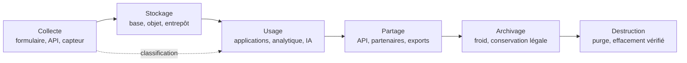

# Sécurité des données

La sécurité s'est longtemps organisée autour du périmètre : la donnée était réputée protégée parce qu'elle vivait à l'intérieur du réseau. Le cloud, le télétravail et les API ont dissous ce modèle. La même information existe désormais dans une base, un bucket, un index de recherche, un lac de données, une sauvegarde et un export CSV.

La sécurité des données prend le problème par l'actif : que vaut chaque jeu de données, qui peut y accéder, comment est-il protégé, quand doit-il disparaître. Une base clients non chiffrée, une sauvegarde accessible avec le compte de production ou une table de test contenant des données réelles sont des chemins d'exfiltration complets.

Cette note complète [[Privacy Engineering]] pour les droits des personnes, [[Gestion des clés et HSM]] pour le matériel cryptographique, [[Compliance]] pour le cadre réglementaire et [[Business Continuity et Disaster Recovery]] pour la reprise.

> [!abstract] Définition — Sécurité des données
> La sécurité des données regroupe les contrôles techniques, organisationnels et juridiques qui garantissent la confidentialité, l'intégrité, la disponibilité et la traçabilité d'un actif informationnel tout au long de son cycle de vie. Trois invariants la structurent : connaître l'emplacement et la valeur de chaque donnée, n'en autoriser l'accès qu'à des identités justifiées, conserver la preuve de cet accès.

## Le cycle de vie comme axe d'organisation

Une politique se construit par phase, parce que les risques changent à chaque étape : licéité et minimisation à la collecte, chiffrement et isolation au stockage, autorisations à l'usage, contrats au partage, conservation légale à l'archivage, preuve d'effacement à la destruction.



| Phase | Risque | Contrôles | Preuve |
|---|---|---|---|
| Collecte | Sur-collecte, base légale absente | Minimisation, finalité | Registre, schéma validé |
| Stockage | Exposition, chiffrement absent | Chiffrement, isolation | Configuration, revue de droits |
| Usage | Abus de privilège, requête massive | RBAC/ABAC, RLS, masquage | Journaux de requêtes |
| Partage | Fuite vers un tiers | Contrat, tokenisation | Inventaire des destinataires |
| Archivage | Conservation excessive | Rétention, supports scellés | Journal de purge |
| Destruction | Résidus, copies oubliées | Effacement certifié | Certificat de destruction |

La classification est le fil conducteur : posée à la collecte, héritée au stockage, vérifiée à l'usage, appliquée à la destruction. Une donnée qui perd son étiquette perd sa politique — défaut courant, car la classification vit souvent dans un tableur que les systèmes ignorent.

## Classification, inventaire et cartographie

Quatre niveaux suffisent : public, interne, confidentiel, restreint. Le niveau doit être actionnable : « restreint » implique chiffrement au champ, accès nominatif, journalisation exhaustive, export interdit par défaut et conservation courte.

| Niveau | Exemples | Chiffrement | Accès | Export |
|---|---|---|---|---|
| Public | Documentation | Recommandé | Tous | Libre |
| Interne | Procédures | Au repos | Employés authentifiés | Contrôlé |
| Confidentiel | Contrats, clients | Au repos et au champ | Besoin d'en connaître | Validation |
| Restreint | Santé, paiement, secrets | Champ, clés dédiées | Nominatif, MFA, JIT | Interdit |

L'étiquette doit être portée par la donnée : métadonnées du catalogue (propriétaire, niveau, finalité, rétention), étiquettes dans les systèmes (colonnes taguées, objets S3, documents Purview) et étiquettes de flux qui voyagent avec les événements.

L'inventaire est la première difficulté : les organisations connaissent leurs applications, rarement leurs jeux de données. Les scanners de bases, l'analyse d'échantillons et les classifieurs produisent des candidats à qualifier. Un champ `iban` trouvé dans une table de logs révèle souvent un problème plus grave : la donnée a fui vers un système non conçu pour elle.

La cartographie des flux relie jeux de données, traitements, applications et destinataires. Elle doit être vérifiée par la télémétrie — journaux de requêtes, traces API, lineage — et pas seulement par des entretiens. Le registre de l'article 30 du RGPD est un bon format, à condition d'être relié au catalogue technique.

## Chiffrement au repos, en transit et en usage

Le chiffrement limite la valeur d'une copie volée ; il n'empêche pas un accès autorisé. Trois états, trois menaces.

| État | Menace | Mécanisme | Limite |
|---|---|---|---|
| Au repos | Vol de disque, snapshot, sauvegarde | TDE, chiffrement objet ou de champ | Invisible pour une requête légitime |
| En transit | Interception, proxy | TLS 1.3, mTLS | Terminaison TLS mal contrôlée |
| En usage | Hyperviseur, opérateur, mémoire | TEE, confidential computing | Canaux auxiliaires |

Au repos, il faut distinguer le chiffrement du support et celui de la donnée. Le chiffrement de volume protège contre le vol physique, pas contre une requête SQL ni un compte compromis. Le chiffrement de champ, appliqué par l'application avant écriture, protège la valeur même si l'attaquant obtient un dump. Le modèle d'enveloppe — une KEK dans un KMS ou HSM qui chiffre des DEK — permet de tourner la KEK sans réchiffrer les données.

En transit, TLS 1.3 est le minimum pour les flux exposés, avec suites restreintes, HSTS et chaînes valides. À l'intérieur du système d'information, le chiffrement est souvent négligé au nom du « réseau interne » — précisément le terrain du mouvement latéral. Le mTLS entre services, avec des identités de charge de travail à durée courte, ferme cette porte.

En usage, la donnée est en clair dans la mémoire du processus. Les enclaves (SGX, SEV-SNP, TDX, CCA) isolent le traitement de l'hyperviseur et permettent l'attestation à distance : le client vérifie la mesure du code avant de confier un secret. Une enclave ne remplace pas une autorisation correcte.

## Gestion des clés

Une donnée chiffrée avec une clé accessible au même administrateur que la base n'est pas protégée : elle est encodée. La séparation entre le détenteur de la clé et celui des données est le cœur du modèle. [[Gestion des clés et HSM]] détaille le cycle de vie ; retenons les décisions qui conditionnent la donnée.

| Clé | Emplacement | Rotation | Portée |
|---|---|---|---|
| Maîtresse de compte | KMS, HSM | Annuelle ou sur incident | Toutes les DEK |
| Par tenant | KMS, HSM | Annuelle | Un locataire |
| DEK par objet ou colonne | Chiffrée par la KEK | Au réchiffrement | Un enregistrement |
| Sauvegarde | HSM hors ligne | Pluriannuelle | Archive complète |

Trois propriétés sont indispensables : la clé n'est jamais exportable en clair ; les politiques de clé sont distinctes des politiques de données, si bien qu'un rôle qui lit un bucket ne déchiffre pas automatiquement ; la clé de sauvegarde est séparée et hors ligne, sinon un rançongiciel qui compromet le compte compromet aussi les sauvegardes.

## Contrôle d'accès : RBAC, ABAC et ReBAC

| Modèle | Principe | Avantage | Faiblesse |
|---|---|---|---|
| RBAC | Rôles porteurs de permissions | Simple | Explosion des rôles, dérive |
| ABAC | Attributs du sujet, de la ressource, du contexte | Contextuel et fin | Complexité des politiques |
| ReBAC | Relations dans un graphe | Colle aux partages réels | Graphe à maintenir |

Le RBAC convient aux fonctions stables : administrateur, analyste, support. Il devient insuffisant pour exprimer « un médecin accède aux dossiers de ses patients, dans son service, pendant sa garde ». L'ABAC apporte le contexte : département, classification, finalité, heure, appareil. Le ReBAC modélise les relations et se prête aux partages documentaires.

Une politique doit refuser par défaut, s'évaluer au point d'accès et se journaliser. Le moindre privilège se joue à trois niveaux : les rôles, les objets (ligne, colonne, dossier) et le temps (accès juste-à-temps plutôt que permanent).

## Masquage, tokenisation et pseudonymisation

| Technique | Réversible | Usage | Limite |
|---|---|---|---|
| Masquage statique | Non | Copies de test, analytique | Détruit la corrélation |
| Masquage dynamique | Selon politique | Support, back-office | Dépend du proxy ou de la vue |
| Tokenisation | Via coffre | Paiement, CRM | Le coffre devient critique |
| Chiffrement de champ | Avec clé | Données sensibles | Coût applicatif |
| Pseudonymisation HMAC | Non sans clé | Corrélation, mesure | Reste une donnée personnelle |

Le masquage dynamique s'implémente souvent par des vues : l'utilisateur interroge une vue qui applique un `CASE` selon son rôle.

La tokenisation remplace une valeur par un jeton sans signification, conservé dans un coffre qui détient la correspondance. Elle est précieuse pour les numéros de carte : la base ne contient que des jetons, une fuite ne livre aucun PAN.

La pseudonymisation par HMAC produit un identifiant stable, non réversible sans la clé, utile pour corréler des événements sans exposer l'e-mail. Elle ne rend pas la donnée anonyme : [[Privacy Engineering]] rappelle que la réidentification reste possible par recoupement. L'anonymisation exige une preuve — isolement, corrélation, inférence.

## Sécurité des bases de données

La base concentre la donnée, donc le point de fuite le plus rentable.

L'authentification : mots de passe hachés avec un algorithme adapté (`scram-sha-256`), authentification par certificat ou identité cloud, aucun compte partagé, MFA pour les administrateurs, connexions chiffrées et limitées à des réseaux connus. L'autorisation : rôles distincts pour la lecture, l'écriture, la migration et l'administration, privilèges au niveau des colonnes, et row-level security quand plusieurs locataires partagent une table.

```sql
CREATE ROLE app_lecture NOLOGIN;
GRANT SELECT (id, nom, region) ON clients TO app_lecture;

ALTER TABLE clients ENABLE ROW LEVEL SECURITY;
CREATE POLICY clients_tenant ON clients
USING (tenant_id = current_setting('app.tenant_id')::uuid);
```

Le RLS n'est efficace que si le contexte est fixé par une couche de confiance et non falsifiable. Une connexion poolée qui conserve `app.tenant_id` d'une requête à l'autre crée une fuite entre locataires : il faut le `SET LOCAL` dans la transaction et le réinitialiser.

Le chiffrement transparent (TDE) chiffre fichiers et sauvegardes au niveau du stockage. Il protège contre le vol de média, pas contre une requête autorisée ni un administrateur qui accède à la clé.

L'audit constitue la troisième couche : connexions, échecs, requêtes, changements de schéma et de privilèges. `pgaudit` journalise les instructions et les objets touchés. Ces journaux doivent partir vers un système séparé, en écriture seule : un attaquant qui administre la base peut sinon effacer ses traces.

La surveillance des accès (DAM) analyse le trafic SQL pour détecter les comportements anormaux : requêtes massives, `SELECT *` sur des tables sensibles, accès hors horaires, extraction de milliers de lignes, connexion depuis un nouveau poste. Elle complète l'audit natif, mais reste aveugle au chiffrement de bout en bout et contournable par un accès local.

La prévention d'injection repose sur des requêtes paramétrées et un compte applicatif aux droits minimaux. Un WAF ne corrige pas une requête vulnérable ; si l'application n'a pas le droit de lire la table `salaires`, une injection qui passe n'obtient rien.

## Sauvegardes et résilience

Une sauvegarde est une copie complète des données, souvent sans les contrôles de la production : dernière ligne de défense contre la perte, mais aussi chemin d'exfiltration. La règle 3-2-1-1-0 structure la réponse : trois copies, deux supports, une hors site, une immuable ou hors ligne, zéro erreur de restauration vérifiée.

L'immuabilité est décisive face au rançongiciel. Un stockage WORM, un bucket avec Object Lock en mode compliance, une bande hors ligne ne peuvent être chiffrés ni supprimés par un attaquant qui détient les identifiants de production. La sauvegarde doit être chiffrée avec une clé distincte, conservée dans un compte séparé, et ses journaux envoyés vers un troisième emplacement.

Le test de restauration est la seule preuve. Il doit être régulier, documenté et mesurer le RTO réel. [[Business Continuity et Disaster Recovery]] détaille RPO et RTO ; du point de vue de la donnée, deux vérifications s'ajoutent : la restauration respecte-t-elle la rétention et les suppressions, et les données restaurées sont-elles replacées dans un environnement aussi protégé que la production ? [[Ransomware]] rappelle la séquence — exfiltration, suppression des clichés, chiffrement : la sauvegarde immuable protège la disponibilité, pas la confidentialité des données déjà copiées.

## Rétention et destruction

Conserver trop longtemps est un risque, supprimer trop tôt une faute. La politique fixe, par catégorie, une durée et un déclencheur : fin de contrat, dernier achat, clôture d'exercice, expiration d'une obligation légale. Elle distingue donnée active, archive intermédiaire et archive légale.

La suppression doit être propagée. Un enregistrement supprimé dans la base primaire survit dans les réplicas, les caches, les index, les entrepôts, les exports et les sauvegardes. La stratégie réaliste combine purge applicative, durées de vie sur les objets, politiques de cycle de vie et exclusion lors des restaurations.

La destruction physique suit NIST SP 800-88 : *clear* pour une réutilisation interne, *purge* pour une sortie d'actif, *destroy* pour une destruction définitive. Le crypto-shredding est efficace pour des données chiffrées avec une clé dédiée, à condition qu'aucune copie de la clé ne subsiste.

## Risque interne

Le risque interne n'est pas seulement le salarié malveillant : il inclut l'erreur, la négligence, le compte compromis et l'utilisateur qui contourne une procédure pour travailler plus vite.

La séparation doit être réelle : celui qui accorde un droit ne doit pas pouvoir l'utiliser sans trace, celui qui gère les sauvegardes ne doit pas pouvoir les supprimer. On sépare par compte, environnement et infrastructure, on applique le moindre privilège et on conserve les journaux hors de portée des administrateurs. L'UEBA établit une baseline par utilisateur — horaires, volumes, systèmes, destinations — et alerte sur les écarts : téléchargement massif la veille d'un départ, dossier jamais consulté, connexion depuis un pays inhabituel.

## Données dans le cloud

Le cloud déplace le contrôle, pas la responsabilité. Le fournisseur protège l'infrastructure, l'organisation protège ses configurations, ses identités et ses données. Les incidents viennent rarement de l'hyperviseur : ils viennent d'un bucket public, d'un rôle trop permissif ou d'une clé exposée.

Les contrôles minimaux sont connus : blocage de l'accès public au niveau du compte, politiques de bucket explicites, refus des connexions non TLS, versioning, journalisation des accès, chiffrement avec une clé gérée par le client pour les données sensibles. Une politique de bucket doit refuser par défaut et n'autoriser que des principes nommés.

La résidence et la souveraineté sont distinctes. La résidence décide où la donnée est stockée ; la souveraineté, qui peut y accéder légalement. Un fournisseur peut stocker dans l'Union européenne et permettre à une autorité étrangère d'accéder aux données via sa maison mère.

Le multi-locataire impose une isolation vérifiée : préfixes par tenant, politiques IAM conditionnées, clés distinctes, journaux séparés.

## Détection et audit

La sécurité des données se prouve par les journaux. Quatre sources sont indispensables : accès au stockage, base de données, identité et clés.

| Source | Ce qu'elle révèle | Signal |
|---|---|---|
| Accès objet | Lecture, écriture, suppression | Volume par principal |
| Audit base | Requêtes, échecs, DDL, rôles | `SELECT` massifs |
| Identité | Connexions, MFA, élévation | Impossible travel |
| KMS/HSM | Déchiffrements, créations de clés | Pic de `Decrypt` |
| [[DLP et protection des données]] | Exports, partages externes | Domaine inconnu |

Les alertes doivent viser des comportements, pas seulement des événements. Un téléchargement de 10 000 fichiers est banal pour un compte de sauvegarde connu ; il est suspect pour un compte de support, un dimanche, depuis un poste non géré. La corrélation entre identité, volume, moment et destination transforme le bruit en signal.

```sql
SELECT principal, date_trunc('hour', ts) AS heure, sum(lignes_lues) AS lignes
FROM audit_acces
WHERE classification IN ('confidentiel', 'restreint')
AND ts > now() - interval '24 hours'
GROUP BY 1, 2
HAVING sum(lignes_lues) > 50000
ORDER BY lignes DESC;
```

Les indicateurs mesurent l'effectivité, pas l'activité : pourcentage de jeux classés, de colonnes sensibles chiffrées, délai de révocation d'un accès, taux de restauration réussie, nombre de buckets publics, âge des clés.

L'audit doit être indépendant du système audité. Les journaux de la base ne doivent pas vivre dans la même base ; ceux du compte de production doivent partir vers un compte de sécurité, avec une rétention immuable. Sinon, l'attaquant dispose du même privilège que l'auditeur.

## Limites

Le chiffrement ne protège pas une donnée qu'un utilisateur légitime est autorisé à voir. TDE ne protège pas contre une requête SQL. Le masquage applicatif ne protège pas d'un accès direct à la table. Le RLS dépend d'un contexte correctement fixé. Chaque contrôle a un contournement ; la sécurité des données est un empilement de couches imparfaites.

La classification se périme vite : les données changent de nature, les systèmes se multiplient, les propriétaires partent. Les sauvegardes restent le point faible : oubliées dans les politiques de rétention, accessibles avec les identifiants de production, jamais restaurées.

> [!quiz] Le chiffrement transparent de la base (TDE) protège-t-il contre un attaquant qui obtient un compte SQL en lecture ?
> Réponse — Non. Le TDE déchiffre les pages à la volée pour toute requête autorisée : un compte valide lit les données en clair. Il protège contre le vol de fichiers, de disques et de sauvegardes, pas contre un accès applicatif. Il faut y ajouter chiffrement de champ, masquage, RLS et surveillance des requêtes.

> [!quiz] Une sauvegarde immuable suffit-elle à protéger une organisation contre un rançongiciel ?
> Réponse — Elle protège la capacité de restauration, pas la confidentialité. Le rançongiciel moderne exfiltre avant de chiffrer : les données déjà copiées restent exposées à la double extorsion. Il faut aussi détecter l'exfiltration, segmenter les accès, chiffrer les sauvegardes avec une clé distincte et tester la restauration.
