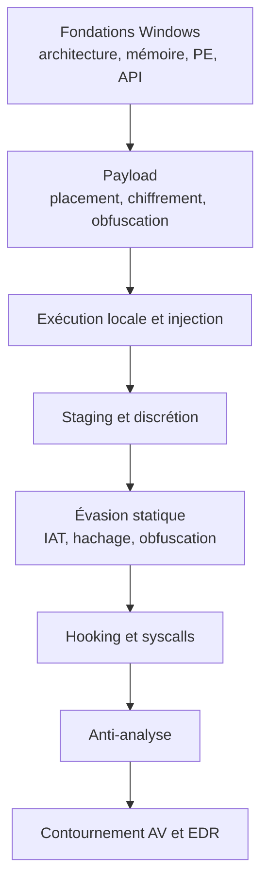

# Index — Malware Development

Carte des connaissances de développement de malware sous Windows. Le corpus part des fondations (architecture système, format PE, API) pour progresser vers les techniques d'exécution, d'injection, d'obfuscation et de contournement des solutions de sécurité. Il s'adresse aux red teams, aux pentesters et aux analystes qui veulent comprendre ce qu'ils observent dans un binaire.

> [!warning] Cadre légal
> Ces techniques ne s'emploient que dans un cadre autorisé : mandat signé, périmètre défini, environnement de laboratoire isolé. Le code produit à des fins d'apprentissage ne doit jamais être diffusé ni exécuté hors de ce cadre.

## Parcours de lecture

## Fondations Windows

Comprendre le terrain avant d'écrire la moindre ligne de payload.

- [[Introduction au développement de malware]] — définition, motivations, choix du langage, cycle de développement, outillage, bases de C
- [[Architecture Windows]] — mode utilisateur et noyau, empilement kernel32 / ntdll / ntoskrnl, transition par `syscall`
- [[Gestion de la mémoire Windows]] — mémoire virtuelle, états des pages, protections, allocation et libération
- [[Windows API]] — types Windows, variantes A/W, paramètres IN/OUT, gestion des erreurs
- [[Format PE]] — en-têtes DOS et NT, sections, répertoires de données
- [[Dynamic-Link Library]] — `DllMain`, exports, adresse de base partagée, `rundll32`
- [[Processus Windows]] — threads, PEB, TEB, handles, modules chargés
- [[Structures non documentées]] — membres réservés, sources alternatives, intégration et validation
- [[Mécanismes de détection]] — signature, heuristique, comportement, hooking, IAT, analyse manuelle

## Payload : stockage, chiffrement, obfuscation

- [[Placement du payload]] — sections `.data`, `.rdata`, `.text`, `.rsrc`, compromis taille / modifiabilité / exécutabilité
- [[Chiffrement du payload]] — XOR, RC4, AES-CBC via CNG ou Tiny-AES, gestion de clé et d'IV
- [[Obfuscation du payload]] — encodage IPv4, IPv6, MAC et UUID, reconstruction en mémoire
- [[Outils HellShell et MiniShell]] — génération automatique des données obfusquées et de la routine inverse
- [[Réduction de l'entropie binaire]] — padding, choix d'algorithmes, EntropyReducer
- [[Déchiffrement par force brute]] — octet indice, clé protégée, outil KeyGuard

## Exécution et injection

- [[Exécution locale de payload]] — chargement d'une DLL, allocation et exécution de shellcode dans le processus courant
- [[Injection de DLL]] — `OpenProcess`, `VirtualAllocEx`, `WriteProcessMemory`, `CreateRemoteThread` sur `LoadLibraryW`
- [[Injection de shellcode]] — écriture directe du shellcode dans la cible puis exécution distante
- [[Détournement de threads]] — `GetThreadContext` / `SetThreadContext`, création ou énumération de threads, local et distant
- [[Injection APC et Early Bird]] — `QueueUserAPC`, thread alertable, APC avant le point d'entrée
- [[Exécution par callbacks]] — `CreateTimerQueueTimer`, `EnumChildWindows`, `EnumUILanguagesW`, `VerifierEnumerateResource`
- [[Injection par mapping]] — `CreateFileMapping`, `MapViewOfFile`, `MapViewOfFile2`, mémoire partagée
- [[Function stomping]] — écrasement du code d'une fonction légitime, variantes locale et distante
- [[Contrôle de l'exécution du payload]] — mutex, sémaphores et évènements pour éviter les doubles exécutions
- [[Énumération des processus]] — `EnumProcesses`, `CreateToolhelp32Snapshot`, `NtQuerySystemInformation`

## Staging, signature et discrétion

- [[Staging du payload]] — récupération HTTP via WinINet, stockage dans le registre, considérations opérationnelles
- [[Signature des binaires malware]] — chaîne de confiance Windows, certificat auto-signé, `signtool`, limites
- [[Spoofing de processus]] — falsification du PPID et de la ligne de commande, `STARTUPINFOEX`, PEB distant

## Évasion statique et résolution d'API

- [[Parsing des en-têtes PE]] — lecture programmatique des structures, RVA, exports, imports, relocations
- [[Hachage de chaînes]] — Djb2, Jenkins One At A Time, LoseLose, Rotr32, stack strings
- [[Dissimulation de l'IAT]] — chargement dynamique, réimplémentation, API hashing, pseudo-handles, compile-time hashing, camouflage
- [[API hooking]] — trampolines, Detours, MinHook, hooking manuel, `SetWindowsHookEx`

## Syscalls

- [[Introduction aux syscalls]] — SSN, stub `mov r10, rcx` / `mov eax, SSN` / `syscall`, hooking userland
- [[SysWhispers et Hell's Gate]] — génération de stubs, extraction des SSN, TartarusGate, HellsHall et syscalls indirects
- [[Réimplémentation des injections via syscalls]] — réécriture des injections classique, par mapping et APC avec les NtAPI

## Anti-analyse

- [[Anti-debugging]] — `IsDebuggerPresent`, PEB, `NtGlobalFlag`, points d'arrêt, chronométrage, auto-suppression
- [[Anti-VM et évasion d'environnement]] — artefacts matériels, résolution d'écran, processus, retardement, API hammering
- [[Suppression de la CRT]] — `/NODEFAULTLIB`, point d'entrée custom, réduction de taille, d'IAT et d'entropie

## Contournement des solutions de sécurité

- [[Contournement des antivirus]] — assemblage d'un loader complet : Hell's Gate, mapping, hachage, anti-analyse, RC4
- [[Introduction aux EDR]] — architecture d'un agent, télémétrie, détection comportementale
- [[Unhooking de NTDLL]] — restauration de `.text` depuis le disque, KnownDlls, processus suspendu ou serveur web
- [[Politique de blocage des DLL]] — `PROC_THREAD_ATTRIBUTE_MITIGATION_POLICY`, blocage des DLL non Microsoft
- [[NtCreateUserProcess]] — création de processus par la Native API, `PS_ATTRIBUTE_LIST`, PPID spoofing et block DLL policy

## Évasion moderne

Techniques contemporaines de discrétion en mémoire, orientées contournement des capteurs comportementaux et de l'inspection des piles d'appels.

- [[Obscurcissement du sommeil]] — chiffrement du beacon pendant les attentes, Ekko, Foliage, Cronos, DeathSleep
- [[Spoofing de pile d'appels]] — frames synthétiques, retour vers `BaseThreadInitThunk`, CallStackMasker, SilentMoonwalk
- [[Process hollowing]] — image légitime vidée puis remplacée, variantes ghosting, herpaderping, doppelgänging
- [[Reflective DLL injection]] — loader réflexif, résolution manuelle des imports et relocations, sRDI
- [[AMSI et ETW bypass]] — patch d'`AmsiScanBuffer`, contournement d'`EtwEventWrite`, limites d'ETW-TI

## Malware Linux et macOS

Le corpus Windows se prolonge sur les deux autres familles de systèmes, avec leurs formats binaires, leurs mécanismes de persistance et leurs capteurs propres.

- [[Malware Linux]] — ELF, `LD_PRELOAD`, `ptrace`, `memfd_create`, systemd, rootkits LKM et eBPF
- [[Malware macOS]] — Mach-O, codesign, Gatekeeper, TCC, launchd, dylib hijacking, EndpointSecurity

## Mapping ATT&CK

Les identifiants ci-dessous renvoient à la matrice Enterprise. La méthode de cartographie, les limites et l'usage en détection sont détaillés dans [[MITRE ATT&CK]].

| Tactique | Techniques | Notes principales |
|---|---|---|
| Execution (TA0002) | T1059, T1106, T1204 | [[Windows API]], [[NtCreateUserProcess]], [[Exécution locale de payload]], [[PowerShell Pentest]] |
| Persistence (TA0003) | T1543, T1547, T1053 | [[Persistence]], [[Malware Linux]], [[Malware macOS]] |
| Privilege Escalation (TA0004) | T1055, T1068 | [[Injection de shellcode]], [[Process hollowing]], [[Windows Privilege Escalation]] |
| Defense Evasion (TA0005) | T1027, T1055, T1620, T1562.001, T1497 | [[Obfuscation du payload]], [[Reflective DLL injection]], [[AMSI et ETW bypass]], [[Anti-VM et évasion d'environnement]] |
| Credential Access (TA0006) | T1003 | [[Credential Access]], [[Mimikatz]] |
| Discovery (TA0007) | T1057, T1082 | [[Énumération des processus]], [[BloodHound]] |
| Command and Control (TA0011) | T1071, T1095, T1572 | [[C2 Infrastructure]], [[C2 avancé]], [[Pivoting et Tunneling]] |
| Exfiltration (TA0010) | T1041, T1048 | [[Data Exfiltration]] |

## Source des connaissances

Ce corpus synthétise les modules de MalDev Academy (1 à 91), complétés par les références Microsoft et les définitions publiques de structures non documentées. Les identifiants d'API, les structures et les enchaînements d'appels sont conservés tels quels pour rester utilisables en laboratoire. Les notes d'évasion moderne et de malware Linux/macOS s'appuient sur les recherches publiques citées dans chaque note.
