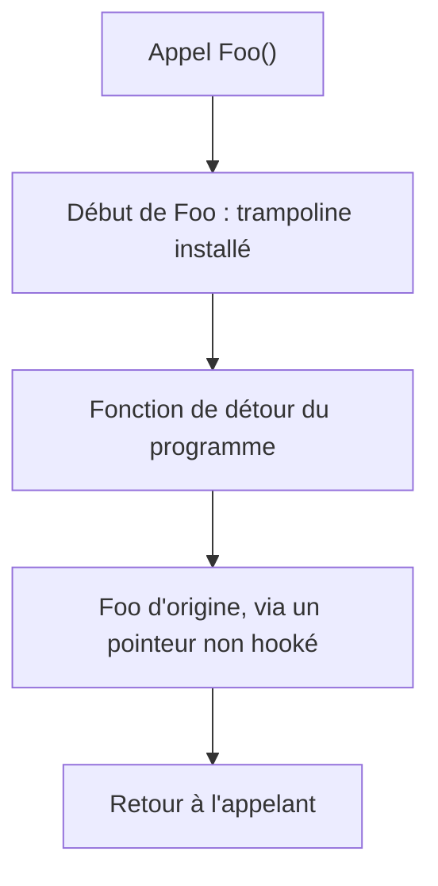
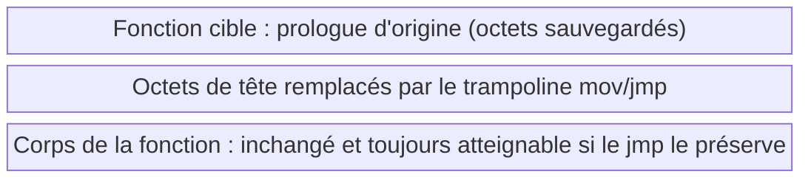

# API hooking

L'API hooking consiste à intercepter une fonction pour en observer ou modifier le comportement sans toucher au code source de l'appelant. C'est d'abord un outil de débogage et de reverse engineering, mais c'est aussi une arme à double tranchant : le malware l'utilise pour voler des données, détourner des appels et contourner des protections, tandis que les solutions de sécurité l'utilisent pour inspecter les fonctions les plus abusées.

## Principe : trampolines et inline hooking

La méthode classique repose sur un **trampoline** : un petit shellcode chargé de changer le chemin d'exécution en sautant vers une autre adresse de l'espace d'adressage du processus. On l'insère au début de la fonction cible ; dès qu'elle est appelée, le trampoline s'exécute à la place et redirige le flux vers une fonction de remplacement.



On distingue deux variantes :

| Approche | Comportement | Coût |
|---|---|---|
| Trampoline / redirection | Le flux part vers la fonction de remplacement et ne revient pas forcément | Simple, mais perte de l'original |
| Inline hook | Redirige puis **rend la main** à la fonction légitime | Plus complexe, plus efficace et plus discret |

## Pourquoi hooker

- Collecter des informations sensibles (identifiants, données utilisateur).
- Intercepter ou modifier des appels de fonctions à des fins malveillantes.
- Contourner des protections en altérant le comportement de Windows ou d'un programme (AMSI, ETW).
- Côté défense : inspecter plus finement les fonctions détournées et scanner les régions mémoire exécutables.

Quatre familles de mise en œuvre existent : les bibliothèques open source (Detours, Minhook), les API Windows prévues pour la surveillance (`SetWindowsHookEx`), et le code maison.

## Bibliothèque Detours

Développée par Microsoft Research, Detours intercepte et redirige les appels de fonctions sur Windows (32 et 64 bits). Elle remplace les premières instructions de la fonction cible par un saut inconditionnel vers la fonction de détour fournie par l'utilisateur.

La bibliothèque s'appuie sur des **transactions** : on regroupe plusieurs opérations, puis on les applique d'un bloc. Cela facilite l'annulation groupée. La compilation produit `detoursx64.lib` ou `detoursx86.lib` selon l'architecture, sélectionnée via les macros `_M_X64` et `_M_IX86` :

```c
#ifdef _M_X64
#pragma comment (lib, "detoursx64.lib")
#endif // _M_X64
#ifdef _M_IX86
#pragma comment (lib, "detoursx86.lib")
#endif // _M_IX86
```

Les fonctions principales renvoient un `LONG` valant `NO_ERROR` (0) en cas de succès :

| API | Rôle |
|---|---|
| `DetourTransactionBegin` | Ouvre une nouvelle transaction |
| `DetourUpdateThread` | Enrôle un thread dans la transaction |
| `DetourAttach` | Ajoute un hook sur la fonction cible |
| `DetourDetach` | Retire un hook |
| `DetourTransactionCommit` | Applique réellement la transaction |

L'installation d'un hook, avec `MessageBoxA` comme cible :

```c
fnMessageBoxA g_pMessageBoxA = MessageBoxA;

INT WINAPI MyMessageBoxA(HWND hWnd, LPCSTR lpText, LPCSTR lpCaption, UINT uType) {
    printf("[+] Paramètres d'origine : %s / %s\n", lpText, lpCaption);
    return g_pMessageBoxA(hWnd, "nouveau texte", "nouvelle légende", uType);
}

BOOL InstallHook() {
    DWORD dwDetoursErr = NULL;

    if ((dwDetoursErr = DetourTransactionBegin()) != NO_ERROR) return FALSE;
    if ((dwDetoursErr = DetourUpdateThread(GetCurrentThread())) != NO_ERROR) return FALSE;
    if ((dwDetoursErr = DetourAttach((PVOID)&g_pMessageBoxA, MyMessageBoxA)) != NO_ERROR) return FALSE;
    if ((dwDetoursErr = DetourTransactionCommit()) != NO_ERROR) return FALSE;

    return TRUE;
}
```

Le déhooking suit le même schéma avec `DetourDetach` à la place de `DetourAttach`.

### Le problème de la boucle infinie

Naïvement, la fonction de détour rappelle la fonction hookée pour retrouver le comportement d'origine. Comme cette dernière est hookée, elle rebascule sur le détour : boucle infinie. Deux solutions :

1. Sauvegarder un pointeur global vers la fonction d'origine avant de hooker et l'appeler à la place.
2. Appeler une autre API équivalente mais non hookée (`MessageBoxW` au lieu de `MessageBoxA`, `VirtualAllocEx` au lieu de `VirtualAlloc`).

La fonction de remplacement doit avoir le même type de retour et, au plus, les mêmes paramètres : en prendre davantage accéderait à une adresse invalide et déclencherait une exception d'accès.

## Bibliothèque Minhook

Minhook est une bibliothèque de hooking écrite en C, compatible 32 et 64 bits, qui utilise de l'assembleur x86/x64 pour l'inline hooking, comme Detours, mais avec une API plus légère et sans transactions.

| API | Rôle |
|---|---|
| `MH_Initialize` | Initialise la structure `HOOK_ENTRY` (une seule fois, au début) |
| `MH_CreateHook` | Crée un hook et renseigne le pointeur vers l'original |
| `MH_EnableHook` | Active le hook créé |
| `MH_DisableHook` | Désactive le hook |
| `MH_Uninitialize` | Nettoie la structure (une seule fois, à la fin) |

Les fonctions renvoient un `MH_STATUS` (`MH_OK` valant 0). Particularité : c'est `MH_CreateHook` qui renseigne le pointeur vers la fonction d'origine, ce qui évite le problème de boucle infinie.

```c
fnMessageBoxA g_pMessageBoxA = NULL;

INT WINAPI MyMessageBoxA(HWND hWnd, LPCSTR lpText, LPCSTR lpCaption, UINT uType) {
    printf("[+] Paramètres d'origine : %s / %s\n", lpText, lpCaption);
    return g_pMessageBoxA(hWnd, "autre texte", "autre légende", uType);
}

BOOL InstallHook() {
    DWORD dwMinHookErr = NULL;

    if ((dwMinHookErr = MH_Initialize()) != MH_OK) return FALSE;
    // g_pMessageBoxA recevra le pointeur vers l'original
    if ((dwMinHookErr = MH_CreateHook(&MessageBoxA, &MyMessageBoxA, &g_pMessageBoxA)) != MH_OK) return FALSE;
    if ((dwMinHookErr = MH_EnableHook(&MessageBoxA)) != MH_OK) return FALSE;

    return TRUE;
}
```

Le déhooking ne demande qu'un `MH_DisableHook(&MessageBoxA)` suivi d'un `MH_Uninitialize()`.

## Hooking manuel

Detours et Minhook ont leurs sources publiques : leurs motifs servent d'indicateurs de compromis (IoCs) aux éditeurs de sécurité. Réécrire le hooking à la main — même rudimentaire — supprime ces signatures et évite d'alourdir le binaire. Le principe reste d'écraser les premières instructions de la fonction par un trampoline `mov` + `jmp`.

Le trampoline est un shellcode dont on remplit l'adresse de destination à l'exécution. En 64 bits, il charge l'adresse dans `r10` puis saute ; en 32 bits, il passe par `eax`. Les octets `0x00` sont des emplacements réservés comblés par `memcpy`.

```asm
; 64 bits
mov r10, pAddress
jmp r10
```

```asm
; 32 bits
mov eax, pAddress
jmp eax
```

```c
// 64 bits : opcode + patch de l'adresse
uint8_t uTrampoline[] = {
    0x49, 0xBA, 0x00, 0x00, 0x00, 0x00, 0x00, 0x00, 0x00, 0x00, // mov r10, pFunctionToRun
    0x41, 0xFF, 0xE2                                            // jmp r10
};
uint64_t uPatch = (uint64_t)pAddress;
memcpy(&uTrampoline[2], &uPatch, sizeof(uPatch)); // l'adresse va à l'offset 2
```

Avant d'écraser la fonction, il faut rendre sa mémoire inscriptible, et exécutable puisque ces octets seront exécutés :

```c
if (!VirtualProtect(pFunctionToHook, sizeof(uTrampoline), PAGE_EXECUTE_READWRITE, &dwOldProtection))
    return FALSE;
memcpy(pFunctionToHook, uTrampoline, sizeof(uTrampoline));
```



Le déhooking restaure les octets d'origine conservés avant le patch, puis rétablit l'ancienne protection mémoire :

```c
memcpy(pFunctionToHook, pOriginalBytes, sizeof(pOriginalBytes));
VirtualProtect(pFunctionToHook, TRAMPOLINE_SIZE, dwOldProtection, &dwNewProtection);
```

Une structure `HookSt` regroupe tout le nécessaire, avec `TRAMPOLINE_SIZE` valant 13 octets en 64 bits et 7 en 32 bits :

```c
typedef struct _HookSt {
    PVOID pFunctionToHook;                  // adresse de la fonction à hooker
    PVOID pFunctionToRun;                   // adresse de la fonction à exécuter à la place
    BYTE  pOriginalBytes[TRAMPOLINE_SIZE];  // copie des octets d'origine (nettoyage)
    DWORD dwOldProtection;                  // protection mémoire d'origine (nettoyage)
} HookSt, *PHookSt;
```

`InitializeHookStruct` remplit la structure et passe la zone en `PAGE_EXECUTE_READWRITE` ; `InstallHook` copie le trampoline patché ; `RemoveHook` restaure les octets et la protection. Faute de pointeur global vers l'original, la fonction de détour appelle une API équivalente non hookée (`MessageBoxW`).

## Hooking via les API Windows : SetWindowsHookEx

`SetWindowsHookExW` ne modifie pas une fonction : il installe un callback déclenché à chaque événement système d'un type donné. Les types d'événements sont limités à ceux fournis par Windows, mais cela suffit pour une tâche classique comme l'enregistrement des frappes (`WH_KEYBOARD_LL`) ou des clics souris (`WH_MOUSE_LL`).

```c
HHOOK SetWindowsHookExW(
    int       idHook,     // type d'événement surveillé
    HOOKPROC  lpfn,       // pointeur vers la procédure de hook (callback)
    HINSTANCE hmod,       // handle de la DLL contenant le hook (NULL ici)
    DWORD     dwThreadId  // thread associé (NULL ici)
);
```

Le callback doit respecter le prototype `HOOKPROC` et transmettre l'information à la suite de la chaîne de hooks via `CallNextHookEx` — optionnel mais fortement recommandé pour ne pas perturber les autres applications :

```c
typedef LRESULT (CALLBACK* HOOKPROC)(int nCode, WPARAM wParam, LPARAM lParam);

BOOL MouseClicksLogger() {
    MSG   Msg = { 0 };
    HHOOK hMouseHook = SetWindowsHookExW(WH_MOUSE_LL, (HOOKPROC)HookCallback, NULL, NULL);
    if (!hMouseHook) return FALSE;

    // Traiter tous les messages non pris en charge pour éviter un pointeur qui « colle »
    while (GetMessageW(&Msg, NULL, NULL, NULL)) {
        DefWindowProcW(Msg.hwnd, Msg.message, Msg.wParam, Msg.lParam);
    }
    return TRUE;
}
```

Sans la boucle de traitement des messages, le thread sature et la souris devient saccadée : `GetMessageW` récupère les événements et `DefWindowProcW` leur applique le traitement par défaut. Le hook s'installe dans un thread dédié, maintenu actif par `WaitForSingleObject`, et se retire avec `UnhookWindowsHookEx(hHook)`.

## Détection

Le hooking laisse des traces exploitables : octets de tête altérés, sauts anormaux vers des adresses hors module, motifs propres aux bibliothèques publiques. Les solutions de sécurité hookent elles-mêmes les fonctions abusées pour observer les appels au runtime, ce qui est précisément la cible des techniques de [[Dissimulation de l'IAT]] et des [[Introduction aux syscalls]] détaillées ailleurs.
