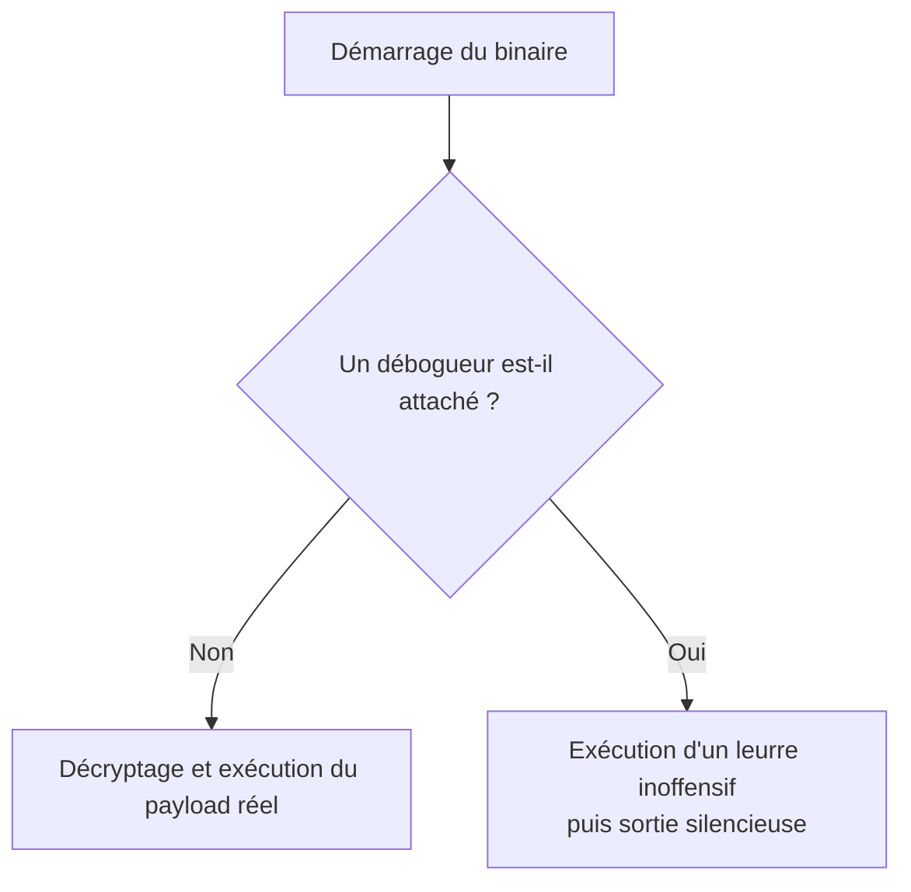
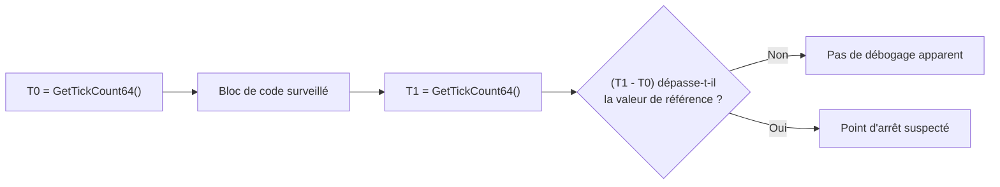
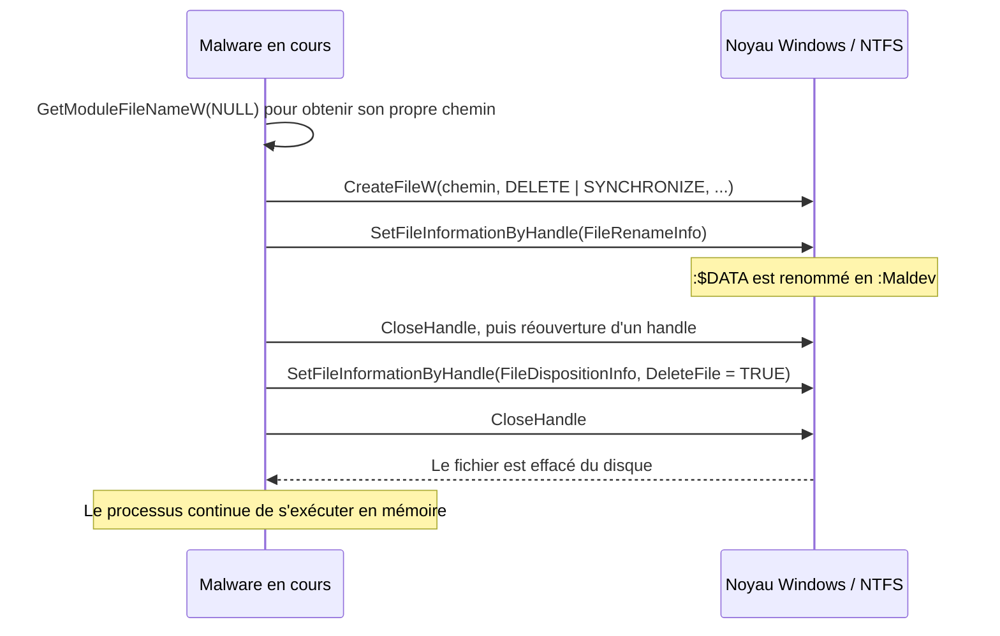

# Anti-debugging

Le débogage est l'outil principal de l'analyste : il permet d'exécuter un binaire pas à pas, d'observer les mutations de la mémoire, les changements de valeurs de variables et l'ordre réel des appels. C'est de cette observation que découlent les signatures et les règles de détection. L'anti-debugging cherche donc à détecter le débogueur et à dévier le flux d'exécution vers un leurre, ou à tuer le processus avant qu'il ne révèle quoi que ce soit.

L'objectif est rarement l'impossibilité, mais le coût. Un analyste expérimenté finira par contourner la protection ; en revanche, les organisations dont le budget sécurité est faible s'appuient sur des outils automatisés (sandboxes, moteurs d'analyse statique) que ces techniques neutralisent bien mieux. C'est le socle de l'anti-analyse, dont les facettes complémentaires sont traitées dans [[Anti-VM et évasion d'environnement]] et [[Déchiffrement par force brute]].

## Panorama des techniques

| Technique | Mécanisme ou API | Indice exploité | Contre-mesure typique |
|---|---|---|---|
| `IsDebuggerPresent` | API documentée | Drapeau `BeingDebugged` du PEB | Plugin anti-anti-debug (ScyllaHide) |
| Variante PEB | Lecture directe du PEB | Même drapeau, sans appel d'API suspect | Hook du PEB |
| Variante `NtGlobalFlag` | Lecture du PEB | Flag `0x70` posé à la création par le débogueur | Injection tardive du débogueur |
| `NtQueryInformationProcess` | Syscall natif | `ProcessDebugPort`, `ProcessDebugObjectHandle` | Patch des informations retournées |
| Points d'arrêt matériels | Registres `Dr0` à `Dr3` | Registres non nuls | Remise à zéro des registres par le débogueur |
| Liste noire | Énumération des processus | Noms `x64dbg.exe`, `ida.exe`, etc. | Renommage des outils |
| Chronométrage | `GetTickCount64`, `QueryPerformanceCounter` | Pause anormale entre deux mesures | Neutralisation des vérifications temporelles |
| `DebugBreak` | Exception `EXCEPTION_BREAKPOINT` | Exception traitée par le débogueur | Configuration du débogueur |
| `OutputDebugString` | Canal de débogage | `GetLastError` reste à zéro | Émulation du canal |



## Détection par IsDebuggerPresent

Approche la plus simple : la fonction renvoie `TRUE` si un débogueur est attaché au processus appelant.

```c
if (IsDebuggerPresent()) {
  printf("[i] IsDebuggerPresent detected a debugger \n");
  // Exécuter du code inoffensif
}
```

Le problème est double : l'appel est en lui-même un indicateur fort (même masqué par [[Hachage de chaînes]]), et il ne résiste pas aux plugins qui interceptent la valeur de retour. D'où l'intérêt de réécrire le test en lisant soi-même les structures concernées, décrites dans [[Structures non documentées]] et [[Processus Windows]].

## Remplacement du test : PEB.BeingDebugged

Le PEB contient le membre `BeingDebugged`, positionné à `1` lorsque le processus est débogué. Le lire directement évite tout appel d'API.

```c
BOOL IsDebuggerPresent2() {

  // Récupération de la structure PEB
#ifdef _WIN64
  PPEB pPeb = (PEB*)(__readgsqword(0x60));
#elif _WIN32
  PPEB pPeb = (PEB*)(__readfsdword(0x30));
#endif

  // Vérification du membre 'BeingDebugged'
  if (pPeb->BeingDebugged == 1)
    return TRUE;

  return FALSE;
}
```

Le décalage diffère en 32 et 64 bits (`0x30` contre `0x60`) : le PEB est accessible via le registre de segment `fs` en mode 32 bits et via `gs` en mode 64 bits.

## Remplacement du test : NtGlobalFlag

Le membre `NtGlobalFlag` du PEB vaut `0x70` lorsque le processus a été créé par un débogueur. La valeur est la combinaison de trois drapeaux de vérification du tas :

| Drapeau | Valeur | Rôle |
|---|---|---|
| `FLG_HEAP_ENABLE_TAIL_CHECK` | `0x10` | Vérifie que le code ne dépasse pas le bloc alloué |
| `FLG_HEAP_ENABLE_FREE_CHECK` | `0x20` | Vérifie la cohérence des blocs libérés |
| `FLG_HEAP_VALIDATE_PARAMETERS` | `0x40` | Valide les paramètres des opérations de tas |

```c
#define FLG_HEAP_ENABLE_TAIL_CHECK   0x10
#define FLG_HEAP_ENABLE_FREE_CHECK   0x20
#define FLG_HEAP_VALIDATE_PARAMETERS 0x40

BOOL IsDebuggerPresent3() {

#ifdef _WIN64
  PPEB pPeb = (PEB*)(__readgsqword(0x60));
#elif _WIN32
  PPEB pPeb = (PEB*)(__readfsdword(0x30));
#endif

  if (pPeb->NtGlobalFlag == (FLG_HEAP_ENABLE_TAIL_CHECK | FLG_HEAP_ENABLE_FREE_CHECK | FLG_HEAP_VALIDATE_PARAMETERS))
    return TRUE;

  return FALSE;
}
```

Limite importante : ces drapeaux ne sont posés que si le débogueur a **créé** le processus. Un débogueur attaché après le démarrage passe donc au travers.

## Détection via NtQueryInformationProcess

Le syscall natif `NtQueryInformationProcess` (voir [[Introduction aux syscalls]]) accepte une classe d'information permettant d'interroger l'état de débogage. Sa signature rappelle celle des autres appels natifs :

```c
NTSTATUS NtQueryInformationProcess(
  IN  HANDLE           ProcessHandle,
  IN  PROCESSINFOCLASS ProcessInformationClass,
  OUT PVOID            ProcessInformation,
  IN  ULONG            ProcessInformationLength,
  OUT PULONG           ReturnLength
);
```

Deux classes sont utiles :

- `ProcessDebugPort` : retourne le numéro de port du débogueur. Une valeur non nulle signifie que le processus est piloté par un débogueur en ring 3.
- `ProcessDebugObjectHandle` (non documentée) : retourne un handle sur l'objet de débogage du processus, créé uniquement si le processus est débogué. En l'absence de débogueur, l'appel échoue avec `0xC0000353` (`STATUS_PORT_NOT_SET`).

```c
BOOL NtQIPDebuggerCheck() {

  NTSTATUS                    STATUS                      = NULL;
  fnNtQueryInformationProcess pNtQueryInformationProcess  = NULL;
  DWORD64                     dwIsDebuggerPresent         = NULL;
  DWORD64                     hProcessDebugObject         = NULL;

  pNtQueryInformationProcess = (fnNtQueryInformationProcess)GetProcAddress(
      GetModuleHandle(TEXT("NTDLL.DLL")), "NtQueryInformationProcess");
  if (pNtQueryInformationProcess == NULL)
    return FALSE;

  // ProcessDebugPort : une valeur non nulle => débogage actif
  STATUS = pNtQueryInformationProcess(GetCurrentProcess(), ProcessDebugPort,
                                      &dwIsDebuggerPresent, sizeof(DWORD64), NULL);
  if (STATUS != 0x0)
    return FALSE;

  if (dwIsDebuggerPresent != NULL)
    return TRUE;

  // ProcessDebugObjectHandle : échec attendu avec STATUS_PORT_NOT_SET
  STATUS = pNtQueryInformationProcess(GetCurrentProcess(), ProcessDebugObjectHandle,
                                      &hProcessDebugObject, sizeof(DWORD64), NULL);
  if (STATUS != 0x0 && STATUS != 0xC0000353)
    return FALSE;

  if (hProcessDebugObject != NULL)
    return TRUE;

  return FALSE;
}
```

Pour aller plus loin dans la dissimulation de ces appels, voir [[SysWhispers et Hell's Gate]] et [[Dissimulation de l'IAT]].

## Détection des points d'arrêt matériels

Les processeurs modernes exposent des registres de débogage `Dr0` à `Dr3`, chacun pouvant contenir l'adresse surveillée par un point d'arrêt matériel. Comme ces points d'arrêt sont gérés par le silicium et non par des octets `0xCC` dans le code, ils ne sont pas repérables par une simple inspection mémoire ; en revanche, les registres trahissent leur présence.

Le contexte d'un thread s'obtient avec `GetThreadContext`, la même API que celle utilisée pour le [[Détournement de threads]]. La structure `CONTEXT` expose les registres `Dr` dès que `ContextFlags` vaut `CONTEXT_DEBUG_REGISTERS`.

```c
BOOL HardwareBpCheck() {

  CONTEXT Ctx = { .ContextFlags = CONTEXT_DEBUG_REGISTERS };

  if (!GetThreadContext(GetCurrentThread(), &Ctx)) {
    printf("[!] GetThreadContext Failed With Error : %d \n", GetLastError());
    return FALSE;
  }

  if (Ctx.Dr0 != NULL || Ctx.Dr1 != NULL || Ctx.Dr2 != NULL || Ctx.Dr3 != NULL)
    return TRUE; // Débogueur détecté

  return FALSE;
}
```

Cette méthode ne fonctionne que si l'analyste a effectivement posé des points d'arrêt matériels ; un débogage sans point d'arrêt n'est pas détecté.

## Détection par liste noire de processus

Plutôt que d'inspecter son propre processus, le malware peut chercher sur la machine les outils d'analyse connus. L'énumération s'appuie sur les techniques décrites dans [[Énumération des processus]], par exemple `CreateToolhelp32Snapshot`, puis chaque nom est comparé à un tableau codé en dur.

```c
#define BLACKLISTARRAY_SIZE 5

WCHAR* g_BlackListedDebuggers[BLACKLISTARRAY_SIZE] = {
    L"x64dbg.exe",          // x64dbg
    L"ida.exe",             // IDA
    L"ida64.exe",           // IDA 64 bits
    L"VsDebugConsole.exe",  // Débogueur Visual Studio
    L"msvsmon.exe"          // Débogueur distant Visual Studio
};
```

Deux précautions s'imposent. D'abord la liste doit être la plus large possible pour couvrir un maximum d'outils. Ensuite les chaînes elles-mêmes constituent des indicateurs : leur présence en clair dans le binaire est une signature facile, il faut donc les obfusquer via [[Hachage de chaînes]] et comparer des empreintes plutôt que des noms.

```c
BOOL BlackListedProcessesCheck() {

  HANDLE          hSnapShot = NULL;
  PROCESSENTRY32W ProcEntry = { .dwSize = sizeof(PROCESSENTRY32W) };
  BOOL            bSTATE    = FALSE;

  hSnapShot = CreateToolhelp32Snapshot(TH32CS_SNAPPROCESS, NULL);
  if (hSnapShot == INVALID_HANDLE_VALUE)
    goto _EndOfFunction;

  if (!Process32FirstW(hSnapShot, &ProcEntry))
    goto _EndOfFunction;

  do {
    for (int i = 0; i < BLACKLISTARRAY_SIZE; i++) {
      if (wcscmp(ProcEntry.szExeFile, g_BlackListedDebuggers[i]) == 0) {
        bSTATE = TRUE;
        break;
      }
    }
  } while (Process32Next(hSnapShot, &ProcEntry));

_EndOfFunction:
  if (hSnapShot != NULL)
    CloseHandle(hSnapShot);
  return bSTATE;
}
```

## Détection par chronométrage

Un point d'arrêt suspend le fil d'exécution le temps que l'analyste observe la mémoire. Ce temps mort est directement mesurable. La méthode consiste à relever l'horloge avant et après un bloc de code, puis à comparer l'écart à une valeur de référence obtenue sur une machine saine, légèrement majorée pour absorber la variabilité matérielle.



`GetTickCount64` fournit une résolution à la milliseconde depuis le démarrage du système :

```c
BOOL TimeTickCheck1() {

  DWORD dwTime1 = NULL, dwTime2 = NULL;

  dwTime1 = GetTickCount64();

  /* Autre code */

  dwTime2 = GetTickCount64();

  if ((dwTime2 - dwTime1) > 50)   // 50 ms de référence
    return TRUE;

  return FALSE;
}
```

`QueryPerformanceCounter` s'appuie sur un compteur matériel haute résolution et exprime le temps en impulsions (counts) plutôt qu'en millisecondes, ce qui le rend beaucoup plus sensible :

```c
BOOL TimeTickCheck2() {

  LARGE_INTEGER Time1 = { 0 }, Time2 = { 0 };

  if (!QueryPerformanceCounter(&Time1))
    return FALSE;

  /* Autre code */

  if (!QueryPerformanceCounter(&Time2))
    return FALSE;

  if ((Time2.QuadPart - Time1.QuadPart) > 100000)
    return TRUE;

  return FALSE;
}
```

Le choix de la valeur de référence est délicat : trop basse, elle génère des faux positifs sur un processeur lent ou une machine chargée ; trop haute, elle laisse passer un débogage rapide.

## Détection par exception et par canal de débogage

Deux APIs détournent des mécanismes conçus pour le débogueur afin de révéler sa présence.

`DebugBreak` provoque une exception `EXCEPTION_BREAKPOINT` dans le processus courant. Si un débogueur est attaché, c'est lui qui traite l'exception ; sinon, le bloc `__except` du programme s'en charge. La valeur renvoyée par `GetExceptionCode` permet d'orienter le traitement.

```c
BOOL DebugBreakCheck() {

  __try {
    DebugBreak();
  }
  __except (GetExceptionCode() == EXCEPTION_BREAKPOINT
              ? EXCEPTION_EXECUTE_HANDLER
              : EXCEPTION_CONTINUE_SEARCH) {
    // Exception traitée par notre bloc : aucun débogueur
    return FALSE;
  }

  // Exception renvoyée vers le débogueur : débogage détecté
  return TRUE;
}
```

`OutputDebugString` envoie une chaîne vers le débogueur. L'appel réussit silencieusement même sans débogueur, mais `GetLastError` reste alors à zéro. On force donc la dernière erreur à une valeur non nulle avant l'appel, ce qui réduit le risque de faux positif.

```c
BOOL OutputDebugStringCheck() {

  SetLastError(1);
  OutputDebugStringW(L"MalDev Academy");

  // Si GetLastError vaut 0, la chaîne a été transmise à un débogueur
  if (GetLastError() == 0)
    return TRUE;

  return FALSE;
}
```

## Auto-suppression du binaire

Une technique plus radicale consiste à effacer le binaire du disque pendant qu'il s'exécute. Le fichier devient alors indisponible pour l'analyste : plus d'échantillon à copier, à hacher ou à soumettre. Windows interdit la suppression directe d'une image en cours d'exécution (un `DeleteFile` échoue avec `ERROR_ACCESS_DENIED`), mais NTFS offre un contournement élégant.

### Flux de données alternatifs NTFS

NTFS attache à chaque fichier un flux de données par défaut nommé `:$DATA`, et autorise des flux supplémentaires. L'astuce consiste à renommer le flux par défaut vers un nom arbitraire, puis à marquer ce nouveau flux pour suppression — le fichier disparaît du disque sans que le processus en cours ne soit affecté.



### Structures et APIs utilisées

Le renommage passe par `SetFileInformationByHandle` : selon la valeur du paramètre `FileInformationClass`, `lpFileInformation` doit pointer vers une structure différente.

```c
typedef struct _FILE_RENAME_INFO {
  union {
    BOOLEAN ReplaceIfExists;
    DWORD   Flags;
  } DUMMYUNIONNAME;
  BOOLEAN ReplaceIfExists;
  HANDLE  RootDirectory;
  DWORD   FileNameLength;   // Taille de 'FileName' en octets
  WCHAR   FileName[1];      // Nouveau nom, commençant par ':'
} FILE_RENAME_INFO, *PFILE_RENAME_INFO;
```

```c
typedef struct _FILE_DISPOSITION_INFO {
  BOOLEAN DeleteFile;       // TRUE pour marquer le fichier pour suppression
} FILE_DISPOSITION_INFO, *PFILE_DISPOSITION_INFO;
```

Pour `FileRenameInfo`, `FileName` doit être une chaîne large commençant par un deux-points : c'est ainsi qu'on désigne un flux alternatif. Pour `FileDispositionInfo`, il suffit de mettre `DeleteFile` à `TRUE`, la suppression étant effective à la fermeture du handle.

### Implémentation

```c
#define NEW_STREAM L":Maldev"

BOOL DeleteSelf() {

  WCHAR                 szPath[MAX_PATH * 2] = { 0 };
  FILE_DISPOSITION_INFO Delete               = { 0 };
  HANDLE                hFile                = INVALID_HANDLE_VALUE;
  PFILE_RENAME_INFO     pRename              = NULL;
  const wchar_t*        NewStream            = (const wchar_t*)NEW_STREAM;
  SIZE_T                sRename              = sizeof(FILE_RENAME_INFO) + sizeof(NewStream);

  pRename = HeapAlloc(GetProcessHeap(), HEAP_ZERO_MEMORY, sRename);
  if (!pRename)
    return FALSE;

  ZeroMemory(szPath, sizeof(szPath));
  ZeroMemory(&Delete, sizeof(FILE_DISPOSITION_INFO));

  // Marque le fichier pour suppression (2e appel)
  Delete.DeleteFile = TRUE;

  // Nouveau nom du flux de données
  pRename->FileNameLength = sizeof(NewStream);
  RtlCopyMemory(pRename->FileName, NewStream, sizeof(NewStream));

  // Chemin du fichier de l'exécutable courant
  if (GetModuleFileNameW(NULL, szPath, MAX_PATH * 2) == 0)
    return FALSE;

  // Étape 1 : renommer :$DATA
  hFile = CreateFileW(szPath, DELETE | SYNCHRONIZE, FILE_SHARE_READ, NULL,
                      OPEN_EXISTING, NULL, NULL);
  if (hFile == INVALID_HANDLE_VALUE)
    return FALSE;

  if (!SetFileInformationByHandle(hFile, FileRenameInfo, pRename, sRename))
    return FALSE;

  CloseHandle(hFile);

  // Étape 2 : réouvrir le fichier pour rafraîchir le flux de données
  hFile = CreateFileW(szPath, DELETE | SYNCHRONIZE, FILE_SHARE_READ, NULL,
                      OPEN_EXISTING, NULL, NULL);
  if (hFile == INVALID_HANDLE_VALUE)
    return FALSE;

  // Étape 3 : marquer pour suppression
  if (!SetFileInformationByHandle(hFile, FileDispositionInfo, &Delete, sizeof(Delete)))
    return FALSE;

  CloseHandle(hFile);

  HeapFree(GetProcessHeap(), 0, pRename);

  return TRUE;
}
```

L'appel intermédiaire à `GetModuleFileNameW(NULL, ...)` retourne le chemin de l'exécutable du processus courant, ce qui évite de coder le chemin en dur. La fermeture puis la réouverture du handle entre les deux `SetFileInformationByHandle` est indispensable : le second handle doit refléter le nouveau flux de données issu du renommage.

### Détection

L'auto-suppression laisse des traces exploitables par l'analyse : un processus dont l'image n'existe plus sur le disque, une tentative d'accès à `SET_INFORMATION` sur un flux `:$DATA` renommé, ou une séquence `CreateFileW` avec le droit `DELETE` sur sa propre image. Les solutions EDR surveillent également la disparition de fichiers exécutés et les renommages de flux NTFS inhabituels.
