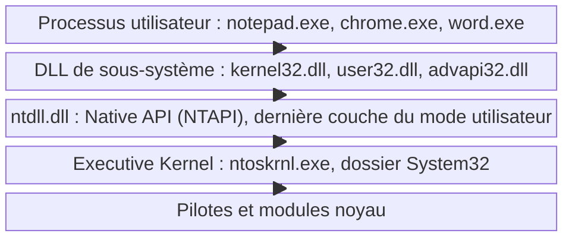
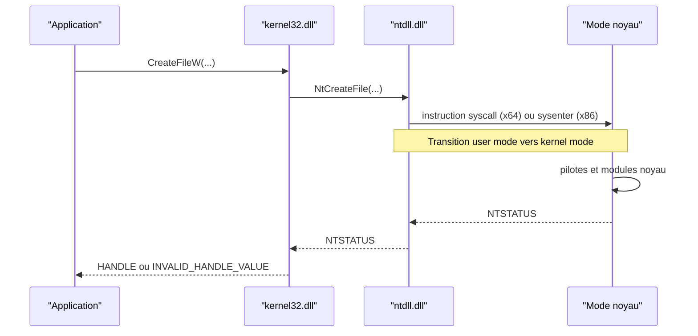

# Architecture Windows

Comprendre l'architecture de Windows, c'est comprendre le trajet exact que parcourt un appel depuis le code de l'application jusqu'au noyau. Ce trajet est le terrain de jeu du développement de malware : chaque étage est un point d'observation pour le défenseur, et donc un point de contournement possible pour l'attaquant.

## Deux modes d'exécution

Un processeur sous Windows fonctionne dans l'un des deux modes suivants, isolés par le matériel :

| Critère | Mode utilisateur | Mode noyau |
|---|---|---|
| Code exécuté | Applications, services, DLL | Noyau, pilotes, modules système |
| Privilèges | Restreints, pas d'accès direct au matériel | Tous les privilèges, accès matériel complet |
| Conséquence d'un plantage | Le processus tombe, le système survit | Écran bleu, arrêt de la machine |
| Accès aux ressources | Uniquement via des appels à l'OS | Contrôle direct du matériel et des ressources |

Une application ne peut rien faire seule : créer un fichier, ouvrir une clé de registre ou afficher une fenêtre suppose que le noyau exécute l'action. Elle doit donc suivre un chemin d'appel normé.

## Pile architecturale



| Étage | Rôle |
|---|---|
| Processus utilisateur | Programme lancé par l'utilisateur |
| DLL de sous-système | Exposent les fonctions WinAPI ; `kernel32.dll` exporte par exemple `CreateFileW` |
| `ntdll.dll` | DLL système présente dans tous les processus, plus basse couche du mode utilisateur ; elle porte la Native API et réalise la transition vers le noyau |
| Executive Kernel | Appelé « Windows Kernel », orchestre les pilotes et modules noyau pour accomplir la tâche |

## Ensemble des appels de fonction

Exemple canonique : une application crée un fichier. La fonction `CreateFileW` de `kernel32.dll` appelle son équivalent natif `NtCreateFile` fourni par `ntdll.dll`, qui exécute une instruction assembleur `sysenter` (x86) ou `syscall` (x64). L'exécution bascule alors en mode noyau, où le `NtCreateFile` du noyau mobilise les pilotes nécessaires pour créer réellement le fichier.



```asm
; Transition effectuée dans le stub de ntdll.dll (x64)
mov r10, rcx
mov eax, <numéro de service de NtCreateFile>
syscall
ret
```

## Pourquoi cette architecture intéresse l'attaquant

Le chemin d'appel est entièrement instrumentable : les EDR posent des hooks sur `ntdll.dll` et sur les couches basses du noyau, ce qui leur permet de voir un appel même quand aucune signature ne correspond. Trois stratégies en découlent :

| Stratégie | Principe |
|---|---|
| Rester dans le flux légitime | Utiliser l'API Windows comme n'importe quelle application, au prix d'être exposé aux hooks |
| Court-circuiter les couches | Appeler directement la Native API ou le syscall, ce qui saute les hooks posés sur les DLL de sous-système |
| Masquer la provenance | Faire exécuter l'appel par un autre processus ou depuis un contexte légitime |

## Appeler directement la Native API

Une application peut invoquer les syscalls (les fonctions de `ntdll.dll`) sans passer par l'API Windows, qui n'est qu'un habillage autour de la Native API. Deux contreparties :

- La Native API n'est pas officiellement documentée par Microsoft ; il faut recourir à des sources tierces et à des [[Structures non documentées]].
- Microsoft déconseille son usage car elle peut changer sans avertissement d'une version de Windows à l'autre.

Ces appels renvoient un `NTSTATUS` plutôt qu'un code d'erreur récupérable via `GetLastError`, et l'appel direct constitue la brique de base des techniques d'[[Introduction aux syscalls]], puis de [[SysWhispers et Hell's Gate]]. Le détail du passage de relais à `ntdll.dll` et l'usage des fonctions exportées sont traités dans [[Windows API]] et [[Dynamic-Link Library]].
