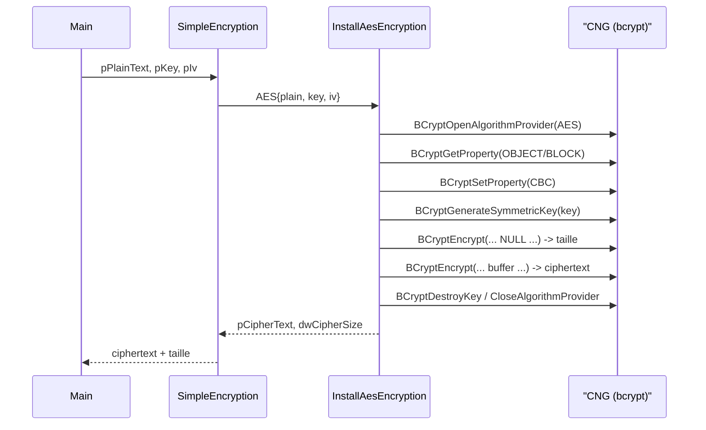
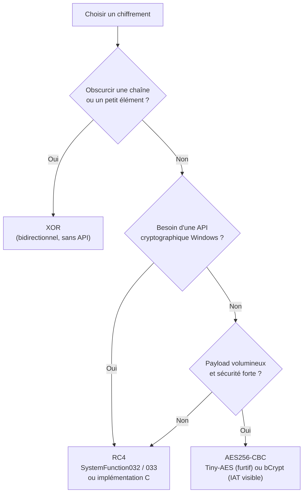

# Chiffrement du payload

Le chiffrement du payload consiste à **dissimuler le code malveillant** présent dans le fichier, généralement du shellcode, pour qu'il n'apparaisse pas en clair. Il s'agit presque toujours d'une nécessité face aux solutions de sécurité modernes : un payload en clair est directement comparable aux signatures connues et aux motifs repérés par les analyseurs statiques. Le chiffrement fait donc partie intégrante de la chaîne [[Placement du payload]] puis [[Obfuscation du payload]].

## Intérêt et limites

Le chiffrement est efficace contre la **détection par signature** : les octets du payload ne correspondent plus à aucun motif connu tant qu'il reste chiffré. Il est en revanche **inefficace seul** contre l'analyse comportementale et heuristique, qui observe ce que fait le programme au runtime — un payload finit bien par être déchiffré en mémoire pour s'exécuter, ce qui peut être intercepté.

Un second effet est contre-intuitif : **plus on chiffre de données dans le fichier, plus l'entropie globale augmente**. Or un binaire à forte entropie est souvent jugé suspect, voire mis en quarantaine. Le chiffrement doit donc être dosé et combiné avec la [[Réduction de l'entropie binaire]].

Trois algorithmes sont couramment employés en développement de malware :

| Algorithme | Type | Bibliothèques/API | Bidirectionnel | Usage recommandé |
|---|---|---|---|---|
| XOR | Flux (octet à octet) | Aucune | Oui | Petites tâches, obscurcissement de chaînes |
| RC4 | Flux | Aucune ou NTAPI (`SystemFunction032/033`) | Oui | Payloads intermédiaires, implémentation légère |
| AES | Bloc (128 bits) | bCrypt (WinAPI) ou Tiny-AES | Non (encrypt/decrypt séparés) | Payloads volumineux, sécurité maximale |

## XOR

Le XOR est l'algorithme le plus **simple et le plus léger**. Il ne nécessite aucune bibliothèque ni API Windows, il est plus rapide qu'AES et RC4, et il est **bidirectionnel** : la même fonction sert à chiffrer et à déchiffrer, puisque `(x XOR k) XOR k = x`.

La version de base applique une clé d'un seul octet à chaque octet du payload.

```c
/*
    - pShellcode     : adresse de base du payload
    - sShellcodeSize : taille du payload
    - bKey           : clé d'un octet pour le chiffrement
*/
VOID XorByOneKey(IN PBYTE pShellcode, IN SIZE_T sShellcodeSize, IN BYTE bKey) {
    for (size_t i = 0; i < sShellcodeSize; i++) {
        pShellcode[i] = pShellcode[i] ^ bKey;
    }
}
```

Avec une clé unique, un outil peut **brute-forcer** la clé (256 valeurs seulement) et exposer le shellcode. On élargit donc l'espace de clés en intégrant l'index `i` à la clé, ce qui rend l'attaque bien plus coûteuse.

```c
VOID XorByiKeys(IN PBYTE pShellcode, IN SIZE_T sShellcodeSize, IN BYTE bKey) {
    for (size_t i = 0; i < sShellcodeSize; i++) {
        pShellcode[i] = pShellcode[i] ^ (bKey + i);
    }
}
```

On peut durcir davantage en utilisant une **clé multi-octets** répétée sur l'ensemble du payload.

```c
/*
    - bKey    : tableau d'octets aléatoires
    - sKeySize: taille de la clé
*/
VOID XorByInputKey(IN PBYTE pShellcode, IN SIZE_T sShellcodeSize, IN PBYTE bKey, IN SIZE_T sKeySize) {
    for (size_t i = 0, j = 0; i < sShellcodeSize; i++, j++) {
        if (j > sKeySize) {
            j = 0;
        }
        pShellcode[i] = pShellcode[i] ^ bKey[j];
    }
}
```

En dépit de ces variantes, le XOR reste **faible en cryptographie** : il est recommandé pour de **petites tâches** (obscurcir des chaînes, des noms d'API), mais pas pour un payload volumineux. Pour cela, mieux vaut passer à l'AES.

## RC4

RC4 est un **chiffrement de flux** rapide, léger et lui aussi **bidirectionnel** : la même fonction `rc4Cipher` sert à chiffrer et à déchiffrer. Trois méthodes d'implémentation sont possibles.

### Méthode 1 : implémentation C autonome

On utilise une structure d'état `Rc4Context` initialisée par `rc4Init` (qui construit la permutation `S` à partir de la clé), puis `rc4Cipher` qui déroule le flux et le combine au payload par XOR.

```c
typedef struct {
    unsigned int  i;
    unsigned int  j;
    unsigned char s[256];
} Rc4Context;

void rc4Init(Rc4Context* context, const unsigned char* key, size_t length) {
    unsigned int  i, j;
    unsigned char temp;

    if (context == NULL || key == NULL) return;

    context->i = 0;
    context->j = 0;

    // Permutation identité
    for (i = 0; i < 256; i++)
        context->s[i] = i;

    // Mélange de S à l'aide de la clé
    for (i = 0, j = 0; i < 256; i++) {
        j = (j + context->s[i] + key[i % length]) % 256;
        temp = context->s[i];
        context->s[i] = context->s[j];
        context->s[j] = temp;
    }
}

void rc4Cipher(Rc4Context* context, const unsigned char* input, unsigned char* output, size_t length) {
    unsigned char temp;
    unsigned int  i = context->i;
    unsigned int  j = context->j;
    unsigned char* s = context->s;

    while (length > 0) {
        i = (i + 1) % 256;
        j = (j + s[i]) % 256;

        temp = s[i];
        s[i] = s[j];
        s[j] = temp;

        if (input != NULL && output != NULL) {
            *output = *input ^ s[(s[i] + s[j]) % 256];
            input++;
            output++;
        }
        length--;
    }

    context->i = i;
    context->j = j;
}
```

L'usage est symétrique : on initialise avec la clé puis on appelle `rc4Cipher` en permutant entrée et sortie selon qu'on chiffre ou déchiffre.

```c
// Chiffrement
Rc4Context ctx = { 0 };
unsigned char* key = "maldev123";
rc4Init(&ctx, key, sizeof(key));
rc4Cipher(&ctx, plaintext, ciphertext, sizeof(plaintext));

// Déchiffrement
Rc4Context ctx2 = { 0 };
rc4Init(&ctx2, key, sizeof(key));
rc4Cipher(&ctx2, ciphertext, plaintext, sizeof(ciphertext));
```

### Méthode 2 : SystemFunction032

La NTAPI non documentée `SystemFunction032`, exportée par `advapi32.dll`, offre une implémentation RC4 **plus rapide et plus compacte**. Elle prend deux paramètres de type `USTRING`.

```c
typedef struct {
    DWORD Length;           // taille des données à chiffrer/déchiffrer
    DWORD MaximumLength;    // taille maximale (souvent égale à Length)
    PVOID Buffer;           // adresse de base des données
} USTRING;

typedef NTSTATUS(NTAPI* fnSystemFunction032)(
    struct USTRING* Data,
    struct USTRING* Key
);

/* Récupération du pointeur de fonction */
fnSystemFunction032 SystemFunction032 =
    (fnSystemFunction032)GetProcAddress(LoadLibraryA("Advapi32"), "SystemFunction032");

BOOL Rc4EncryptionViaSystemFunc032(IN PBYTE pRc4Key, IN PBYTE pPayloadData,
                                   IN DWORD dwRc4KeySize, IN DWORD sPayloadSize) {

    NTSTATUS STATUS = NULL;

    USTRING Data = { .Buffer = pPayloadData, .Length = sPayloadSize, .MaximumLength = sPayloadSize };
    USTRING Key  = { .Buffer = pRc4Key,      .Length = dwRc4KeySize, .MaximumLength = dwRc4KeySize };

    if ((STATUS = SystemFunction032(&Data, &Key)) != 0x0) {
        printf("[!] SystemFunction032 FAILED: 0x%0.8X \n", STATUS);
        return FALSE;
    }
    return TRUE;
}
```

`USTRING` n'est pas documenté par Microsoft ; sa définition provient de recherches croisées (par exemple `wine/crypt.h`). C'est un bon exemple de réutilisation d'une [[Structures non documentées|structure non documentée]] via un appel d'API.

### Méthode 3 : SystemFunction033

`SystemFunction033` prend exactement les mêmes paramètres que `SystemFunction032` et sert d'alternative équivalente.

```c
typedef NTSTATUS(NTAPI* fnSystemFunction033)(
    struct USTRING* Data,
    struct USTRING* Key
);

BOOL Rc4EncryptionViSystemFunc033(IN PBYTE pRc4Key, IN PBYTE pPayloadData,
                                  IN DWORD dwRc4KeySize, IN DWORD sPayloadSize) {

    NTSTATUS STATUS = NULL;
    USTRING  Key  = { .Buffer = pRc4Key,      .Length = dwRc4KeySize,  .MaximumLength = dwRc4KeySize };
    USTRING  Data = { .Buffer = pPayloadData, .Length = sPayloadSize,  .MaximumLength = sPayloadSize };

    fnSystemFunction033 SystemFunction033 =
        (fnSystemFunction033)GetProcAddress(LoadLibraryA("Advapi32"), "SystemFunction033");

    if ((STATUS = SystemFunction033(&Data, &Key)) != 0x0) {
        printf("[!] SystemFunction033 FAILED: 0x%0.8X \n", STATUS);
        return FALSE;
    }
    return TRUE;
}
```

### Représentation de la clé

La clé peut être écrite de plusieurs façons équivalentes. La dernière, construite sur la pile, est préférable car la clé n'apparaît pas en clair dans le binaire.

```c
// Méthode 1 : littéral de chaîne
unsigned char* key = "maldev123";

// Méthode 2 : tableau d'octets hexadécimaux
unsigned char key[] = { 0x6D, 0x61, 0x6C, 0x64, 0x65, 0x76, 0x31, 0x32, 0x33 };

// Méthode 3 : séquence d'échappement hexadécimale
unsigned char* key = "\x6D\x61\x64\x65\x76\x31\x32\x33";

// Méthode 4 (recommandée) : stack strings
unsigned char key[] = { 'm', 'a', 'l', 'd', 'e', 'v', '1', '2', '3' };
```

**Attention** : une clé codée en dur en clair est une mauvaise pratique, car elle est facilement extraite lors de l'analyse. Les modules ultérieurs couvrent les techniques protégeant la clé et le [[Déchiffrement par force brute]].

## AES

L'Advanced Encryption Standard est un algorithme à **clé symétrique** (même clé pour chiffrer et déchiffrer), bien plus robuste que XOR et RC4. Il existe plusieurs variantes — AES128, AES192, AES256 — qui diffèrent par la taille de clé (respectivement 128, 192 et 256 bits).

AES peut fonctionner selon différents **modes d'opération** de bloc (CBC, GCM...). Certains modes requièrent un **vecteur d'initialisation (IV)**, qui ajoute une couche de sécurité supplémentaire. Quel que soit le mode, AES travaille par **blocs de 128 bits (16 octets)** : les données d'entrée doivent donc être un multiple de 16 octets, sinon un **padding** est nécessaire.

Deux implémentations sont présentées, toutes deux en AES256-CBC (clé de 32 octets, IV de 16 octets).

### Implémentation via bCrypt (WinAPIs)

La bibliothèque bCrypt (`bcrypt.h`) s'appuie sur Cryptographic Next Generation (CNG) et donc sur des WinAPIs. L'ensemble s'articule autour d'une structure `AES` et de deux fonctions d'orchestration.

```c
typedef struct _AES {
    PBYTE pPlainText;    // adresse du texte clair
    DWORD dwPlainSize;   // taille du texte clair
    PBYTE pCipherText;   // adresse des données chiffrées
    DWORD dwCipherSize;  // taille (peut changer après padding)
    PBYTE pKey;          // clé de 32 octets
    PBYTE pIv;           // IV de 16 octets
} AES, *PAES;
```

`SimpleEncryption` et `SimpleDecryption` sont des **wrappers** pratiques : ils initialisent la structure `AES` puis appellent respectivement `InstallAesEncryption` / `InstallAesDecryption`, et renvoient un pointeur sur le buffer de sortie ainsi que sa taille.

```c
BOOL SimpleEncryption(IN PVOID pPlainTextData, IN DWORD sPlainTextSize,
                      IN PBYTE pKey, IN PBYTE pIv,
                      OUT PVOID* pCipherTextData, OUT DWORD* sCipherTextSize) {

    if (pPlainTextData == NULL || sPlainTextSize == NULL || pKey == NULL || pIv == NULL)
        return FALSE;

    AES Aes = { .pKey = pKey, .pIv = pIv,
                .pPlainText = pPlainTextData, .dwPlainSize = sPlainTextSize };

    if (!InstallAesEncryption(&Aes)) return FALSE;

    *pCipherTextData = Aes.pCipherText;
    *sCipherTextSize = Aes.dwCipherSize;
    return TRUE;
}
```

`InstallAesEncryption` enchaîne les fonctions CNG suivantes.

| API bCrypt | Rôle |
|---|---|
| `BCryptOpenAlgorithmProvider` | Ouvre le fournisseur `BCRYPT_AES_ALGORITHM` |
| `BCryptGetProperty` | Récupère `BCRYPT_OBJECT_LENGTH` puis `BCRYPT_BLOCK_LENGTH` |
| `BCryptSetProperty` | Configure le mode CBC (`BCRYPT_CHAIN_MODE_CBC`) |
| `BCryptGenerateSymmetricKey` | Crée l'objet clé à partir de la clé AES |
| `BCryptEncrypt` | Appelée deux fois : d'abord pour obtenir la taille de sortie, puis pour chiffrer |
| `BCryptDestroyKey` / `BCryptCloseAlgorithmProvider` | Nettoyage des handles |

```c
BOOL InstallAesEncryption(PAES pAes) {

    BOOL              bSTATE     = TRUE;
    BCRYPT_ALG_HANDLE hAlgorithm = NULL;
    BCRYPT_KEY_HANDLE hKeyHandle = NULL;
    ULONG             cbResult   = NULL;
    DWORD             dwBlockSize = NULL, cbKeyObject = NULL, cbCipherText = NULL;
    PBYTE             pbKeyObject = NULL, pbCipherText = NULL;

    // Fournisseur AES
    STATUS = BCryptOpenAlgorithmProvider(&hAlgorithm, BCRYPT_AES_ALGORITHM, NULL, 0);
    if (!NT_SUCCESS(STATUS)) { bSTATE = FALSE; goto _EndOfFunc; }

    // Taille de l'objet clé et du bloc
    STATUS = BCryptGetProperty(hAlgorithm, BCRYPT_OBJECT_LENGTH, (PBYTE)&cbKeyObject, sizeof(DWORD), &cbResult, 0);
    STATUS = BCryptGetProperty(hAlgorithm, BCRYPT_BLOCK_LENGTH,  (PBYTE)&dwBlockSize,  sizeof(DWORD), &cbResult, 0);
    if (dwBlockSize != 16) { bSTATE = FALSE; goto _EndOfFunc; }

    pbKeyObject = (PBYTE)HeapAlloc(GetProcessHeap(), 0, cbKeyObject);

    // Mode CBC (clé 32 octets, IV 16 octets)
    STATUS = BCryptSetProperty(hAlgorithm, BCRYPT_CHAINING_MODE,
                               (PBYTE)BCRYPT_CHAIN_MODE_CBC, sizeof(BCRYPT_CHAIN_MODE_CBC), 0);

    STATUS = BCryptGenerateSymmetricKey(hAlgorithm, &hKeyHandle, pbKeyObject, cbKeyObject,
                                        (PBYTE)pAes->pKey, KEYSIZE, 0);

    // Premier appel : récupération de la taille du ciphertext
    STATUS = BCryptEncrypt(hKeyHandle, (PUCHAR)pAes->pPlainText, (ULONG)pAes->dwPlainSize,
                           NULL, pAes->pIv, IVSIZE, NULL, 0, &cbCipherText, BCRYPT_BLOCK_PADDING);
    pbCipherText = (PBYTE)HeapAlloc(GetProcessHeap(), 0, cbCipherText);

    // Second appel : chiffrement effectif
    STATUS = BCryptEncrypt(hKeyHandle, (PUCHAR)pAes->pPlainText, (ULONG)pAes->dwPlainSize,
                           NULL, pAes->pIv, IVSIZE, pbCipherText, cbCipherText, &cbResult, BCRYPT_BLOCK_PADDING);

_EndOfFunc:
    if (hKeyHandle)  BCryptDestroyKey(hKeyHandle);
    if (hAlgorithm)  BCryptCloseAlgorithmProvider(hAlgorithm, 0);
    if (pbKeyObject) HeapFree(GetProcessHeap(), 0, pbKeyObject);
    if (pbCipherText != NULL && bSTATE) { pAes->pCipherText = pbCipherText; pAes->dwCipherSize = cbCipherText; }
    return bSTATE;
}
```

`InstallAesDecryption` suit exactement la même trame, en remplaçant `BCryptEncrypt` par **`BCryptDecrypt`** (également appelée deux fois pour dimensionner puis remplir le buffer du texte clair).



Le **padding** est géré automatiquement par le drapeau `BCRYPT_BLOCK_PADDING` passé à `BCryptEncrypt`/`BCryptDecrypt` : le buffer d'entrée est complété jusqu'à un multiple de 16 octets si nécessaire.

Côté outillage, deux helpers facilitent le travail : `PrintHexData` imprime un buffer sous forme de tableau d'octets en syntaxe C, et `GenerateRandomBytes` remplit un buffer d'octets aléatoires (utilisé pour générer la clé et l'IV). La génération de la clé et de l'IV s'appuie sur `srand(time(NULL))`, l'IV étant dérivé du premier octet de la clé pour renforcer l'aléa.

```c
VOID GenerateRandomBytes(PBYTE pByte, SIZE_T sSize) {
    for (int i = 0; i < sSize; i++) {
        pByte[i] = (BYTE)rand() % 0xFF;
    }
}
```

Le **principal inconvénient** de cette approche est l'import des fonctions cryptographiques : elles deviennent visibles dans l'Import Address Table (IAT) sous la forme de références à `bcrypt.dll`, ce qui constitue un signal fort pour les solutions de sécurité. Le masquage de l'IAT est traité dans [[Dissimulation de l'IAT]].

### Implémentation via Tiny-AES

La bibliothèque tierce **tiny-AES-c** réalise l'AES128/192/256 en C pur, **sans aucune WinAPI**. L'intégration demande deux choses : inclure `aes.hpp` (C++) ou `aes.h` (C) et ajouter le fichier `aes.c` au projet.

Deux limites doivent être connues :

1. **Pas de padding** : tous les buffers doivent être des multiples de 16 octets. On écrit alors une fonction de padding maison.

```c
BOOL PaddBuffer(IN PBYTE InputBuffer, IN SIZE_T InputBufferSize,
                OUT PBYTE* OutputPaddedBuffer, OUT SIZE_T* OutputPaddedSize) {

    SIZE_T PaddedSize = InputBufferSize + 16 - (InputBufferSize % 16);
    PBYTE  PaddedBuffer = (PBYTE)HeapAlloc(GetProcessHeap(), 0, PaddedSize);
    if (!PaddedBuffer) return FALSE;

    ZeroMemory(PaddedBuffer, PaddedSize);
    memcpy(PaddedBuffer, InputBuffer, InputBufferSize);

    *OutputPaddedBuffer = PaddedBuffer;
    *OutputPaddedSize   = PaddedSize;
    return TRUE;
}
```

2. **Signatures détectables** : les tableaux internes de Tiny-AES (issus de l'algorithme) sont des motifs constants que les solutions de sécurité peuvent reconnaître. Une parade consiste à les chiffrer (par exemple en XOR) et à les déchiffrer au runtime juste avant l'appel à `AES_init_ctx_iv`.

L'usage est concis : initialisation du contexte avec clé et IV, puis chiffrement/déchiffrement de buffers multiples de 16 octets.

```c
#include <Windows.h>
#include "aes.h"

struct AES_ctx ctx;

// Initialisation de la bibliothèque
AES_init_ctx_iv(&ctx, pKey, pIv);

// Chiffrement (buffer déjà multiple de 16, ou paddé)
AES_CBC_encrypt_buffer(&ctx, PaddedBuffer, PAddedSize);
```

```c
// Déchiffrement
struct AES_ctx ctx;
AES_init_ctx_iv(&ctx, pKey, pIv);

AES_CBC_decrypt_buffer(&ctx, CipherText, sizeof(CipherText));
printf("Data: %s \n", CipherText);
```

Là où bCrypt apparaît dans l'IAT, **Tiny-AES n'y laisse aucune trace de fonction cryptographique** : c'est son avantage principal du point de vue de la furtivité.

## Synthèse



| Critère | XOR | RC4 | AES |
|---|---|---|---|
| Complexité | Très faible | Faible | Élevée |
| Dépendance API | Aucune | Optionnelle (`advapi32`) | bCrypt ou Tiny-AES |
| Force cryptographique | Faible | Moyenne | Forte |
| Gestion du padding | Non concerné | Non concerné | Requise (16 octets / CBC) |
| Visibilité IAT | Aucune | `SystemFunction032/033` si utilisée | `bcrypt.dll` si bCrypt |

Le chiffrement protège surtout contre l'analyse **statique**. Pour survivre à l'analyse dynamique, il doit être complété par la dissimulation de l'IAT, la gestion de la clé (via des outils comme [[Outils HellShell et MiniShell]]) et le contrôle du [[Mécanismes de détection|comportement observable]] au runtime. Le pendant inverse — rendre un binaire chiffré analysable — relève du [[Déchiffrement par force brute]].
