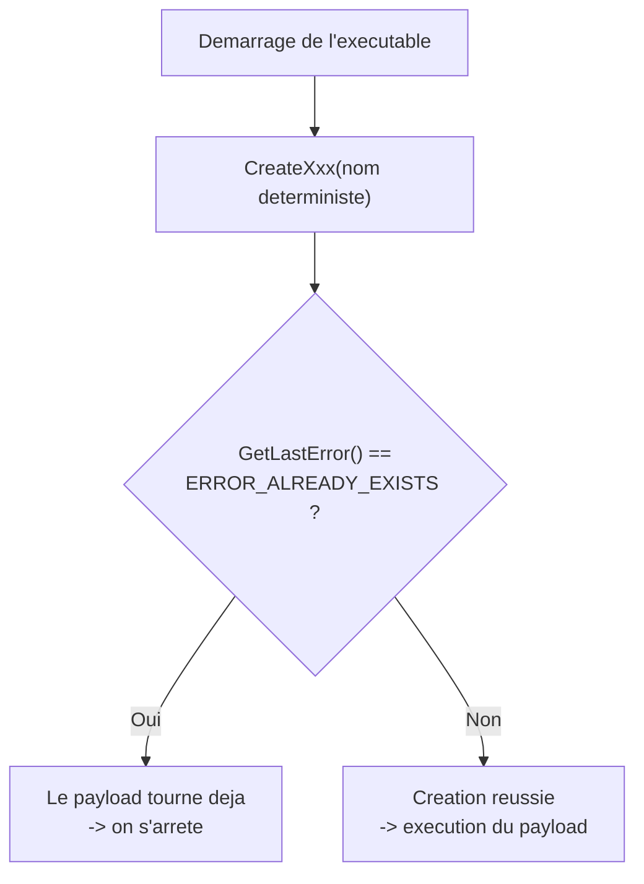

# Contrôle de l'exécution du payload

Dans un scénario réel, un malware qui multiplie les actions augmente mécaniquement ses chances d'être repéré. Une bonne pratique offensive consiste donc à **limiter** ce que le binaire fait et à ne s'exécuter qu'une seule fois sur une machine donnée. Les objets de synchronisation Windows, prévus à l'origine pour coordonner l'accès concurrent à des ressources partagées, offrent exactement ce moyen : ils permettent de compter, voire d'interdire, les exécutions répétées d'un payload.

## Principe

Les objets de synchronisation coordonnent l'accès de plusieurs threads ou processus à une ressource commune, évitant les conflits et les situations de course. Trois familles existent : les sémaphores, les mutex et les évènements. Toutes suivent la même idée lorsqu'elles sont **nommées** : le nom est enregistré dans l'espace de noms global du système, ce qui rend l'objet visible par toutes les instances de l'exécutable. La première exécution crée l'objet ; les suivantes constatent qu'il existe déjà et s'arrêtent.



## Sémaphores

Un sémaphore s'appuie sur une **valeur en mémoire** qui contrôle l'accès à une ressource. On distingue deux formes :

- **Binaire** : valeur 0 ou 1, indiquant la disponibilité ou l'indisponibilité de la ressource.
- **À compteur** : valeur supérieure à 1, représentant le nombre de ressources disponibles ou d'accès simultanés autorisés.

Un sémaphore **nommé** est créé à chaque exécution du payload. À la première exécution, il est créé et le payload s'exécute normalement. Aux exécutions suivantes, `CreateSemaphoreA` retourne un handle vers l'objet existant et `GetLastError` renvoie `ERROR_ALREADY_EXISTS` : l'instance précédente tourne encore, il faut donc s'abstenir.

```c
HANDLE hSemaphore = CreateSemaphoreA(NULL, 10, 10, "ControlString");

if (hSemaphore != NULL && GetLastError() == ERROR_ALREADY_EXISTS)
    // Le payload tourne deja : ne rien faire
else
    // Premiere execution : lancer le payload
```

Les deux paramètres numériques sont la valeur initiale et la valeur maximale du compteur ; ils n'ont pas d'importance pour ce seul usage de verrouillage.

## Mutex

Un mutex (« *mutual exclusion* ») gère l'accès exclusif à une ressource entre processus et threads. Un thread voulant accéder à la ressource consulte l'état du mutex : s'il est verrouillé, il attend ; s'il est libre, il le verrouille, agit, puis le libère. Un seul thread accède ainsi à la ressource à la fois, ce qui prévient les conflits et la corruption de données.

Pour le contrôle d'exécution, on se sert là encore du nom et de l'erreur retournée :

```c
HANDLE hMutex = CreateMutexA(NULL, FALSE, "ControlString");

if (hMutex != NULL && GetLastError() == ERROR_ALREADY_EXISTS)
    // Le payload tourne deja
else
    // Premiere execution : lancer le payload
```

Le second paramètre indique la propriété initiale du mutex par l'appelant : `FALSE` laisse le mutex libre, ce qui suffit ici. C'est la variante la plus utilisée par les malwares pour garantir une **exécution unique**.

## Évènements

Un évènement est un objet de synchronisation pouvant être **manuel** (nécessitant une action explicite de mise à l'état signalé ou de remise à zéro) ou **automatique** (déclenché par une condition externe, expiration de minuteur ou fin de tâche). Son usage pour le contrôle d'exécution est identique aux précédents.

```c
HANDLE hEvent = CreateEventA(NULL, FALSE, FALSE, "ControlString");

if (hEvent != NULL && GetLastError() == ERROR_ALREADY_EXISTS)
    // Le payload tourne deja
else
    // Premiere execution : lancer le payload
```

## Comparaison des trois objets

| Objet | API de création | Valeur / état | Usage typique en contrôle d'exécution |
|---|---|---|---|
| Sémaphore | `CreateSemaphoreA` | Compteur (0/1 ou > 1) | Limiter le nombre d'instances simultanées |
| Mutex | `CreateMutexA` | Verrouillé / libre | Garantir une instance unique |
| Évènement | `CreateEventA` | Signalé / non signalé | Synchronisation ponctuelle, verrouillage simple |

Les trois se comportent de manière équivalente pour le simple besoin « une seule exécution » : le choix relève de la discrétion et de la cohérence avec le reste du code.

## Bonnes pratiques et détection

- Le nom du noyau est un **indicateur** : un nom en clair tel que `ControlString` est immédiatement repérable par les outils qui énumèrent les objets du noyau (Process Explorer, `handle.exe`, Procmon). Mieux vaut un nom discret, voire imitant une convention légitime, ou le dériver d'un identifiant machine pour rester unique.
- Le motif « créer un objet nommé au démarrage puis tester `ERROR_ALREADY_EXISTS` » est une signature comportementale connue des EDR ; un malware prudent peut le combiner à d'autres vérifications ou éviter les API les plus surveillées.
- L'intérêt opérationnel est double : éviter de **rejouer** un payload déjà actif (ce qui déclencherait des alertes par duplication d'actions), et limiter l'empreinte globale sur la machine. Voir [[Mécanismes de détection]] et [[Exécution locale de payload]].

Ce mécanisme est souvent couplé au placement du payload décrit dans [[Placement du payload]], et au nettoyage des traces mémoire de [[Gestion de la mémoire Windows]].
