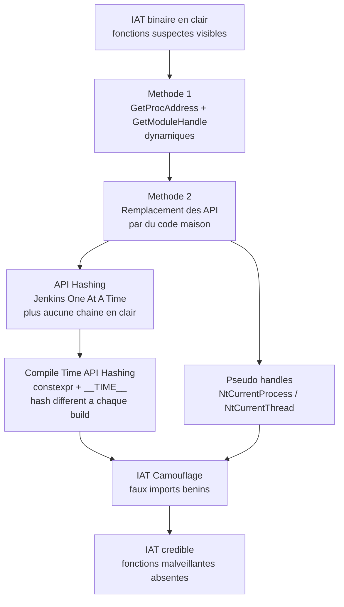
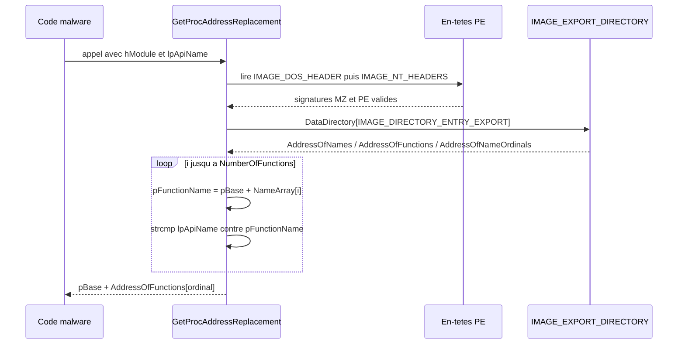
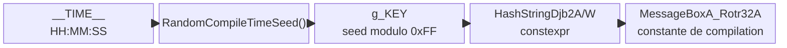

# Dissimulation de l'IAT

## Pourquoi l'IAT trahit un binaire

L'Import Address Table (IAT) est la table des fonctions importées, inscrite en clair dans l'en-tête PE du binaire. Elle mentionne à la fois les fonctions utilisées et les DLL qui les exportent. Un exécutable qui importe `VirtualAllocEx`, `WriteProcessMemory`, `CreateRemoteThread` et `QueueUserAPC` annonce donc lui-même sa nature malveillante : un antivirus peut s'en servir comme signature statique, sans même exécuter le programme.

L'objectif de cette famille de techniques est de casser ce lien entre le comportement réel du code et ce que déclare l'IAT. La structure du binaire est détaillée dans [[Format PE]] et [[Parsing des en-têtes PE]].



## Le lien entre import table et chargement

Au chargement, le Windows Loader lit le répertoire d'import, résout chaque nom de fonction via la table d'export de la DLL cible, puis écrit l'adresse obtenue dans l'IAT. Le code appelant passe ensuite par un `jmp` vers cette adresse. Toute la logique de détection statique repose sur le fait que ces noms sont présents dans le fichier.

Les techniques de dissimulation déplacent cette résolution du chargement vers l'exécution (run-time dynamic linking), ou la suppriment totalement en recalculant l'adresse à la main.

## Méthode 1 — chargement dynamique classique

La première approche est d'appeler `GetProcAddress` et `GetModuleHandle` à l'exécution. La fonction visée n'apparaît alors plus dans l'IAT.

```c
typedef LPVOID (WINAPI* fnVirtualAllocEx)(HANDLE hProcess, LPVOID lpAddress,
                                          SIZE_T dwSize, DWORD flAllocationType,
                                          DWORD flProtect);

fnVirtualAllocEx pVirtualAllocEx =
    GetProcAddress(GetModuleHandleA("KERNEL32.DLL"), "VirtualAllocEx");
pVirtualAllocEx(...);
```

Elle est simple mais faible pour deux raisons :

- la chaîne `"VirtualAllocEx"` reste présente en clair dans le binaire, tout comme `"KERNEL32.DLL"` ;
- `GetProcAddress` et `GetModuleHandleA` apparaissent eux-mêmes dans l'IAT, ce qui devient une signature à part entière.

## Méthode 2 — réimplémenter les API de résolution

La solution élégante consiste à écrire ses propres équivalents de `GetProcAddress` et `GetModuleHandle`. Ni les chaînes de fonctions de résolution, ni ces deux WinAPI, n'apparaissent plus dans l'IAT.

### Rappel : la table d'export

Toute la mécanique repose sur le répertoire d'export de la DLL, décrit par `IMAGE_EXPORT_DIRECTORY` :

| Membre | Rôle |
|---|---|
| `NumberOfFunctions` | Nombre de fonctions exportées |
| `NumberOfNames` | Nombre de fonctions exportées **par nom** |
| `AddressOfFunctions` | RVA du tableau des adresses de fonctions |
| `AddressOfNames` | RVA du tableau des noms de fonctions |
| `AddressOfNameOrdinals` | RVA du tableau des ordinaux associés aux noms |

Les RVAs sont converties en adresses absolues en y ajoutant l'adresse de base du module (`pBase`).

### GetProcAddressReplacement

`GetProcAddress` parcourt les exports d'un module et renvoie l'adresse de la fonction demandée, ou `NULL`. La version maison suit exactement la même logique.

```c
typedef struct _IMAGE_EXPORT_DIRECTORY {
    /* ... */
    DWORD   AddressOfFunctions;     // RVA depuis la base de l'image
    DWORD   AddressOfNames;         // RVA depuis la base de l'image
    DWORD   AddressOfNameOrdinals;  // RVA depuis la base de l'image
} IMAGE_EXPORT_DIRECTORY, *PIMAGE_EXPORT_DIRECTORY;

FARPROC GetProcAddressReplacement(IN HMODULE hModule, IN LPCSTR lpApiName) {

    PBYTE pBase = (PBYTE)hModule;   // evite un cast a chaque usage

    PIMAGE_DOS_HEADER pImgDosHdr = (PIMAGE_DOS_HEADER)pBase;
    if (pImgDosHdr->e_magic != IMAGE_DOS_SIGNATURE)
        return NULL;

    PIMAGE_NT_HEADERS pImgNtHdrs = (PIMAGE_NT_HEADERS)(pBase + pImgDosHdr->e_lfanew);
    if (pImgNtHdrs->Signature != IMAGE_NT_SIGNATURE)
        return NULL;

    IMAGE_OPTIONAL_HEADER ImgOptHdr = pImgNtHdrs->OptionalHeader;

    PIMAGE_EXPORT_DIRECTORY pImgExportDir = (PIMAGE_EXPORT_DIRECTORY)
        (pBase + ImgOptHdr.DataDirectory[IMAGE_DIRECTORY_ENTRY_EXPORT].VirtualAddress);

    PDWORD FunctionNameArray    = (PDWORD)(pBase + pImgExportDir->AddressOfNames);
    PDWORD FunctionAddressArray = (PDWORD)(pBase + pImgExportDir->AddressOfFunctions);
    PWORD  FunctionOrdinalArray = (PWORD) (pBase + pImgExportDir->AddressOfNameOrdinals);

    for (DWORD i = 0; i < pImgExportDir->NumberOfFunctions; i++) {
        CHAR* pFunctionName    = (CHAR*)(pBase + FunctionNameArray[i]);
        PVOID pFunctionAddress = (PVOID)(pBase + FunctionAddressArray[FunctionOrdinalArray[i]]);

        if (strcmp(lpApiName, pFunctionName) == 0)
            return (FARPROC)pFunctionAddress;
    }
    return NULL;
}
```

### Comprendre les ordinaux

Un ordinal est un entier représentant la **position** de la fonction dans le tableau d'adresses exportées. L'OS s'en sert en interne car il est plus rapide de retrouver une adresse par index que par comparaison de chaînes, et cela fonctionne même quand le nom est absent ou ambigu.

La relation clé est :

```c
// l'adresse d'une fonction se trouve a l'index de son ordinal
PVOID pFunctionAddress = (PVOID)(pBase + FunctionAddressArray[FunctionOrdinalArray[i]]);
```

Attention : chaque processus fait générer par le Windows Loader son propre tableau d'ordinaux. Les ordinaux ne sont donc **pas stables d'un processus à l'autre**, même si les adresses résolues, elles, concordent (vérifiable en comparant avec x64dbg sur `ntdll.dll`).



### GetModuleHandleReplacement

`GetModuleHandle` renvoie l'adresse de base (`HMODULE`) d'une DLL déjà chargée. Plutôt que de réimplémenter la recherche, on lit directement le Process Environment Block (PEB), dont le membre `Ldr` décrit les modules chargés. Voir [[Architecture Windows]] et [[Structures non documentées]].

#### Obtenir le PEB

Sur 64 bits, le TEB est adressé via le registre `GS` ; sur 32 bits via `FS`. Deux méthodes existent : passer par le TEB, ou lire directement le champ `ProcessEnvironmentBlock`.

```c
// 64 bits
PPEB pPeb = (PPEB)__readgsqword(0x60);              // direct (offset de PEB dans le TEB)
PTEB pTeb = (PTEB)__readgsqword(0x30);              // via le TEB
pPeb      = (PPEB)pTeb->ProcessEnvironmentBlock;

// 32 bits
PPEB pPeb = (PPEB)__readfsdword(0x30);              // direct
PTEB pTeb = (PTEB)__readfsdword(0x18);              // via le TEB
pPeb      = (PPEB)pTeb->ProcessEnvironmentBlock;
```

#### Parcourir la liste des modules

`PEB->Ldr` est un `PPEB_LDR_DATA` dont le membre `InMemoryOrderModuleList` est une `LIST_ENTRY` (liste doublement chaînée, via `Flink` et `Blink`). Chaque nœud pointe vers un `LDR_DATA_TABLE_ENTRY` décrivant une DLL chargée.

```c
typedef struct _PEB_LDR_DATA {
    BYTE       Reserved1[8];
    PVOID      Reserved2[3];
    LIST_ENTRY InMemoryOrderModuleList;
} PEB_LDR_DATA, *PPEB_LDR_DATA;

typedef struct _LIST_ENTRY {
   struct _LIST_ENTRY *Flink;   // noeud suivant
   struct _LIST_ENTRY *Blink;   // noeud precedent
} LIST_ENTRY, *PLIST_ENTRY;

typedef struct _LDR_DATA_TABLE_ENTRY {
    PVOID        Reserved1[2];
    LIST_ENTRY   InMemoryOrderLinks;
    PVOID        Reserved2[2];   // Reserved2[0] == DllBase en pratique
    PVOID        DllBase;
    PVOID        EntryPoint;
    PVOID        Reserved3;
    UNICODE_STRING FullDllName;
    /* ... */
} LDR_DATA_TABLE_ENTRY, *PLDR_DATA_TABLE_ENTRY;
```

Le passage à l'élément suivant se fait en déréférençant le début de la structure, qui correspond au `InMemoryOrderLinks` servant de maillon :

```c
pDte = *(PLDR_DATA_TABLE_ENTRY*)(pDte);
```

#### Comparaison insensible à la casse

Les noms de DLL ne sont pas normalisés (`KERNEL32.DLL` côtoie `ntdll.dll`). Une comparaison avec `wcscmp` échouerait sur une différence de casse, d'où l'helper `IsStringEqual` qui convertit les deux chaînes en minuscules puis les compare.

```c
BOOL IsStringEqual(IN LPCWSTR Str1, IN LPCWSTR Str2) {
    WCHAR lStr1[MAX_PATH], lStr2[MAX_PATH];
    int len1 = lstrlenW(Str1), len2 = lstrlenW(Str2);

    if (len1 >= MAX_PATH || len2 >= MAX_PATH)   // protection debordement
        return FALSE;

    for (int i = 0; i < len1; i++)
        lStr1[i] = (WCHAR)tolower(Str1[i]);
    lStr1[len1] = L'\0';

    for (int j = 0; j < len2; j++)
        lStr2[j] = (WCHAR)tolower(Str2[j]);
    lStr2[len2] = L'\0';

    return (lstrcmpiW(lStr1, lStr2) == 0);
}
```

#### Récupérer l'adresse de base

`DllBase` est absent de la documentation officielle : Microsoft le déclare comme `Reserved2[0]`. Dans la définition issue des structures noyau Windows Vista, il correspond à `InInitializationOrderLinks.Flink`. Un `#ifdef STRUCTS` permet de basculer entre les deux définitions.

```c
HMODULE GetModuleHandleReplacement(IN LPCWSTR szModuleName) {

#ifdef _WIN64
    PPEB pPeb = (PPEB)(__readgsqword(0x60));
#elif _WIN32
    PPEB pPeb = (PPEB)(__readfsdword(0x30));
#endif

    PPEB_LDR_DATA          pLdr = (PPEB_LDR_DATA)(pPeb->Ldr);
    PLDR_DATA_TABLE_ENTRY  pDte = (PLDR_DATA_TABLE_ENTRY)(pLdr->InMemoryOrderModuleList.Flink);

    while (pDte) {
        if (pDte->FullDllName.Length != NULL) {
            if (IsStringEqual(pDte->FullDllName.Buffer, szModuleName)) {
#ifdef STRUCTS
                return (HMODULE)(pDte->InInitializationOrderLinks.Flink);
#else
                return (HMODULE)pDte->Reserved2[0];   // == DllBase
#endif
            }
        } else {
            break;
        }
        pDte = *(PLDR_DATA_TABLE_ENTRY*)(pDte);   // maillon suivant
    }
    return NULL;
}
```

## API Hashing

Réimplémenter `GetProcAddress` et `GetModuleHandle` supprime les fonctions de l'IAT, mais laisse les chaînes `"ntdll.dll"` et `"VirtualAllocEx"` dans le binaire, ce qu'un scan de chaînes révèle immédiatement. La parade consiste à remplacer les chaînes par des **hash** calculés avec l'algorithme Jenkins One At A Time 32 bits (vu dans [[Hachage de chaînes]]).

Les deux fonctions deviennent `GetProcAddressH` et `GetModuleHandleH` : au lieu de comparer des chaînes, elles comparent des hachages. Par convention, le nom du module est haché en majuscules (`USER32.DLL`).

```c
#define HASHA(API) (HashStringJenkinsOneAtATime32BitA((PCHAR) API))
#define HASHW(API) (HashStringJenkinsOneAtATime32BitW((PWCHAR) API))

// Hash of "USER32.DLL"    : 0x81E3778E
// Hash of "MessageBoxA"   : 0xF10E27CA
fnMessageBoxA pMessageBoxA =
    GetProcAddressH(GetModuleHandleH(0x81E3778E), 0xF10E27CA);
```

### GetProcAddressH

Identique à `GetProcAddressReplacement`, mais la comparaison porte sur le hachage du nom de chaque export.

```c
FARPROC GetProcAddressH(HMODULE hModule, DWORD dwApiNameHash) {

    if (hModule == NULL || dwApiNameHash == NULL)
        return NULL;

    PBYTE pBase = (PBYTE)hModule;

    PIMAGE_DOS_HEADER pImgDosHdr = (PIMAGE_DOS_HEADER)pBase;
    if (pImgDosHdr->e_magic != IMAGE_DOS_SIGNATURE)
        return NULL;

    PIMAGE_NT_HEADERS pImgNtHdrs = (PIMAGE_NT_HEADERS)(pBase + pImgDosHdr->e_lfanew);
    if (pImgNtHdrs->Signature != IMAGE_NT_SIGNATURE)
        return NULL;

    IMAGE_OPTIONAL_HEADER ImgOptHdr = pImgNtHdrs->OptionalHeader;

    PIMAGE_EXPORT_DIRECTORY pImgExportDir = (PIMAGE_EXPORT_DIRECTORY)
        (pBase + ImgOptHdr.DataDirectory[IMAGE_DIRECTORY_ENTRY_EXPORT].VirtualAddress);

    PDWORD FunctionNameArray    = (PDWORD)(pBase + pImgExportDir->AddressOfNames);
    PDWORD FunctionAddressArray = (PDWORD)(pBase + pImgExportDir->AddressOfFunctions);
    PWORD  FunctionOrdinalArray = (PWORD) (pBase + pImgExportDir->AddressOfNameOrdinals);

    for (DWORD i = 0; i < pImgExportDir->NumberOfFunctions; i++) {
        CHAR* pFunctionName    = (CHAR*)(pBase + FunctionNameArray[i]);
        PVOID pFunctionAddress = (PVOID)(pBase + FunctionAddressArray[FunctionOrdinalArray[i]]);

        if (dwApiNameHash == HASHA(pFunctionName))   // comparaison de hash
            return (FARPROC)pFunctionAddress;
    }
    return NULL;
}
```

### GetModuleHandleH

Même principe côté module : on énumère les DLL du PEB et on compare le hachage du nom. Comme la fonction met le nom en majuscules avant hachage, l'appelant doit fournir le hash d'un nom capitalisé (`USER32.DLL`).

```c
HMODULE GetModuleHandleH(DWORD dwModuleNameHash) {

    if (dwModuleNameHash == NULL)
        return NULL;

#ifdef _WIN64
    PPEB pPeb = (PPEB)(__readgsqword(0x60));
#elif _WIN32
    PPEB pPeb = (PPEB)(__readfsdword(0x30));
#endif

    PPEB_LDR_DATA         pLdr = (PPEB_LDR_DATA)(pPeb->Ldr);
    PLDR_DATA_TABLE_ENTRY pDte = (PLDR_DATA_TABLE_ENTRY)(pLdr->InMemoryOrderModuleList.Flink);

    while (pDte) {
        if (pDte->FullDllName.Length != NULL && pDte->FullDllName.Length < MAX_PATH) {

            CHAR UpperCaseDllName[MAX_PATH];
            DWORD i = 0;
            while (pDte->FullDllName.Buffer[i]) {
                UpperCaseDllName[i] = (CHAR)toupper(pDte->FullDllName.Buffer[i]);
                i++;
            }
            UpperCaseDllName[i] = '\0';

            if (HASHA(UpperCaseDllName) == dwModuleNameHash)
                return (HMODULE)pDte->Reserved2[0];   // == DllBase
        } else {
            break;
        }
        pDte = *(PLDR_DATA_TABLE_ENTRY*)(pDte);
    }
    return NULL;
}
```

Une recherche texte sur le binaire compilé (`strings.exe`) ne trouve alors plus `MessageBox`, et `dumpbin` ne montre rien de suspect dans l'IAT : la fonction est appelée sans être ni importée ni exposée en clair.

## Pseudo handles — remplacer plutôt que hasher

Certaines WinAPI sont si triviales qu'il est plus simple de les réimplémenter, ce qui réduit le nombre de hashes et supprime tout signe heuristique lié à l'algorithme de hachage. C'est le cas des pseudo handles.

Un pseudo handle ne référence aucun objet noyau réel : c'est une constante interprétée par le noyau comme « le processus / thread courant ». L'analyse au débogueur de `GetCurrentProcess` et `GetCurrentThread` (`kernel32.dll`) révèle qu'elles se contentent de retourner une constante :

```asm
; GetCurrentProcess
or rax, FFFFFFFFFFFFFFFF    ; RAX = 0xFFFFFFFFFFFFFFFF
ret                         ; soit -1 en complement a deux

; GetCurrentThread
or rax, FFFFFFFFFFFFFFFE    ; RAX = 0xFFFFFFFFFFFFFFFE
ret                         ; soit -2 en complement a deux
```

D'où deux macros immédiates, qui évitent tout import :

```c
#define NtCurrentProcess() ((HANDLE)-1)   // pseudo handle du processus courant
#define NtCurrentThread()  ((HANDLE)-2)   // pseudo handle du thread courant
```

Sur 32 bits, le comportement est identique, seule la taille de `HANDLE` change (4 octets). Toutes les WinAPI ne sont pas remplaçables de la sorte : la plupart sont bien plus complexes. Le dépôt VX-API recense les remplacements existants.

## Compile Time API Hashing

Avec le hachage classique, les hash sont calculés à la main puis codés en dur. C'est fastidieux et surtout **réutilisable comme IoC** : si le hash n'est pas régénéré à chaque build, il devient une signature stable. Le *Compile Time API Hashing* résout les deux problèmes en calculant les hash pendant la compilation.

Contrainte : cela n'est possible qu'en **C++**, à cause du mot-clé `constexpr` (évaluation à la compilation).

### Seed aléatoire à chaque compilation

La graine `g_KEY` est dérivée de la macro `__TIME__` (heure courante `HH:MM:SS` au moment du build) : chaque compilation produit donc des hash différents.

```cpp
#define SEED 5

// Graine aleatoire calculee a la compilation a partir de __TIME__
constexpr int RandomCompileTimeSeed(void) {
    return '0' * -40271 +
        __TIME__[7] * 1     + __TIME__[6] * 10   +
        __TIME__[4] * 60    + __TIME__[3] * 600  +
        __TIME__[1] * 3600  + __TIME__[0] * 36000;
};

constexpr auto g_KEY = RandomCompileTimeSeed() % 0xFF;

// Fonctions de hachage compile time (Djb2)
constexpr DWORD HashStringDjb2A(const char* String) {
    ULONG Hash = (ULONG)g_KEY;
    INT c = 0;
    while ((c = *String++))
        Hash = ((Hash << SEED) + Hash) + c;
    return Hash;
}

constexpr DWORD HashStringDjb2W(const wchar_t* String) {
    ULONG Hash = (ULONG)g_KEY;
    INT c = 0;
    while ((c = *String++))
        Hash = ((Hash << SEED) + Hash) + c;
    return Hash;
}
```

### Macros runtime et compile time

Deux familles de macros : les unes servent au **runtime** (hacher un nom d'export pendant le parcours), les autres créent des **variables constantes** au moment de la compilation.

```cpp
// Runtime : hache une chaine lors de l'execution
#define RTIME_HASHA(API) HashStringDjb2A((const char*) API)
#define RTIME_HASHW(API) HashStringDjb2W((const wchar_t*) API)

// Compile time : cree une variable constante nommee <API>_Rotr32A / _Rotr32W
#define CTIME_HASHA(API) constexpr auto API##_Rotr32A = HashStringDjb2A((const char*) #API);
#define CTIME_HASHW(API) constexpr auto API##_Rotr32W = HashStringDjb2W((const wchar_t*) L#API);
```

Deux opérateurs du préprocesseur sont à l'œuvre :

| Opérateur | Nom | Effet | Exemple avec `MessageBoxA` |
|---|---|---|---|
| `#` | stringizing | transforme un paramètre en littéral chaîne | `#API` devient `"MessageBoxA"` |
| `##` | merging | concatène deux tokens | `API##_Rotr32A` devient `MessageBoxA_Rotr32A` |

L'appel `CTIME_HASHA(MessageBoxA)` définit donc une constante de compilation `MessageBoxA_Rotr32A`, utilisable directement à la place d'un hash codé en dur.



L'usage côté résolution reste identique, seul le type de hash change (comparaison runtime contre la constante) :

```cpp
FARPROC GetProcAddressH(HMODULE hModule, DWORD dwApiNameHash) {
    /* ... parcours du repertoire d'export identique ... */
    for (DWORD i = 0; i < pImgExportDir->NumberOfFunctions; i++) {
        CHAR* pFunctionName = (CHAR*)(pBase + FunctionNameArray[i]);
        PVOID pFunctionAddress = (PVOID)(pBase + FunctionAddressArray[FunctionOrdinalArray[i]]);

        if (dwApiNameHash == RTIME_HASHA(pFunctionName))   // hash calcule au runtime
            return (FARPROC)pFunctionAddress;
    }
    return NULL;
}
```

Vérification : `strings.exe` ne doit rien trouver de relatif à `MessageBox`, `dumpbin` ne doit rien voir dans l'IAT, et imprimer les hash puis recompiler doit afficher des valeurs **différentes** à chaque build.

## IAT Camouflage — simuler une IAT crédible

Après suppression de la CRT (voir [[Suppression de la CRT]]) et usage de l'API hashing, un binaire peut n'importer quasiment rien. Un exécutable avec une IAT vide ou minuscule est **anormal** : Process Hacker le colore comme suspect, car ce profil ressemble à celui d'un binaire packé.

La parade inverse consiste à gonfler artificiellement l'IAT avec des fonctions bénignes, appelées avec des paramètres `NULL` ou sur des données factices, sans effet sur le programme. Une **fausse IAT crédible est plus discrète qu'une IAT vide**.

| Approche | Effet | Risque |
|---|---|---|
| IAT quasi vide | Aucune signature de fonction | Repéré comme packé ou obfusqué |
| Faux imports bénins | Profil d'un binaire normal | Doit rester cohérent avec l'usage |

### Le piège de la dead-code elimination

Placer les faux appels dans une condition impossible à satisfaire ne suffit pas : les compilateurs suppriment le code mort (dead-code elimination), et les appels disparaissent de l'IAT.

```c
int z = 4;
if (z > 5) {   // condition impossible : le bloc est supprime a la compilation
    unsigned __int64 i = MessageBoxA(NULL, NULL, NULL, NULL);
    i = GetLastError();
    i = SetCriticalSectionSpinCount(NULL, NULL);
    i = GetWindowContextHelpId(NULL);
    i = GetWindowLongPtrW(NULL, NULL);
    i = RegisterClassW(NULL);
    i = IsWindowVisible(NULL);
    i = ConvertDefaultLocale(NULL);
    i = MultiByteToWideChar(NULL, NULL, NULL, NULL, NULL, NULL);
    i = IsDialogMessageW(NULL, NULL);
}
```

Deux solutions pour forcer la présence des imports.

**1. Désactiver l'optimisation** dans Visual Studio — simple, mais pénalise les performances des gros programmes.

**2. Tromper le compilateur** — lui faire croire que la condition peut être vraie. Ici, la valeur testée est produite à l'exécution et bornée par construction à moins de 255, alors que le seuil du test est 350 : le compilateur ne peut pas le prouver.

```c
int RandomCompileTimeSeed(void) {
    return '0' * -40271 +
        __TIME__[7] * 1     + __TIME__[6] * 10   +
        __TIME__[4] * 60    + __TIME__[3] * 600  +
        __TIME__[1] * 3600  + __TIME__[0] * 36000;
}

// Remplit un buffer avec une valeur toujours inferieure a 255
PVOID Helper(PVOID *ppAddress) {
    PVOID pAddress = HeapAlloc(GetProcessHeap(), HEAP_ZERO_MEMORY, 0xFF);
    if (!pAddress)
        return NULL;
    *(int*)pAddress = RandomCompileTimeSeed() % 0xFF;
    *ppAddress = pAddress;
    return pAddress;
}

VOID IatCamouflage() {
    PVOID pAddress = NULL;
    int* A = (int*)Helper(&pAddress);

    if (*A > 350) {   // toujours faux, mais impossible a prouver pour le compilateur
        unsigned __int64 i = MessageBoxA(NULL, NULL, NULL, NULL);
        i = GetLastError();
        i = SetCriticalSectionSpinCount(NULL, NULL);
        i = GetWindowContextHelpId(NULL);
        i = GetWindowLongPtrW(NULL, NULL);
        i = RegisterClassW(NULL);
        i = IsWindowVisible(NULL);
        i = ConvertDefaultLocale(NULL);
        i = MultiByteToWideChar(NULL, NULL, NULL, NULL, NULL, NULL);
        i = IsDialogMessageW(NULL, NULL);
    }

    HeapFree(GetProcessHeap(), 0, pAddress);
}
```

Résultat : les fonctions bénignes figurent dans l'IAT, tandis que les fonctions malveillantes en sont retirées par API hashing. Le binaire paraît normal à l'analyse statique.

## Synthèse et détection

| Technique | Ce qu'elle masque | Faiblesse / trace |
|---|---|---|
| GetProcAddress dynamique | La fonction cible de l'IAT | Chaînes en clair, imports de résolution visibles |
| Custom GetProcAddress | Les fonctions dynamiques et les API de résolution | Structure du code (parcours d'export) détectable |
| Custom GetModuleHandle | Idem, côté module | Lecture du PEB par offsets, heuristiques possibles |
| API Hashing | Les chaînes de noms | Hash réutilisables si codés en dur |
| Compile Time Hashing | Chaînes **et** hash stables | Nécessite C++, seed lié à `__TIME__` |
| Pseudo handles | Deux imports mineurs | Ne s'applique qu'à des API triviales |
| IAT Camouflage | L'absence anormale d'imports | Cohérence des faux imports à respecter |

Côté défense, les pistes sont : surveiller les accès anormaux au PEB et aux répertoires d'export, repérer les IAT incohérentes avec le comportement réel (faux imports jamais exécutés), détecter les régions de code qui parcourent les tables d'export, et croiser ces signaux avec [[Mécanismes de détection]] et [[Windows API]]. Ces techniques se combinent naturellement avec [[Unhooking de NTDLL]], [[Introduction aux syscalls]] et [[Contournement des antivirus]].
