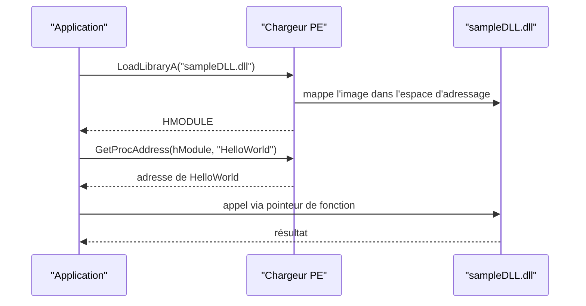

# Dynamic-Link Library

Les fichiers `.exe` et `.dll` sont tous deux des images PE, mais leur comportement diffère radicalement. Comprendre la DLL, c'est comprendre comment Windows fournit l'API aux processus et comment un attaquant peut charger, résoudre et appeler du code à l'exécution — la base de toute injection.

## Qu'est-ce qu'une DLL

Une DLL est une bibliothèque partagée de fonctions et de données exécutables, utilisable simultanément par plusieurs applications. Elle exporte des fonctions vers les processus.

| Critère | EXE | DLL |
|---|---|---|
| Exécution autonome | Oui, point d'entrée classique | Non, doit être invoquée par un programme |
| Rôle | Programme complet | Bibliothèque de fonctions exportées |
| Chargement | Par l'utilisateur ou le système | Par le chargeur PE, à la demande ou au démarrage |

Exemple concret : `CreateFileW` est exportée par `kernel32.dll`. Un processus qui souhaite l'appeler doit d'abord charger `kernel32.dll` dans son espace d'adressage.

Certaines DLL sont chargées dans **tous** les processus, car leurs fonctions sont nécessaires au bon fonctionnement du programme : `ntdll.dll`, `kernel32.dll`, `kernelbase.dll`. Leur présence est donc normale et ne constitue pas un signal de détection.

## Adresse de base commune à l'échelle du système

Windows utilise une adresse de base système pour charger certaines DLL à la même adresse virtuelle dans tous les processus de la machine, afin d'optimiser la mémoire et les performances. `kernel32.dll` se retrouve ainsi chargée à une adresse identique — par exemple `0x7fff9fad0000` — dans des dizaines de processus simultanément.

Cette uniformité a une conséquence directe en maldev : l'adresse d'une fonction système peut être considérée comme stable sur une machine donnée, ce qui rend possible la résolution d'adresses par offset calculé.

## Intérêts des DLL

| Intérêt | Explication |
|---|---|
| Modularisation du code | Fonctionnalités réparties en bibliothèques indépendantes, plus faciles à développer et à déboguer |
| Réutilisation du code | Une même bibliothèque sert à de nombreux processus |
| Économie de mémoire | Une DLL utilisée par plusieurs processus n'est présente qu'une fois en mémoire physique |

## Point d'entrée : DllMain

Une DLL peut définir une fonction d'entrée exécutée lorsqu'un événement particulier se produit, par exemple le chargement de la bibliothèque.

| Raison de l'appel | Signification |
|---|---|
| `DLL_PROCESS_ATTACHED` | Un processus charge la DLL |
| `DLL_THREAD_ATTACHED` | Un processus crée un nouveau thread |
| `DLL_THREAD_DETACH` | Un thread se termine normalement |
| `DLL_PROCESS_DETACH` | Un processus décharge la DLL |

```c
BOOL APIENTRY DllMain(
    HANDLE hModule,             // Handle du module DLL
    DWORD  ul_reason_for_call,  // Raison de l'appel
    LPVOID lpReserved           // Réservé
) {
    switch (ul_reason_for_call) {
        case DLL_PROCESS_ATTACHED:  // Un processus charge la DLL
            break;
        case DLL_THREAD_ATTACHED:   // Un processus crée un thread
            break;
        case DLL_THREAD_DETACH:     // Un thread se termine normalement
            break;
        case DLL_PROCESS_DETACH:    // Un processus décharge la DLL
            break;
    }
    return TRUE;
}
```

`DLL_PROCESS_ATTACHED` est le point d'entrée naturel pour exécuter du code dès le chargement, ce qu'exploite l'[[Injection de DLL]].

## Exporter une fonction

Une fonction doit être marquée par `extern` et `__declspec(dllexport)` pour être visible de l'extérieur.

```c
////// sampleDLL.dll //////

extern __declspec(dllexport) void HelloWorld() {
    // Code de la fonction
}
```

## Liaison dynamique

Par défaut, les imports sont résolus à la compilation par l'éditeur de liens, qui remplit la table d'imports (`.idata`). La **liaison dynamique** résout au contraire la DLL et la fonction à l'exécution, via trois WinAPI : `LoadLibrary`, `GetModuleHandle` et `GetProcAddress`.



### Charger une DLL

Appeler `MessageBoxA` force Windows à charger `user32.dll` dans le processus. Pour une DLL qui n'est pas déjà résidente, il faut l'appeler explicitement.

```c
HMODULE hModule = LoadLibraryA("sampleDLL.dll");   // contient le handle de sampleDLL.dll
```

### Récupérer le handle d'une DLL déjà chargée

```c
HMODULE hModule = GetModuleHandleA("sampleDLL.dll");
```

### Récupérer l'adresse d'une fonction

```c
PVOID pHelloWorld = GetProcAddress(hModule, "HelloWorld");
```

### Invoquer la fonction

L'adresse renvoyée est un `PVOID` : il faut la transtyper en pointeur de fonction pour l'appeler.

```c
// Nouveau type représentant le pointeur de fonction de HelloWorld
typedef void (WINAPI* HelloWorldFunctionPointer)();

void call() {
    HMODULE hModule    = LoadLibraryA("sampleDLL.dll");
    PVOID   pHelloWorld = GetProcAddress(hModule, "HelloWorld");

    // Transtypage de l'adresse vers le pointeur de fonction
    HelloWorldFunctionPointer HelloWorld = (HelloWorldFunctionPointer)pHelloWorld;

    HelloWorld();   // Appel via le pointeur de fonction
}
```

### Exemple complet avec MessageBoxA

```c
typedef int (WINAPI* MessageBoxAFunctionPointer)(
  HWND          hWnd,
  LPCSTR        lpText,
  LPCSTR        lpCaption,
  UINT          uType
);

void call() {
    // Résolution de l'adresse de MessageBoxA, puis appel
    MessageBoxAFunctionPointer pMessageBoxA =
        (MessageBoxAFunctionPointer)GetProcAddress(LoadLibraryA("user32.dll"), "MessageBoxA");

    if (pMessageBoxA != NULL) {
        pMessageBoxA(NULL, "MessageBox's Text", "MessageBox's Caption", MB_OK);
    }
}
```

### Convention de nommage des pointeurs de fonction

Dans tout le corpus, le type pointeur de fonction reprend le nom de la WinAPI préfixé par `fn` : `MessageBoxAFunctionPointer` devient `fnMessageBoxA`. Ce préfixe, signifiant « function pointer », est utilisé systématiquement pour la lisibilité.

## rundll32.exe

`rundll32.exe` est un binaire signé de Windows qui exécute directement une fonction exportée d'une DLL, sans programme intermédiaire.

```powershell
rundll32.exe <dllname>, <fonction exportée>
```

```powershell
rundll32.exe user32.dll,LockWorkStation   # verrouille la session Windows
```

C'est une technique d'exécution par proxy : le code s'exécute dans le contexte d'un binaire Microsoft légitime, ce qui explique son usage historique en post-exploitation.

## Créer une DLL avec Visual Studio

1. Créer un nouveau projet et choisir le modèle `Dynamic-Link Library (DLL)`.
2. Choisir l'emplacement du projet ; un squelette C apparaît.
3. Supprimer les en-têtes précompilés générés (`framework.h`, `pch.h`, `pch.cpp`) : ils accélèrent la compilation des gros projets mais sont inutiles ici.
4. Dans les propriétés du projet, section **C/C++ > Advanced**, régler `Precompiled Header` sur `Not Using Precompiled Headers`, puis appliquer.
5. Renommer `dllmain.cpp` en `dllmain.c` : les exemples du corpus sont écrits en C et non en C++.
6. Compiler via Build > Build Solution ; la DLL apparaît dans `Release` ou `Debug` selon la configuration.

## Portée opérationnelle

La liaison dynamique produit un binaire dont la table d'imports ne mentionne plus les fonctions réellement utilisées : c'est le fondement de la [[Dissimulation de l'IAT]] et du [[Hachage de chaînes]] pour les noms de fonctions et de DLL. Elle permet aussi de charger du code absent de la machine au démarrage, logique reprise par l'[[Injection de DLL]] et la [[Politique de blocage des DLL]], qui vise précisément à restreindre ce chargement.
